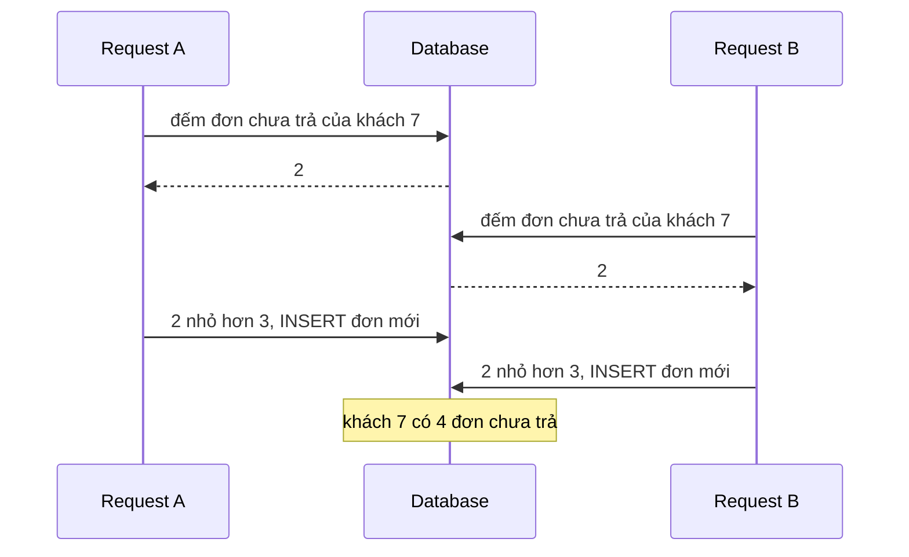

# DDD: Domain-Driven Design

**Domain-Driven Design** là cách thiết kế phần mềm xoay quanh nghiệp vụ: luật của business nằm **trong** model, model dùng đúng từ business dùng, và hệ thống được chia theo các vùng nghiệp vụ. DDD có hai tầng. **Tactical** (bên trong một service): value object, entity, aggregate, domain event, repository. **Strategic** (chia cả hệ thống): bounded context, ngôn ngữ chung, context map. Trang này đi theo một ví dụ: đơn hàng `Order` của một shop online, từ code không giữ được luật nào tới từng mảnh DDD. Đọc trước: [Encapsulation và ví dụ `Payout`](/dotnet/oop-fundamentals#oop) (DDD là encapsulation áp lên cả một nhóm object). Liên quan: [Ranh giới service](/architecture/microservices#service-boundaries), [Outbox](/architecture/messaging#outbox).

<svg width="0" height="0" style="position:absolute" aria-hidden="true"><defs><marker id="dddInk" viewBox="0 0 10 10" refX="8" refY="5" markerWidth="7" markerHeight="7" orient="auto-start-reverse"><path class="head" d="M0 0L10 5L0 10z"/></marker><marker id="dddOk" viewBox="0 0 10 10" refX="8" refY="5" markerWidth="7" markerHeight="7" orient="auto-start-reverse"><path class="headOk" d="M0 0L10 5L0 10z"/></marker><marker id="dddBad" viewBox="0 0 10 10" refX="8" refY="5" markerWidth="7" markerHeight="7" orient="auto-start-reverse"><path class="headBad" d="M0 0L10 5L0 10z"/></marker><marker id="dddAcc" viewBox="0 0 10 10" refX="8" refY="5" markerWidth="7" markerHeight="7" orient="auto-start-reverse"><path class="headAcc" d="M0 0L10 5L0 10z"/></marker></defs></svg>

## Bản đồ chủ đề {#topic-map}

<div class="fig">
<svg viewBox="0 0 720 464" role="img" aria-label="Bản đồ chủ đề DDD: hàng tactical từ anemic model tới domain event, các luật hay bị hỏi, hàng strategic với bounded context, context map và khi nào thừa"><text x="10" y="22" font-size="13" font-weight="600" class="muted">Tactical · bên trong một service, theo đơn hàng Order</text><a href="#problem" style="text-decoration:none"><rect class="boxBad" x="10" y="36" width="130" height="130" rx="8"/><circle class="boxAcc" cx="26" cy="54" r="11"/><text x="26" y="59" font-size="12" text-anchor="middle" font-weight="700" class="accT">1</text><text x="75" y="84" font-size="13" text-anchor="middle" font-weight="600" class="badT">Model thiếu máu</text><text x="75" y="110" font-size="10.5" text-anchor="middle" class="mono badT">Status = &quot;Paid&quot;</text><text x="75" y="136" font-size="10.5" text-anchor="middle">setter public</text><text x="75" y="152" font-size="10.5" text-anchor="middle" class="muted">rule rải ở service</text></a><line class="ln" x1="141" y1="101" x2="150" y2="101" marker-end="url(#dddInk)"/><a href="#entity-value-object" style="text-decoration:none"><rect class="boxAcc" x="152" y="36" width="130" height="130" rx="8"/><circle class="boxAcc" cx="168" cy="54" r="11"/><text x="168" y="59" font-size="12" text-anchor="middle" font-weight="700" class="accT">2</text><text x="217" y="84" font-size="13" text-anchor="middle" font-weight="600" class="accT">Value object</text><text x="217" y="110" font-size="10.5" text-anchor="middle" class="mono">Money(100, EUR)</text><text x="217" y="136" font-size="10.5" text-anchor="middle">không Id, bất biến</text><text x="217" y="152" font-size="10.5" text-anchor="middle" class="muted">so sánh bằng giá trị</text></a><line class="ln" x1="283" y1="101" x2="292" y2="101" marker-end="url(#dddInk)"/><a href="#entity-value-object" style="text-decoration:none"><rect class="box" x="294" y="36" width="130" height="130" rx="8"/><circle class="boxAcc" cx="310" cy="54" r="11"/><text x="310" y="59" font-size="12" text-anchor="middle" font-weight="700" class="accT">3</text><text x="359" y="84" font-size="13" text-anchor="middle" font-weight="600">Entity</text><text x="359" y="110" font-size="10.5" text-anchor="middle" class="mono">Order #123</text><text x="359" y="136" font-size="10.5" text-anchor="middle">có Id xuyên suốt</text><text x="359" y="152" font-size="10.5" text-anchor="middle" class="muted">đổi field vẫn là nó</text></a><line class="ln" x1="425" y1="101" x2="434" y2="101" marker-end="url(#dddInk)"/><a href="#aggregate" style="text-decoration:none"><rect class="boxAcc" x="436" y="36" width="130" height="130" rx="8"/><circle class="boxAcc" cx="452" cy="54" r="11"/><text x="452" y="59" font-size="12" text-anchor="middle" font-weight="700" class="accT">4</text><text x="501" y="84" font-size="13" text-anchor="middle" font-weight="600" class="accT">Aggregate</text><text x="501" y="110" font-size="10.5" text-anchor="middle" class="mono">order.AddLine()</text><text x="501" y="136" font-size="10.5" text-anchor="middle">nhóm giữ invariant</text><text x="501" y="152" font-size="10.5" text-anchor="middle" class="muted">chỉ đổi qua root</text></a><line class="ln" x1="567" y1="101" x2="576" y2="101" marker-end="url(#dddInk)"/><a href="#domain-event" style="text-decoration:none"><rect class="boxOk" x="578" y="36" width="130" height="130" rx="8"/><circle class="boxAcc" cx="594" cy="54" r="11"/><text x="594" y="59" font-size="12" text-anchor="middle" font-weight="700" class="accT">5</text><text x="643" y="84" font-size="13" text-anchor="middle" font-weight="600" class="okT">Domain event</text><text x="643" y="110" font-size="10.5" text-anchor="middle" class="mono">OrderPaid</text><text x="643" y="136" font-size="10.5" text-anchor="middle">việc đã xảy ra</text><text x="643" y="152" font-size="10.5" text-anchor="middle" class="muted">nơi khác tự phản ứng</text></a><text x="10" y="192" font-size="13" font-weight="600" class="muted">Luật hay bị hỏi</text><a href="#aggregate" style="text-decoration:none"><rect class="boxAcc" x="10" y="202" width="168" height="92" rx="8"/><circle class="boxAcc" cx="26" cy="220" r="11"/><text x="26" y="225" font-size="12" text-anchor="middle" font-weight="700" class="accT">6</text><text x="42" y="225" font-size="12" font-weight="600" class="accT">Chỉ đổi qua root</text><text x="22" y="248" font-size="10" class="mono">order.AddLine(...)</text><text x="22" y="264" font-size="10">OrderLine không có</text><text x="22" y="280" font-size="10">constructor public</text></a><a href="#aggregate-rules" style="text-decoration:none"><rect class="box" x="188" y="202" width="168" height="92" rx="8"/><circle class="boxAcc" cx="204" cy="220" r="11"/><text x="204" y="225" font-size="12" text-anchor="middle" font-weight="700" class="accT">7</text><text x="220" y="225" font-size="12" font-weight="600">Ba luật ranh giới</text><text x="200" y="248" font-size="10">1 transaction = 1 aggregate</text><text x="200" y="264" font-size="10">aggregate khác: chỉ giữ Id</text><text x="200" y="280" font-size="10">giữ aggregate nhỏ</text></a><a href="#cross-aggregate" style="text-decoration:none"><rect class="boxBad" x="366" y="202" width="168" height="92" rx="8"/><circle class="boxAcc" cx="382" cy="220" r="11"/><text x="382" y="225" font-size="12" text-anchor="middle" font-weight="700" class="accT">8</text><text x="398" y="225" font-size="12" font-weight="600" class="badT">Vượt ranh giới</text><text x="378" y="248" font-size="10">≤ 3 đơn chưa trả / khách</text><text x="378" y="264" font-size="10">Order không thấy đơn khác</text><text x="378" y="280" font-size="10" class="badT">invariant vẽ ranh giới</text></a><a href="#repository-uow" style="text-decoration:none"><rect class="box" x="544" y="202" width="168" height="92" rx="8"/><circle class="boxAcc" cx="560" cy="220" r="11"/><text x="560" y="225" font-size="12" text-anchor="middle" font-weight="700" class="accT">9</text><text x="576" y="225" font-size="12" font-weight="600">Repository + UoW</text><text x="556" y="248" font-size="10">repo theo aggregate root</text><text x="556" y="264" font-size="10">DbContext đã là UoW</text><text x="556" y="280" font-size="10" class="badT">không generic repository</text></a><text x="10" y="322" font-size="13" font-weight="600" class="muted">Strategic · chia cả hệ thống theo nghiệp vụ</text><a href="#bounded-context" style="text-decoration:none"><rect class="boxAcc" x="10" y="332" width="400" height="124" rx="8"/><circle class="boxAcc" cx="26" cy="350" r="11"/><text x="26" y="355" font-size="12" text-anchor="middle" font-weight="700" class="accT">10</text><text x="42" y="355" font-size="12" font-weight="600" class="accT">Bounded context + ngôn ngữ chung</text><rect class="box" x="24" y="370" width="118" height="48" rx="6"/><text x="83" y="389" font-size="10.5" text-anchor="middle" class="mono">Catalog.Product</text><text x="83" y="407" font-size="10" text-anchor="middle" class="muted">mô tả, ảnh</text><rect class="box" x="152" y="370" width="118" height="48" rx="6"/><text x="211" y="389" font-size="10.5" text-anchor="middle" class="mono">Inventory.Product</text><text x="211" y="407" font-size="10" text-anchor="middle" class="muted">tồn theo kho</text><rect class="box" x="280" y="370" width="118" height="48" rx="6"/><text x="339" y="389" font-size="10.5" text-anchor="middle" class="mono">Shipping.Product</text><text x="339" y="407" font-size="10" text-anchor="middle" class="muted">nặng, kích thước</text><text x="210" y="442" font-size="10.5" text-anchor="middle">cùng chữ Product, mỗi context một model</text></a><a href="#context-map" style="text-decoration:none"><rect class="box" x="420" y="332" width="140" height="124" rx="8"/><circle class="boxAcc" cx="436" cy="350" r="11"/><text x="436" y="355" font-size="12" text-anchor="middle" font-weight="700" class="accT">11</text><text x="452" y="355" font-size="12" font-weight="600">Context map</text><text x="432" y="380" font-size="10.5">ai phụ thuộc ai</text><text x="432" y="398" font-size="10.5">ACL dịch model</text><text x="432" y="416" font-size="10.5">của hệ thống ngoài</text></a><a href="#when-to-use-ddd" style="text-decoration:none"><rect class="box" x="570" y="332" width="140" height="124" rx="8"/><circle class="boxAcc" cx="586" cy="350" r="11"/><text x="586" y="355" font-size="12" text-anchor="middle" font-weight="700" class="accT">12</text><text x="602" y="355" font-size="12" font-weight="600">Khi nào thừa</text><text x="582" y="380" font-size="10.5">CRUD, màn admin:</text><text x="582" y="398" font-size="10.5">không cần aggregate</text><text x="582" y="416" font-size="10.5" class="okT">rule nhiều: đáng làm</text></a></svg>
<p class="fig-caption">Ôn lại: đi hàng trên từ trái sang (mỗi bước chữa cái đau của bước trước), đọc 4 luật, rồi hàng strategic. Chỗ nào không tự giải thích được thì bấm vào đọc mục đó.</p>
</div>

## 1. Vấn đề: model chỉ chứa dữ liệu {#problem}

**Khi luật nghiệp vụ nằm ở nơi gọi chứ không nằm trong dữ liệu, mỗi đường code mới phải tự nhớ hết luật; quên một luật là dữ liệu sai mà không ai báo.** Đây là kiểu code quen thuộc: `Order` chỉ là túi property, gọi là **anemic model** (model thiếu máu).

```csharp
public class Order
{
    public int Id { get; set; }
    public string Status { get; set; } = "Draft";
    public List<OrderLine> Lines { get; set; } = [];
}

// CartService.cs: nhớ luật "tối đa 20 dòng"
if (order.Lines.Count < 20) order.Lines.Add(new OrderLine { ProductId = id, Quantity = qty });

// PaymentService.cs
if (order.Status == "Draft") order.Status = "Paid";

// AdminController.cs, viết sau 6 tháng: không biết luật nào cả
order.Lines.Add(new OrderLine { ProductId = id, Quantity = -1 });   // đơn đã Paid, quantity âm, dòng thứ 21
```

Code compile, test của `CartService` vẫn xanh, và đơn đã thanh toán bị thêm một dòng số lượng âm. Không có chỗ nào để chặn, vì `Order` cho mọi người sửa mọi thứ. **DDD kéo luật vào trong model**: `Order` tự kiểm tra trước khi đổi, nên không ai đưa được nó vào trạng thái sai, bất kể ai gọi. Ý tưởng giống hệt `Payout.Approve()` ở [Encapsulation](/dotnet/oop-fundamentals#oop); DDD mở rộng nó ra cả một nhóm object và cả hệ thống.

## 2. Một ví dụ tiến hoá: từ túi dữ liệu tới bounded context {#evolution}

<div class="fig">
<svg viewBox="0 0 720 450" role="img" aria-label="Sáu bước tiến hoá của Order: anemic, value object, entity, aggregate, domain event, bounded context"><rect class="boxBad" x="20" y="10" width="680" height="60" rx="8"/><text x="36" y="34" font-size="14" font-weight="600" class="badT">Bước 0 · Anemic model: setter public</text><text x="36" y="57" font-size="11.5" class="mono">order.Lines.Add(line);  order.Status = "Paid";</text><text x="440" y="34" font-size="12">đau: thêm dòng vào đơn đã trả tiền</text><text x="440" y="54" font-size="12" class="muted">đau: quantity âm, quá 20 dòng</text><line class="ln" x1="560" y1="70" x2="560" y2="81" marker-end="url(#dddInk)"/><rect class="boxAcc" x="20" y="84" width="680" height="60" rx="8"/><text x="36" y="108" font-size="14" font-weight="600" class="accT">Bước 1 · Value object</text><text x="36" y="131" font-size="11.5" class="mono">new Money(-5, "EUR")   // ném lỗi ngay</text><text x="440" y="108" font-size="12">hết: giá trị sai không tạo ra được</text><text x="440" y="128" font-size="12" class="muted">còn: vẫn set thẳng Status, Lines</text><line class="ln" x1="560" y1="144" x2="560" y2="155" marker-end="url(#dddInk)"/><rect class="boxOk" x="20" y="158" width="680" height="60" rx="8"/><text x="36" y="182" font-size="14" font-weight="600" class="okT">Bước 2 · Entity tự giữ trạng thái</text><text x="36" y="205" font-size="11.5" class="mono">Status { get; private set; }   order.Pay()</text><text x="440" y="182" font-size="12">hết: không ai set Status bừa</text><text x="440" y="202" font-size="12" class="muted">còn: Lines vẫn bị sửa từ ngoài</text><line class="ln" x1="560" y1="218" x2="560" y2="229" marker-end="url(#dddInk)"/><rect class="boxAcc" x="20" y="232" width="680" height="60" rx="8"/><text x="36" y="256" font-size="14" font-weight="600" class="accT">Bước 3 · Aggregate + root</text><text x="36" y="279" font-size="11.5" class="mono">order.AddLine(productId, 2, price)</text><text x="440" y="256" font-size="12">hết: mọi rule của đơn ở một cửa</text><text x="440" y="276" font-size="12" class="muted">còn: Pay() phải tự gọi kho, email?</text><line class="ln" x1="560" y1="292" x2="560" y2="303" marker-end="url(#dddInk)"/><rect class="boxOk" x="20" y="306" width="680" height="60" rx="8"/><text x="36" y="330" font-size="14" font-weight="600" class="okT">Bước 4 · Domain event</text><text x="36" y="353" font-size="11.5" class="mono">_events.Add(new OrderPaid(Id, Total, paidAt))</text><text x="440" y="330" font-size="12">hết: Order không biết ai quan tâm</text><text x="440" y="350" font-size="12" class="muted">còn: mỗi team hiểu Product một kiểu</text><line class="ln" x1="560" y1="366" x2="560" y2="377" marker-end="url(#dddInk)"/><rect class="box" x="20" y="380" width="680" height="60" rx="8"/><text x="36" y="404" font-size="14" font-weight="600">Bước 5 · Bounded context</text><text x="36" y="427" font-size="11.5" class="mono">Catalog.Product ≠ Inventory.Product</text><text x="440" y="404" font-size="12">hết: mỗi context một model gọn</text><text x="440" y="424" font-size="12" class="muted">→ ranh giới service tự nhiên</text></svg>
<p class="fig-caption">Mỗi bước chữa cái "còn" của bước trên. Bước 1–4 là tactical (trong một service), bước 5 là strategic (chia hệ thống). Tên khái niệm chỉ là nhãn dán lên từng bước.</p>
</div>

## 3. Entity và value object {#entity-value-object}

**Câu hỏi phân biệt: hai object có cùng mọi giá trị thì có phải là _một_ thứ không?** Nếu có, nó là **<T>value object</T>**: chỉ là giá trị, không cần Id. Nếu không, nó là **entity**: có danh tính sống lâu hơn các field của nó.

- **Entity**: `Order #123` đổi địa chỉ giao, thêm dòng, chuyển sang Paid, vẫn là đơn #123. Hai đơn có cùng nội dung vẫn là hai đơn. Vì danh tính là thứ duy nhất không đổi nên entity **so sánh bằng Id**, và trạng thái của nó thay đổi qua method có kiểm tra (Bước 2).
- **Value object**: hai tờ 100 EUR là như nhau; `Money(100, "EUR")` không có Id. Vì không có danh tính để theo dõi nên **không sửa tại chỗ** mà tạo giá trị mới (bất biến), và **so sánh bằng giá trị**. Vì bất biến, chỉ cần kiểm tra **một lần trong constructor**: object sai không bao giờ tồn tại, mọi chỗ nhận `Money` khỏi phải kiểm tra lại.

`record` của C# hợp với value object vì nó tự sinh so sánh theo giá trị (`Equals`, `==`, `GetHashCode` trên mọi field), xem [struct, class, record](/dotnet/oop-fundamentals#struct-class-record).

::: code-group

```csharp [Money.cs]
namespace Shop.Ordering.Domain;

public sealed record Money
{
    public decimal Amount { get; }
    public string Currency { get; }

    public Money(decimal amount, string currency)
    {
        if (amount < 0)
            throw new ArgumentOutOfRangeException(nameof(amount), "Money cannot be negative");
        if (string.IsNullOrWhiteSpace(currency) || currency.Length != 3)
            throw new ArgumentException("Currency must be a 3-letter code", nameof(currency));

        Amount = amount;
        Currency = currency.ToUpperInvariant();
    }

    public Money Add(Money other)
    {
        if (other.Currency != Currency)
            throw new InvalidOperationException($"Cannot add {other.Currency} to {Currency}");
        return new Money(Amount + other.Amount, Currency);   // trả object mới, không sửa this
    }

    public Money Multiply(int factor) => new(Amount * factor, Currency);
}
```

```csharp [DateRange.cs]
namespace Shop.Ordering.Domain;

// Ví dụ: thời gian chạy một chương trình khuyến mãi
public sealed record DateRange
{
    public DateOnly Start { get; }
    public DateOnly End { get; }

    public DateRange(DateOnly start, DateOnly end)
    {
        if (end < start)
            throw new ArgumentException("End must not be before Start", nameof(end));
        Start = start;
        End = end;
    }

    public bool Contains(DateOnly day) => day >= Start && day <= End;
    public bool Overlaps(DateRange other) => Start <= other.End && other.Start <= End;
}
```

:::

`new Money(100, "eur") == new Money(100, "EUR")` là `true`. Property chỉ có `get` (không `init`) để biểu thức `with { Amount = -5 }` không compile: `with` gán thẳng qua `init` accessor và **không chạy constructor**, nên positional record `record Money(decimal Amount, string Currency)` có validation đặt trong property initializer vẫn bị `with` đi vòng qua.

Với <T>EF Core</T>, value object được lưu thành các cột của bảng chủ (`OwnsOne`, hoặc complex type từ EF Core 8) chứ không có bảng và khoá riêng.

## 4. Aggregate và aggregate root {#aggregate}

**Một luật chỉ được giữ khi mọi thay đổi đi qua một cửa nhìn thấy đủ dữ liệu luật đó cần.** "Tối đa 20 dòng" cần thấy cả danh sách dòng; "không thêm dòng sau khi trả tiền" cần thấy `Status`. Nên `Order` và các `OrderLine` của nó là một **aggregate**: một nhóm object phải nhất quán với nhau, có đúng một cửa vào là **aggregate root** (`Order`). Luật phải luôn đúng đó gọi là <T>invariant</T>.

<div class="fig">
<svg viewBox="0 0 720 290" role="img" aria-label="Order aggregate: caller chỉ gọi được root Order, không chạm được OrderLine; Customer và Product là aggregate khác, chỉ tham chiếu bằng Id"><rect class="box" x="10" y="64" width="120" height="48" rx="8"/><text x="70" y="84" font-size="12" text-anchor="middle">Checkout</text><text x="70" y="100" font-size="12" text-anchor="middle">handler</text><rect class="box dash" x="230" y="20" width="320" height="250" rx="12"/><text x="244" y="40" font-size="12" class="accT">Order aggregate · ranh giới nhất quán</text><rect class="boxAcc" x="260" y="56" width="250" height="60" rx="8"/><text x="385" y="80" font-size="13" text-anchor="middle" font-weight="600">Order · aggregate root</text><text x="385" y="101" font-size="11" text-anchor="middle" class="mono">AddLine · Pay · Cancel</text><rect class="box" x="260" y="160" width="110" height="44" rx="8"/><text x="315" y="187" font-size="12" text-anchor="middle" class="mono">OrderLine</text><rect class="box" x="400" y="160" width="110" height="44" rx="8"/><text x="455" y="187" font-size="12" text-anchor="middle" class="mono">OrderLine</text><rect class="box dash" x="270" y="222" width="90" height="30" rx="6"/><text x="315" y="241" font-size="11" text-anchor="middle" class="mono">Money</text><rect class="box dash" x="410" y="222" width="90" height="30" rx="6"/><text x="455" y="241" font-size="11" text-anchor="middle" class="mono">Money</text><line class="ln" x1="330" y1="116" x2="318" y2="156" marker-end="url(#dddInk)"/><line class="ln" x1="440" y1="116" x2="452" y2="156" marker-end="url(#dddInk)"/><line class="ln" x1="315" y1="204" x2="315" y2="222"/><line class="ln" x1="455" y1="204" x2="455" y2="222"/><line class="lnOk" x1="130" y1="86" x2="256" y2="86" marker-end="url(#dddOk)"/><text x="190" y="78" font-size="10.5" text-anchor="middle" class="mono okT">AddLine()</text><path class="lnBad dash" d="M70 112 V182 H256" marker-end="url(#dddBad)"/><text x="78" y="150" font-size="10" class="mono badT">line.Quantity = -5</text><text x="160" y="176" font-size="14" font-weight="700" class="badT">✗</text><rect class="box" x="566" y="56" width="148" height="44" rx="8"/><text x="640" y="76" font-size="12" text-anchor="middle" font-weight="600">Customer</text><text x="640" y="92" font-size="10" text-anchor="middle" class="muted">Order giữ CustomerId</text><rect class="box" x="566" y="170" width="148" height="44" rx="8"/><text x="640" y="190" font-size="12" text-anchor="middle" font-weight="600">Product</text><text x="640" y="206" font-size="10" text-anchor="middle" class="muted">OrderLine giữ ProductId</text><line class="ln dash" x1="510" y1="80" x2="566" y2="78"/><line class="ln dash" x1="510" y1="182" x2="566" y2="192"/></svg>
<p class="fig-caption">Mũi tên xanh là cửa duy nhất. Mũi tên đỏ không có đường đi, vì OrderLine không có setter hay constructor public. Aggregate khác (Customer, Product) chỉ được nhắc tới bằng Id.</p>
</div>

::: code-group

```csharp [Order.cs]
namespace Shop.Ordering.Domain;

public enum OrderStatus { Draft, Paid, Cancelled }

public sealed class Order
{
    public const int MaxLines = 20;

    private readonly List<OrderLine> _lines = [];
    private readonly List<IDomainEvent> _events = [];

    public Guid Id { get; private set; }
    public Guid CustomerId { get; private set; }        // aggregate khác: chỉ giữ Id
    public string Currency { get; private set; } = null!;
    public OrderStatus Status { get; private set; }
    public IReadOnlyList<OrderLine> Lines => _lines;     // đọc được, không Add được
    public IReadOnlyList<IDomainEvent> DomainEvents => _events;

    public Money Total =>
        _lines.Select(l => l.Subtotal).Aggregate(new Money(0, Currency), (sum, x) => sum.Add(x));

    private Order() { }                                   // cho EF Core khi load từ DB

    public Order(Guid customerId, string currency)
    {
        Id = Guid.NewGuid();
        CustomerId = customerId;
        Currency = currency;
        Status = OrderStatus.Draft;
    }

    public void AddLine(Guid productId, int quantity, Money unitPrice)
    {
        if (Status != OrderStatus.Draft)
            throw new InvalidOperationException($"Cannot add lines to a {Status} order");
        if (quantity <= 0)
            throw new ArgumentOutOfRangeException(nameof(quantity), "Quantity must be positive");
        if (unitPrice.Currency != Currency)
            throw new InvalidOperationException("Line currency must match order currency");

        var existing = _lines.FirstOrDefault(l => l.ProductId == productId);
        if (existing is not null) { existing.Increase(quantity); return; }

        if (_lines.Count >= MaxLines)
            throw new InvalidOperationException($"An order can have at most {MaxLines} lines");
        _lines.Add(new OrderLine(productId, quantity, unitPrice));
    }

    public void Pay(DateTimeOffset paidAt)
    {
        if (Status != OrderStatus.Draft)
            throw new InvalidOperationException($"Cannot pay a {Status} order");
        if (_lines.Count == 0)
            throw new InvalidOperationException("Cannot pay an empty order");

        Status = OrderStatus.Paid;
        _events.Add(new OrderPaid(Id, Total, paidAt));   // ghi lại sự việc, xem mục 5
    }

    public void ClearDomainEvents() => _events.Clear();
}
```

```csharp [OrderLine.cs]
namespace Shop.Ordering.Domain;

public sealed class OrderLine
{
    public Guid Id { get; private set; }
    public Guid ProductId { get; private set; }
    public int Quantity { get; private set; }
    public Money UnitPrice { get; private set; } = null!;
    public Money Subtotal => UnitPrice.Multiply(Quantity);

    private OrderLine() { }                               // cho EF Core

    // internal: chỉ code cùng assembly (Order) tạo và sửa được
    internal OrderLine(Guid productId, int quantity, Money unitPrice)
    {
        Id = Guid.NewGuid();
        ProductId = productId;
        Quantity = quantity;
        UnitPrice = unitPrice;
    }

    internal void Increase(int quantity) => Quantity += quantity;
}
```

```csharp [OrderPaid.cs]
namespace Shop.Ordering.Domain;

public interface IDomainEvent { }

public sealed record OrderPaid(Guid OrderId, Money Total, DateTimeOffset PaidAt) : IDomainEvent;
```

:::

`internal` chỉ chặn code ở assembly **khác** (Api, Infrastructure); code khác trong cùng project Domain vẫn gọi được. Đó là lý do project domain nên nhỏ và chỉ chứa model. EF Core map được field `_lines` theo quy ước backing field, và dùng constructor `private` không tham số khi load.

### Ba luật suy ra từ ranh giới {#aggregate-rules}

Cả ba suy ra từ một ý: **aggregate là đơn vị nhất quán, được load và lưu nguyên khối**.

- **Một transaction chỉ sửa một aggregate.** Vì luật của một aggregate chỉ cần dữ liệu bên trong nó, transaction không cần khoá thêm gì khác. Muốn sửa hai aggregate cùng lúc thường là dấu hiệu ranh giới sai, hoặc phần thứ hai nên chạy sau qua [domain event](#domain-event). Đây là hướng dẫn chứ không phải luật của framework: hai aggregate cùng DB, cùng service thì nhiều team vẫn lưu chung một `SaveChanges`, biết là đang đổi lấy coupling.
- **Tham chiếu aggregate khác bằng Id.** `Order.CustomerId` chứ không phải `Order.Customer`. Vì giữ object thì code có thể `order.Customer.Email = ...`, tức sửa aggregate khác qua cửa sau, và load một Order kéo theo cả Customer.
- **Giữ aggregate nhỏ.** Vì luôn load nguyên khối và tranh chấp được phát hiện trên cả khối, aggregate to thì load chậm, và hai người sửa hai phần không liên quan cũng đụng nhau.

### Luật vượt ra ngoài một aggregate {#cross-aggregate}

**Một aggregate chỉ bảo vệ được invariant trên dữ liệu nằm bên trong nó**, vì root chỉ thấy những gì được load cùng nó. Luật "mỗi khách tối đa 3 đơn chưa thanh toán" cần biết các đơn **khác** của khách; mỗi đơn là một aggregate riêng, nên `Order.Pay()` hay constructor của `Order` không có cách nào thấy chúng.

Cách ngây thơ là đếm trong service rồi mới tạo. Nó đúng khi chạy một mình, nhưng sai khi hai request tới cùng lúc:



Câu hỏi đúng không phải "đặt `if` ở đâu" mà là **"luật này phải đúng ngay sau mỗi transaction, hay được phép sai một lúc rồi sửa?"**. Từ đó có ba lựa chọn:

1. **Đưa dữ liệu luật cần vào một aggregate.** Tạo aggregate cấp khách, vd `CustomerAccount`, giữ danh sách id đơn chưa trả; method `RegisterUnpaidOrder(orderId)` kiểm tra tối đa 3. Thêm <T>optimistic concurrency</T> trên aggregate đó thì hai request song song cùng sửa nó, một bên bị `DbUpdateConcurrencyException` ([cơ chế](/data/ef-core#concurrency)). Giá: đặt đơn giờ chạm hai aggregate, và `CustomerAccount` phải được cập nhật lại khi đơn được trả.
2. **Để DB chặn.** DB là nơi duy nhất thấy mọi dòng cùng lúc và tự xử lý race. Luật dạng "tối đa **1**" làm được bằng filtered unique index, vd `UNIQUE (CustomerId) WHERE Status = 'Unpaid'`: insert thứ hai lỗi, bắt `DbUpdateException` rồi trả 409. Luật "tối đa 3" thì SQL không có constraint gọn, nên quay về cách 1 hoặc 3.
3. **Chấp nhận eventual consistency** (nhất quán sau một khoảng trễ). Cho tạo đơn, rồi một handler hoặc job phát hiện khách có hơn 3 đơn chưa trả và gắn cờ, huỷ đơn mới nhất, hoặc báo người duyệt. Hợp khi business chịu được sai tạm thời; hỏi thẳng: "lỡ có 4 đơn trong vài giây thì thiệt hại gì?".

Đi ngược lại khi thiết kế: liệt kê các luật phải đúng **ngay lập tức**; dữ liệu mà một luật như vậy cần phải nằm chung một aggregate. Luật được phép trễ thì đặt giữa các aggregate và nối bằng event. Đó là nghĩa của câu **"invariants decide aggregate boundaries"**.

## 5. Domain event: ghi lại "việc đã xảy ra" {#domain-event}

**Khi đơn được trả tiền, nhiều nơi cần biết (giữ hàng, giao hàng, gửi email); nếu `Order.Pay()` gọi từng nơi thì `Order` phải biết tất cả và hỏng theo mỗi nơi.** Nên aggregate chỉ **ghi lại một sự việc ở thì quá khứ**, `OrderPaid`, vào list `_events` (xem `Pay()` ở code trên); ai quan tâm tự đăng ký handler để phản ứng.

<div class="fig">
<svg viewBox="0 0 720 250" role="img" aria-label="Order.Pay ghi OrderPaid; handler trong Ordering service ghi lịch sử và ghi vào outbox; outbox đẩy integration event qua broker tới Inventory, Shipping, Notification"><rect class="box dash" x="10" y="14" width="430" height="226" rx="12"/><text x="24" y="34" font-size="12" class="muted">Ordering service · một process</text><rect class="boxAcc" x="30" y="50" width="150" height="48" rx="8"/><text x="105" y="79" font-size="12" text-anchor="middle" class="mono">order.Pay()</text><line class="ln" x1="180" y1="74" x2="226" y2="74" marker-end="url(#dddInk)"/><text x="203" y="66" font-size="10" text-anchor="middle" class="muted">ghi lại</text><rect class="boxOk" x="230" y="54" width="130" height="40" rx="20"/><text x="295" y="79" font-size="12" text-anchor="middle" font-weight="600" class="mono okT">OrderPaid</text><line class="ln" x1="295" y1="94" x2="125" y2="146" marker-end="url(#dddInk)"/><line class="ln" x1="295" y1="94" x2="325" y2="146" marker-end="url(#dddInk)"/><rect class="box" x="30" y="150" width="180" height="48" rx="8"/><text x="120" y="170" font-size="12" text-anchor="middle">ghi lịch sử đơn</text><text x="120" y="188" font-size="10.5" text-anchor="middle" class="muted">cùng transaction</text><rect class="boxAcc" x="230" y="150" width="190" height="48" rx="8"/><text x="325" y="170" font-size="12" text-anchor="middle">ghi vào bảng outbox</text><text x="325" y="188" font-size="10.5" text-anchor="middle" class="muted">cùng transaction</text><text x="24" y="226" font-size="11" class="okT">domain event: không rời khỏi service</text><rect class="box" x="465" y="150" width="90" height="48" rx="8"/><text x="510" y="179" font-size="12" text-anchor="middle" font-weight="600">Broker</text><line class="lnAcc" x1="420" y1="174" x2="461" y2="174" marker-end="url(#dddAcc)"/><text x="510" y="216" font-size="11" text-anchor="middle" class="accT">integration event</text><text x="655" y="84" font-size="11" text-anchor="middle" class="muted">service khác</text><rect class="box" x="600" y="96" width="110" height="36" rx="8"/><text x="655" y="119" font-size="12" text-anchor="middle" class="mono">Inventory</text><rect class="box" x="600" y="150" width="110" height="36" rx="8"/><text x="655" y="173" font-size="12" text-anchor="middle" class="mono">Shipping</text><rect class="box" x="600" y="204" width="110" height="36" rx="8"/><text x="655" y="227" font-size="12" text-anchor="middle" class="mono">Notification</text><line class="lnAcc" x1="555" y1="168" x2="596" y2="116" marker-end="url(#dddAcc)"/><line class="lnAcc" x1="555" y1="174" x2="596" y2="168" marker-end="url(#dddAcc)"/><line class="lnAcc" x1="555" y1="180" x2="596" y2="220" marker-end="url(#dddAcc)"/></svg>
<p class="fig-caption">Bên trái: domain event, handler chạy trong cùng process. Bên phải: thứ rời service là integration event, đi qua outbox để không mất khi crash.</p>
</div>

Ai gọi handler? Thường là một dispatcher nhỏ chạy quanh `SaveChangesAsync`: lấy `DomainEvents` của các aggregate đang được track, gọi handler đã đăng ký trong DI, rồi `ClearDomainEvents()`. Thời điểm dispatch là một lựa chọn, không phải mặc định của EF Core:

- **Trước khi commit**: thay đổi của handler lưu chung transaction, cùng thành công hoặc cùng rollback. Handler vì vậy **không được** làm việc không rollback được như gửi email hay gọi HTTP.
- **Sau khi commit**: handler lỗi không làm hỏng đơn đã lưu, nhưng process chết giữa chừng là event mất.

Muốn báo cho **service khác** thì không gửi thẳng lên broker trong handler (DB commit mà broker lỗi, hoặc ngược lại, là lệch). Handler ghi một dòng vào bảng outbox **trong cùng transaction**, một worker đọc outbox và publish sau, xem [Outbox](/architecture/messaging#outbox).

**Domain event** là sự việc trong một bounded context, dùng type của domain (`Money`), đổi thoải mái vì chỉ code của service dùng. **Integration event** là hợp đồng công khai giữa các service: chỉ chứa dữ liệu cần chia sẻ, kiểu đơn giản, đổi phải giữ tương thích ngược vì service khác đang đọc.

## 6. Bounded context: mỗi vùng nghiệp vụ một model {#bounded-context}

**Cùng một từ, mỗi bộ phận hiểu một nghĩa; một model cố phục vụ tất cả sẽ phình ra và khoá mọi bộ phận vào nhau.** "Product" với marketing là mô tả và ảnh, với kho là số tồn từng kho, với giao hàng là cân nặng và kích thước. Một class `Product` 40 cột thì đổi cho kho là ảnh hưởng catalog. **Bounded context** là ranh giới mà bên trong nó mỗi từ có đúng một nghĩa và có model riêng.

<div class="fig">
<svg viewBox="0 0 720 240" role="img" aria-label="Ba bounded context Catalog, Inventory, Shipping, mỗi nơi có class Product riêng với field khác nhau, nối bằng ProductId"><rect class="box" x="10" y="14" width="220" height="170" rx="10"/><text x="24" y="40" font-size="13" font-weight="600">Catalog</text><text x="24" y="58" font-size="11" class="muted">team marketing</text><rect class="boxAcc" x="24" y="70" width="192" height="100" rx="8"/><text x="36" y="90" font-size="12" font-weight="600" class="mono">Product</text><text x="36" y="112" font-size="11" class="mono">Name, Description</text><text x="36" y="132" font-size="11" class="mono">Images</text><text x="36" y="152" font-size="11" class="mono">Category, Price</text><rect class="box" x="250" y="14" width="220" height="170" rx="10"/><text x="264" y="40" font-size="13" font-weight="600">Inventory</text><text x="264" y="58" font-size="11" class="muted">team kho</text><rect class="boxAcc" x="264" y="70" width="192" height="100" rx="8"/><text x="276" y="90" font-size="12" font-weight="600" class="mono">Product</text><text x="276" y="112" font-size="11" class="mono">Sku</text><text x="276" y="132" font-size="11" class="mono">OnHandByWarehouse</text><text x="276" y="152" font-size="11" class="mono">Reserved</text><rect class="box" x="490" y="14" width="220" height="170" rx="10"/><text x="504" y="40" font-size="13" font-weight="600">Shipping</text><text x="504" y="58" font-size="11" class="muted">team giao hàng</text><rect class="boxAcc" x="504" y="70" width="192" height="100" rx="8"/><text x="516" y="90" font-size="12" font-weight="600" class="mono">Product</text><text x="516" y="112" font-size="11" class="mono">Sku</text><text x="516" y="132" font-size="11" class="mono">WeightKg, SizeCm</text><text x="516" y="152" font-size="11" class="mono">IsFragile</text><path class="ln dash" d="M120 184 V206 H600 V184 M360 184 V206"/><text x="360" y="228" font-size="11.5" text-anchor="middle">nối với nhau bằng ProductId / Sku, không dùng chung một bảng Products</text></svg>
<p class="fig-caption">Ba class cùng tên Product, mỗi class chỉ có field mà context đó cần. Kho đổi cách đếm tồn không chạm tới catalog.</p>
</div>

Vì mỗi context có model và dữ liệu riêng, nó là **ứng viên tự nhiên cho ranh giới một service**: cắt service theo bounded context thì ít phải gọi nhau và ít dùng chung bảng, xem [Ranh giới service](/architecture/microservices#service-boundaries) và [Database per service](/architecture/microservices#database-per-service). Không bắt buộc 1–1: một modular monolith có thể chứa nhiều context, miễn mỗi context giữ model riêng.

### Ubiquitous language: code nói từ của business {#ubiquitous-language}

**Trong một context, dev, BA và người dùng nói cùng một bộ từ, và code dùng đúng những từ đó.** Business nói "huỷ đơn" thì code là `order.Cancel(reason)`, không phải `order.StatusId = 4`; kho nói "giữ hàng" (chưa trừ hẳn) và "xuất kho" (trừ hẳn) thì code có `Reserve()` và `Ship()`, không gộp chung thành `UpdateQty()`. Vì từ trong code khớp từ trong cuộc họp, một yêu cầu mới tìm được ngay chỗ cần sửa, và chỗ hai bên hiểu khác nhau lộ ra sớm.

### Context map và anti-corruption layer {#context-map}

**Context map** vẽ các context quan hệ với nhau thế nào: ai cung cấp (upstream), ai phụ thuộc (downstream), ai phải theo model của ai. Các kiểu quan hệ có tên riêng (customer–supplier, conformist, shared kernel...); câu hay bị hỏi nhất là **anti-corruption layer (ACL)**: một lớp ở ranh giới **dịch model bên ngoài sang model của mình**, để mã lỗi và tên field của hệ thống ngoài không lan vào domain.

```csharp
// Payment context: chỉ lớp này biết mã của cổng thanh toán (mã ở đây là ví dụ)
public sealed class GatewayResponseTranslator
{
    public PaymentResult Translate(GatewayChargeResponse r) => r.ResultCode switch
    {
        "00"         => PaymentResult.Succeeded(r.TransactionRef),
        "05" or "51" => PaymentResult.Declined(r.Message),
        _            => PaymentResult.Unknown(r.ResultCode),
    };
}
```

Đổi cổng thanh toán thì viết translator mới; phần còn lại của Payment vẫn chỉ biết `PaymentResult`. Khi tách dần một hệ thống cũ, ACL cũng là lớp đứng giữa model cũ và model mới.

## 7. Repository và Unit of Work {#repository-uow}

**Vì aggregate được load và lưu nguyên khối qua root, repository làm việc theo aggregate root: một repository cho `Order`, không có repository cho `OrderLine`.** Method của nó nói theo nghiệp vụ (`GetAsync(orderId)` luôn load kèm các dòng), không phải CRUD cho từng bảng. **<T>Unit of work</T>** là phần ghi: gom mọi thay đổi trong một thao tác rồi commit trong một transaction.

::: code-group

```csharp [IOrderRepository.cs]
namespace Shop.Ordering.Domain;

public interface IOrderRepository
{
    Task<Order?> GetAsync(Guid id, CancellationToken ct);   // luôn load nguyên aggregate
    void Add(Order order);
}
```

```csharp [OrderRepository.cs]
using Microsoft.EntityFrameworkCore;
using Shop.Ordering.Domain;

namespace Shop.Ordering.Infrastructure;

public sealed class OrderRepository(OrderingDbContext db) : IOrderRepository
{
    public Task<Order?> GetAsync(Guid id, CancellationToken ct) =>
        db.Orders.Include(o => o.Lines).SingleOrDefaultAsync(o => o.Id == id, ct);

    public void Add(Order order) => db.Orders.Add(order);
}
```

```csharp [Program.cs]
builder.Services.AddScoped<IOrderRepository, OrderRepository>();
// handler: var order = await repo.GetAsync(id, ct); order.AddLine(...); await db.SaveChangesAsync(ct);
```

:::

EF Core đã có sẵn cả hai: **<T>DbContext</T> là unit of work** (change tracker gom thay đổi; `SaveChanges` mặc định bọc tất cả trong một transaction; nếu bạn đã mở transaction thì nó chạy trong transaction đó) và **`DbSet<Order>` gần như là repository**. Nên có hai trường phái, cả hai đều hợp lệ:

- **Viết repository riêng** khi muốn domain không biết EF, muốn ép "luôn load nguyên aggregate" ở một chỗ, hoặc muốn fake trong unit test. Giá: thêm một lớp, và dễ bị kéo thành wrapper mỏng trả `IQueryable`.
- **Dùng DbContext trực tiếp** trong handler, test bằng DB thật. Ít code hơn; giá là kỷ luật "load kèm `Lines`" phải nhớ ở mọi chỗ.

Thứ nên tránh là **generic repository** (`IRepository<T>` cho mọi bảng): nó cho `Get<OrderLine>(id)` và `Update(line)`, tức mở đúng cửa sau mà aggregate vừa đóng. PayoutHub cũng cấm generic repository vì lý do này.

## 8. Khi nào đáng dùng, khi nào thừa {#when-to-use-ddd}

**Tactical DDD tốn thêm class, constructor private, mapping EF phức tạp hơn; nó chỉ trả lại khi có nhiều luật cần bảo vệ.** Từ đó:

- **Đáng**: vùng có luật nhiều và hay đổi, sai thì mất tiền: đặt hàng, thanh toán, tính hoa hồng, chuyển trạng thái nhiều bước.
- **Thừa**: CRUD và màn admin (danh mục quốc gia, cấu hình, danh sách nhà cung cấp). Không có invariant đáng kể thì aggregate chỉ là lớp vỏ quanh setter.
- **Phía đọc** (trang list, báo cáo) không cần đi qua aggregate: query thẳng sang <T>DTO</T> bằng [projection](/data/ef-core#projection). Aggregate là cho phía **ghi**.
- **Strategic DDD** (bounded context, ngôn ngữ chung) có ích kể cả khi không dùng tactical: nó quyết định chia service và chia dữ liệu ở đâu.

Một hệ thống thường trộn: Ordering dùng aggregate đầy đủ, Catalog admin chỉ là CRUD với EF.

## Câu hỏi phỏng vấn {#interview}

### Entity và value object khác nhau thế nào? {#entity-vs-value-object}

::: tip Trả lời nhanh
Entity có danh tính sống qua mọi thay đổi (Order #123 đổi địa chỉ vẫn là #123), so sánh bằng Id. Value object chỉ là giá trị: không Id, bất biến, so sánh bằng giá trị, tự validate trong constructor nên giá trị sai không tồn tại (`Money`, `DateRange`). Trong C# dùng `record`. Xem [Entity và value object](#entity-value-object).
:::

::: details Câu trả lời mẫu (English)
The question is whether two objects with the same values are the same thing. An entity has an identity that stays while its attributes change: order 123 can change its address and is still order 123, so we compare entities by Id. A value object is defined only by its values, like `Money(100, "EUR")` or a date range. It has no Id, it's immutable, and two instances with the same values are equal. Because it's immutable, I validate once in the constructor, so an invalid `Money` can never exist and nobody downstream has to re-check it. In C# a `record` with get-only properties fits well.
:::

::: warning Bẫy & follow-up
**"Address là entity hay value object?"**

Tuỳ context. Trong đơn hàng, địa chỉ giao là value object (đổi = thay cả địa chỉ). Trong một hệ thống quản lý địa chỉ có lịch sử và Id riêng thì là entity. Câu hỏi luôn là: hai cái giống hệt nhau có phải là một không?

**"Value object lưu DB thế nào khi không có Id?"**

Thành các cột của bảng chủ (`OwnsOne` hoặc complex type từ EF Core 8), không có bảng riêng.
:::

### Aggregate là gì, vì sao chỉ được sửa qua root? {#what-is-aggregate}

::: tip Trả lời nhanh
Một nhóm object phải nhất quán với nhau, có một cửa vào là root. Luật như "không thêm dòng sau khi trả", "tối đa 20 dòng" cần thấy cả nhóm; chỉ root thấy đủ, nên mọi thay đổi phải qua root thì luật mới không bị bỏ qua. Kèm ba luật: một transaction một aggregate, tham chiếu aggregate khác bằng Id, giữ nhỏ. Xem [Aggregate](#aggregate).
:::

::: details Câu trả lời mẫu (English)
An aggregate is a cluster of objects that must stay consistent together, with one entry point, the aggregate root. In a shop, `Order` is the root and `OrderLine`s live inside it. Rules like "no new lines after the order is paid" or "max 20 lines" need to see the whole order, and only the root sees everything, so all changes go through methods like `order.AddLine()`. `OrderLine` has no public constructor or setters. On top of that: one transaction should change one aggregate, other aggregates are referenced by Id, and aggregates should stay small because they are loaded and saved as a whole.
:::

::: warning Bẫy & follow-up
**"Hai request cùng thêm dòng vào một đơn thì luật tối đa 20 dòng có giữ được không?"**

Không tự động: mỗi request load một bản riêng và đều thấy 19 dòng. Cần concurrency token trên root, xem [Tự kiểm tra](#self-check) câu 3.
:::

### Một luật cần dữ liệu của nhiều aggregate thì đặt ở đâu? <Badge type="warning" text="câu senior" /> {#cross-aggregate-rule}

::: tip Trả lời nhanh
Aggregate chỉ bảo vệ được dữ liệu bên trong nó. Đếm trong service rồi insert thì bị race. Hỏi: luật phải đúng ngay hay được trễ? Ngay: gom dữ liệu luật cần vào một aggregate (kèm optimistic concurrency), hoặc để DB chặn bằng constraint. Được trễ: eventual consistency, phát hiện và xử lý sau. "Invariants decide aggregate boundaries." Xem [Luật vượt ra ngoài một aggregate](#cross-aggregate).
:::

::: details Câu trả lời mẫu (English)
An aggregate can only protect invariants over data inside it. Take "a customer may have at most 3 unpaid orders": each order is its own aggregate, so `Order` can't see the others. Counting in a service and then inserting has a race: two requests both see 2 and both insert. So I first ask the business whether the rule must hold immediately. If yes, I either move the data into one aggregate, for example a customer-level aggregate that tracks unpaid orders, with optimistic concurrency so concurrent requests conflict, or I let the database enforce it with a constraint when the rule fits one, like a filtered unique index for "at most one". If a short violation is acceptable, I accept eventual consistency and detect and fix it afterwards. In short, invariants decide aggregate boundaries.
:::

::: warning Bẫy & follow-up
**"Cho `Customer` chứa luôn list toàn bộ `Order` là xong?"**

Luật giữ được, nhưng aggregate khổng lồ: load một khách kéo cả nghìn đơn, mọi thao tác trên mọi đơn của khách đó đụng nhau. Chỉ đưa vào đúng dữ liệu luật cần (danh sách id đơn chưa trả).

**"Dùng transaction `SERIALIZABLE` cho phần đếm và insert?"**

Chặn được race trong một DB nhưng giữ khoá range, dễ chờ và deadlock khi tải cao. Là lựa chọn kỹ thuật, không thay cho câu hỏi ranh giới.
:::

### Bounded context là gì, liên quan gì tới microservices? {#bounded-context-microservices}

::: tip Trả lời nhanh
Ranh giới mà bên trong mỗi từ có một nghĩa và có model riêng: "Product" ở Catalog, Inventory, Shipping là ba model khác nhau. Vì mỗi context có model và dữ liệu riêng, nó là ứng viên tự nhiên cho một service; không bắt buộc 1–1. Xem [Bounded context](#bounded-context).
:::

::: details Câu trả lời mẫu (English)
I haven't designed microservices in production, so here is how I understand it. A bounded context is a boundary inside which every term has one meaning and one model. "Product" means description and images in Catalog, stock per warehouse in Inventory, and weight and size in Shipping, so each context gets its own `Product` class and its own data, linked by a product Id. That makes a bounded context a natural candidate for a service boundary: services cut along contexts call each other less and don't share tables. It isn't one-to-one though; a modular monolith can host several contexts as long as each keeps its own model. At the boundary with an external system I'd use an anti-corruption layer to translate its model into ours.
:::

::: warning Bẫy & follow-up
**"Cắt service theo bảng (ProductService, OrderLineService) có được không?"**

Đó là cắt theo dữ liệu, không theo nghiệp vụ: một use case phải gọi nhiều service, luật bị xé ra nhiều nơi. Cắt theo context, xem [Ranh giới service](/architecture/microservices#service-boundaries).

**"Anti-corruption layer là gì?"**

Lớp ở ranh giới dịch model của hệ thống ngoài (cổng thanh toán, hệ thống cũ) sang model của mình, xem [Context map](#context-map).
:::

### Domain event khác integration event thế nào? {#domain-vs-integration-event}

::: tip Trả lời nhanh
Domain event: sự việc trong một service (`OrderPaid`), handler chạy trong cùng process, dùng type của domain, đổi thoải mái. Integration event: hợp đồng công khai gửi qua broker cho service khác, dữ liệu tối thiểu, phải tương thích ngược, đi qua outbox để không mất. Xem [Domain event](#domain-event).
:::

::: details Câu trả lời mẫu (English)
A domain event records something that happened inside one bounded context, like `OrderPaid`, raised by the aggregate. Handlers run in the same process, often in the same transaction, and it can use domain types, so I can change it freely. An integration event is a public contract published to a broker for other services. It carries only the data others need, uses simple types, and must stay backward compatible because other teams consume it. Typically a domain event handler writes the integration event to an outbox table in the same transaction, and a worker publishes it, so the database and the broker can't drift apart.
:::

::: warning Bẫy & follow-up
**"Handler của domain event gửi email luôn được không?"**

Nếu dispatch trước commit: email đi rồi mà transaction rollback thì khách nhận email cho đơn không tồn tại. Việc không rollback được thì đi qua outbox hoặc chạy sau commit.
:::

### Dùng EF Core thì có cần repository không? {#repository-with-ef-core}

::: tip Trả lời nhanh
DbContext đã là unit of work, `DbSet` gần như repository, nên không bắt buộc. Viết repository theo aggregate root khi muốn domain không biết EF, ép load nguyên aggregate ở một chỗ, hoặc fake khi test. Không dùng generic repository: nó mở lại cửa sau vào entity con. Xem [Repository và Unit of Work](#repository-uow).
:::

::: details Câu trả lời mẫu (English)
Not necessarily. `DbContext` already is a unit of work, it tracks changes and `SaveChanges` commits them in one transaction by default, and a `DbSet` is close to a repository. I'd add a repository per aggregate root when I want the domain to be independent of EF, when I want one place that always loads the whole aggregate, like an order with its lines, or when I want to fake it in unit tests. Otherwise using the `DbContext` directly in handlers and testing against a real database is fine. What I avoid is a generic repository per table: it lets anyone load and update an `OrderLine` directly, which bypasses the aggregate root.
:::

::: warning Bẫy & follow-up
**"Repository trả `IQueryable<Order>` cho linh hoạt?"**

Khi đó caller tự viết query, có thể bỏ `Include(Lines)` và nhận một aggregate thiếu dữ liệu; repository chỉ còn là lớp vỏ của `DbSet`.
:::

## Tự kiểm tra {#self-check}

::: details 1. Nếu `Money` là `record Money(decimal Amount, string Currency)` và validation đặt trong property initializer, `money with { Amount = -5 }` có bị chặn không?
Không. `with` copy object rồi gán qua `init` accessor, không chạy constructor hay initializer. Muốn chặn thì property chỉ có `get` và validate trong constructor như `Money` ở [mục 3](#entity-value-object).
:::

::: details 2. Vì sao không có `OrderLineRepository`?
`OrderLine` nằm trong aggregate `Order`; luật về dòng (đơn đã trả, tối đa 20 dòng) chỉ root kiểm tra được. Repository riêng cho dòng là cửa sau đi vòng qua root.
:::

::: details 3. Hai request cùng gọi `AddLine` trên đơn đang có 19 dòng. Đơn có thể thành 21 dòng không? Thêm `[Timestamp]` trên `Order` có đủ không?
Có thể: mỗi request load một bản, đều thấy 19 và đều thêm. `[Timestamp]` trên `Order` chưa đủ, vì thêm dòng chỉ INSERT vào bảng `OrderLines`, dòng `Order` không đổi nên EF không UPDATE nó và không kiểm tra version. Phải làm root đổi theo (vd tăng một cột `Version` trong mọi method của root) để EF ghi UPDATE có kiểm tra version lên dòng `Order`. Xem [optimistic concurrency](/data/ef-core#concurrency).
:::

::: details 4. Đặt luật "tối đa 3 đơn chưa trả" trong `Order.Pay()` hay constructor của `Order` thì sao?
Không giữ được: `Order` chỉ thấy chính nó. Muốn kiểm tra thì phải truyền số đơn hiện có vào, và con số đó cũ ngay khi request khác chen vào. Xem [ba lựa chọn](#cross-aggregate).
:::

::: details 5. Catalog và Inventory dùng chung bảng `Products` thì hỏng gì?
Hai context bị khoá vào một schema: kho đổi cột là catalog phải deploy theo, và không rõ ai sở hữu dữ liệu. Mỗi context giữ dữ liệu riêng, nối bằng `ProductId`.
:::

::: details 6. Màn admin sửa danh mục quốc gia có cần aggregate, domain event, repository không?
Không. Không có invariant đáng kể thì chỉ là CRUD; EF và DTO là đủ. DDD tactical dành cho vùng có luật.
:::
