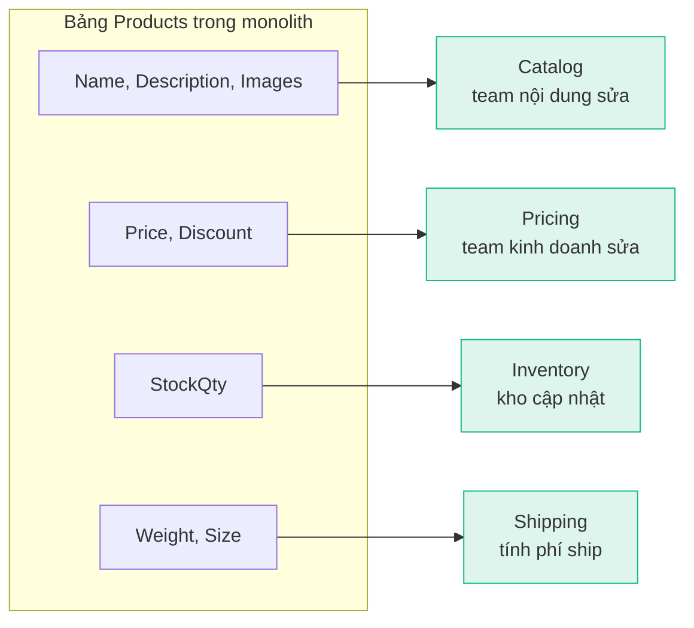
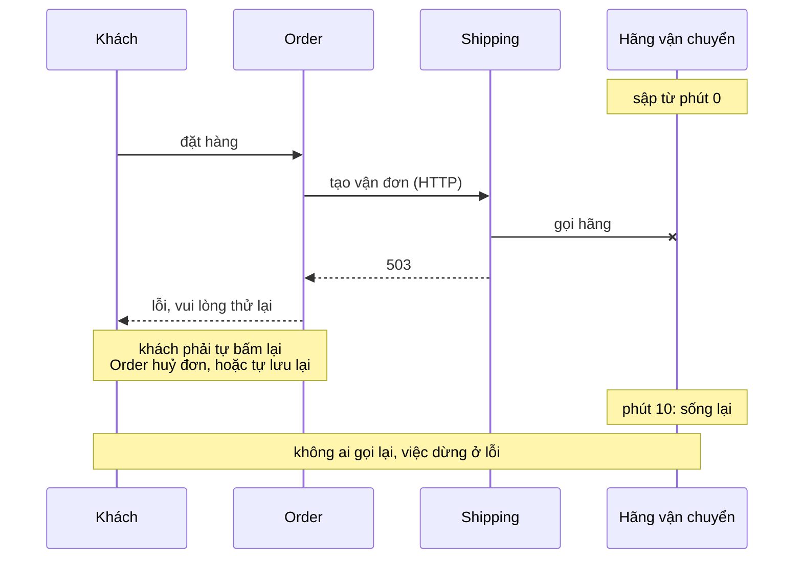
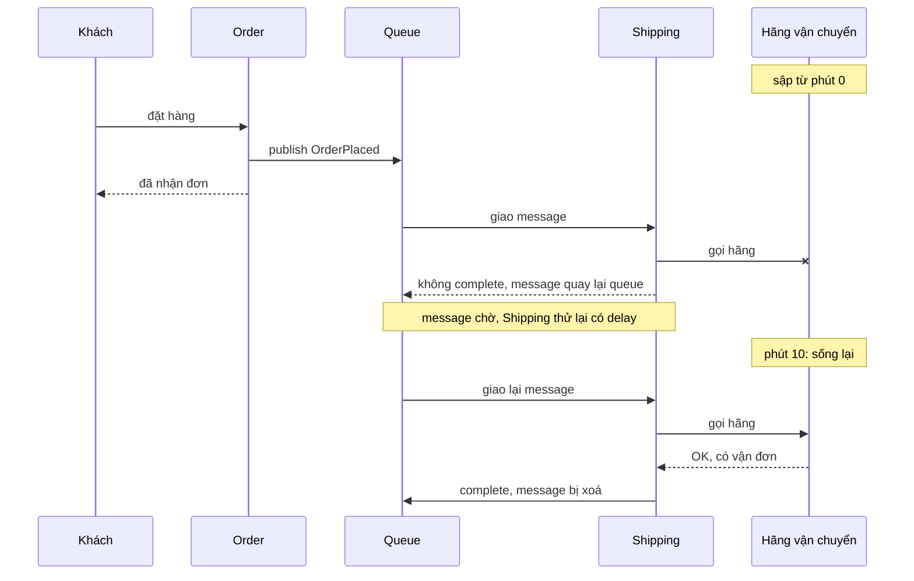
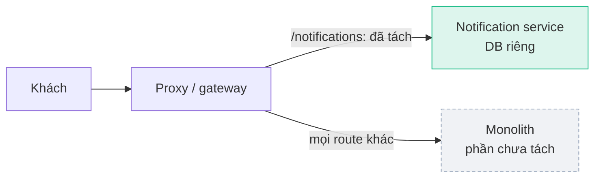

# Microservices: khi nào tách, tách thế nào

**Microservices** là chia một hệ thống thành nhiều service nhỏ, mỗi service một năng lực nghiệp vụ, deploy riêng, giữ DB riêng và nói chuyện với nhau qua mạng. Nó giải quyết việc nhiều team phải chờ nhau trong một monolith lớn, đổi lại là cái giá của mạng và dữ liệu phân tán. Trang này đi theo một shop online (Order, Payment, Inventory, Shipping, Notification): khi nào nên tách, chia ranh giới ở đâu, vì sao mỗi service một DB, khi nào gọi sync và khi nào gửi message, và cách tách dần một monolith. Đọc kèm: [Messaging](/architecture/messaging), [DDD](/architecture/ddd).

<svg width="0" height="0" style="position:absolute" aria-hidden="true"><defs><marker id="msInk" viewBox="0 0 10 10" refX="8" refY="5" markerWidth="7" markerHeight="7" orient="auto-start-reverse"><path class="head" d="M0 0L10 5L0 10z"/></marker><marker id="msAcc" viewBox="0 0 10 10" refX="8" refY="5" markerWidth="7" markerHeight="7" orient="auto-start-reverse"><path class="headAcc" d="M0 0L10 5L0 10z"/></marker><marker id="msOk" viewBox="0 0 10 10" refX="8" refY="5" markerWidth="7" markerHeight="7" orient="auto-start-reverse"><path class="headOk" d="M0 0L10 5L0 10z"/></marker><marker id="msBad" viewBox="0 0 10 10" refX="8" refY="5" markerWidth="7" markerHeight="7" orient="auto-start-reverse"><path class="headBad" d="M0 0L10 5L0 10z"/></marker></defs></svg>

## Bản đồ chủ đề {#topic-map}

<div class="fig">
<svg viewBox="0 0 800 404" role="img" aria-label="Một đơn hàng: client gửi POST /orders qua API gateway tới Order; Order gọi sync Inventory và chờ; lưu đơn vào DB riêng; publish OrderPlaced lên message broker; trả 201 cho client không chờ ai nữa; broker gửi Notification và Shipping mỗi bên một bản; Shipping gọi hãng vận chuyển bên ngoài với timeout, retry, circuit breaker">
<text x="16" y="22" font-size="12" font-weight="600" class="muted">Một đơn hàng đi qua shop</text>
<rect class="box" x="16" y="50" width="72" height="52" rx="6"/><text x="52" y="80" font-size="12.5" text-anchor="middle">Client</text>
<line class="ln" x1="88" y1="64" x2="174" y2="64" marker-end="url(#msInk)"/><text x="126" y="56" font-size="10" text-anchor="middle" class="mono muted">POST /orders</text>
<line class="lnOk dash" x1="180" y1="90" x2="94" y2="90" marker-end="url(#msOk)"/><text x="132" y="116" font-size="10.5" text-anchor="middle" class="okT">201 Created</text>
<a href="#api-gateway" style="text-decoration:none"><rect class="boxAcc" x="180" y="50" width="112" height="52" rx="8"/><text x="236" y="81" font-size="12.5" font-weight="600" text-anchor="middle">API gateway</text><circle cx="180" cy="50" r="12" style="fill:var(--vp-c-bg)"/><circle class="boxAcc" cx="180" cy="50" r="12"/><text x="180" y="55" font-size="13" font-weight="700" text-anchor="middle" class="accT">1</text></a>
<line class="ln" x1="292" y1="64" x2="374" y2="64" marker-end="url(#msInk)"/>
<a href="#sync-question" style="text-decoration:none"><line class="lnOk dash" x1="380" y1="90" x2="298" y2="90" marker-end="url(#msOk)"/><circle cx="336" cy="90" r="12" style="fill:var(--vp-c-bg)"/><circle class="boxOk" cx="336" cy="90" r="12"/><text x="336" y="95" font-size="13" font-weight="700" text-anchor="middle" class="okT">5</text></a>
<rect class="box" x="380" y="50" width="120" height="52" rx="6"/><text x="440" y="81" font-size="12.5" font-weight="600" text-anchor="middle">Order</text>
<a href="#sync-question" style="text-decoration:none"><line class="lnAcc" x1="500" y1="64" x2="614" y2="64" marker-end="url(#msAcc)"/><text x="557" y="56" font-size="10.5" text-anchor="middle" class="accT">còn hàng?</text><line class="lnAcc dash" x1="620" y1="90" x2="506" y2="90" marker-end="url(#msAcc)"/><text x="557" y="112" font-size="10.5" text-anchor="middle" class="accT">chờ trả lời</text><circle cx="557" cy="77" r="11" style="fill:var(--vp-c-bg)"/><circle class="boxAcc" cx="557" cy="77" r="11"/><text x="557" y="82" font-size="12" font-weight="700" text-anchor="middle" class="accT">2</text></a>
<rect class="box" x="620" y="50" width="120" height="52" rx="6"/><text x="680" y="81" font-size="12.5" font-weight="600" text-anchor="middle">Inventory</text>
<g class="boxOk"><path d="M664 120 L664 140 A16 4 0 0 0 696 140 L696 120 A16 4 0 0 0 664 120 Z"/><ellipse cx="680" cy="120" rx="16" ry="4"/></g><line class="lnMuted" x1="680" y1="102" x2="680" y2="116"/>
<a href="#database-per-service" style="text-decoration:none"><g class="boxOk"><path d="M394 122 L394 142 A16 4 0 0 0 426 142 L426 122 A16 4 0 0 0 394 122 Z"/><ellipse cx="410" cy="122" rx="16" ry="4"/></g><line class="lnMuted" x1="410" y1="102" x2="410" y2="118"/><circle cx="374" cy="136" r="11" style="fill:var(--vp-c-bg)"/><circle class="boxAcc" cx="374" cy="136" r="11"/><text x="374" y="141" font-size="12" font-weight="700" text-anchor="middle" class="accT">3</text><text x="410" y="164" font-size="10.5" text-anchor="middle" class="muted">lưu đơn</text></a>
<a href="#messaging-benefits" style="text-decoration:none"><line class="lnAcc" x1="470" y1="102" x2="470" y2="210" marker-end="url(#msAcc)"/><circle cx="470" cy="152" r="12" style="fill:var(--vp-c-bg)"/><circle class="boxAcc" cx="470" cy="152" r="12"/><text x="470" y="157" font-size="13" font-weight="700" text-anchor="middle" class="accT">4</text><text x="490" y="156" font-size="10.5">publish <tspan class="mono">OrderPlaced</tspan></text></a>
<rect class="boxAcc dash" x="160" y="216" width="420" height="40" rx="6"/><text x="300" y="241" font-size="12" font-weight="600" text-anchor="middle">message broker</text>
<a href="#messaging-benefits" style="text-decoration:none"><line class="lnAcc dash" x1="220" y1="256" x2="220" y2="304" marker-end="url(#msAcc)"/><line class="lnAcc dash" x1="460" y1="256" x2="460" y2="304" marker-end="url(#msAcc)"/><circle cx="300" cy="281" r="12" style="fill:var(--vp-c-bg)"/><circle class="boxAcc" cx="300" cy="281" r="12"/><text x="300" y="286" font-size="13" font-weight="700" text-anchor="middle" class="accT">6</text><text x="320" y="285" font-size="10.5" class="muted">mỗi bên một bản, làm sau</text></a>
<rect class="box" x="160" y="310" width="120" height="46" rx="6"/><text x="220" y="338" font-size="12.5" font-weight="600" text-anchor="middle">Notification</text>
<rect class="box" x="400" y="310" width="120" height="46" rx="6"/><text x="460" y="338" font-size="12.5" font-weight="600" text-anchor="middle">Shipping</text>
<g class="boxOk"><path d="M204 372 L204 392 A16 4 0 0 0 236 392 L236 372 A16 4 0 0 0 204 372 Z"/><ellipse cx="220" cy="372" rx="16" ry="4"/><path d="M444 372 L444 392 A16 4 0 0 0 476 392 L476 372 A16 4 0 0 0 444 372 Z"/><ellipse cx="460" cy="372" rx="16" ry="4"/></g><line class="lnMuted" x1="220" y1="356" x2="220" y2="368"/><line class="lnMuted" x1="460" y1="356" x2="460" y2="368"/>
<a href="#cascading-failure" style="text-decoration:none"><line class="ln" x1="520" y1="333" x2="620" y2="333" marker-end="url(#msInk)"/><circle cx="570" cy="333" r="12" style="fill:var(--vp-c-bg)"/><circle class="boxAcc" cx="570" cy="333" r="12"/><text x="570" y="338" font-size="13" font-weight="700" text-anchor="middle" class="accT">7</text><text x="570" y="366" font-size="10.5" text-anchor="middle">timeout · retry</text><text x="570" y="381" font-size="10.5" text-anchor="middle">circuit breaker</text></a>
<rect class="box dash" x="626" y="310" width="150" height="46" rx="6"/><text x="701" y="330" font-size="12" font-weight="600" text-anchor="middle">Hãng vận chuyển</text><text x="701" y="346" font-size="10.5" text-anchor="middle" class="muted">bên ngoài</text>
</svg>
<p class="fig-caption">Đọc 1 đến 7. Tự trả lời: vì sao ở 2 Order phải chờ, còn ở 5 trả lời khách mà không chờ Shipping? Vì sao 7 cần timeout, retry, circuit breaker?</p>
</div>

Các chủ đề khác ở mục riêng: [ba nấc monolith, modular monolith, microservices](#evolution), [cascading failure](#cascading-failure), [strangler fig](#strangler-fig).

## 1. Monolith lớn dần đau ở đâu, và khi nào nên tách {#when-to-use}

Vì mọi phần của monolith nằm chung một process và một lần deploy, nên chúng chia chung mọi thứ: lịch release, tài nguyên, và rủi ro. Shop còn nhỏ thì đó là ưu điểm (một chỗ build, một chỗ debug). Shop lớn lên, 5 team cùng sửa một codebase, thì chính sự "chung" đó gây đau:

- **Deploy chung nên lịch chung**: team Payment xong tính năng từ thứ Hai nhưng phải chờ team Shipping test xong mới release được, vì cả hai nằm trong cùng một bản build.
- **Process chung nên scale chung**: dịp sale chỉ Order và Inventory bị dồn tải, nhưng muốn thêm sức thì phải chạy thêm instance của cả app.
- **Process chung nên sập chung**: Notification rò memory làm process chết, khách cũng không đặt hàng được.

### Ba nấc: monolith, modular monolith, microservices {#evolution}

<div class="fig">
<svg viewBox="0 0 760 256" role="img" aria-label="Ba nấc: monolith code gọi chéo, modular monolith có ranh giới module nhưng một deploy, microservices mỗi service deploy và DB riêng">
<text x="122" y="26" font-size="13" font-weight="600" text-anchor="middle" class="badT">Nấc 0 · Monolith</text>
<text x="360" y="26" font-size="13" font-weight="600" text-anchor="middle" class="accT">Nấc 1 · Modular monolith</text>
<text x="625" y="26" font-size="13" font-weight="600" text-anchor="middle" class="okT">Nấc 2 · Microservices</text>
<rect class="boxBad" x="20" y="44" width="204" height="116" rx="8"/>
<g class="lnBad"><line x1="65" y1="67" x2="172" y2="115"/><line x1="168" y1="71" x2="78" y2="111"/><line x1="78" y1="111" x2="115" y2="143"/><line x1="65" y1="67" x2="78" y2="111"/><line x1="168" y1="71" x2="172" y2="115"/><line x1="172" y1="115" x2="115" y2="143"/></g>
<g font-size="10" text-anchor="middle"><rect class="box" x="30" y="56" width="70" height="22" rx="4"/><text x="65" y="71">Order</text><rect class="box" x="130" y="60" width="76" height="22" rx="4"/><text x="168" y="75">Payment</text><rect class="box" x="40" y="100" width="76" height="22" rx="4"/><text x="78" y="115">Inventory</text><rect class="box" x="136" y="104" width="72" height="22" rx="4"/><text x="172" y="119">Shipping</text><rect class="box" x="70" y="132" width="90" height="22" rx="4"/><text x="115" y="147">Notification</text></g>
<line class="ln" x1="122" y1="160" x2="122" y2="170"/><path class="box" d="M104 172 L104 194 A18 4 0 0 0 140 194 L140 172 A18 4 0 0 0 104 172 Z"/><ellipse class="box" cx="122" cy="172" rx="18" ry="4"/>
<line class="ln" x1="230" y1="100" x2="248" y2="100" marker-end="url(#msInk)"/>
<rect class="boxAcc" x="258" y="44" width="204" height="116" rx="8"/>
<g font-size="10" text-anchor="middle"><rect class="box" x="268" y="54" width="88" height="26" rx="4"/><text x="312" y="71">Order</text><rect class="box" x="364" y="54" width="88" height="26" rx="4"/><text x="408" y="71">Payment</text><rect class="box" x="268" y="88" width="88" height="26" rx="4"/><text x="312" y="105">Inventory</text><rect class="box" x="364" y="88" width="88" height="26" rx="4"/><text x="408" y="105">Shipping</text><rect class="box" x="316" y="122" width="88" height="26" rx="4"/><text x="360" y="139">Notification</text></g>
<line class="ln" x1="360" y1="160" x2="360" y2="170"/><path class="box" d="M342 172 L342 194 A18 4 0 0 0 378 194 L378 172 A18 4 0 0 0 342 172 Z"/><ellipse class="box" cx="360" cy="172" rx="18" ry="4"/>
<line class="ln" x1="470" y1="100" x2="490" y2="100" marker-end="url(#msInk)"/>
<g font-size="10" text-anchor="middle"><rect class="boxOk" x="500" y="52" width="70" height="24" rx="4"/><text x="535" y="68">Order</text><rect class="boxOk" x="590" y="52" width="70" height="24" rx="4"/><text x="625" y="68">Payment</text><rect class="boxOk" x="680" y="52" width="70" height="24" rx="4"/><text x="715" y="68">Inventory</text><rect class="boxOk" x="534" y="118" width="76" height="24" rx="4"/><text x="572" y="134">Shipping</text><rect class="boxOk" x="642" y="118" width="90" height="24" rx="4"/><text x="687" y="134">Notification</text></g>
<g class="box"><path d="M526 82 L526 94 A9 3 0 0 0 544 94 L544 82 A9 3 0 0 0 526 82 Z"/><ellipse cx="535" cy="82" rx="9" ry="3"/><path d="M616 82 L616 94 A9 3 0 0 0 634 94 L634 82 A9 3 0 0 0 616 82 Z"/><ellipse cx="625" cy="82" rx="9" ry="3"/><path d="M706 82 L706 94 A9 3 0 0 0 724 94 L724 82 A9 3 0 0 0 706 82 Z"/><ellipse cx="715" cy="82" rx="9" ry="3"/><path d="M563 148 L563 160 A9 3 0 0 0 581 160 L581 148 A9 3 0 0 0 563 148 Z"/><ellipse cx="572" cy="148" rx="9" ry="3"/><path d="M678 148 L678 160 A9 3 0 0 0 696 160 L696 148 A9 3 0 0 0 678 148 Z"/><ellipse cx="687" cy="148" rx="9" ry="3"/></g>
<g font-size="10.5" text-anchor="middle"><text x="122" y="222" font-weight="600">1 deploy, 1 DB, code gọi chéo</text><text x="122" y="240" class="badT">đau: team chờ nhau, 1 bug sập cả app</text><text x="360" y="222" font-weight="600">1 deploy, module có ranh giới</text><text x="360" y="240" class="muted">còn: deploy chung, scale chung</text><text x="625" y="222" font-weight="600">deploy riêng, DB riêng</text><text x="625" y="240" class="badT">giá: mạng, dữ liệu phân tán, giám sát</text></g>
</svg>
<p class="fig-caption">Mỗi nấc chữa một cái đau của nấc trước. Nấc 1 chữa code dính nhau mà chưa trả giá mạng; nấc 2 mới tách deploy, process và DB.</p>
</div>

- **Modular monolith** (nấc 1): vẫn một deploy, nhưng mỗi module chỉ gọi module khác qua interface công khai và chỉ đụng bảng của mình. Phần lớn cái đau "sửa chỗ này vỡ chỗ kia" là do code dính nhau, không phải do deploy chung, nên nấc này chữa được nó với chi phí thấp. Nó cũng là bước chuẩn bị: ranh giới module rõ thì sau này tách ra thành service gần như theo đường kẻ sẵn.
- **Microservices** (nấc 2): mỗi module thành một process riêng, deploy riêng, DB riêng. Thứ duy nhất nấc này thêm so với nấc 1 là **tách deploy và runtime**, và cái giá là mọi lời gọi giữa module thành lời gọi qua mạng.

**Lý do chính để lên nấc 2 thường là deploy độc lập cho các team độc lập**: team Payment release lúc nào xong, không hẹn ai. Hai lợi ích còn lại là phụ:

- **Scale riêng**: monolith cũng scale ngang được bằng cách chạy thêm instance; scale riêng chỉ đáng khi phần nóng ngốn tài nguyên khác hẳn phần còn lại.
- **Cô lập lỗi**: chỉ đúng khi service **không gọi nhau theo chuỗi sync**. Order gọi sync Shipping, Shipping gọi sync hãng vận chuyển, thì hãng sập vẫn kéo đặt hàng sập theo, xem [Hãng sập 10 phút](#provider-down).

### Khi nào không nên tách {#when-not}

Vì mỗi ranh giới service biến một method call thành một network call và một DB thành nhiều DB, nên microservices có một cái giá trả hằng ngày: lời gọi có thể chậm hoặc mất, không còn transaction chung giữa các service, và phải vận hành N lần deploy, log, alert, <T>distributed tracing</T>. Suy ra ba trường hợp không nên:

- **Team nhỏ**: vài dev không có ai phải chờ ai, nên lợi ích chính không tồn tại, chỉ còn cái giá.
- **Domain chưa rõ**: vẽ sai ranh giới trong monolith thì sửa là refactor trong một solution; vẽ sai giữa hai service thì sửa là đổi API, đổi event và chuyển data giữa hai DB.
- **Chưa đủ sức vận hành**: chưa có <T>CI/CD</T> cho từng service, chưa trace được một request đi qua 4 service, thì sự cố đầu tiên sẽ rất khó tìm.

Hướng an toàn: bắt đầu bằng modular monolith, tách một module ra khi nó có lý do thật (team riêng cần release riêng, hoặc tải khác hẳn).

## 2. Chia ranh giới theo năng lực nghiệp vụ {#service-boundaries}

Ranh giới đúng là ranh giới mà **một thay đổi nghiệp vụ chỉ phải sửa một service**. Vì mục tiêu là một team sửa và deploy mà không chờ ai, nên mọi cách kiểm bên dưới đều quy về câu này.

<div class="fig">
<svg viewBox="0 0 720 220" role="img" aria-label="Chia theo tầng: tính năng giao hàng nhanh chạm cả ba service. Chia theo nghiệp vụ: chỉ chạm Shipping">
<text x="180" y="22" font-size="13" font-weight="600" text-anchor="middle" class="badT">Chia theo tầng kỹ thuật</text>
<text x="540" y="22" font-size="13" font-weight="600" text-anchor="middle" class="okT">Chia theo năng lực nghiệp vụ</text>
<g font-size="12" text-anchor="middle"><rect class="box" x="40" y="40" width="250" height="32" rx="6"/><text x="165" y="61">UI service</text><rect class="box" x="40" y="82" width="250" height="32" rx="6"/><text x="165" y="103">Logic service</text><rect class="box" x="40" y="124" width="250" height="32" rx="6"/><text x="165" y="145">Data service (mọi bảng)</text></g>
<line class="lnBad" x1="310" y1="44" x2="310" y2="152"/><circle class="dotBad" cx="310" cy="56" r="4"/><circle class="dotBad" cx="310" cy="98" r="4"/><circle class="dotBad" cx="310" cy="140" r="4"/>
<text x="165" y="182" font-size="11" text-anchor="middle">tính năng: phí giao hàng nhanh</text>
<text x="165" y="202" font-size="11" text-anchor="middle" class="badT">sửa cả 3 service, 3 team, deploy cùng lúc</text>
<line class="lnMuted" x1="360" y1="14" x2="360" y2="210"/>
<g font-size="10" text-anchor="middle"><rect class="box" x="390" y="36" width="90" height="124" rx="6"/><text x="435" y="54" font-size="12" font-weight="600">Order</text><rect class="box" x="490" y="36" width="90" height="124" rx="6"/><text x="535" y="54" font-size="12" font-weight="600">Payment</text><rect class="boxOk" x="600" y="36" width="90" height="124" rx="6"/><text x="645" y="54" font-size="12" font-weight="600" class="okT">Shipping</text><rect class="box dash" x="398" y="66" width="74" height="22" rx="4"/><text x="435" y="81" class="muted">API</text><rect class="box dash" x="398" y="96" width="74" height="22" rx="4"/><text x="435" y="111" class="muted">logic</text><rect class="box dash" x="398" y="126" width="74" height="22" rx="4"/><text x="435" y="141" class="muted">DB</text><rect class="box dash" x="498" y="66" width="74" height="22" rx="4"/><text x="535" y="81" class="muted">API</text><rect class="box dash" x="498" y="96" width="74" height="22" rx="4"/><text x="535" y="111" class="muted">logic</text><rect class="box dash" x="498" y="126" width="74" height="22" rx="4"/><text x="535" y="141" class="muted">DB</text><rect class="box" x="608" y="66" width="74" height="22" rx="4"/><text x="645" y="81">API</text><rect class="box" x="608" y="96" width="74" height="22" rx="4"/><text x="645" y="111">logic</text><rect class="box" x="608" y="126" width="74" height="22" rx="4"/><text x="645" y="141">DB</text></g>
<text x="540" y="182" font-size="11" text-anchor="middle">tính năng: phí giao hàng nhanh</text>
<text x="540" y="202" font-size="11" text-anchor="middle" class="okT">chỉ sửa Shipping: 1 team, 1 deploy</text>
</svg>
<p class="fig-caption">Cùng một tính năng. Chia theo tầng thì nó cắt ngang mọi service; chia theo nghiệp vụ thì nó nằm gọn trong một service.</p>
</div>

Chia theo tầng là **cắt ngang**: mỗi lát là một tầng (Controllers, Services, Repositories) của mọi tính năng, nên tính năng nào cũng chạm mọi lát. Chia theo nghiệp vụ là **cắt dọc**: mỗi lát chứa đủ API, logic, DB của một nghiệp vụ.

### Bẫy của người quen monolith: chia theo bảng {#split-by-table}

Monolith dùng chung một DB nên ta quen tách mỗi bảng chính thành một service: Product service, Customer service. Nhưng một bảng thường gom dữ liệu của nhiều nghiệp vụ, mỗi nhóm cột đổi vì một lý do khác:



"Product service" sẽ phải sửa mỗi khi đổi giá, nhập kho hay sửa mô tả: lại thành chỗ ai cũng phải chờ. Chia đúng thì **bảng bị xé ra**, mỗi service giữ phần cột của mình, nối bằng cùng `ProductId`.

### Cách tìm ranh giới: liệt kê thay đổi, không liệt kê bảng {#boundaries-howto}

**Bước 1. Viết ra các yêu cầu thay đổi** đã gặp hoặc sắp gặp, và mỗi yêu cầu chạm vào việc gì:

| Yêu cầu thay đổi | Chạm vào | Nhóm |
|---|---|---|
| Thêm một hãng vận chuyển | phí ship, vận đơn, theo dõi kiện hàng | Shipping |
| Tính phí ship theo cân nặng | phí ship, cân nặng sản phẩm | Shipping |
| Thêm một cổng thanh toán | thu tiền, hoàn tiền | Payment |
| Đổi chính sách hoàn tiền | hoàn tiền, trạng thái thanh toán | Payment |
| Chạy khuyến mãi theo mùa | giá, mã giảm giá | Pricing |
| Đổi mẫu email xác nhận | nội dung email | Notification |

**Bước 2. Gom những việc hay bị chạm cùng nhau** thành nhóm (cột cuối): "phí ship" bị hai yêu cầu cùng chạm nên phí ship, vận đơn, cân nặng về chung Shipping. Kiểm bằng từ vựng: trong một nhóm, mỗi chữ chỉ có một nghĩa. Chữ "đơn" ở Shipping là kiện hàng có địa chỉ, ở Payment là khoản cần thu, nên đó là hai nhóm ([bounded context](/architecture/ddd#bounded-context)).

**Bước 3. Đi thử một use case** ("khách đặt hàng") qua các nhóm. Mỗi chỗ nhóm này cần nhóm kia, xếp vào một trong ba loại:

- **Chỉ cần dữ liệu** (Shipping cần địa chỉ giao): không gộp. Nhận dữ liệu qua event hoặc giữ bản sao, xem [Cần dữ liệu của service khác](#cross-service-data). Đừng gộp vì "có liên quan": mọi thứ đều liên quan qua đơn hàng, gộp kiểu đó sẽ dây chuyền tới khi thành monolith.
- **Một luật phải đúng ngay lập tức** (không bán quá tồn kho): dữ liệu của luật đó phải nằm trong cùng một service, vì giữa hai service không có transaction chung.
- **Cùng lý do thay đổi** (mỗi lần đổi khuyến mãi đều phải sửa cả Pricing và Promotion): gộp.

**Bước 4. Kiểm cỡ**: mỗi nhóm một team sở hữu được. Nhiều team cùng sửa một service, release phải xếp hàng, thì nó quá to: làm lại bước 1 bên trong nó.

Trong thực tế bước 1–2 thường là một buổi workshop với người nghiệp vụ (event storming: dán các sự kiện nghiệp vụ lên tường rồi gom nhóm). Ranh giới hiếm khi đúng lần đầu, nên vẽ trong [modular monolith](#evolution) trước: sai thì dời code giữa hai module, rẻ hơn nhiều so với dời giữa hai service đã có DB riêng.

## 3. Mỗi service một database {#database-per-service}

Vì bảng của một service là chi tiết bên trong của nó, nên service khác đọc thẳng bảng đó thì chi tiết bên trong thành hợp đồng công khai. Shipping `SELECT` thẳng từ bảng `Orders` thì team Order không đổi tên cột được nữa nếu không báo team Shipping, và hai bên phải hẹn deploy cùng lúc. Đó là **distributed monolith**: trả đủ giá của microservices (mạng, nhiều deploy) mà mất đúng lợi ích chính là deploy độc lập.

<div class="fig">
<svg viewBox="0 0 720 190" role="img" aria-label="DB chung: Shipping đọc bảng Orders của Order. DB riêng: Shipping chỉ hỏi qua API hoặc nghe event">
<text x="180" y="22" font-size="13" font-weight="600" text-anchor="middle" class="badT">Đọc chung bảng</text>
<text x="540" y="22" font-size="13" font-weight="600" text-anchor="middle" class="okT">Mỗi service giữ dữ liệu của mình</text>
<g font-size="12" text-anchor="middle"><rect class="box" x="40" y="40" width="110" height="34" rx="6"/><text x="95" y="62">Order</text><rect class="box" x="210" y="40" width="110" height="34" rx="6"/><text x="265" y="62">Shipping</text><rect class="box" x="70" y="110" width="220" height="50" rx="6"/><text x="125" y="140" font-size="11" class="mono">Orders</text><text x="235" y="140" font-size="11" class="mono">Shipments</text></g>
<line class="ln" x1="95" y1="74" x2="115" y2="106" marker-end="url(#msInk)"/><line class="ln" x1="265" y1="74" x2="240" y2="106" marker-end="url(#msInk)"/><line class="lnBad" x1="250" y1="74" x2="145" y2="106" marker-end="url(#msBad)"/>
<text x="180" y="180" font-size="11" text-anchor="middle" class="badT">Order đổi cột Orders → Shipping vỡ</text>
<line class="lnMuted" x1="360" y1="14" x2="360" y2="186"/>
<g font-size="12" text-anchor="middle"><rect class="box" x="400" y="40" width="110" height="34" rx="6"/><text x="455" y="62">Order</text><rect class="box" x="580" y="40" width="110" height="34" rx="6"/><text x="635" y="62">Shipping</text><rect class="boxOk" x="400" y="110" width="110" height="50" rx="6"/><text x="455" y="140" font-size="11" class="mono">Orders</text><rect class="boxOk" x="580" y="110" width="110" height="50" rx="6"/><text x="635" y="140" font-size="11" class="mono">Shipments</text></g>
<line class="ln" x1="455" y1="74" x2="455" y2="106" marker-end="url(#msInk)"/><line class="ln" x1="635" y1="74" x2="635" y2="106" marker-end="url(#msInk)"/><line class="lnAcc dash" x1="576" y1="57" x2="514" y2="57" marker-end="url(#msAcc)"/>
<text x="545" y="50" font-size="10" text-anchor="middle" class="accT">API / event</text>
<text x="545" y="180" font-size="11" text-anchor="middle" class="okT">Orders đổi gì cũng được, miễn API/event giữ nguyên</text>
</svg>
<p class="fig-caption">Hợp đồng giữa hai service là API và event, không phải schema bảng.</p>
</div>

- **"DB riêng" là riêng quyền truy cập**, không bắt buộc riêng server: hai schema trên cùng một SQL Server, mỗi service chỉ có quyền vào schema của mình, vẫn đạt mục tiêu.
- **Không có foreign key xuyên service**: `Shipments.OrderId` chỉ là một giá trị, DB không kiểm tra nó tồn tại bên Order. Tính đúng giữa các service do quy trình (API, event) giữ, không do constraint.

### Cần dữ liệu của service khác thì làm sao {#cross-service-data}

Rule ví dụ: **Shipping chỉ tạo vận đơn cho đơn đã thanh toán**. Thông tin "đã thanh toán" thuộc Payment. Có ba cách, khác nhau ở chỗ dữ liệu được lấy **lúc nào**:

1. **Hỏi chủ dữ liệu ngay lúc cần**: Shipping gọi API của Payment. Luôn đúng số mới nhất, nhưng Shipping chỉ chạy được khi Payment đang sống, và mỗi lần cần là một lời gọi mạng.
2. **Giữ bản sao đọc tại chỗ, nuôi bằng event**: Shipping nghe event `PaymentCompleted`, ghi vào bảng `PaidOrders` của riêng mình. Lúc cần thì đọc DB của mình, không phụ thuộc Payment. Đổi lại là **eventual consistency**: bản sao có thể trễ vài giây so với Payment, nên phải chấp nhận được độ trễ đó.
3. **Thiết kế quy trình để rule tự đúng**: Shipping không bắt đầu từ `OrderPlaced` mà từ `PaymentCompleted`. Không có đường nào để một đơn chưa thanh toán tới được Shipping, nên không cần kiểm tra gì. Cách này thường gọn nhất, nhưng cần nghĩ lại luồng nghiệp vụ, xem [Saga](/architecture/messaging#saga).

Truy vấn xuyên service (danh sách đơn kèm trạng thái giao hàng) cũng theo hai hướng tương tự: một chỗ (gateway hoặc service đứng trước) gọi từng service rồi ghép kết quả, hoặc dựng một bảng chỉ để đọc, nuôi bằng event từ Order và Shipping. Không ai `JOIN` sang DB của service khác.

## 4. Sync hay async: chỉ một câu hỏi {#sync-vs-async}

### Người gọi có cần câu trả lời để làm tiếp không? {#sync-question}

Đó là câu hỏi duy nhất. **Cần** thì gọi sync (HTTP, gRPC) và chờ. **Không cần** thì gửi message rồi đi tiếp. Giống **gọi điện và gửi email**: gọi điện khi phải có câu trả lời mới làm tiếp được, nhưng người kia phải nghe máy ngay lúc đó; gửi email khi chỉ cần báo, người kia đọc lúc rảnh, còn mình làm việc khác.

- **Sync**: khách mở trang đơn hàng thì trang cần trạng thái hiện tại mới hiển thị được. Lúc checkout, Order cần Inventory trả lời giá và số lượng còn **trước khi** xác nhận đơn. Không có câu trả lời thì không có gì để làm tiếp.
- **Async**: đơn đã xác nhận, Order publish `OrderPlaced`. Inventory trừ kho, Shipping tạo vận đơn, Notification gửi email, mỗi bên làm khi nó làm được. Order không cần kết quả của bên nào để trả lời khách "đã nhận đơn", nên không chờ.

### Hãng vận chuyển sập 10 phút {#provider-down}

Hai thiết kế chỉ khác nhau thật khi có sự cố. Cho hãng vận chuyển bên ngoài sập 10 phút, rồi đọc hai sơ đồ dưới từ trên xuống (trục dọc là thời gian), nhìn xem lỗi của hãng dừng lại ở đâu.

**A · Order gọi sync Shipping**



Lỗi chạy ngược về tới khách, và khi hãng sống lại thì không có ai tự làm lại.

**B · Order publish `OrderPlaced`**



Khách được trả lời ngay; message nằm chờ, vận đơn xong sau 10 phút mà không ai thấy lỗi. Inventory và Notification cũng nhận `OrderPlaced` và chạy bình thường suốt 10 phút đó.

Ở A, Order có thể bắt lỗi rồi tự lưu đơn lại để thử sau, nhưng như vậy là đang tự viết lại một cái queue. B làm việc đó có sẵn, với hai điều kiện:

- **Shipping không được xác nhận xong message khi gọi hãng lỗi**, và phải **thử lại có delay**. Với Azure Service Bus, receive mode mặc định của SDK là PeekLock: message chỉ bị xoá khi consumer gọi complete, xem [Peek-lock](/architecture/messaging#peek-lock). Nhưng nếu thử lại ngay lập tức thì 10 lần (MaxDeliveryCount mặc định là 10) có thể hết trong vài giây, message vào [dead-letter queue](/architecture/messaging#dead-letter) trước khi hãng sống lại.
- **Lời hứa với khách đổi đi**: B nói "đã nhận đơn", không nói "đã có vận đơn". Nếu hãng không bao giờ sống lại thì phải có bước bù (huỷ đơn, hoàn tiền), xem [Saga](/architecture/messaging#saga).

### Vì sao qua mạng câu hỏi này nặng hơn trong monolith {#network-call}

Trong monolith, Order gọi `shipping.CreateLabel()` là một method call trong cùng process: process còn sống thì bên kia chắc chắn có mặt, gọi mất vài nanosecond, lỗi thì thành exception. Vì vậy chọn sync hay không gần như không quan trọng. Qua mạng thì bên kia có thể chết, chậm, hoặc đã làm xong mà response bị mất giữa đường (timeout: không biết bên kia đã làm chưa, xem [Timeout](/aspnet-core/rest-api#timeout)). Nên mỗi lời gọi sync **cộng thêm độ trễ và nhân thêm xác suất lỗi** vào người gọi: chuỗi 3 service, mỗi cái sống 99,9% thời gian, thì cả chuỗi chỉ còn khoảng 99,7% (0,999³). Message cắt chuỗi đó: lúc publish, Order chỉ cần broker sống.

### Messaging cho thêm gì, và giá phải trả {#messaging-benefits}

- **Một event, nhiều người nghe mà người gửi không biết**: thêm service tích điểm nghe `OrderPlaced` mà không sửa một dòng nào trong Order. Order chỉ biết "đơn đã đặt", không biết ai quan tâm, nên <T>coupling</T> giữa các service thấp.
- **Queue hấp thụ tải đột biến**: giờ mở sale có 5.000 đơn mỗi phút, Shipping xử lý được 500 mỗi phút. Queue dài ra rồi rút dần; Shipping làm theo sức mình, không bị đè chết.
- **Giá phải trả**: dữ liệu giữa các service chỉ khớp sau một lúc (eventual consistency); message có thể tới hơn một lần ([at-least-once](/architecture/messaging#at-least-once)) nên consumer phải [idempotent](/architecture/messaging#idempotent-consumer); lưu đơn và publish event phải cùng thành công hoặc cùng thất bại ([Outbox](/architecture/messaging#outbox)); và debug khó hơn vì một việc chạy qua nhiều process ở nhiều thời điểm.

### REST hay gRPC {#rest-vs-grpc}

Cả hai đều là gọi sync, tức vẫn là gọi điện; chọn cái nào không thay đổi câu trả lời ở trên. <T>REST</T> (JSON qua HTTP) thì ai cũng gọi được: browser, đối tác, `curl`. <T>gRPC</T> gửi dữ liệu nhị phân (Protobuf) qua HTTP/2, viết contract trước trong file `.proto` rồi sinh code client và server, nên nhanh, gọn và chặt kiểu; hợp với gọi nội bộ giữa các service. Browser không gọi thẳng gRPC được (phải qua gRPC-Web), nên API cho client bên ngoài thường vẫn là REST.

## 5. Cascading failure: một service chậm kéo sập service khác {#cascading-failure}

Vì service **chậm** vẫn nhận request và giữ kết nối, nên người gọi không thấy lỗi ngay mà ngồi chờ. Mỗi request đang chờ giữ một phần tài nguyên của người gọi; traffic vẫn vào đều nên tài nguyên cạn dần, và đến lúc endpoint không liên quan cũng phải xếp hàng. Service **chết hẳn** lại ít hại hơn: kết nối bị từ chối ngay, người gọi nhận lỗi trong vài mili giây.

<div class="fig">
<svg viewBox="0 0 720 236" role="img" aria-label="Inventory chậm 30 giây, request của Order chờ chồng chất, endpoint xem đơn không gọi Inventory cũng chậm theo">
<text x="20" y="70" font-size="10.5" class="mono">POST /orders</text><text x="20" y="88" font-size="10" class="muted">checkout, gọi Inventory</text>
<text x="20" y="152" font-size="10.5" class="mono">GET /orders/42</text><text x="20" y="170" font-size="10" class="badT">không gọi Inventory, vẫn chậm</text>
<line class="ln" x1="140" y1="66" x2="270" y2="66" marker-end="url(#msInk)"/><line class="lnBad" x1="140" y1="148" x2="270" y2="148" marker-end="url(#msBad)"/>
<rect class="box" x="276" y="30" width="210" height="160" rx="8"/><text x="381" y="54" font-size="12.5" font-weight="600" text-anchor="middle">Order</text>
<g class="boxBad dash"><rect x="298" y="70" width="14" height="54" rx="2"/><rect x="320" y="70" width="14" height="54" rx="2"/><rect x="342" y="70" width="14" height="54" rx="2"/><rect x="364" y="70" width="14" height="54" rx="2"/><rect x="386" y="70" width="14" height="54" rx="2"/><rect x="408" y="70" width="14" height="54" rx="2"/><rect x="430" y="70" width="14" height="54" rx="2"/><rect x="452" y="70" width="14" height="54" rx="2"/></g>
<text x="381" y="150" font-size="10.5" text-anchor="middle" class="badT">request đang chờ: tăng dần</text>
<text x="381" y="168" font-size="10" text-anchor="middle" class="muted">mỗi cái giữ tài nguyên của Order</text>
<line class="lnBad" x1="486" y1="98" x2="560" y2="98" marker-end="url(#msBad)"/><text x="523" y="90" font-size="10" text-anchor="middle" class="badT">chờ…</text>
<rect class="boxBad" x="566" y="68" width="140" height="62" rx="8"/><text x="636" y="92" font-size="12" font-weight="600" text-anchor="middle">Inventory</text>
<circle class="boxBad" cx="584" cy="112" r="7"/><path class="lnBad" d="M584 107.5 V112 H587.5" style="stroke-width:1.5"/><text x="596" y="116" font-size="10" class="badT">chậm 30s, chưa chết</text>
<text x="360" y="220" font-size="10.5" text-anchor="middle" class="muted">client của Order cũng chờ theo → chậm lan ngược lên trên</text>
</svg>
<p class="fig-caption">Inventory không trả lỗi nên Order không biết để dừng. Request chờ chồng lên nhau cho tới khi tài nguyên dùng chung của Order cạn.</p>
</div>

"Tài nguyên" ở đây cụ thể là gì phụ thuộc code. Code gọi blocking (`.Result`, `.Wait()`) thì mỗi request giữ hẳn một thread, nhanh chóng thành <T>thread pool starvation</T> và mọi endpoint chậm, xem [Async/await giải quyết gì](/runtime/async#why-async). Code async đúng thì thread được trả lại trong lúc chờ, nhưng request vẫn giữ memory, kết nối, và DB connection nếu đang mở transaction quanh lời gọi; client của Order cũng treo theo. Cách chữa, mỗi cách cắt một khâu:

- **Timeout**: không chờ vô hạn. `HttpClient` mặc định chờ 100 giây, quá dài cho gọi nội bộ.
- **Retry với <T>backoff</T>**: thử lại lỗi tạm thời, giãn cách và thêm jitter để không dồn thêm tải vào service đang yếu; chỉ retry request idempotent.
- **<T>Circuit breaker</T>**: lỗi vượt ngưỡng thì ngắt, fail ngay trong một khoảng thay vì chờ timeout, rồi thử lại vài request xem bên kia đã ổn chưa. Trong .NET dùng Polly hoặc `Microsoft.Extensions.Http.Resilience` (xây trên Polly).
- **Chuyển sang messaging** nếu người gọi không cần câu trả lời: không còn ai chờ, không còn chuỗi, xem [mục 4](#sync-question).

```csharp
// Program.cs của Order: một dòng gắn sẵn timeout + retry + circuit breaker
builder.Services.AddHttpClient<InventoryClient>(c => c.BaseAddress = new Uri("http://inventory"))
    .AddStandardResilienceHandler(); // mặc định: 10s mỗi lần thử, 30s tổng, retry có backoff + jitter
```

Giá trị mặc định và bẫy retry POST của `AddStandardResilienceHandler()` nằm ở [Gọi API bên ngoài](/aspnet-core/questions#httpclientfactory).

## 6. API gateway và service discovery {#api-gateway}

Vì client không nên biết shop có bao nhiêu service và mỗi cái ở địa chỉ nào, nên đặt **một cửa vào duy nhất**: <T>API gateway</T>. Nó nhận mọi request từ ngoài và làm các việc chung một lần: **routing** (`/orders/*` sang Order, `/shipments/*` sang Shipping), **xác thực** token, <T>rate limiting</T>. Tách hay gộp service phía sau thì chỉ sửa bảng route ở gateway, client không đổi. Ví dụ: <T>YARP</T> (thư viện <T>reverse proxy</T> của Microsoft, tự host trong một app ASP.NET Core) hoặc Azure API Management (<T>APIM</T>, dịch vụ có sẵn trên Azure). Bẫy: không đặt logic nghiệp vụ vào gateway, nếu không nó thành một monolith mới mà mọi team phải sửa chung.

**Service discovery**: vì instance của service sinh ra, chết đi và đổi IP liên tục (scale, deploy lại), nên không gọi bằng IP mà gọi **bằng tên**, và một thành phần khác tra tên ra địa chỉ hiện tại. Trên <T>Kubernetes</T> việc này có sẵn: tạo một <T k="k8s service">Service</T> tên `inventory` thì DNS trong cluster phân giải `http://inventory` (cùng namespace) hoặc `inventory.<namespace>.svc.cluster.local` ra một IP ổn định, chia request cho các pod đang sống phía sau. Đó là lý do đoạn code ở mục 5 chỉ cần `http://inventory`.

Công cụ cho gateway, resilience, tracing, chạy cả hệ thống ở máy dev: [Công cụ](/architecture/tooling#dotnet-tooling).

## 7. Strangler fig: tách monolith từng phần {#strangler-fig}

Vì rủi ro của một lần release tỉ lệ với lượng thay đổi chưa từng chạy trên production, nên tách monolith theo <T>strangler fig</T>: đặt một proxy hoặc gateway trước monolith, mỗi lần dựng **một** năng lực thành service mới rồi chuyển route của nó sang; phần còn lại vẫn đi vào monolith. Lát nào lỗi thì trả riêng route đó về monolith. <T>Big-bang</T> (viết lại toàn bộ, một ngày chuyển) dồn mọi rủi ro vào ngày đó, hàng tháng không giao được gì, và trong lúc chờ monolith vẫn phải sửa ở cả hai nơi.

Nhìn vào proxy: nó là chỗ duy nhất quyết định request đi đâu, nên chuyển một route sang service mới (hoặc trả về monolith khi lỗi) chỉ là đổi một dòng cấu hình, khách không biết gì.



### Bước trước khi tách: modular hoá ngay trong monolith {#modularize-first}

Vì tách service thực chất là dời một ranh giới đã có ra ngoài mạng, nên ranh giới phải có trước, trong lúc sửa còn rẻ. Làm từng module một, app vẫn chạy và release bình thường:

1. **Gom code theo nghiệp vụ**: mỗi module một folder hoặc project (Catalog, Ordering, Shipping), bỏ kiểu một thư mục Services chung cho mọi thứ.
2. **Chỉ gọi nhau qua interface công khai** của module; class bên trong để `internal`.
3. **Mỗi module chỉ đụng bảng của mình**: bỏ các `JOIN` xuyên module, thay bằng gọi interface hoặc nghe event trong process. Đây là bước lâu nhất, và cũng chính là việc khó nhất khi tách service sau này.
4. **Giữ ranh giới bằng test**: một test kiến trúc (vd NetArchTest) fail khi module này dùng class bên trong của module kia.

Xong bước 3 của một module thì module đó tách ra service gần như chỉ là đổi lời gọi interface thành lời gọi HTTP hoặc message.

**Bỏ qua bước này, tách thẳng cả app thành microservices thì sao?** Ranh giới được vẽ lần đầu ngay trên mạng. Code còn dính nhau nên service phải gọi nhau liên tục, còn chung DB, và phải deploy cùng nhau: đó là [distributed monolith](#database-per-service), trả mọi cái giá của microservices mà không có deploy độc lập. Vẽ sai thì sửa bằng đổi API và chuyển data giữa hai DB, thay vì dời code giữa hai folder. Ngoại lệ: một phần **vốn đã ít dính** (vd Notification chỉ nghe event) thì tách thẳng bằng strangler được, vì chỉ cần ranh giới của đúng lát đó sạch, không cần cả app.

### Chọn lát đầu {#first-slice}

Với shop: lát đầu nên là thứ **ít phụ thuộc và có lý do tách rõ**, vd Notification (chỉ nghe event, không ai chờ kết quả của nó). Thường phần khó nhất là **dữ liệu**: service mới phải sở hữu bảng của nó, nên các chỗ trong monolith đang đọc thẳng bảng đó phải chuyển sang gọi API hoặc nghe event trước khi tách được.

Cơ chế chạy song song, proxy bằng YARP và cutover DB đã có chi tiết ở [Migrate .NET Framework: vì sao strangler fig](/dotnet/framework-vs-core#why-strangler) và [Migrate một app .NET Framework](/dotnet/framework-vs-core#migration-strategy); cùng nguyên lý, chỉ khác đích đến là nhiều service thay vì một app mới.

## Câu hỏi phỏng vấn {#interview}

### Khi nào nên và không nên dùng microservices? <Badge type="warning" text="gần như chắc chắn bị hỏi" /> {#when-microservices}

::: tip Trả lời nhanh
Nên khi nhiều team cần deploy độc lập trên một domain đã rõ, và có sức vận hành (CI/CD, tracing, monitoring). Không nên khi team nhỏ, domain chưa rõ, hoặc chưa trả nổi giá mạng và dữ liệu phân tán. Bước giữa an toàn là modular monolith. Xem [mục 1](#when-to-use).
:::

::: details Câu trả lời mẫu (English)
I haven't run microservices in production, so here is how I reason about it. The main reason to split is independent deployment by independent teams; separate scaling and fault isolation are secondary, and fault isolation only holds if services don't call each other in long synchronous chains. The cost is paid every day: network calls that can be slow or fail, no shared transactions, and many deployments to operate and monitor. So for a small team or a domain that is still changing, I would start with a modular monolith with clear module boundaries, and extract a module only when it has a real reason, like a team that needs its own release cycle.
:::

::: warning Bẫy & follow-up
**"Microservices để scale tốt hơn?"**

Chỉ một phần: monolith cũng chạy nhiều instance được. Scale riêng đáng giá khi một phần ngốn tài nguyên khác hẳn phần còn lại.

**"Tách ra là một service sập không ảnh hưởng service khác?"**

Chỉ khi chúng không gọi nhau theo chuỗi sync. Xem [Hãng sập 10 phút](#provider-down).
:::

### Chia ranh giới service thế nào? {#define-boundaries}

::: tip Trả lời nhanh
Ranh giới đúng khi một thay đổi nghiệp vụ chỉ sửa một service. Liệt kê các yêu cầu thay đổi, gom những việc hay bị chạm cùng nhau, kiểm bằng từ vựng và một use case; chỉ cần dữ liệu của nhau thì không gộp. Xem [Cách tìm ranh giới](#boundaries-howto).
:::

::: details Câu trả lời mẫu (English)
I split by business capability, not by technical layer. A feature usually cuts through UI, logic and data, so a "UI service, logic service, data service" split means every feature touches every service. I look for things that change together, that use the same vocabulary, and that one team can own; in DDD terms that is a bounded context. A sign of a wrong boundary is two services that always have to be deployed together, or one request that bounces between two services many times. Coming from a monolith, the usual trap is splitting by table: one Products table really holds catalog, pricing, stock and shipping data, owned by different people.
:::

::: warning Bẫy & follow-up
**"Mỗi entity (Customer, Product, Order) một service?"**

Thường là sai: một bảng chứa dữ liệu của nhiều nghiệp vụ, và một use case cần nhiều entity nên service phải gọi nhau liên tục. Xem [bẫy chia theo bảng](#split-by-table).
:::

### Vì sao mỗi service một database? Query xuyên service thế nào? <Badge type="warning" text="hay bị hỏi" /> {#db-per-service-q}

::: tip Trả lời nhanh
Service khác đọc thẳng bảng của mình thì schema thành hợp đồng, hai bên phải deploy cùng nhau: distributed monolith. Cần dữ liệu của service khác: gọi API của chủ dữ liệu, giữ bản sao đọc nuôi bằng event, hoặc thiết kế quy trình để rule tự đúng. Xem [mục 3](#database-per-service).
:::

::: details Câu trả lời mẫu (English)
A service's tables are its private implementation. If another service reads them directly, the schema becomes a public contract, so you can't change a column without coordinating a joint deployment, and you lose independent deployment, which was the point. Separate can mean separate schemas with separate permissions on the same server. To use another service's data I have three options: call the owner's API when I need it, which is always fresh but couples me to its availability; keep a local read-only copy updated from its events, which is fast and independent but eventually consistent; or design the flow so the rule holds by itself, for example Shipping starts from a PaymentCompleted event, so it never sees an unpaid order. For cross-service queries, either compose the results from several APIs, or build a read model fed by events.
:::

::: warning Bẫy & follow-up
**"Vậy foreign key giữa Orders và Shipments?"**

Không có. `OrderId` bên Shipping chỉ là một giá trị; tính đúng do quy trình giữ.

**"Eventual consistency có chấp nhận được không?"**

Hỏi lại nghiệp vụ: bản sao trễ vài giây có làm sai điều gì quan trọng không. Nếu không chấp nhận được thì gọi API của chủ dữ liệu, hoặc hai thứ đó vốn nên ở cùng một service.
:::

### Giữa các service, gọi sync hay gửi message? Cho ví dụ. <Badge type="warning" text="gần như chắc chắn bị hỏi" /> {#sync-async-q}

::: tip Trả lời nhanh
Một câu hỏi: người gọi có cần câu trả lời để làm tiếp không. Checkout cần giá và tồn kho thì gọi sync; đơn đã đặt thì publish `OrderPlaced`, Inventory, Shipping, Notification tự làm phần mình. Khác biệt lộ ra khi có sự cố: hãng vận chuyển sập 10 phút thì sync trả lỗi về khách, queue thì chờ rồi xong. Xem [mục 4](#sync-vs-async).
:::

::: details Câu trả lời mẫu (English)
The deciding question is whether the caller needs the answer to continue. At checkout, Order needs price and stock from Inventory before it can confirm, so that is a synchronous call. Once the order is placed, Order publishes an OrderPlaced event and doesn't wait: Inventory, Shipping and Notification each do their part. The difference shows up during failures. If the shipping provider is down for ten minutes and Order calls Shipping synchronously, the error travels back to the customer and nobody retries when the provider comes back. With a queue, the customer gets "order received", the message waits, and the label is created ten minutes later. In my current job we used MSMQ for sending emails asynchronously, so I've seen the basic idea; in a microservices setup I would also need idempotent consumers and the outbox pattern, because messages can arrive more than once.
:::

::: warning Bẫy & follow-up
**"Message thì không bao giờ mất việc?"**

Chỉ khi consumer không complete message lúc lỗi và retry có delay. Retry dồn dập thì hết MaxDeliveryCount (Azure Service Bus mặc định 10) và vào [dead-letter](/architecture/messaging#dead-letter).

**"Dùng gRPC thay REST là hết vấn đề chuỗi sync?"**

Không. gRPC nhanh hơn nhưng vẫn là gọi sync, vẫn chờ. Xem [REST hay gRPC](#rest-vs-grpc).
:::

### Làm sao để một service chậm không kéo sập service khác? {#stop-cascading}

::: tip Trả lời nhanh
Service chậm giữ chân người gọi, request chờ chồng lên tới khi tài nguyên cạn. Chữa: timeout, retry có backoff (chỉ request idempotent), circuit breaker (Polly, `Microsoft.Extensions.Http.Resilience`), và chuyển sang messaging khi không cần câu trả lời. Xem [mục 5](#cascading-failure).
:::

::: details Câu trả lời mẫu (English)
A slow service is worse than a dead one, because callers keep waiting instead of failing fast. Waiting requests hold threads if the code blocks, or memory and connections if it is async, and soon even unrelated endpoints of the caller slow down. First I set a short timeout, since the HttpClient default is 100 seconds. Then retries with exponential backoff and jitter, only for idempotent requests. Then a circuit breaker, so after too many failures we fail immediately for a while instead of piling up. In .NET, `AddStandardResilienceHandler` gives all three with sensible defaults. And where the caller doesn't need the answer, I'd replace the call with a message. When I integrated external APIs, timeout and retry on the HttpClient were the first things I had to get right.
:::

::: warning Bẫy & follow-up
**"Retry càng nhiều càng chắc?"**

Không: retry dồn dập đè thêm tải lên service đang yếu, và retry POST không idempotent có thể tạo trùng. Xem [Gọi API bên ngoài](/aspnet-core/questions#httpclientfactory).
:::

### Bạn sẽ tách một monolith thế nào? {#split-monolith}

::: tip Trả lời nhanh
Không big-bang. Làm rõ ranh giới module bên trong trước ([modular hoá](#modularize-first)), rồi strangler fig: gateway đứng trước, mỗi lần chuyển một năng lực ít phụ thuộc sang service mới, dữ liệu đi theo service. Xem [mục 7](#strangler-fig).
:::

::: details Câu trả lời mẫu (English)
I haven't split a monolith into microservices, but I have migrated a legacy ASP.NET app to ASP.NET Core, and the approach is the same: no big bang. First I make the module boundaries clear inside the monolith, so each module only talks to others through an interface and only touches its own tables. Then I put a gateway or reverse proxy like YARP in front and move one capability at a time, starting with something with few dependencies, like notifications. Each slice goes to production on its own and can be routed back to the monolith if something breaks. The hardest part is usually data: before a module can move out, other code that reads its tables directly has to switch to an API or events.
:::

::: warning Bẫy & follow-up
**"Tách theo thứ tự nào?"**

Bắt đầu từ chỗ ít phụ thuộc và có lý do tách rõ (team riêng, tải riêng), không bắt đầu từ lõi rối nhất.

**"Bỏ qua modular monolith, tách thẳng cho nhanh được không?"**

Cho cả app thì không: ranh giới vẽ lần đầu trên mạng, code còn dính nên ra distributed monolith. Một lát vốn đã ít dính thì được. Xem [Bước trước khi tách](#modularize-first).
:::

## Tự kiểm tra {#self-check}

::: details 1. Hai service luôn phải deploy cùng nhau. Nói lên điều gì, và có được lợi gì so với monolith không?
Ranh giới sai hoặc đang chia chung DB: thứ thay đổi cùng nhau bị cắt đôi. Đó là distributed monolith: trả giá mạng và nhiều deploy mà mất deploy độc lập, nên tệ hơn monolith.
:::

::: details 2. Nếu Order gọi sync Payment, Payment gọi sync Inventory, mỗi service sống 99,9% thời gian, thì đặt hàng sống bao nhiêu? Vì sao message giúp được?
Khoảng 99,7% (0,999³): mỗi lời gọi sync nhân thêm xác suất lỗi. Bước nào không cần câu trả lời thì đổi sang message; lúc publish chỉ cần broker sống, bên kia làm sau.
:::

::: details 3. Vì sao service chậm 30 giây nguy hiểm hơn service chết hẳn?
Chết hẳn thì kết nối bị từ chối ngay, người gọi nhận lỗi và giải phóng tài nguyên. Chậm thì người gọi chờ, request chồng lên tới khi tài nguyên dùng chung cạn, endpoint không liên quan cũng chậm.
:::

::: details 4. Shipping nhận OrderPlaced, gọi hãng lỗi, rồi ném exception ngay lập tức mỗi lần. Hãng sập 10 phút thì message ra sao?
Với `ServiceBusProcessor` để mặc định, handler ném exception thì message bị abandon và được giao lại ngay; 10 lần (MaxDeliveryCount mặc định của Azure Service Bus) có thể hết trong vài giây, rồi vào dead-letter queue. Muốn "chờ 10 phút rồi xong" phải retry có delay.
:::

::: details 5. Shipping cần biết đơn đã thanh toán chưa. Nếu Payment đang sập, cách nào trong ba cách vẫn chạy?
Bản sao đọc nuôi bằng event (đọc DB của chính Shipping) và quy trình bắt đầu từ PaymentCompleted (không cần hỏi). Gọi API của Payment thì không.
:::

::: details 6. Team 4 người, domain đang thay đổi hằng tuần, sếp muốn microservices "để scale". Bạn trả lời thế nào?
Lợi ích chính (team độc lập) không có, domain đổi liên tục thì ranh giới service dễ sai và sửa rất đắt. Scale thì monolith chạy nhiều instance được. Đề xuất modular monolith, tách khi có lý do cụ thể.
:::
