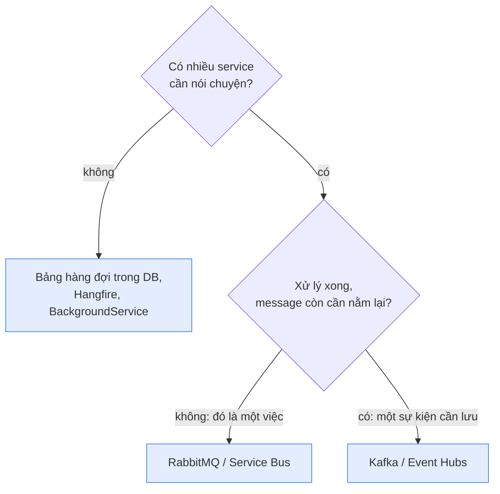
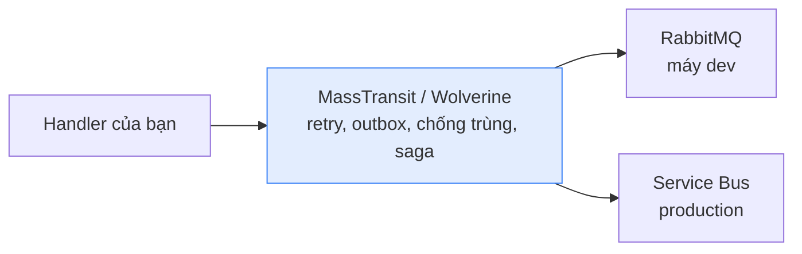
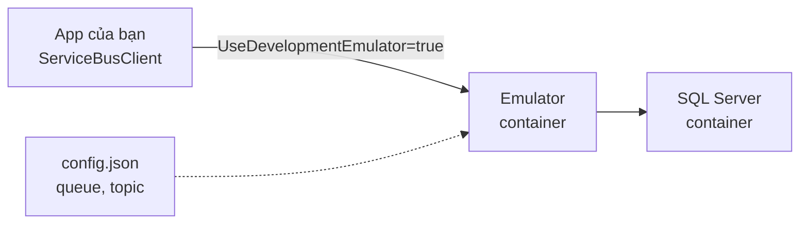

# Công cụ: broker, thư viện, chạy local

Gắn tên công cụ vào các khái niệm ở [Messaging](/architecture/messaging) và [Microservices](/architecture/microservices). Câu hay bị hỏi nhất là **Kafka hay RabbitMQ**, và câu trả lời nằm trọn trong hình ở mục 1.

<svg width="0" height="0" style="position:absolute" aria-hidden="true"><defs><marker id="tInk" viewBox="0 0 10 10" refX="8" refY="5" markerWidth="7" markerHeight="7" orient="auto-start-reverse"><path class="head" d="M0 0L10 5L0 10z"/></marker><marker id="tOk" viewBox="0 0 10 10" refX="8" refY="5" markerWidth="7" markerHeight="7" orient="auto-start-reverse"><path class="headOk" d="M0 0L10 5L0 10z"/></marker><marker id="tBad" viewBox="0 0 10 10" refX="8" refY="5" markerWidth="7" markerHeight="7" orient="auto-start-reverse"><path class="headBad" d="M0 0L10 5L0 10z"/></marker><marker id="tAcc" viewBox="0 0 10 10" refX="8" refY="5" markerWidth="7" markerHeight="7" orient="auto-start-reverse"><path class="headAcc" d="M0 0L10 5L0 10z"/></marker></defs></svg>

## 1. Hộp thư hay cuộn log {#kafka-vs-rabbitmq}

**RabbitMQ và Service Bus xoá message khi consumer xử lý xong. Kafka không xoá: message nằm lại tới hết hạn lưu, mỗi nhóm consumer chỉ giữ một dấu trang (offset) "đã đọc tới đâu".** Cả trang suy ra từ khác biệt này.

<svg viewBox="0 0 760 316" role="img" aria-label="Bên trái hộp thư: hai consumer chia nhau message, message xong bị xoá, message lỗi quá N lần vào DLQ. Bên phải cuộn log: message m1 tới m6 nằm lại theo offset, Shipping ở offset 2, Analytics ở offset 5, nhóm mới đọc lại từ 0">
<text x="190" y="22" font-size="13" font-weight="600" text-anchor="middle">Hộp thư: RabbitMQ, Service Bus</text>
<rect class="boxAcc" x="20" y="56" width="180" height="44" rx="8"/>
<g font-size="11" text-anchor="middle" class="mono"><rect class="box" x="32" y="66" width="40" height="24" rx="4"/><text x="52" y="82">m3</text><rect class="box" x="82" y="66" width="40" height="24" rx="4"/><text x="102" y="82">m4</text><rect class="box" x="132" y="66" width="40" height="24" rx="4"/><text x="152" y="82">m5</text></g>
<line class="ln" x1="200" y1="70" x2="264" y2="56" marker-end="url(#tInk)"/><text x="230" y="54" font-size="10" class="mono">m3</text>
<line class="ln" x1="200" y1="88" x2="264" y2="104" marker-end="url(#tInk)"/><text x="230" y="112" font-size="10" class="mono">m4</text>
<rect class="box" x="270" y="40" width="96" height="32" rx="6"/><text x="318" y="61" font-size="11.5" text-anchor="middle">consumer A</text>
<rect class="box" x="270" y="88" width="96" height="32" rx="6"/><text x="318" y="109" font-size="11.5" text-anchor="middle">consumer B</text>
<text x="318" y="138" font-size="10.5" text-anchor="middle" class="muted">chia nhau việc</text>
<rect class="boxBad dash" x="32" y="164" width="40" height="24" rx="4"/><text x="52" y="180" font-size="11" text-anchor="middle" class="mono badT">m2</text>
<line class="lnBad dash" x1="72" y1="176" x2="196" y2="176" marker-end="url(#tBad)"/><text x="134" y="168" font-size="10.5" text-anchor="middle" class="badT">lỗi quá N lần</text>
<rect class="boxBad" x="200" y="160" width="90" height="32" rx="6"/><text x="245" y="181" font-size="11.5" font-weight="600" text-anchor="middle" class="badT">DLQ</text>
<rect class="box dash" x="32" y="214" width="40" height="24" rx="4"/><text x="52" y="230" font-size="11" text-anchor="middle" class="mono muted">m1</text>
<text x="84" y="231" font-size="10.5" class="muted">Complete xong: đã xoá</text>
<text x="20" y="282" font-size="11.5">Xử lý xong là mất. Retry và DLQ cho từng message.</text>
<text x="20" y="300" font-size="11.5">Thêm consumer là chia việc ngay.</text>
<line class="lnMuted" x1="386" y1="14" x2="386" y2="304"/>
<text x="575" y="22" font-size="13" font-weight="600" text-anchor="middle">Cuộn log: Kafka</text>
<text x="400" y="52" font-size="10.5" class="muted">offset</text>
<g font-size="10" text-anchor="middle" class="muted"><text x="422" y="66">0</text><text x="474" y="66">1</text><text x="526" y="66">2</text><text x="578" y="66">3</text><text x="630" y="66">4</text><text x="682" y="66">5</text></g>
<g font-size="11" text-anchor="middle" class="mono"><rect class="box" x="400" y="72" width="44" height="26" rx="4"/><text x="422" y="89">m1</text><rect class="box" x="452" y="72" width="44" height="26" rx="4"/><text x="474" y="89">m2</text><rect class="box" x="504" y="72" width="44" height="26" rx="4"/><text x="526" y="89">m3</text><rect class="box" x="556" y="72" width="44" height="26" rx="4"/><text x="578" y="89">m4</text><rect class="box" x="608" y="72" width="44" height="26" rx="4"/><text x="630" y="89">m5</text><rect class="box" x="660" y="72" width="44" height="26" rx="4"/><text x="682" y="89">m6</text></g>
<line class="ln" x1="708" y1="85" x2="748" y2="85" marker-end="url(#tInk)"/><text x="728" y="112" font-size="10" text-anchor="middle" class="muted">ghi nối</text>
<path class="lnOk" d="M526 144 V104" marker-end="url(#tOk)"/><text x="526" y="160" font-size="10.5" text-anchor="middle" class="okT">Shipping ở 2</text>
<path class="lnAcc" d="M682 144 V104" marker-end="url(#tAcc)"/><text x="682" y="160" font-size="10.5" text-anchor="middle" class="accT">Analytics ở 5</text>
<path class="lnAcc dash" d="M422 196 V104" marker-end="url(#tAcc)"/><text x="422" y="212" font-size="10.5" text-anchor="middle" class="accT">nhóm mới: đọc lại từ 0</text>
<text x="400" y="282" font-size="11.5">Đọc xong không xoá, nằm lại tới hết hạn lưu.</text>
<text x="400" y="300" font-size="11.5">Mỗi nhóm một dấu trang, tua lại được.</text>
</svg>

Tự hỏi: service mới cần đọc đơn của tuần trước thì bên nào làm được? m2 lỗi mãi thì bên trái và bên phải khác nhau thế nào?

Bốn hệ quả, đều từ hình trên:

- **Đọc lại**: Kafka được (dời dấu trang về trước), hộp thư không (đã xoá).
- **Message lỗi**: hộp thư có retry, khoá, DLQ cho từng message. Kafka chỉ có dấu trang, nên một message lỗi chặn mọi message sau nó, trừ khi tự dựng retry topic.
- **Song song và thứ tự**: hộp thư thêm consumer là chia việc. Kafka chia topic thành nhiều partition (mỗi partition là một cuộn như hình); thứ tự chỉ đúng trong một partition, số consumer song song tối đa bằng số partition.
- **Lưu lượng**: Kafka ghi tuần tự xuống đĩa nên chịu được lượng rất lớn. Việc nghiệp vụ thông thường thì cả hai đều đủ.

Trên Azure: **Service Bus** là hộp thư, **Event Hubs** là cuộn log (nói được giao thức Kafka).

## 2. Khi nào chọn cái nào {#when-kafka}

- **Một việc cần làm** (gửi email, tạo vận đơn, xuất hoá đơn): mỗi việc một nơi làm, cần retry và DLQ từng message. Chọn hộp thư.
- **Một sự kiện cần lưu** (đơn hàng, click, thay đổi giá): nhiều bên đọc mỗi bên một tốc độ, cần đọc lại để dựng read model hay chạy lại sau khi sửa bug, lượng rất lớn. Chọn Kafka; cần thứ tự theo đơn thì dùng `OrderId` làm partition key.

Hệ thống lớn hay dùng cả hai: hộp thư cho lệnh giữa các service, Kafka cho dòng sự kiện sang analytics.

## 3. Thư viện messaging cho .NET {#dotnet-libraries}

SDK gốc (`Azure.Messaging.ServiceBus`, `RabbitMQ.Client`, `Confluent.Kafka`) chỉ gửi và nhận. Thư viện bọc thêm những thứ trang [Messaging](/architecture/messaging) dạy viết tay, và cho đổi broker mà không sửa handler:

- **MassTransit**: phổ biến nhất. Từ v9 trả phí; v8 miễn phí (Apache 2.0), hỗ trợ tới hết 2026.
- **NServiceBus**: thương mại, lâu đời. **Wolverine**: mã nguồn mở, mới hơn.

Broker và thư viện tính phí riêng: RabbitMQ, Kafka là mã nguồn mở (tự chạy chỉ tốn máy), Service Bus trả theo tier và số thao tác, SDK gốc đều miễn phí. Đổi broker qua thư viện vẫn phải test trên broker thật, vì session, giới hạn kích thước, filter không giống hệt nhau.

## 4. Chạy Service Bus ở máy dev {#service-bus-local}

"Service Bus không chạy local được" là thông tin cũ: có **Service Bus emulator** chạy bằng Docker.

Code giữ nguyên, chỉ đổi connection string. Dùng .NET Aspire thì `AddAzureServiceBus(...).RunAsEmulator()`. Giới hạn: không có portal, restart là mất dữ liệu, không có partition, message tối đa 256 KB.

## 5. Công cụ cho các vấn đề khác {#dotnet-tooling}

Công cụ che bớt việc viết tay, không xoá khái niệm. Nhớ theo vấn đề:

| Vấn đề | Công cụ |
|---|---|
| [Một cửa vào, routing](/architecture/microservices#api-gateway) | YARP, Ocelot; Azure API Management |
| [Gọi service chậm, lỗi](/architecture/microservices#cascading-failure) | `Microsoft.Extensions.Http.Resilience` (Polly) |
| [Theo một request qua nhiều service](/aspnet-core/logging#trace-a-500) | OpenTelemetry; xem trên Jaeger, Grafana, Application Insights |
| Chạy cả hệ thống ở máy dev | .NET Aspire, Docker Compose |
| Chạy production | Kubernetes, Azure Container Apps |
| Một API chung cho pub/sub, state, gọi service | Dapr (sidecar cạnh mỗi service) |

## Câu hỏi phỏng vấn {#interview}

### Kafka và RabbitMQ khác nhau thế nào? Khi nào chọn cái nào? <Badge type="warning" text="hay bị hỏi" /> {#kafka-vs-rabbitmq-q}

::: tip Trả lời nhanh
RabbitMQ (và Service Bus) là hộp thư: Complete thì xoá, retry và DLQ từng message. Kafka là log chỉ ghi nối: message nằm lại theo thời hạn lưu, mỗi nhóm consumer giữ offset riêng, đọc lại được, thứ tự theo partition. Giao việc chọn hộp thư; dòng sự kiện nhiều bên đọc, cần replay, lượng lớn chọn Kafka. Xem [Hộp thư hay cuộn log](#kafka-vs-rabbitmq) và [Khi nào chọn](#when-kafka).
:::

::: details Câu trả lời mẫu (English)
They have different models. RabbitMQ and Azure Service Bus are queue brokers: a consumer takes a message, and when it acknowledges, the message is gone. They give you per-message retries, locks and dead-lettering, and adding consumers simply spreads the work. Kafka is a distributed append-only log: messages stay for the retention period whether anyone read them or not, and each consumer group keeps its own offset. That gives replay and many independent readers, with ordering per partition, and parallelism limited by the number of partitions. But a failing message has no built-in dead-letter; you build retry topics yourself. So for commands and background jobs, like sending emails or creating shipments, I'd use a queue broker; for a high-volume event stream that several teams read and may need to replay, Kafka. On Azure that maps to Service Bus versus Event Hubs.
:::

::: warning Bẫy & follow-up
**"Kafka nhanh hơn nên dùng Kafka cho mọi thứ?"**

Nhanh hơn ở lưu lượng, nhưng mất retry và DLQ từng message, và một message lỗi có thể chặn cả partition. Chọn theo kiểu việc, không theo tốc độ.

**"Kafka có đảm bảo thứ tự không?"**

Chỉ trong một partition. Muốn mọi event của một đơn đi đúng thứ tự thì dùng OrderId làm key để chúng vào cùng partition.
:::

## Tự kiểm tra {#self-check}

1. Một service mới cần đọc toàn bộ đơn hàng của 30 ngày qua. Broker nào cho làm việc đó, vì sao cái kia không?
2. Gửi email xác nhận đơn: vì sao chọn hộp thư mà không chọn Kafka, dù Kafka chịu lưu lượng lớn hơn?
3. Dev local chạy RabbitMQ, production chạy Service Bus qua MassTransit. Cái gì có thể khác giữa hai môi trường?
