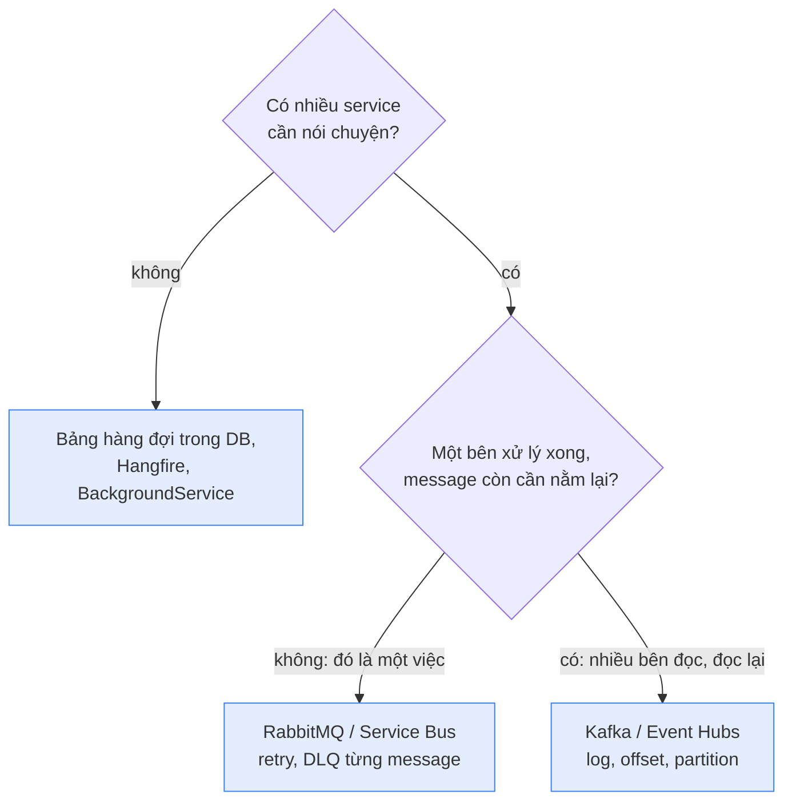

# Công cụ: broker, thư viện, chạy local

Trang [Messaging](/architecture/messaging) và [Microservices](/architecture/microservices) dạy khái niệm; trang này gắn tên công cụ vào từng khái niệm. Phỏng vấn thường hỏi "dùng gì cho X, vì sao", và câu đánh đố hay gặp là **Kafka hay RabbitMQ**. Mọi lựa chọn ở đây đều suy ra từ một khác biệt: broker **xoá** message khi xử lý xong (hộp thư), hay **giữ lại** (cuộn log). Công cụ chỉ che bớt việc phải viết tay, không xoá khái niệm: dùng MassTransit vẫn phải hiểu at-least-once.

<svg width="0" height="0" style="position:absolute" aria-hidden="true"><defs><marker id="msInk" viewBox="0 0 10 10" refX="8" refY="5" markerWidth="7" markerHeight="7" orient="auto-start-reverse"><path class="head" d="M0 0L10 5L0 10z"/></marker><marker id="msOk" viewBox="0 0 10 10" refX="8" refY="5" markerWidth="7" markerHeight="7" orient="auto-start-reverse"><path class="headOk" d="M0 0L10 5L0 10z"/></marker><marker id="msBad" viewBox="0 0 10 10" refX="8" refY="5" markerWidth="7" markerHeight="7" orient="auto-start-reverse"><path class="headBad" d="M0 0L10 5L0 10z"/></marker><marker id="msAcc" viewBox="0 0 10 10" refX="8" refY="5" markerWidth="7" markerHeight="7" orient="auto-start-reverse"><path class="headAcc" d="M0 0L10 5L0 10z"/></marker></defs></svg>

## 1. Kafka, RabbitMQ, Service Bus: hộp thư hay cuộn băng {#kafka-vs-rabbitmq}

**RabbitMQ và Azure Service Bus là broker kiểu hộp thư: consumer báo Complete thì message bị xoá. Kafka là một cuộn log chỉ ghi nối: message nằm lại tới hết hạn lưu (vd 7 ngày) dù đã đọc hay chưa, mỗi nhóm consumer tự giữ một dấu trang (offset) "đã đọc tới đâu".** Mọi khác biệt suy ra từ đó:

<svg viewBox="0 0 740 250" role="img" aria-label="Bên trái hộp thư: consumer lấy message ra và Complete thì message biến mất. Bên phải cuộn log: message nằm lại, mỗi nhóm consumer có một dấu trang offset riêng, có thể tua lại">
<text x="170" y="22" font-size="13" font-weight="600" text-anchor="middle">Hộp thư: RabbitMQ, Service Bus</text>
<text x="550" y="22" font-size="13" font-weight="600" text-anchor="middle">Cuộn log: Kafka</text>
<rect class="boxAcc" x="30" y="50" width="200" height="44" rx="8"/>
<g font-size="11" text-anchor="middle" class="mono"><rect class="box" x="44" y="60" width="40" height="24" rx="4"/><text x="64" y="76">m3</text><rect class="box" x="94" y="60" width="40" height="24" rx="4"/><text x="114" y="76">m4</text><rect class="box" x="144" y="60" width="40" height="24" rx="4"/><text x="164" y="76">m5</text></g>
<line class="ln" x1="230" y1="72" x2="276" y2="72" marker-end="url(#msInk)"/>
<rect class="box" x="280" y="52" width="70" height="40" rx="6"/><text x="315" y="76" font-size="11.5" text-anchor="middle">consumer</text>
<rect class="box dash" x="60" y="128" width="40" height="24" rx="4"/><text x="80" y="144" font-size="11" text-anchor="middle" class="mono muted">m1</text>
<rect class="box dash" x="110" y="128" width="40" height="24" rx="4"/><text x="130" y="144" font-size="11" text-anchor="middle" class="mono muted">m2</text>
<text x="170" y="145" font-size="11" class="muted">Complete rồi: đã xoá</text>
<text x="30" y="190" font-size="11">Mỗi message một người xử lý, retry và DLQ từng message.</text>
<text x="30" y="208" font-size="11">Đọc lại việc cũ: không được.</text>
<line class="lnMuted" x1="372" y1="14" x2="372" y2="236"/>
<g font-size="11" text-anchor="middle" class="mono"><rect class="box" x="400" y="60" width="40" height="24" rx="4"/><text x="420" y="76">m1</text><rect class="box" x="446" y="60" width="40" height="24" rx="4"/><text x="466" y="76">m2</text><rect class="box" x="492" y="60" width="40" height="24" rx="4"/><text x="512" y="76">m3</text><rect class="box" x="538" y="60" width="40" height="24" rx="4"/><text x="558" y="76">m4</text><rect class="box" x="584" y="60" width="40" height="24" rx="4"/><text x="604" y="76">m5</text></g>
<line class="ln" x1="630" y1="72" x2="700" y2="72" marker-end="url(#msInk)"/><text x="666" y="62" font-size="10.5" text-anchor="middle" class="muted">ghi nối</text>
<path class="lnOk" d="M512 120 V90" marker-end="url(#msOk)"/><text x="512" y="136" font-size="10.5" text-anchor="middle" class="okT">Shipping ở m3</text>
<path class="lnAcc" d="M604 160 V90" marker-end="url(#msAcc)"/><text x="604" y="176" font-size="10.5" text-anchor="middle" class="accT">Analytics ở m5</text>
<path class="lnAcc dash" d="M420 160 V90" marker-end="url(#msAcc)"/><text x="420" y="176" font-size="10.5" text-anchor="middle" class="accT">nhóm mới: đọc từ đầu</text>
<text x="400" y="208" font-size="11">Message nằm lại, mỗi nhóm một dấu trang, tua lại được.</text>
</svg>

Hộp thư: lấy ra là hết. Cuộn log: không ai lấy đi, chỉ có dấu trang của từng người đọc.

- **Đọc lại (replay)**: vì Kafka không xoá khi đọc, một service mới hoặc một bug fix có thể đọc lại event của tuần trước. Hộp thư không làm được, message đã Complete là mất.
- **Thứ tự và song song**: một topic Kafka chia thành nhiều partition; thứ tự chỉ đảm bảo trong một partition, và số consumer chạy song song trong một nhóm tối đa bằng số partition. Hộp thư thì thêm consumer là chia việc ngay (competing consumers); cần thứ tự thì Service Bus có session.
- **Lỗi từng message**: hộp thư có sẵn retry, khoá, DLQ cho từng message ([PeekLock](/architecture/messaging#peek-lock), [dead-letter](/architecture/messaging#dead-letter)). Kafka chỉ có offset: một message lỗi chặn cả partition phía sau nếu không tự dựng retry topic và DLQ topic.
- **Lưu lượng**: Kafka ghi tuần tự xuống đĩa nên chịu được lượng event rất lớn (click, log, telemetry). Với lượng việc nghiệp vụ thông thường thì cả ba đều đủ.

Chọn theo việc, không theo "cái nào nhanh hơn": **giao việc** cho một nơi xử lý (gửi email, tạo vận đơn, cần retry từng message) thì hộp thư; **dòng sự kiện** nhiều bên đọc, cần đọc lại, lượng lớn thì Kafka. Trên Azure: Service Bus là hộp thư; **Event Hubs** là kiểu log, nói được giao thức Kafka.

## 2. Khi nào chọn Kafka, khi nào RabbitMQ {#when-kafka}

Câu hỏi quyết định: **sau khi một bên xử lý xong, message còn cần nằm lại không?** Không cần thì hộp thư; cần (để bên khác đọc, để đọc lại) thì log.

**Chọn RabbitMQ (hoặc Service Bus) khi message là một việc cần làm:**
- Gửi email, tạo vận đơn, xuất hoá đơn, resize ảnh: mỗi việc một nơi làm, xong là thôi.
- Cần retry và dead-letter cho **từng** message, một message hỏng không được chặn các message khác.
- Cần routing linh hoạt (theo loại, theo khu vực) hoặc hẹn giờ gửi.
- Lượng vừa phải (vài trăm tới vài nghìn message mỗi giây), team nhỏ, muốn vận hành đơn giản.

**Chọn Kafka khi message là một sự kiện cần lưu lại:**
- Nhiều bên cùng đọc một dòng sự kiện, mỗi bên một tốc độ, thêm bên mới không ảnh hưởng ai: click, đơn hàng, thay đổi giá cho analytics, search, gợi ý.
- Cần **đọc lại**: dựng lại read model, chạy lại sau khi sửa bug, service mới đọc lịch sử từ đầu.
- Lượng rất lớn (log, telemetry, IoT, hàng trăm nghìn sự kiện mỗi giây) hoặc xử lý luồng (đếm, gom theo cửa sổ thời gian).
- Cần thứ tự theo một khoá (mọi sự kiện của cùng một đơn): dùng khoá đó làm partition key.

**Không cần cả hai** khi chỉ có một app và vài job nền: một bảng làm hàng đợi trong DB, Hangfire, hoặc `BackgroundService` là đủ. Nhiều hệ thống lớn dùng **cả hai**: Service Bus hay RabbitMQ cho lệnh giữa các service, Kafka hay Event Hubs cho dòng sự kiện đi sang analytics.

## 3. Thư viện messaging cho .NET {#dotnet-libraries}

Broker và thư viện là hai thứ tính phí riêng: RabbitMQ và Kafka là mã nguồn mở, tự chạy thì miễn phí (chỉ tốn máy); Service Bus là dịch vụ Azure trả theo tier và số thao tác; SDK gốc của cả ba đều miễn phí. Các SDK gốc (`Azure.Messaging.ServiceBus`, `RabbitMQ.Client`, `Confluent.Kafka`) chỉ gửi và nhận. Những thứ trang này dạy viết tay (retry, DLQ, outbox, chống trùng, saga) là phần thư viện bọc thêm:

- **MassTransit**: phổ biến nhất, một API cho RabbitMQ, Service Bus, Amazon SQS; có retry, outbox, saga state machine. Từ v9 là bản trả phí; v8 vẫn miễn phí (Apache 2.0), hỗ trợ tới hết 2026.
- **NServiceBus**: thương mại, lâu đời, mạnh về saga và vận hành.
- **Wolverine**: mã nguồn mở, mới hơn, gộp messaging và xử lý command.

Viết code qua abstraction của thư viện thì dev local chạy RabbitMQ, production chạy Service Bus mà không sửa handler. Nhưng hai broker không giống hệt nhau (session, giới hạn kích thước, filter), nên vẫn phải test trên đúng broker trước khi lên production.

## 4. Chạy Service Bus ở máy dev {#service-bus-local}

"Service Bus không chạy local được" là thông tin cũ. Microsoft có **Service Bus emulator** chạy bằng Docker: hai container, emulator và SQL Server Linux làm nơi lưu. Khai báo queue, topic, subscription trong một file `config.json`, rồi app trỏ vào bằng connection string có `UseDevelopmentEmulator=true`; code dùng `ServiceBusClient` y như với Azure. Dùng .NET Aspire thì một dòng `AddAzureServiceBus(...).RunAsEmulator()` trong AppHost tự dựng nó.

Emulator chỉ để dev và test: không có portal, dữ liệu mất khi restart container, không có partition, message tối đa 256 KB, tối đa 50 queue/topic. Thứ không giả lập được (quyền truy cập bằng Microsoft Entra ID, network) thì test trên một namespace Azure riêng cho dev.

## 5. Công cụ cho các vấn đề khác của microservices {#dotnet-tooling}

Mỗi công cụ dưới đây che đi một cái giá ở mục [Khi nào không nên tách](/architecture/microservices#when-not), không xoá khái niệm: dùng MassTransit vẫn phải hiểu at-least-once, dùng Polly vẫn phải chọn timeout. Phỏng vấn thường hỏi "dùng gì cho X, vì sao", nên nhớ theo vấn đề:

| Vấn đề | Công cụ hay gặp | Mục liên quan |
|---|---|---|
| Một cửa vào, routing | YARP, Ocelot; trên Azure: API Management | [API gateway](/architecture/microservices#api-gateway) |
| Gọi service chậm, lỗi | `Microsoft.Extensions.Http.Resilience` (Polly bên dưới) | [Cascading failure](/architecture/microservices#cascading-failure) |
| Gửi, nhận message | MassTransit, NServiceBus, Wolverine | [Thư viện messaging](#dotnet-libraries) |
| Theo một request qua nhiều service | OpenTelemetry; xem trên Jaeger, Grafana, Application Insights | [Trace một request](/aspnet-core/logging#trace-a-500) |
| Chạy cả hệ thống ở máy dev | .NET Aspire (AppHost chạy mọi service và container, gọi nhau bằng tên, có dashboard), Docker Compose | [Service discovery](/architecture/microservices#api-gateway) |
| Chạy production | Kubernetes, Azure Container Apps | [Service discovery](/architecture/microservices#api-gateway) |

**Dapr** đáng biết tên: một sidecar chạy cạnh mỗi service, cho một API chung cho pub/sub, state, gọi service khác; đổi broker bên dưới không phải sửa code. Đổi lại là thêm một thành phần phải vận hành.

## Câu hỏi phỏng vấn {#interview}

### Kafka và RabbitMQ khác nhau thế nào? Khi nào chọn cái nào? <Badge type="warning" text="hay bị hỏi" /> {#kafka-vs-rabbitmq-q}

::: tip Trả lời nhanh
RabbitMQ (và Service Bus) là hộp thư: Complete thì xoá, retry và DLQ từng message. Kafka là log chỉ ghi nối: message nằm lại theo thời hạn lưu, mỗi nhóm consumer giữ offset riêng, đọc lại được, thứ tự theo partition. Giao việc chọn hộp thư; dòng sự kiện nhiều bên đọc, cần replay, lượng lớn chọn Kafka. Xem [Hộp thư hay cuộn băng](#kafka-vs-rabbitmq) và [Khi nào chọn](#when-kafka).
:::

::: details Câu trả lời mẫu (English)
They have different models. RabbitMQ and Azure Service Bus are queue brokers: a consumer takes a message, and when it acknowledges, the message is gone. They give you per-message retries, locks and dead-lettering, and adding consumers simply spreads the work. Kafka is a distributed append-only log: messages stay for the retention period whether anyone read them or not, and each consumer group keeps its own offset. That gives replay and many independent readers, with ordering per partition, and parallelism limited by the number of partitions. But a failing message has no built-in dead-letter; you build retry topics yourself. So for commands and background jobs, like sending emails or creating shipments, I'd use a queue broker; for a high-volume event stream that several teams read and may need to replay, Kafka. On Azure that maps to Service Bus versus Event Hubs.
:::

::: warning Bẫy & follow-up
**"Kafka nhanh hơn nên dùng Kafka cho mọi thứ?"**

Nhanh hơn ở lưu lượng, nhưng mất retry và DLQ từng message, và một message lỗi có thể chặn cả partition. Chọn theo kiểu việc, không theo tốc độ.

**"Kafka có đảm bảo thứ tự không?"**

Chỉ trong một partition. Muốn mọi event của một đơn đi đúng thứ tự thì dùng OrderId làm key để chúng vào cùng partition.
:::

## Tự kiểm tra {#self-check}

1. Một service mới cần đọc toàn bộ đơn hàng của 30 ngày qua. Broker nào cho làm việc đó, vì sao cái kia không?
2. Gửi email xác nhận đơn: vì sao chọn hộp thư mà không chọn Kafka, dù Kafka chịu lưu lượng lớn hơn?
3. Dev local chạy RabbitMQ, production chạy Service Bus qua MassTransit. Cái gì có thể khác giữa hai môi trường?
