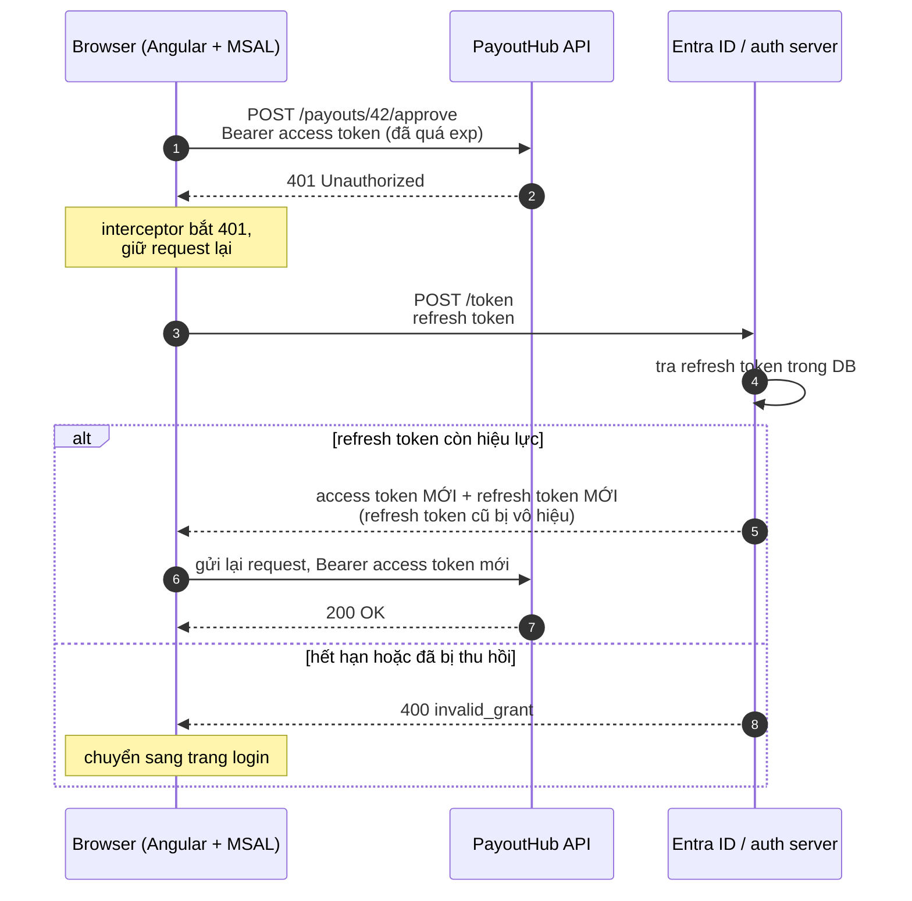
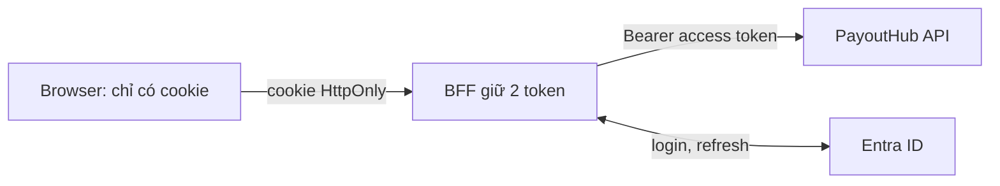

# Đăng nhập và JWT

Trang này đi sâu vào [bước 7 của Bảo mật API](/aspnet-core/api-security#step-7): API biết **bạn là ai** bằng cách nào. Đọc theo thứ tự: JWT chặn được gì, ai phát hành và ký token, các loại token, rồi chuyện hết hạn và bị trộm.

## 1. JWT chặn được gì, không chặn được gì {#what-jwt-blocks}

<T>JWT</T> gồm 3 phần `header.payload.signature`. **Header** nói thuật toán ký, **payload** chứa thông tin user (`sub`, `role`, `exp`), **signature** là một con số được **tính** từ header + payload bằng một khoá bí mật. Server không "giải mã" signature: nó **tính lại** từ header + payload nhận được, rồi so với signature trong token.

| Kẻ tấn công thử | Kết quả | Vì sao |
|---|---|---|
| Tự chế token "tôi là user 42" | **Chặn** | Không có khoá thì không tính ra signature đúng |
| Sửa token, đổi `role` thành `Admin` | **Chặn** | Payload đổi thì signature cũ không khớp nữa |
| Trộm nguyên token của chị Lan | **Không chặn** | Token thật, chưa bị sửa, server chấp nhận |

Giống **thẻ phòng khách sạn**: lễ tân chỉ đưa thẻ cho người xuất trình giấy tờ (bước **login**, password + <T>MFA</T>). Cửa phòng chỉ kiểm "thẻ do khách sạn này làm, còn hạn", không nhìn mặt người cầm. Nên câu "**ai là thật**" được trả lời **một lần lúc login**; JWT chỉ mang kết quả đó theo mỗi request.

::: info Dễ nhầm
**JWT được ký, không được mã hoá.** Payload chỉ là **Base64Url**: ai cầm token cũng decode được (dán vào jwt.io là đọc). Đừng bao giờ để số tài khoản, lương, dữ liệu bệnh nhân vào claim. Chữ ký chỉ đảm bảo **không ai sửa được**, không đảm bảo **không ai đọc được**.

Ba khái niệm hay bị lẫn:

| | Mục đích | Đảo ngược được? | Ví dụ |
|---|---|---|---|
| **Encoding** | Đổi format để truyền cho tiện | Có, ai cũng làm được, **không có khoá** | Base64, URL encoding, payload của JWT |
| **Encryption** | Giữ **bí mật** | Có, nhưng **chỉ người có khoá** | TLS, TDE, Always Encrypted |
| **Hashing** | "Dấu vân tay" một chiều, để so sánh | **Không** | Lưu mật khẩu (bcrypt, PBKDF2), checksum |

Ký số (signature) và HMAC dùng hashing + khoá để chứng minh **toàn vẹn và nguồn gốc**, không giữ bí mật.
:::

## 2. Ai phát hành và ký token {#issuing}

### Cách 1: server tự phát hành {#self-issued}

Một app vừa có `POST /login` vừa là API, thuật toán **HS256**:

1. Cài đặt một lần: dev sinh một **secret** ngẫu nhiên (32 byte trở lên), cất trong <T>Azure Key Vault</T> hoặc config, không để trong code.
2. `POST /login`: server so password với hash trong DB. Đúng thì tạo header `{alg: HS256}` và payload `{sub: 42, role: Approver, exp: +15 phút}`.
3. `signature = HMACSHA256(header + "." + payload, secret)`, trả token cho browser.
4. Request sau: JwtBearer **tính lại** HMAC bằng **cùng secret** đó, so với signature. Khớp thì đọc claim, lệch thì 401.

Chỉ có một secret, vì bên ký và bên kiểm là cùng một server. Nếu thêm service khác cần kiểm token, service đó cũng phải giữ secret, nghĩa là **ai kiểm được cũng ký được**.

### Cách 2: dùng nhà cung cấp {#identity-provider}

Chị Lan đăng nhập ở một <T>IdP</T> là <T k="entra id">Microsoft Entra ID</T>, theo chuẩn <T>OAuth 2.0</T> và <T>OpenID Connect</T>. Vẫn 4 bước như trên, **chỉ khác 2 chỗ**: ai làm bước login, và ai giữ khoá ký.

| Bước | Cách 1: tự phát hành | Cách 2: Entra ID |
|---|---|---|
| 1. Khoá | Dev sinh **1 secret** | Entra ID tự sinh **cặp key**: private key giữ kín, public key đăng công khai |
| 2. Login | `POST /login` của **PayoutHub** | Trang login của **Entra ID**, password không đi qua PayoutHub |
| 3. Ký | PayoutHub ký bằng secret | **Entra ID** ký bằng **private key** (<T>RS256</T>) |
| 4. Kiểm | PayoutHub tính lại bằng secret | PayoutHub kiểm bằng **public key** tải từ Entra ID |

Điểm mấu chốt của cặp key: **public key chỉ kiểm được, không ký được**. PayoutHub cầm public key thì biết token thật hay giả, nhưng nó (hay bất kỳ ai có public key) không làm ra token được. Chỉ Entra ID, nơi giữ private key, ký được.

<div class="fig">
<svg width="0" height="0" style="position:absolute" aria-hidden="true"><defs><marker id="jInk" viewBox="0 0 10 10" refX="8" refY="5" markerWidth="7" markerHeight="7" orient="auto-start-reverse"><path class="head" d="M0 0L10 5L0 10z"/></marker><marker id="jAcc" viewBox="0 0 10 10" refX="8" refY="5" markerWidth="7" markerHeight="7" orient="auto-start-reverse"><path class="headAcc" d="M0 0L10 5L0 10z"/></marker><marker id="jOk" viewBox="0 0 10 10" refX="8" refY="5" markerWidth="7" markerHeight="7" orient="auto-start-reverse"><path class="headOk" d="M0 0L10 5L0 10z"/></marker></defs></svg>
<svg viewBox="0 0 400 440" style="min-width:0;max-width:460px;margin:0 auto" role="img" aria-label="Entra ID giữ private key và ký token; browser chỉ chuyển token; API tải public key từ Entra ID một lần rồi tự kiểm chữ ký"><rect class="boxAcc" x="10" y="10" width="380" height="104" rx="10"/><text x="24" y="34" font-size="15" font-weight="600">Entra ID (IdP)</text><text x="24" y="56" font-size="12"><tspan class="accT" font-weight="600">🔑 private key:</tspan> chỉ Entra ID giữ, dùng để KÝ</text><text x="24" y="78" font-size="12"><tspan class="okT" font-weight="600">🔓 public key:</tspan> công khai (JWKS), ai cũng tải</text><text x="24" y="96" font-size="12">được, nhưng chỉ dùng để KIỂM chữ ký</text><line class="ln" x1="40" y1="196" x2="40" y2="120" marker-end="url(#jInk)"/><text x="48" y="150" font-size="12"><tspan font-weight="700" font-size="14">1.</tspan> đăng nhập</text><text x="48" y="166" font-size="11" class="muted">mật khẩu + MFA</text><line class="lnAcc" x1="150" y1="118" x2="150" y2="194" marker-end="url(#jAcc)"/><text x="158" y="150" font-size="12" class="accT"><tspan font-weight="700" font-size="14">2.</tspan> token</text><text x="158" y="166" font-size="11" class="accT">đã ký</text><line class="lnOk dash" x1="300" y1="118" x2="300" y2="194" marker-end="url(#jOk)"/><text x="308" y="150" font-size="12" class="okT"><tspan font-weight="700" font-size="14">3.</tspan> tải public key</text><text x="308" y="166" font-size="11" class="muted">1 lần, rồi cache</text><rect class="box" x="10" y="200" width="172" height="134" rx="10"/><text x="24" y="224" font-size="15" font-weight="600">Browser (chị Lan)</text><text x="24" y="246" font-size="12">chỉ cầm token,</text><text x="24" y="262" font-size="12" font-weight="600">không giữ key nào</text><text x="24" y="292" font-size="12"><tspan font-weight="700" font-size="14">4.</tspan> gửi request kèm</text><text x="24" y="308" font-size="12" class="mono">Bearer token</text><line class="ln" x1="184" y1="300" x2="222" y2="300" marker-end="url(#jInk)"/><text x="14" y="360" font-size="11" class="muted">Như cầm vé: ai cầm cũng dùng</text><text x="14" y="376" font-size="11" class="muted">được (bearer = người cầm)</text><rect class="boxOk" x="226" y="200" width="164" height="230" rx="10"/><text x="240" y="224" font-size="15" font-weight="600">PayoutHub API</text><text x="240" y="246" font-size="12" class="okT" font-weight="600">mỗi request, tự kiểm:</text><g font-size="12"><text x="240" y="268">a. đọc <tspan class="mono">kid</tspan> trong token</text><text x="240" y="284">   → chọn public key</text><text x="240" y="304">b. tính lại chữ ký,</text><text x="240" y="320">   so khớp signature</text><text x="240" y="340">c. <tspan class="mono">iss</tspan> đúng tenant?</text><text x="240" y="358">d. <tspan class="mono">aud</tspan> = PayoutHub?</text><text x="240" y="376">e. chưa quá <tspan class="mono">exp</tspan>?</text></g><text x="240" y="400" font-size="11" class="muted">không gọi Entra ID</text><text x="240" y="416" font-size="11" class="badT">sai bước nào → 401</text></svg>
<p class="fig-caption">Cách 2 vẽ ra. Private key không bao giờ rời Entra ID. Browser không giữ key nào, chỉ chuyển token.</p>
</div>

PayoutHub lấy public key ở đâu (bước 3 trên hình)? `Authority` trong code bên dưới là địa chỉ Entra ID. Lúc khởi động, JwtBearer tự gọi `{Authority}/.well-known/openid-configuration`, đọc `jwks_uri`, tải bộ public key (<T>JWKS</T>) và cache lại. Entra ID có nhiều key và **xoay vòng** định kỳ, nên header token ghi <T>kid</T> để API biết dùng key nào.

```csharp
// cần package Microsoft.AspNetCore.Authentication.JwtBearer (M3)
builder.Services.AddAuthentication(JwtBearerDefaults.AuthenticationScheme)
    .AddJwtBearer(o =>
    {
        // IdP cấp token; API tải public key từ đây để kiểm chữ ký
        o.Authority = "https://login.microsoftonline.com/<tenant-id>/v2.0";
        // token phải dành cho đúng API này (claim aud)
        o.Audience = "api://payouthub";
    });

app.UseAuthentication();
```

::: details Vì sao private key ký được còn public key thì không?
Vì toán học một chiều: **nhân 2 số nguyên tố rất lớn thì dễ, nhưng từ tích tách ngược ra 2 số đó thì gần như không thể**. Public key chứa cái tích. Private key được tính từ 2 số nguyên tố gốc, mà chỉ người sinh key biết.

Ví dụ đồ chơi (<T>RS256</T> thật dùng số dài khoảng 617 chữ số):

```text
Sinh key:  chọn 3 và 11 → n = 33.   Public = (n = 33, e = 3).   Private = d = 7 (tính được vì biết 3 và 11)

Ký:        hash của token = 4   →   signature = 4^7 mod 33 = 16      (cần d = 7)

Kiểm:      16^3 mod 33 = 4   →   bằng hash 4 → chữ ký đúng          (chỉ cần e = 3, n = 33)
```

Số 7 từ đâu ra? Từ 2 số bí mật 3 và 11:

```text
1. φ = (3 − 1) × (11 − 1) = 20
2. Tìm d sao cho (e × d) chia 20 dư 1:   3 × 7 = 21 = 20 + 1   →   d = 7
```

Ký là lũy thừa 7, kiểm là lũy thừa 3, gộp lại là lũy thừa 21. Định lý Euler nói: với n = 33, lũy thừa (1 + bội số của 20) luôn trả về đúng số ban đầu (4^21 mod 33 = 4). Nên "ký rồi kiểm" trả lại đúng hash.

Muốn giả chữ ký thì cần d. Muốn có d thì phải có φ = 20, tức là phải tách 33 thành 3 × 11. Với 33 thì dễ, với số 617 chữ số thì máy tính hiện nay chạy hàng tỷ năm cũng chưa xong. Nên public key đăng công khai mà không lộ private key.
:::

## 3. Access token, refresh token, ID token {#token-types}

**Token** là tên chung. **JWT** là một **định dạng** (cách viết token). **Access token**, **refresh token**, **ID token** là ba **công dụng**:

| | Dùng để | Gửi tới | Sống | Định dạng thường gặp |
|---|---|---|---|---|
| **Access token** | Gọi API, gửi kèm mỗi request | API | Ngắn: 15–60 phút (Entra ID mặc định 60–90) | JWT, API tự kiểm chữ ký |
| <T>Refresh token</T> | Đổi lấy access token mới | **Chỉ** IdP hoặc auth server | Dài: vài giờ tới 90 ngày | Chuỗi ngẫu nhiên (opaque), server lưu trong DB |
| **ID token** | Cho app client biết ai vừa đăng nhập (<T>OpenID Connect</T>) | App client | Ngắn | JWT, **không** gửi tới API |

Nên "JWT có phải token không?": có, JWT là một loại token. Access token **thường** là JWT, nhưng hai từ không đồng nghĩa.

## 4. Token hết hạn thì xử lý thế nào {#expiry}

User **không** phải đăng nhập lại mỗi 15 phút. Access token hết hạn thì client tự đổi ngầm, user không thấy gì. User chỉ phải đăng nhập lại khi **refresh token** hết hạn hoặc bị thu hồi.



Bước 1–2 là token cũ bị từ chối, bước 3–7 là đổi token ngầm. Interceptor (hoặc MSAL) làm hết, code gọi API không phải biết.

Vì sao phải tách hai loại? Access token **không thu hồi được**: API chỉ kiểm chữ ký và `exp`, không hỏi ai. Vì vậy cho nó sống ngắn. Refresh token **thu hồi được**: lần nào dùng, server cũng tra DB. Khi logout, đổi mật khẩu hay phát hiện bị trộm, server xoá refresh token, và chậm nhất một vòng `exp` sau kẻ trộm mất quyền. Thêm **rotation**: mỗi lần đổi là cấp refresh token mới, cái cũ hết hiệu lực. Nếu cái cũ bị dùng lại, server biết có người trộm và thu hồi cả chuỗi.

Thư viện như MSAL còn **làm mới trước** khi access token hết hạn (đọc `exp` ngay trong token), nên phần lớn thời gian user không gặp cả bước 401.

## 5. Token bị trộm thì sao {#stolen-token}

Chữ ký không cứu được trường hợp này, vì token bị trộm là token thật. Phải giữ token và giới hạn thiệt hại: đi qua <T>TLS</T> để không bị nghe lén; `exp` ngắn để trộm được cũng chỉ dùng được một lúc; không lưu token ở chỗ script lạ đọc được (<T>XSS</T>), `localStorage` nguy hiểm hơn cookie `HttpOnly`; nâng cao thì gắn token với key riêng của client (DPoP, mTLS) để trộm token thôi chưa đủ.

### Lưu token ở đâu {#token-storage}

Không phải client nào cũng cầm cả 2 token. SPA kiểu Angular + MSAL thì cầm. Kiểu <T>BFF</T> thì browser **không cầm token nào**. Trong browser có 5 chỗ:

| Chỗ | JavaScript đọc được? | <T>XSS</T> lấy token mang đi được? | Ghi chú |
|---|---|---|---|
| `localStorage` | Có | **Có** | Còn sau khi đóng tab. Tệ nhất cho refresh token |
| `sessionStorage` | Có | **Có** | Mất khi đóng tab. MSAL mặc định dùng |
| Biến trong RAM | Có | Khó hơn | Reload trang là mất, phải xin token lại |
| Cookie `HttpOnly; Secure` | **Không** | Không | Browser tự gửi kèm, nên phải chống <T>CSRF</T> (`SameSite` + anti-forgery token) |
| <T>BFF</T> | Không có token | Không | Browser chỉ có cookie session. BFF là một server ASP.NET Core nhỏ cùng domain, giữ cả 2 token, tự gắn token khi gọi API và tự refresh |



Chọn theo loại app:

- **App y tế, tài chính** (ASW, PayoutHub): BFF. Không nhất thiết là hệ thống riêng: thường chính app ASP.NET Core phục vụ file Angular kiêm luôn BFF, dùng <T>YARP</T> chuyển request sang API. BFF dùng cookie nên vẫn phải [chống CSRF](#csrf).
- **SPA bình thường**: access token trong RAM, refresh token trong cookie `HttpOnly` giới hạn `Path=/auth/refresh`.
- **Mobile**: Keychain (iOS), Keystore (Android).
- **Service gọi service**: không có refresh token. Dùng client credentials với secret trong <T>Azure Key Vault</T>, hoặc <T>managed identity</T> để khỏi cần secret.

Không chỗ nào trong browser an toàn tuyệt đối trước XSS: khi trang đang mở, script độc vẫn gọi API được dưới tên user. Cookie `HttpOnly` và BFF chỉ ngăn script **mang token đi dùng ở chỗ khác, sau này**. Vẫn phải chặn XSS từ gốc bằng <T>output encoding</T> và <T>CSP</T>.

### Chống CSRF khi dùng cookie {#csrf}

Cookie `HttpOnly` và BFF chặn được XSS lấy token, nhưng đổi lại mở ra <T>CSRF</T>: **browser tự gắn cookie** vào mọi request tới domain của nó, kể cả request do trang khác khởi tạo.

```text
Chị Lan đang đăng nhập PayoutHub, mở thêm tab evil.com. Trang đó có form ẩn tự submit:

   <form method="POST" action="https://payouthub.com/payouts/42/approve">

browser gửi request → TỰ GẮN cookie của payouthub.com → server thấy cookie hợp lệ → duyệt tiền
```

Kẻ tấn công không đọc được cookie hay response, chỉ **mượn browser** của chị Lan để gửi lệnh. Bearer token trong header thì không bị, vì browser không tự gắn header và evil.com không đọc được token. Hai hàng rào, dùng cả hai:

**1. `SameSite` trên cookie**: browser có gửi cookie khi request đến từ site khác không.

| Giá trị | Request từ site khác | Ghi chú |
|---|---|---|
| `Strict` | Không bao giờ gửi cookie | Chặn chắt nhất; bấm link từ email vào thì chưa thấy đăng nhập |
| `Lax` | Chỉ gửi khi user bấm link (GET chuyển trang) | Mặc định của browser hiện đại. **Không** gửi với POST hay `fetch` từ site khác |
| `None` | Luôn gửi (bắt buộc kèm `Secure`) | Không có bảo vệ |

Chưa đủ vì "site" tính theo domain gốc: subdomain bị chiếm (vd `blog.payouthub.com`) vẫn là cùng site, và browser cũ có thể không hỗ trợ.

**2. Anti-forgery token**: một con số ngẫu nhiên mà request thay đổi dữ liệu phải gửi lại trong **header**.

```text
1. Server set cookie XSRF-TOKEN=abc123      (KHÔNG HttpOnly, để JavaScript đọc được)
2. Angular HttpClient tự đọc cookie, gắn header X-XSRF-TOKEN: abc123 vào POST/PUT/DELETE
3. Server so header với token nó đã phát → khớp thì cho qua

evil.com không đọc được cookie của payouthub.com (same-origin policy)
→ không biết abc123 → không gắn được header → 400
```

```csharp
builder.Services.AddAntiforgery(o => o.HeaderName = "X-XSRF-TOKEN");

// Controller: kiểm token cho mọi POST/PUT/PATCH/DELETE (GET, HEAD, OPTIONS được bỏ qua)
builder.Services.AddControllers(o => o.Filters.Add(new AutoValidateAntiforgeryTokenAttribute()));

// Angular gọi endpoint này sau khi login để nhận cookie XSRF-TOKEN
app.MapGet("/antiforgery/token", (IAntiforgery af, HttpContext ctx) =>
{
    var tokens = af.GetAndStoreTokens(ctx);

    ctx.Response.Cookies.Append("XSRF-TOKEN", tokens.RequestToken!,
        new CookieOptions { HttpOnly = false, Secure = true, SameSite = SameSiteMode.Strict });

    return Results.NoContent();
});
```

Phía Angular gần như không phải code: `HttpClient` mặc định đọc cookie `XSRF-TOKEN` và gửi header `X-XSRF-TOKEN`.

Thêm một quy tắc: **không dùng GET để thay đổi dữ liệu**, vì `SameSite=Lax` vẫn gửi cookie với GET chuyển trang.

## Câu hỏi phỏng vấn {#interview}

### JWT bị trộm thì sao? {#stolen-token-question}

::: tip Trả lời nhanh
JWT là bearer token: ai cầm cũng dùng được tới `exp`, chữ ký chỉ chống **giả** và **sửa**, không chống **trộm**. Nên: chỉ gửi qua TLS, access token sống ngắn, không lưu ở `localStorage` (XSS đọc được), dùng refresh token có rotation để thu hồi được, và với hệ thống nhạy cảm thì gắn token với client (DPoP, mTLS).
:::

### Access token và refresh token khác nhau thế nào? Hết hạn thì sao? {#access-vs-refresh}

::: tip Trả lời nhanh
Access token gửi tới API mỗi request, thường là JWT, sống ngắn và **không thu hồi được**. Refresh token chỉ gửi tới auth server để đổi access token mới, sống lâu, server lưu trong DB nên **thu hồi được**. Access token hết hạn thì client tự đổi ngầm bằng refresh token; user chỉ đăng nhập lại khi refresh token hết hạn hoặc bị thu hồi. Mỗi lần đổi cấp refresh token mới (rotation), token cũ bị dùng lại là dấu hiệu bị trộm.
:::

### Vì sao dùng RS256 thay vì HS256 khi có nhiều service? {#rs256-vs-hs256}

::: tip Trả lời nhanh
HS256 dùng một secret chung: service nào kiểm được token thì cũng ký được token, lộ một chỗ là lộ hết. RS256 tách ra: chỉ auth server giữ private key để ký, các service khác chỉ cần public key (tải từ JWKS) để kiểm, không giả được token.
:::

### CSRF là gì? Chặn thế nào? {#csrf-question}

::: tip Trả lời nhanh
Trang lạ khiến browser của user gửi request tới app của bạn, browser tự gắn cookie nên request được xác thực. Chỉ xảy ra khi xác thực bằng cookie, không xảy ra với Bearer token trong header. Chặn bằng: cookie `SameSite=Lax/Strict`, anti-forgery token gửi trong header (ASP.NET Core `AddAntiforgery`, Angular tự gửi `X-XSRF-TOKEN`), và không đổi dữ liệu bằng GET.
:::

### SPA nên lưu token ở đâu? {#token-storage-question}

::: tip Trả lời nhanh
Không để refresh token ở `localStorage`: XSS đọc được và mang đi. SPA thông thường: access token trong RAM, refresh token trong cookie `HttpOnly; Secure; SameSite` và chống CSRF. App nhạy cảm (y tế, tài chính): dùng BFF, browser chỉ giữ cookie session, token nằm ở server. Dù chọn cách nào vẫn phải chặn XSS bằng output encoding và CSP, vì script độc vẫn gọi API được khi trang đang mở.
:::
