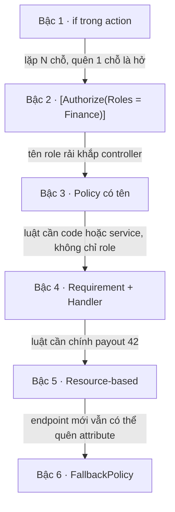
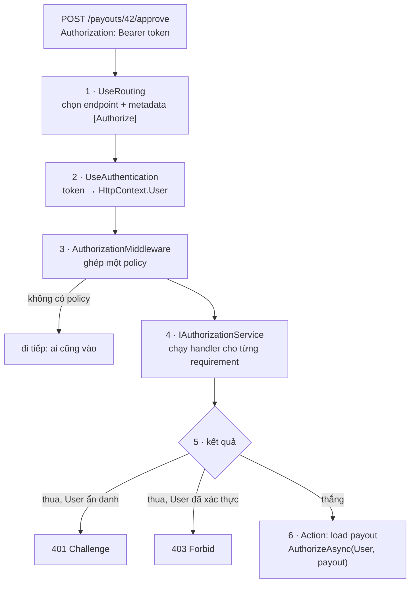

# Authorization: bạn được làm gì

<T>Authorization</T> trả lời câu "**bạn được làm gì**", sau khi <T>authentication</T> đã trả lời "bạn là ai". Trang này đi qua: vì sao không tự viết `if` trong action, ASP.NET Core quyết định cho qua, 401 hay 403 như thế nào, luật "requirement và handler" đánh giá một policy ra sao, khi luật cần chính object (payout 43 của ai) thì làm gì, và cách chặn mặc định mọi endpoint quên gắn `[Authorize]`.

Đọc trước: [Authentication: mỗi request từ Bearer token tới `HttpContext.User`](/aspnet-core/authentication-jwt#per-request), vì authorization chỉ đọc `User` mà bước đó dựng ra. Bức tranh bảo mật cả request: [Bảo mật API](/aspnet-core/api-security#flow).

PayoutHub hiện **chưa có** authentication và authorization trong `Program.cs` (việc của M3). Code trong trang là cái sẽ viết. Ví dụ xuyên suốt: chị Lan (role `Finance`, công ty A) gọi `POST /payouts/42/approve`.

<svg width="0" height="0" style="position:absolute" aria-hidden="true"><defs><marker id="zInk" viewBox="0 0 10 10" refX="8" refY="5" markerWidth="7" markerHeight="7" orient="auto-start-reverse"><path class="head" d="M0 0L10 5L0 10z"/></marker><marker id="zOk" viewBox="0 0 10 10" refX="8" refY="5" markerWidth="7" markerHeight="7" orient="auto-start-reverse"><path class="headOk" d="M0 0L10 5L0 10z"/></marker><marker id="zBad" viewBox="0 0 10 10" refX="8" refY="5" markerWidth="7" markerHeight="7" orient="auto-start-reverse"><path class="headBad" d="M0 0L10 5L0 10z"/></marker><marker id="zAcc" viewBox="0 0 10 10" refX="8" refY="5" markerWidth="7" markerHeight="7" orient="auto-start-reverse"><path class="headAcc" d="M0 0L10 5L0 10z"/></marker></defs></svg>

## Bản đồ chủ đề {#topic-map}

<div class="fig">
<svg viewBox="0 0 720 422" role="img" aria-label="Bản đồ chủ đề authorization: sáu ô, mỗi ô một mục của trang">
<a href="#problem" style="text-decoration:none"><g transform="translate(10,10)">
<rect class="box" x="0" y="0" width="228" height="196" rx="10"/>
<text x="14" y="26" font-size="14" font-weight="600">Luật quyền rải khắp action</text>
<rect class="box" x="14" y="42" width="200" height="30" rx="6"/><text x="24" y="62" font-size="11" class="mono">Approve(): if (!IsInRole…)</text>
<rect class="box" x="14" y="80" width="200" height="30" rx="6"/><text x="24" y="100" font-size="11" class="mono">Reject(): if (!IsInRole…)</text>
<rect class="box dash" x="14" y="118" width="200" height="30" rx="6"/><text x="24" y="138" font-size="11" class="mono muted">Export(): …</text><text x="200" y="138" font-size="12" font-weight="700" text-anchor="end" class="badT">quên!</text>
<text x="14" y="178" font-size="12" class="muted">đổi luật = sửa N chỗ</text>
</g></a>
<a href="#evolution" style="text-decoration:none"><g transform="translate(246,10)">
<rect class="box" x="0" y="0" width="228" height="196" rx="10"/>
<text x="14" y="26" font-size="14" font-weight="600">Bậc thang: if → policy</text>
<line class="ln" x1="34" y1="40" x2="34" y2="178"/><line class="ln" x1="62" y1="40" x2="62" y2="178"/>
<line class="lnAcc" x1="34" y1="166" x2="62" y2="166"/><line class="lnAcc" x1="34" y1="138" x2="62" y2="138"/><line class="lnAcc" x1="34" y1="110" x2="62" y2="110"/><line class="lnAcc" x1="34" y1="82" x2="62" y2="82"/><line class="lnAcc" x1="34" y1="54" x2="62" y2="54"/>
<line class="lnAcc" x1="18" y1="176" x2="18" y2="48" marker-end="url(#zAcc)"/>
<g font-size="11.5"><text x="72" y="170">if trong action</text><text x="72" y="142" class="mono">[Authorize(Roles)]</text><text x="72" y="114">Policy có tên</text><text x="72" y="86">Requirement + Handler</text><text x="72" y="58">Resource-based</text></g>
</g></a>
<a href="#flow" style="text-decoration:none"><g transform="translate(482,10)">
<rect class="box" x="0" y="0" width="228" height="196" rx="10"/>
<text x="14" y="26" font-size="14" font-weight="600">Một request qua AuthZ</text>
<path class="boxAcc" d="M14 46 h82 l8 12 l-8 12 h-82 z"/><text x="57" y="62" font-size="11" text-anchor="middle" class="mono accT">[Authorize]</text>
<line class="ln" x1="106" y1="58" x2="126" y2="58" marker-end="url(#zInk)"/>
<rect class="boxOk" x="130" y="44" width="84" height="28" rx="6"/><text x="172" y="63" font-size="12" text-anchor="middle" class="okT" font-weight="600">policy</text>
<line class="ln" x1="154" y1="72" x2="44" y2="104" marker-end="url(#zInk)"/><line class="ln" x1="172" y1="72" x2="114" y2="104" marker-end="url(#zInk)"/><line class="ln" x1="186" y1="72" x2="184" y2="104" marker-end="url(#zInk)"/>
<rect class="boxBad" x="14" y="108" width="60" height="26" rx="6"/><text x="44" y="126" font-size="13" text-anchor="middle" font-weight="700" class="badT">401</text>
<rect class="boxBad" x="84" y="108" width="60" height="26" rx="6"/><text x="114" y="126" font-size="13" text-anchor="middle" font-weight="700" class="badT">403</text>
<rect class="boxOk" x="154" y="108" width="60" height="26" rx="6"/><text x="184" y="126" font-size="13" text-anchor="middle" font-weight="700" class="okT">✓</text>
<g font-size="11" text-anchor="middle" class="muted"><text x="44" y="150">ẩn danh</text><text x="114" y="150">thiếu quyền</text><text x="184" y="150">action</text></g>
<text x="14" y="180" font-size="12" class="badT" font-weight="600">401 chưa biết bạn · 403 không cho</text>
</g></a>
<a href="#requirements" style="text-decoration:none"><g transform="translate(10,216)">
<rect class="box" x="0" y="0" width="228" height="196" rx="10"/>
<text x="14" y="26" font-size="14" font-weight="600">Requirement × handler</text>
<g font-size="11" text-anchor="middle" class="muted"><text x="114" y="46">H1</text><text x="150" y="46">H2</text></g>
<text x="14" y="68" font-size="11.5">R1 role</text><rect class="box" x="98" y="54" width="32" height="22" rx="4"/><text x="114" y="70" font-size="13" text-anchor="middle" class="okT" font-weight="700">✓</text><rect class="box" x="134" y="54" width="32" height="22" rx="4"/><text x="150" y="70" font-size="12" text-anchor="middle" class="muted">–</text><text x="196" y="70" font-size="13" text-anchor="middle" class="okT" font-weight="700">✓</text>
<text x="14" y="98" font-size="11.5">R2 active</text><rect class="box" x="98" y="84" width="32" height="22" rx="4"/><text x="114" y="100" font-size="12" text-anchor="middle" class="muted">–</text><rect class="box" x="134" y="84" width="32" height="22" rx="4"/><text x="150" y="100" font-size="13" text-anchor="middle" class="okT" font-weight="700">✓</text><text x="196" y="100" font-size="13" text-anchor="middle" class="okT" font-weight="700">✓</text>
<line class="lnMuted" x1="14" y1="114" x2="214" y2="114"/>
<text x="14" y="132" font-size="11.5" class="okT">mọi requirement ✓ → qua</text>
<text x="14" y="158" font-size="11.5" class="badT" font-weight="600">1 Fail() thắng mọi Succeed</text>
<text x="14" y="180" font-size="11.5" class="badT" font-weight="600">2 [Authorize] = AND · "A,B" = OR</text>
</g></a>
<a href="#resource-based" style="text-decoration:none"><g transform="translate(246,216)">
<rect class="box" x="0" y="0" width="228" height="196" rx="10"/>
<text x="14" y="26" font-size="14" font-weight="600">Resource-based: cần object</text>
<path class="boxAcc" d="M14 48 h84 l8 12 l-8 12 h-84 z"/><text x="56" y="64" font-size="11" text-anchor="middle" class="mono accT">[Authorize]</text>
<line class="lnBad dash" x1="108" y1="60" x2="138" y2="60"/><text x="123" y="54" font-size="14" text-anchor="middle" class="badT" font-weight="700">✗</text>
<rect class="boxOk" x="142" y="42" width="80" height="38" rx="6"/><text x="182" y="58" font-size="11.5" text-anchor="middle" class="mono">payout</text><text x="182" y="73" font-size="10.5" text-anchor="middle" class="muted">CreatedBy?</text>
<rect class="box" x="14" y="104" width="92" height="30" rx="6"/><text x="60" y="124" font-size="11.5" text-anchor="middle">trong action</text>
<line class="lnOk" x1="106" y1="118" x2="160" y2="82" marker-end="url(#zOk)"/>
<text x="118" y="140" font-size="11" class="mono okT">AuthorizeAsync</text>
<text x="14" y="180" font-size="11.5" class="badT" font-weight="600">attribute chạy trước khi có object</text>
</g></a>
<a href="#deny-by-default" style="text-decoration:none"><g transform="translate(482,216)">
<rect class="box" x="0" y="0" width="228" height="196" rx="10"/>
<text x="14" y="26" font-size="14" font-weight="600">Deny by default</text>
<rect class="box" x="14" y="44" width="100" height="28" rx="6"/><text x="64" y="62" font-size="11.5" text-anchor="middle" class="mono">[Authorize]</text>
<line class="lnOk" x1="114" y1="58" x2="150" y2="58" marker-end="url(#zOk)"/><text x="156" y="62" font-size="12" class="okT" font-weight="600">policy</text>
<rect class="box dash" x="14" y="94" width="100" height="28" rx="6"/><text x="64" y="112" font-size="11.5" text-anchor="middle" class="muted">quên tag</text>
<line class="lnAcc" x1="114" y1="108" x2="148" y2="108" marker-end="url(#zAcc)"/>
<path class="lnAcc" d="M158 102 v-6 a8 8 0 0 1 16 0 v6"/><rect class="boxAcc" x="153" y="102" width="26" height="20" rx="3"/>
<text x="186" y="117" font-size="12" class="accT" font-weight="700">401</text>
<text x="14" y="148" font-size="11" class="mono accT">FallbackPolicy</text>
<text x="14" y="180" font-size="11.5" class="badT" font-weight="600">mặc định: không tag = public</text>
</g></a>
</svg>
<p class="fig-caption">Mỗi ô một mục, bấm để tới. Chữ đỏ là bẫy hay bị hỏi. Ôn lại: nhìn ô "Requirement × handler" và tự giải thích vì sao hai <code>[Authorize]</code> là AND.</p>
</div>

## 1. Vấn đề: luật quyền rải khắp action {#problem}

**Nếu mỗi action tự kiểm quyền, luật quyền nằm ở N chỗ và chỉ cần quên một chỗ là hở.** Đây là cách viết khi chưa có authorization của framework:

```csharp
[HttpPost("{id:int}/approve")]
public async Task<IActionResult> Approve(int id, CancellationToken ct)
{
    if (User.Identity?.IsAuthenticated != true) return Unauthorized();
    if (!User.IsInRole("Finance")) return Forbid();
    // ... duyệt payout
}
```

- **Lặp và quên**: `Reject`, `Export`, mỗi action mới phải chép lại. Endpoint quên dòng này thì ai đăng nhập cũng gọi được.
- **Đổi luật sửa N chỗ**: "Finance hoặc Admin" nghĩa là đi tìm mọi chỗ có `"Finance"`.
- **Chạy muộn**: action đã chạy model binding và validation rồi mới bị từ chối, và không middleware nào khác (rate limiter theo user, Swagger) biết endpoint này cần quyền gì.

## 2. Bậc thang: từ `if` tới policy {#evolution}

**Mỗi bậc chuyển luật quyền ra khỏi action thêm một chút, để framework đọc được và kiểm trước khi code của bạn chạy.** Mỗi mũi tên là cái đau của bậc dưới:



**Bậc 2**: luật thành **metadata** gắn trên endpoint. Middleware `UseAuthorization` đọc nó trước khi action chạy.

```csharp
[Authorize(Roles = "Finance")]
public async Task<IActionResult> Approve(int id, CancellationToken ct) { ... }
```

**Bậc 3**: controller chỉ ghi **tên** luật, nội dung luật nằm một chỗ trong `Program.cs`. Đổi "Finance hoặc Admin" là sửa một dòng.

```csharp
builder.Services.AddAuthorizationBuilder()
    .AddPolicy("CanApprovePayout", p => p.RequireRole("Finance", "Admin"));

[Authorize(Policy = "CanApprovePayout")]
```

Điểm mấu chốt: `[Authorize(Roles = "Finance")]` cũng chỉ là một policy không tên, chứa một requirement "có role Finance". **Role-based, claims-based hay policy-based đều chạy chung một cơ chế**: policy là danh sách requirement. Bậc 4, 5, 6 có mục riêng: [requirement + handler](#requirements), [resource-based](#resource-based), [FallbackPolicy](#deny-by-default).

## 3. Luồng một request qua authorization {#flow}

**`UseAuthorization` không tự biết luật nào: nó đọc metadata của endpoint mà routing đã chọn, ghép thành một policy, nhờ `IAuthorizationService` chạy các handler, rồi đổi kết quả thành 401, 403 hoặc cho đi tiếp.** Bản đồ các thành phần:



<FlowStep :n="1" title="Routing chọn endpoint, kèm metadata [Authorize]" layer="ASP.NET Core" icon="tag">

**Authorization chạy được trước action vì routing đã chọn endpoint từ trước, và endpoint mang theo các attribute của controller lẫn action dưới dạng metadata.** Nên `UseAuthorization` phải đứng **sau** `UseRouting`: đứng trước thì chưa có endpoint, không đọc được `[Authorize]` nào. Xem [Middleware: Routing](/aspnet-core/middleware#middleware).

Ở đây endpoint `PayoutsController.Approve` mang `[Authorize(Policy = "CanApprovePayout")]`.

</FlowStep>

<FlowStep :n="2" title="Authentication đã dựng HttpContext.User" layer="ASP.NET Core" icon="principal">

**Authorization chỉ đọc `HttpContext.User`, không đọc token.** `UseAuthentication` đứng trước đã kiểm JWT và biến claim thành <T>ClaimsPrincipal</T>: `sub=42`, `role=Finance`, `tenant_id=A`. Token sai hoặc thiếu thì `User` **ẩn danh**, request vẫn đi tiếp tới đây. Chi tiết: [Authentication: mỗi request](/aspnet-core/authentication-jwt#per-request).

Vì vậy `UseAuthentication` phải đứng trước `UseAuthorization`. Đảo ngược thì lúc kiểm quyền `User` còn rỗng, mọi endpoint có `[Authorize]` đều 401.

</FlowStep>

<FlowStep :n="3" title="Ghép mọi [Authorize] thành một policy" layer="ASP.NET Core" icon="combine">

**Middleware gom mọi `[Authorize]` của endpoint (cấp class và cấp action) thành một policy duy nhất chứa tất cả requirement.** Từ một quy tắc ghép đó suy ra:

- `[Authorize]` không tham số → `DefaultPolicy`, mặc định chỉ có một requirement: **đã đăng nhập**.
- Class có `[Authorize]`, action có thêm `[Authorize(Policy = "CanApprovePayout")]` → phải thoả **cả hai** ([AND hay OR](#and-or)).
- Endpoint có `[AllowAnonymous]` → bỏ qua bước kiểm, đi tiếp. Gắn ở action thì thắng `[Authorize]` ở class.
- Endpoint **không có** gì → dùng `FallbackPolicy`. Mặc định FallbackPolicy là `null`, nên request **đi thẳng**: endpoint quên attribute là public. Sửa ở [deny by default](#deny-by-default).

</FlowStep>

<FlowStep :n="4" title="IAuthorizationService chạy handler cho từng requirement" layer="ASP.NET Core" icon="handlers">

**Policy chỉ là danh sách requirement; quyết định đúng sai nằm ở các handler.** `IAuthorizationService` gọi lần lượt mọi `IAuthorizationHandler` đã đăng ký trong DI, mỗi handler xem các requirement nó hiểu và gọi `context.Succeed(requirement)` hoặc `context.Fail()`.

Policy `CanApprovePayout` của chị Lan có hai requirement: "role Finance" (requirement này tự xử lý, không cần handler riêng) và "chưa bị khoá" (do `NotSuspendedHandler` xử lý). Luật thắng thua ở [mục 4](#requirements).

</FlowStep>

<FlowStep :n="5" title="Kết quả: 401, 403 hay đi tiếp" layer="ASP.NET Core" icon="verdict">

**Middleware không hỏi "vì sao thua", chỉ hỏi "User đã xác thực chưa" để chọn mã lỗi.**

- Thắng → gọi `next()`, action chạy.
- Thua và `User` **ẩn danh** → *Challenge* trên scheme JwtBearer → **401** kèm `WWW-Authenticate: Bearer`. Client sửa được bằng token mới.
- Thua và `User` **đã xác thực** → *Forbid* → **403**. Gửi lại cùng token vẫn 403.

Nên controller không tự viết `return Unauthorized()` hay `Forbid()` cho luật đã nằm trong policy. Bảng status code đầy đủ: [REST API: 401 và 403](/aspnet-core/rest-api#auth-codes).

</FlowStep>

<FlowStep :n="6" title="Trong action: kiểm quyền trên chính payout 42" layer="Your code" icon="idor">

**Bước 1–5 chạy trước khi action load dữ liệu, nên chúng không biết payout 42 thuộc công ty nào hay ai tạo ra nó.** Luật cần object thì kiểm **trong** action, sau khi load: lọc query theo tenant, rồi gọi `IAuthorizationService.AuthorizeAsync(User, payout, requirement)`. Chi tiết ở [mục 5](#resource-based).

</FlowStep>

## 4. Requirement và handler: luật thắng thua {#requirements}

**Một policy qua khi mọi requirement đều được ít nhất một handler gọi `Succeed`, và không handler nào gọi `Fail()`.** Requirement là cái nhãn "cần gì", handler là code "kiểm thế nào". Ba người gọi cùng endpoint `CanApprovePayout`:

<div class="fig">
<svg viewBox="0 0 720 262" role="img" aria-label="Ba người gọi CanApprovePayout: Lan qua vì cả hai requirement được Succeed; Minh role Ops nên requirement role còn treo, 403; Hùng bị khoá, handler gọi Fail, 403 dù role đúng">
<g font-size="13" font-weight="600" text-anchor="middle"><text x="240" y="24">Lan · Finance</text><text x="420" y="24">Minh · Ops</text><text x="600" y="24">Hùng · Finance, bị khoá</text></g>
<text x="10" y="66" font-size="13" font-weight="600">R1 · role Finance</text><text x="10" y="84" font-size="11" class="muted">requirement tự xử</text>
<text x="10" y="132" font-size="13" font-weight="600">R2 · chưa bị khoá</text><text x="10" y="150" font-size="11" class="mono muted">NotSuspendedHandler</text>
<rect class="boxOk" x="165" y="50" width="150" height="40" rx="6"/><text x="240" y="75" font-size="12.5" text-anchor="middle" class="okT" font-weight="600">Succeed</text>
<rect class="boxOk" x="165" y="116" width="150" height="40" rx="6"/><text x="240" y="141" font-size="12.5" text-anchor="middle" class="okT" font-weight="600">Succeed</text>
<rect class="box dash" x="345" y="50" width="150" height="40" rx="6"/><text x="420" y="68" font-size="12.5" text-anchor="middle" class="muted" font-weight="600">không ai Succeed</text><text x="420" y="83" font-size="11" text-anchor="middle" class="muted">→ còn treo</text>
<rect class="boxOk" x="345" y="116" width="150" height="40" rx="6"/><text x="420" y="141" font-size="12.5" text-anchor="middle" class="okT" font-weight="600">Succeed</text>
<rect class="boxOk" x="525" y="50" width="150" height="40" rx="6"/><text x="600" y="75" font-size="12.5" text-anchor="middle" class="okT" font-weight="600">Succeed</text>
<rect class="boxBad" x="525" y="116" width="150" height="40" rx="6"/><text x="600" y="141" font-size="12.5" text-anchor="middle" class="badT" font-weight="700">Fail()</text>
<line class="lnMuted" x1="10" y1="176" x2="710" y2="176"/>
<line class="lnOk" x1="240" y1="160" x2="240" y2="196" marker-end="url(#zOk)"/><line class="lnBad" x1="420" y1="160" x2="420" y2="196" marker-end="url(#zBad)"/><line class="lnBad" x1="600" y1="160" x2="600" y2="196" marker-end="url(#zBad)"/>
<rect class="boxOk" x="165" y="200" width="150" height="50" rx="6"/><text x="240" y="221" font-size="13" text-anchor="middle" class="okT" font-weight="700">qua</text><text x="240" y="239" font-size="11" text-anchor="middle">action chạy</text>
<rect class="boxBad" x="345" y="200" width="150" height="50" rx="6"/><text x="420" y="221" font-size="13" text-anchor="middle" class="badT" font-weight="700">403</text><text x="420" y="239" font-size="11" text-anchor="middle">R1 còn treo</text>
<rect class="boxBad" x="525" y="200" width="150" height="50" rx="6"/><text x="600" y="221" font-size="13" text-anchor="middle" class="badT" font-weight="700">403</text><text x="600" y="239" font-size="11" text-anchor="middle">Fail() phủ quyết</text>
</svg>
<p class="fig-caption">Tự hỏi: nếu quên đăng ký NotSuspendedHandler vào DI thì Lan nhận gì? Nếu có thêm handler thứ hai cũng xử lý R2 và gọi Succeed cho Hùng thì sao?</p>
</div>

Từ luật đó suy ra ba điều:

- **Nhiều handler cho một requirement là OR**: chỉ cần một cái `Succeed`. Không gọi gì (`return`) nghĩa là "tôi không quyết", để handler khác có cơ hội.
- **`Fail()` là phủ quyết**: dùng cho trường hợp phải chặn dù handler khác đồng ý, như user bị khoá. Vì thế đa số handler chỉ nên `Succeed` hoặc im lặng.
- **Quên đăng ký handler không báo lỗi**: requirement không ai xử lý thì còn treo, kết quả là **403** cho mọi người. Thấy 403 khó hiểu thì kiểm DI trước.

Handler `NotSuspendedHandler` cũng là cách vá điểm yếu của token stateless: JWT của user vừa bị khoá vẫn hợp lệ tới `exp` ([Authentication: stateless](/aspnet-core/authentication-jwt#stateless)), còn handler này tra danh sách khoá ở mỗi request.

::: code-group

```csharp [NotSuspendedHandler.cs]
using System.Security.Claims;
using Microsoft.AspNetCore.Authorization;

namespace PayoutHub.Api.Authorization;

// Requirement chỉ là nhãn "cần gì", có thể mang tham số; không chứa logic
public sealed class NotSuspendedRequirement : IAuthorizationRequirement;

// Giả sử ISuspendedUsers là cache danh sách user bị khoá (memory hoặc Redis)
public sealed class NotSuspendedHandler(ISuspendedUsers suspended)
    : AuthorizationHandler<NotSuspendedRequirement>
{
    protected override async Task HandleRequirementAsync(
        AuthorizationHandlerContext context, NotSuspendedRequirement requirement)
    {
        var userId = context.User.FindFirstValue(ClaimTypes.NameIdentifier);
        if (userId is null) return;                  // không quyết: requirement còn treo → thua

        if (await suspended.ContainsAsync(userId))
            context.Fail();                          // phủ quyết, dù handler khác Succeed
        else
            context.Succeed(requirement);
    }
}
```

```csharp [Program.cs]
using Microsoft.AspNetCore.Authorization;
using PayoutHub.Api.Authorization;

builder.Services.AddAuthorizationBuilder()
    .AddPolicy("CanApprovePayout", p => p
        .RequireRole("Finance")                       // R1: requirement tự xử
        .AddRequirements(new NotSuspendedRequirement())); // R2: cần handler

// Không đăng ký thì R2 không ai xử lý → 403 cho mọi người, không có exception
builder.Services.AddScoped<IAuthorizationHandler, NotSuspendedHandler>();
```

:::

### Nhiều `[Authorize]`: AND hay OR {#and-or}

**Vì middleware ghép mọi attribute thành một policy và policy cần mọi requirement, nên nhiều `[Authorize]` là AND. Còn `Roles = "A,B"` là một requirement chấp nhận bất kỳ role nào trong danh sách, nên là OR.**

```csharp
[Authorize(Roles = "Finance,Admin")]   // OR: một requirement, có Finance hoặc Admin là qua

[Authorize(Roles = "Finance")]
[Authorize(Roles = "Approver")]        // AND: hai requirement, phải có cả hai role
```

Luật OR giữa hai policy khác nhau thì không ghép bằng attribute được: viết một policy mới với `RequireAssertion(ctx => ...)` hoặc một handler riêng.

## 5. Resource-based: khi luật cần chính object {#resource-based}

**Attribute được đánh giá ở bước 3–5, trước khi action load payout từ DB, nên luật nào cần biết payout (của công ty nào, ai tạo, bao nhiêu tiền) phải kiểm trong action, sau khi load.** Kiểm theo role là **function-level** ("Finance có được approve không"), kiểm theo object là **object-level** ("payout 42 này thì sao"). Thiếu object-level là lỗi <T>IDOR</T>, xem câu chuyện ở [Bảo mật API: bước 9](/aspnet-core/api-security#step-9).

PayoutHub có hai luật object-level, mỗi luật một cách kiểm vì chúng cho ra mã khác nhau:

- **Đúng tenant**: lọc ngay trong query, không thấy thì **404**. Trả 403 sẽ xác nhận "id 43 có tồn tại", giúp kẻ dò id.
- **Maker-checker** (người tạo payout không được tự duyệt): load xong mới biết `CreatedBy`, nên dùng handler nhận cả `User` lẫn `Payout`, thua thì **403**.

::: code-group

```csharp [ApprovePayoutHandler.cs]
using System.Security.Claims;
using Microsoft.AspNetCore.Authorization;
using PayoutHub.Core.Domain;

namespace PayoutHub.Api.Authorization;

public sealed class ApprovePayoutRequirement : IAuthorizationRequirement;

// Kiểu thứ hai (Payout) là resource: handler chỉ chạy khi được gọi kèm một Payout
public sealed class ApprovePayoutHandler
    : AuthorizationHandler<ApprovePayoutRequirement, Payout>
{
    protected override Task HandleRequirementAsync(
        AuthorizationHandlerContext context, ApprovePayoutRequirement requirement, Payout payout)
    {
        var userId = context.User.FindFirstValue(ClaimTypes.NameIdentifier);

        // maker-checker: người tạo không được tự duyệt
        if (userId is not null && payout.CreatedBy != userId)
            context.Succeed(requirement);

        return Task.CompletedTask;
    }
}
```

```csharp [PayoutsController.cs]
using System.Security.Claims;
using Microsoft.AspNetCore.Authorization;
using Microsoft.AspNetCore.Mvc;
using Microsoft.EntityFrameworkCore;
using PayoutHub.Api.Authorization;
using PayoutHub.Infrastructure.Persistence;

namespace PayoutHub.Api.Controllers;

[ApiController]
[Route("payouts")]
public class PayoutsController(PayoutDbContext db, IAuthorizationService authz) : ControllerBase
{
    [HttpPost("{id:int}/approve")]
    [Authorize(Policy = "CanApprovePayout")]          // function-level: Finance, chưa bị khoá
    public async Task<IActionResult> Approve(int id, CancellationToken ct)
    {
        // tenant lấy từ token, không bao giờ từ body hay query
        var tenantId = User.FindFirstValue("tenant_id")!;
        var payout = await db.Payouts.SingleOrDefaultAsync(
            p => p.Id == id && p.TenantId == tenantId, ct);
        if (payout is null) return NotFound();        // tenant khác: không lộ "id có tồn tại"

        var result = await authz.AuthorizeAsync(User, payout, new ApprovePayoutRequirement());
        if (!result.Succeeded) return Forbid();       // tự tạo payout này → 403

        payout.Approve(User.FindFirstValue(ClaimTypes.NameIdentifier)!);
        await db.SaveChangesAsync(ct);
        return NoContent();
    }
}
```

```csharp [Program.cs]
builder.Services.AddSingleton<IAuthorizationHandler, ApprovePayoutHandler>();
```

:::

Giả sử entity `Payout` có `TenantId`, `CreatedBy` và method `Approve`. `return Forbid()` trong action đi qua cùng đường với bước 5: scheme JwtBearer ghi **403**.

Lọc tenant bằng tay ở mỗi query vẫn là "quên một chỗ là hở". Cách chắc hơn là EF Core global query filter `HasQueryFilter(p => p.TenantId == currentTenant)`: mọi query trên `Payouts` tự có điều kiện tenant, và phải gọi `IgnoreQueryFilters()` mới thoát được.

## 6. Deny by default: FallbackPolicy {#deny-by-default}

**Mặc định, endpoint không có `[Authorize]` là public, vì FallbackPolicy bằng `null`. Đặt FallbackPolicy thì endpoint quên attribute bị chặn, còn endpoint public phải ghi rõ `[AllowAnonymous]`.** Đây là nguyên tắc **deny by default** (mặc định từ chối) của [Bảo mật API](/aspnet-core/api-security#blocklist-vs-allowlist): quên thì an toàn, không quên thì mới mở.

```csharp
builder.Services.AddAuthorizationBuilder()
    .SetFallbackPolicy(new AuthorizationPolicyBuilder()
        .RequireAuthenticatedUser()
        .Build());

app.MapHealthChecks("/health/live").AllowAnonymous();   // public thì phải nói ra
```

- `DefaultPolicy` khác `FallbackPolicy`: Default dùng cho `[Authorize]` **không tham số**, Fallback dùng cho endpoint **không có** attribute nào.
- FallbackPolicy chỉ bảo đảm "đã đăng nhập", không bảo đảm đúng role: endpoint vẫn cần policy riêng cho luật quyền thật.
- Nó áp cho mọi endpoint đi qua `UseAuthorization`, kể cả health check: probe của Kubernetes không gửi token nên phải `AllowAnonymous()` hoặc tách port ([Health check](/aspnet-core/health-checks)).

## 7. Tự làm lại bản mini {#mini}

**Toàn bộ luật ở [mục 4](#requirements) gói gọn trong một object context giữ "requirement còn treo" và "có ai Fail chưa".** Viết lại khoảng 30 dòng để thấy vì sao quên handler thì 403 và vì sao `Fail()` thắng:

::: details MiniAuthorization: requirement, handler, context
```csharp
public interface IRequirement;

public sealed class Ctx(ClaimsPrincipal user, object? resource, IEnumerable<IRequirement> reqs)
{
    private readonly HashSet<IRequirement> _pending = [.. reqs];
    private bool _failed;

    public ClaimsPrincipal User { get; } = user;
    public object? Resource { get; } = resource;
    public IEnumerable<IRequirement> Pending => _pending;

    public void Succeed(IRequirement r) => _pending.Remove(r);
    public void Fail() => _failed = true;

    // Luật thắng: không ai Fail và không còn requirement nào treo
    public bool Succeeded => !_failed && _pending.Count == 0;
}

public interface IHandler { void Handle(Ctx ctx); }

public sealed class RoleRequirement(string role) : IRequirement, IHandler
{
    // requirement tự xử lý, giống RolesAuthorizationRequirement thật
    public void Handle(Ctx ctx)
    {
        if (ctx.Pending.Contains(this) && ctx.User.IsInRole(role)) ctx.Succeed(this);
    }
}

public static class MiniAuthorizationService
{
    public static bool Authorize(ClaimsPrincipal user, object? resource,
        IReadOnlyList<IRequirement> policy, IEnumerable<IHandler> handlersFromDi)
    {
        var ctx = new Ctx(user, resource, policy);
        // handler từ DI + requirement nào tự là handler
        foreach (var h in handlersFromDi.Concat(policy.OfType<IHandler>()))
            h.Handle(ctx);                 // bản thật: mặc định vẫn gọi tiếp sau khi có Fail
        return ctx.Succeeded;
    }
}
```

Bản thật khác ở chỗ: handler `async`, được lấy từ DI qua `IAuthorizationHandlerProvider`, và bước "requirement tự xử" do `PassThroughAuthorizationHandler` làm.
:::

## 8. Biến thể và trade-off {#trade-offs}

- **Role nằm trong token nên đổi quyền không có hiệu lực ngay.** Token không đổi tới `exp`, nên gỡ role Finance của ai đó thì họ vẫn duyệt được tới khi token hết hạn. Cần hiệu lực ngay thì tra cứu ở mỗi request như `NotSuspendedHandler`, đổi lại một lần đọc cache.
- **Token chỉ nên mang role hoặc group, không mang hàng trăm permission**, vì mỗi request gửi lại cả token và header lớn thì gateway có thể từ chối. Cách thường gặp: map role sang permission trong app, hoặc `IClaimsTransformation` thêm claim từ DB sau khi authenticate. `IClaimsTransformation` có thể chạy **nhiều lần** trong một request, nên phải idempotent và có cache.
- **Policy theo tên động**: có 50 permission thì không đăng ký 50 policy bằng tay. Viết `IAuthorizationPolicyProvider` dựng policy từ tên, vd `"Permission:payout.approve"`. Chỉ đáng làm khi số luật thật sự nhiều.
- **Minimal API dùng cùng cơ chế**: `.RequireAuthorization("CanApprovePayout")` và `.AllowAnonymous()` cũng chỉ thêm metadata cho endpoint, cùng middleware đọc ([Câu hỏi khác: Minimal API](/aspnet-core/questions)).
- **Khi không cần dựng gì thêm**: API nội bộ chỉ có service gọi service thì FallbackPolicy "đã xác thực" cộng một kiểm tra app role là đủ. Đừng dựng policy provider cho ba role.

## Câu hỏi phỏng vấn {#interview}

### Authentication và authorization khác nhau thế nào? <Badge type="warning" text="hay bị hỏi" /> {#authn-vs-authz}

::: tip Trả lời nhanh
Authentication = **bạn là ai**: kiểm token, dựng `HttpContext.User`, không dựng được và endpoint cần danh tính → 401. Authorization = **bạn được làm gì**: đánh giá policy trên `User`, đã biết là ai mà không đủ quyền → 403. Authentication đứng trước. Authorization có hai mức: function-level (role, policy trên endpoint) và object-level (payout này có phải của bạn). Xem [luồng](#flow), [resource-based](#resource-based).
:::

::: details Câu trả lời mẫu (English)
- AuthN = who you are. JwtBearer validates the token, builds the `ClaimsPrincipal` on `HttpContext.User`.
- AuthZ = what you may do. `UseAuthorization` evaluates the endpoint's policy against `User`.
- Failure codes: no identity → 401 (challenge), identity but not allowed → 403 (forbid).
- Order: `UseRouting` → `UseAuthentication` → `UseAuthorization`.
- Two levels: function-level, the `CanApprovePayout` policy; object-level, the payout must be in the caller's tenant and not created by them. Missing the second one is IDOR.
:::

::: warning Bẫy & follow-up
**"Token sai thì JwtBearer trả 401 luôn à?"** Không. Nó để `User` ẩn danh; 401 chỉ sinh ra ở bước authorization khi endpoint cần danh tính. Xem [bước 5](#step-5).

**"Token hết hạn thì 401 hay 403?"** 401: danh tính không còn hợp lệ, client lấy token mới là hết lỗi.

**"Payout của công ty khác thì trả 403 hay 404?"** 404: 403 xác nhận id có tồn tại.
:::

### Role-based, claims-based và policy-based authorization khác nhau thế nào? {#role-vs-policy}

::: tip Trả lời nhanh
Cùng một cơ chế: `[Authorize(Roles = "Finance")]` là một policy không tên chứa một requirement về role; `RequireClaim` là requirement về claim. Policy-based là cách gọi chung: policy có tên gồm nhiều requirement, mỗi requirement được handler kiểm. Dùng policy có tên để luật nằm một chỗ và để viết được luật tuỳ ý bằng handler. Xem [bậc thang](#evolution), [requirement và handler](#requirements).
:::

::: details Câu trả lời mẫu (English)
- Under the hood they're all policies: a policy is a list of requirements.
- `Roles = "Finance"` → one roles requirement. `RequireClaim` → one claims requirement.
- Named policies keep the rule in one place; controllers only reference the name.
- Custom logic → my own requirement + `AuthorizationHandler`, e.g. block suspended users.
- Rule: every requirement needs one `Succeed`, any `Fail()` vetoes.
:::

::: warning Bẫy & follow-up
**"Quên đăng ký handler thì sao?"** Không exception: requirement còn treo, mọi người nhận 403.

**"Role có trong token mà vẫn 403?"** Thường là claim type sau khi tắt `MapInboundClaims`. Xem [Authentication: claim thành User](/aspnet-core/authentication-jwt#step-2).
:::

### Hai `[Authorize]` trên một action là AND hay OR? {#multiple-authorize}

::: tip Trả lời nhanh
AND: middleware ghép mọi attribute (class + action) thành một policy, policy cần mọi requirement. `Roles = "Finance,Admin"` là OR vì là một requirement chấp nhận bất kỳ role nào. Muốn OR giữa hai policy thì viết policy mới với `RequireAssertion` hoặc handler. Xem [AND hay OR](#and-or).
:::

### Làm sao chặn "chỉ duyệt payout của công ty mình, không tự duyệt payout mình tạo"? <Badge type="warning" text="câu senior" /> {#resource-based-question}

::: tip Trả lời nhanh
Attribute chạy trước khi có object, nên kiểm trong action sau khi load. Tenant: lọc query theo `tenant_id` lấy từ token (hoặc EF global query filter), không thấy → 404. Maker-checker: resource-based authorization, `IAuthorizationService.AuthorizeAsync(User, payout, requirement)` với `AuthorizationHandler<TRequirement, Payout>`, thua → `Forbid()` (403). Xem [resource-based](#resource-based).
:::

::: details Câu trả lời mẫu (English)
- Policies on attributes run before the action loads data, so they can't see the payout.
- Tenant isolation: tenant id from the token, filter every query (global query filter), foreign id → 404.
- Business rules on the object, like maker-checker: resource-based authorization with `IAuthorizationService` and a handler that receives the `Payout`, failure → 403.
- Test it: integration test calling another tenant's id.
:::

### Làm sao bảo đảm không endpoint nào quên `[Authorize]`? {#deny-by-default-question}

::: tip Trả lời nhanh
Mặc định endpoint không attribute là public vì FallbackPolicy = `null`. Đặt `FallbackPolicy = RequireAuthenticatedUser()`, endpoint public ghi rõ `[AllowAnonymous]` (deny by default). Thêm test duyệt mọi endpoint qua `EndpointDataSource` kiểm có metadata authorize hoặc allow-anonymous. Xem [deny by default](#deny-by-default).
:::

::: warning Bẫy & follow-up
**"DefaultPolicy với FallbackPolicy khác gì?"** Default cho `[Authorize]` không tham số; Fallback cho endpoint không có attribute nào.
:::

## Tự kiểm tra {#self-check}

::: details 1. Đổi `app.UseAuthorization()` lên trước `app.UseAuthentication()`. Chuyện gì xảy ra, vì sao?
Lúc kiểm quyền `User` chưa được dựng nên ẩn danh: mọi endpoint có `[Authorize]` trả 401, kể cả khi token đúng. Endpoint không có attribute vẫn chạy. Xem [bước 2](#step-2).
:::

::: details 2. Class có `[Authorize(Roles = "Finance")]`, action có `[Authorize(Roles = "Admin")]`. User chỉ có role Finance gọi action đó nhận gì?
403: hai attribute ghép thành một policy có hai requirement, cả hai phải thoả. Xem [AND hay OR](#and-or).
:::

::: details 3. Vì sao không kiểm maker-checker bằng một policy trên attribute?
Vì policy trên attribute được đánh giá trước khi action load payout, nên không biết `CreatedBy`. Phải gọi `AuthorizeAsync(User, payout, ...)` sau khi load. Xem [resource-based](#resource-based).
:::

::: details 4. Thêm handler mới nhưng quên `AddScoped<IAuthorizationHandler, ...>`. Lỗi gì hiện ra?
Không có exception: requirement không ai xử lý nên còn treo, policy thua, user đã đăng nhập nhận 403. Xem [mục 4](#requirements).
:::
