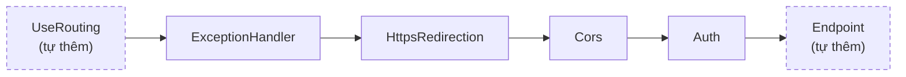
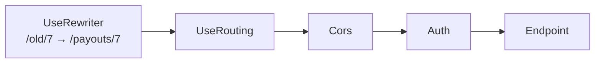

# Middleware pipeline

Phần đầu là bài học kèm hình. [Câu hỏi phỏng vấn](#interview) nằm ở cuối, để ôn nhanh. Liên quan: [Captive dependency](/aspnet-core/dependency-injection#captive-dependency).

<svg width="0" height="0" style="position:absolute" aria-hidden="true"><defs><marker id="aAcc" viewBox="0 0 10 10" refX="8" refY="5" markerWidth="7" markerHeight="7" orient="auto-start-reverse"><path class="headAcc" d="M0 0L10 5L0 10z"/></marker><marker id="aInk" viewBox="0 0 10 10" refX="8" refY="5" markerWidth="7" markerHeight="7" orient="auto-start-reverse"><path class="head" d="M0 0L10 5L0 10z"/></marker><marker id="aOk" viewBox="0 0 10 10" refX="8" refY="5" markerWidth="7" markerHeight="7" orient="auto-start-reverse"><path class="headOk" d="M0 0L10 5L0 10z"/></marker><marker id="aBad" viewBox="0 0 10 10" refX="8" refY="5" markerWidth="7" markerHeight="7" orient="auto-start-reverse"><path class="headBad" d="M0 0L10 5L0 10z"/></marker></defs></svg>

## 1. Pipeline là các hàm gọi lồng nhau

**Middleware** là một hàm nhận <T>HttpContext</T> và hàm kế tiếp (`next`). Nó làm gì đó, gọi `next`, rồi làm tiếp sau khi `next` trả về.

**Pipeline** là chuỗi các hàm đó gọi lồng vào nhau: 1 gọi 2, 2 gọi 3... "Chiều ra" không phải một cơ chế riêng, nó chỉ là **các hàm trả về cho hàm đã gọi nó**, nên thứ tự tự nhiên là ngược lại.

<div class="fig">
<svg viewBox="0 0 720 522" role="img" aria-label="Các middleware lồng nhau như củ hành"><rect class="band" x="20" y="36" width="680" height="466" rx="10" fill-opacity=".05"/><rect class="band" x="36" y="78" width="648" height="414" rx="10" fill-opacity=".07"/><rect class="band" x="52" y="120" width="616" height="362" rx="10" fill-opacity=".09"/><rect class="band" x="68" y="162" width="584" height="310" rx="10" fill-opacity=".11"/><rect class="band" x="84" y="204" width="552" height="258" rx="10" fill-opacity=".13"/><rect class="band" x="100" y="246" width="520" height="206" rx="10" fill-opacity=".15"/><rect class="band" x="116" y="288" width="488" height="154" rx="10" fill-opacity=".17"/><rect class="band" x="132" y="330" width="456" height="102" rx="10" fill-opacity=".19"/><rect class="boxOk" x="148" y="372" width="424" height="50" rx="8"/><g font-size="14" font-weight="600" text-anchor="middle"><text x="360" y="62" class="mono">1 · UseExceptionHandler</text><text x="360" y="104" class="mono">2 · UseHsts</text><text x="360" y="146" class="mono">3 · UseHttpsRedirection</text><text x="360" y="188" class="mono">4 · UseRouting</text><text x="360" y="230" class="mono">5 · UseCors</text><text x="360" y="272" class="mono">6 · UseAuthentication</text><text x="360" y="314" class="mono">7 · UseAuthorization</text><text x="360" y="356" class="mono">8 · UseRateLimiter</text><text x="360" y="402" class="okT">Endpoint: PayoutsController.Approve</text></g><line class="lnAcc" x1="190" y1="30" x2="190" y2="368" marker-end="url(#aAcc)"/><line class="lnAcc" x1="530" y1="368" x2="530" y2="30" marker-end="url(#aAcc)"/><text x="190" y="20" font-size="13" text-anchor="middle" class="accT" font-weight="600">gọi vào (code trước next)</text><text x="530" y="20" font-size="13" text-anchor="middle" class="accT" font-weight="600">trả về (code sau next)</text></svg>
<p class="fig-caption">Thứ tự khuyến nghị cho một API có auth. PayoutHub hiện mới có lớp 1, 3 và endpoint.</p>
</div>

### Một lớp middleware trông thế nào

```cs
app.Use(async (ctx, next) =>
{
    // chạy khi được gọi vào
    await next(ctx);   // gọi lớp trong
    // chạy khi lớp trong trả về
});
```

### Ba luật suy ra từ "hàm lồng nhau"

1. **Lớp ngoài bắt lỗi của lớp trong**, như `try/catch` bọc lời gọi hàm.
2. **Lớp trong dùng được thứ lớp ngoài đã gắn** vào `HttpContext` (endpoint, User).
3. **Không gọi `next`** thì lớp trong không chạy (short-circuit).

::: details Dễ nhầm: middleware và filter khác nhau thế nào?
**Middleware** bọc _mọi_ request, chỉ biết `HttpContext`. **[Filter](/aspnet-core/middleware#filters)** là một pipeline nhỏ hơn nằm bên trong endpoint MVC, biết action nào, có `ModelState`. Cùng hình củ hành, chỉ khác là filter nằm trong lõi.
:::

## 2. Exception và short-circuit

**Exception** bay ngược lên qua các hàm đang gọi dở, giống `throw` trong method lồng nhau: code sau lời gọi **bị bỏ qua** (trừ `finally`) cho tới hàm có `catch`.

Một lớp **chủ động không gọi** `next` mà tự ghi response rồi `return` gọi là <T>short-circuit</T>. Đường về hoàn toàn bình thường.

<Compare :labels="['Lớp 5 ném exception', 'Lớp 3 short-circuit']" caption="Ví dụ dùng 5 lớp tự đặt, ExceptionHandler ở lớp 2 để thấy lớp 1 vẫn chạy bình thường.">
<template #a>
<svg viewBox="0 0 720 300" role="img" aria-label="Exception đi ngược lên, bỏ qua code sau next cho tới khi gặp catch"><g font-size="13" class="mono" text-anchor="middle"><rect class="box" x="150" y="14" width="250" height="40" rx="8"/><text x="275" y="39">1 · Request logging</text><rect class="boxAcc" x="150" y="70" width="250" height="40" rx="8"/><text x="275" y="95">2 · ExceptionHandler</text><rect class="box" x="150" y="126" width="250" height="40" rx="8"/><text x="275" y="151">3 · Authentication</text><rect class="box" x="150" y="182" width="250" height="40" rx="8"/><text x="275" y="207">4 · Authorization</text><rect class="boxBad" x="150" y="238" width="250" height="40" rx="8"/><text x="275" y="263">5 · Endpoint: throw!</text></g><line class="lnAcc" x1="130" y1="14" x2="130" y2="272" marker-end="url(#aAcc)"/><text x="118" y="150" font-size="12" text-anchor="end" class="accT">vào</text><path class="lnBad dash" d="M420 258 L420 96" marker-end="url(#aBad)"/><path class="lnOk" d="M420 84 L420 40" marker-end="url(#aOk)"/><g font-size="12"><text x="436" y="263" class="badT">exception bay lên</text><text x="436" y="207" class="badT">✗ code sau next bị bỏ qua</text><text x="436" y="151" class="badT">✗ code sau next bị bỏ qua</text><text x="436" y="90" class="okT">✓ catch, ghi response 500</text><text x="436" y="105" class="muted">từ đây trở ra là đường về bình thường</text><text x="436" y="39" class="okT">✓ code sau next chạy, thấy status 500</text></g></svg>
</template>
<template #b>
<svg viewBox="0 0 720 300" role="img" aria-label="Short-circuit: lớp 3 không gọi next"><g font-size="13" class="mono" text-anchor="middle"><rect class="box" x="150" y="14" width="250" height="40" rx="8"/><text x="275" y="39">1 · Request logging</text><rect class="box" x="150" y="70" width="250" height="40" rx="8"/><text x="275" y="95">2 · ExceptionHandler</text><rect class="boxAcc" x="150" y="126" width="250" height="40" rx="8"/><text x="275" y="151">3 · RateLimiter: hết quota</text><rect class="box dash" x="150" y="182" width="250" height="40" rx="8" opacity=".45"/><text x="275" y="207" class="muted">4 · Authorization</text><rect class="box dash" x="150" y="238" width="250" height="40" rx="8" opacity=".45"/><text x="275" y="263" class="muted">5 · Endpoint</text></g><line class="lnAcc" x1="130" y1="14" x2="130" y2="160" marker-end="url(#aAcc)"/><text x="118" y="90" font-size="12" text-anchor="end" class="accT">vào</text><path class="lnOk" d="M420 146 L420 40" marker-end="url(#aOk)"/><g font-size="12"><text x="436" y="146" class="accT">không gọi next(), tự ghi 429</text><text x="436" y="161" class="muted">return bình thường, không có exception</text><text x="436" y="95" class="okT">✓ code sau next chạy, không có gì để catch</text><text x="436" y="39" class="okT">✓ code sau next chạy, thấy status 429</text><text x="436" y="236" class="muted">4 và 5 không bao giờ chạy</text></g></svg>
</template>
</Compare>

## 3. Các middleware có sẵn, mỗi cái một dòng

### ExceptionHandler

**UseExceptionHandler**: `try/catch` lớn nhất, đặt ngoài cùng để bọc tất cả. Chi tiết trong [Exception handling](/aspnet-core/exception-handling).

### HttpsRedirection và HSTS

**UseHttpsRedirection**: **server** trả 307 bảo client "gọi lại bằng https".

**UseHsts**: gửi header <T>HSTS</T> dặn **browser** "từ giờ chỉ gọi tôi bằng HTTPS", để browser tự đổi mà không gửi HTTP ra mạng nữa.

<Compare :labels="['Chỉ có HttpsRedirection', 'Có thêm HSTS']" caption="HttpsRedirection: server chuyển hướng, request đầu vẫn hở. HSTS: browser tự giác không đi HTTP nữa.">
<template #a>
<svg viewBox="0 0 720 270" role="img" aria-label="Không có HSTS: request HTTP đầu tiên đi qua kẻ gian"><g font-size="13" font-weight="600" text-anchor="middle"><rect class="box" x="30" y="10" width="120" height="30" rx="6"/><text x="90" y="30">Browser</text><rect class="boxBad" x="290" y="10" width="140" height="30" rx="6"/><text x="360" y="30">Wifi quán cà phê</text><rect class="box" x="570" y="10" width="120" height="30" rx="6"/><text x="630" y="30">PayoutHub</text></g><line class="lnMuted dash" x1="90" y1="40" x2="90" y2="250"/><line class="lnMuted dash" x1="360" y1="40" x2="360" y2="250"/><line class="lnMuted dash" x1="630" y1="40" x2="630" y2="250"/><line class="lnBad" x1="90" y1="80" x2="626" y2="80" marker-end="url(#aBad)"/><text x="200" y="72" font-size="12" class="mono">GET http://…/login</text><circle class="dotBad" cx="360" cy="80" r="7"/><text x="372" y="102" font-size="12" class="badT">đọc / sửa được, có thể giữ</text><text x="372" y="117" font-size="12" class="badT">bạn ở HTTP (SSL stripping)</text><line class="ln" x1="630" y1="150" x2="94" y2="150" marker-end="url(#aInk)"/><text x="400" y="126" font-size="12">server trả 307 Redirect: “hãy gọi lại bằng</text><text x="400" y="141" font-size="12" class="mono">https://…/login”</text><line class="lnOk" x1="90" y1="200" x2="626" y2="200" marker-end="url(#aOk)"/><text x="200" y="192" font-size="12" class="mono okT">GET https://… (mã hoá)</text><text x="90" y="240" font-size="12" class="muted">Mỗi lần gõ http:// là lại có một request hở đầu tiên.</text></svg>
</template>
<template #b>
<svg viewBox="0 0 720 300" role="img" aria-label="Có HSTS: browser tự đổi sang HTTPS"><g font-size="13" font-weight="600" text-anchor="middle"><rect class="box" x="30" y="10" width="120" height="30" rx="6"/><text x="90" y="30">Browser</text><rect class="box" x="290" y="10" width="140" height="30" rx="6"/><text x="360" y="30">Wifi quán cà phê</text><rect class="box" x="570" y="10" width="120" height="30" rx="6"/><text x="630" y="30">PayoutHub</text></g><line class="lnMuted dash" x1="90" y1="40" x2="90" y2="290"/><line class="lnMuted dash" x1="360" y1="40" x2="360" y2="290"/><line class="lnMuted dash" x1="630" y1="40" x2="630" y2="290"/><line class="lnOk" x1="90" y1="75" x2="626" y2="75" marker-end="url(#aOk)"/><text x="200" y="67" font-size="12" class="mono okT">GET https://… (lần đầu)</text><line class="ln" x1="630" y1="120" x2="94" y2="120" marker-end="url(#aInk)"/><text x="300" y="104" font-size="12" class="mono">200 + Strict-Transport-Security: max-age=2592000</text><text x="300" y="138" font-size="12" class="muted">nghĩa là: “30 ngày tới chỉ được gọi tôi bằng HTTPS”</text><rect class="boxAcc" x="20" y="150" width="250" height="28" rx="6"/><text x="145" y="169" font-size="12" text-anchor="middle">nhớ 30 ngày: domain này chỉ HTTPS</text><path class="lnAcc" d="M90 195 C 150 195, 150 235, 94 235" marker-end="url(#aAcc)"/><text x="160" y="212" font-size="12" class="accT">gõ http:// → tự đổi thành https://</text><text x="160" y="228" font-size="12" class="accT">(307 Internal Redirect, không ra mạng)</text><line class="lnOk" x1="90" y1="270" x2="626" y2="270" marker-end="url(#aOk)"/><text x="200" y="262" font-size="12" class="mono okT">GET https://…</text></svg>
</template>
</Compare>

### Routing và CORS {#routing}

**UseRouting**: chọn endpoint cho request và **gắn nhãn** lên `HttpContext` (endpoint nào, có attribute gì). Các lớp sau đọc nhãn này.

**Không gọi `UseRouting()` thì sao?** Với `WebApplication` (.NET 6 trở lên) app vẫn chạy bình thường. Chỉ cần có một `Map…`, `WebApplication` **tự thêm** `UseRouting` ở **đầu** pipeline, trước mọi `Use…` của bạn, và tự thêm lớp chạy endpoint (`UseEndpoints`) ở **cuối**. PayoutHub đang chạy kiểu này, nên lớp nào cũng đã thấy nhãn endpoint.

**Routing ngầm** (không gọi `UseRouting`): nhãn được dán trước tất cả.



**Tự gọi `UseRouting()`**: routing đứng **đúng chỗ bạn gọi**. Cần khi có lớp phải chạy **trước khi chọn endpoint**, thường là lớp **đổi đường dẫn** như `UsePathBase` hay `UseRewriter`.



Nếu để routing ngầm, endpoint đã được chọn theo path **cũ** trước khi rewriter kịp đổi, nên request rơi vào 404 hoặc sai endpoint mà không báo lỗi gì.

::: details Còn Startup.cs kiểu cũ (.NET Core 3.x, .NET 5)?
Ở đó không có gì tự thêm. Có `UseEndpoints` mà quên `UseRouting` thì app **ném `InvalidOperationException` lúc start**: "EndpointRoutingMiddleware ... must be added to the request execution pipeline before EndpointMiddleware". Dự án migrate từ Startup sang `WebApplication` thường vẫn giữ cặp `UseRouting` / `UseEndpoints` cũ; vẫn chạy, chỉ là không bắt buộc nữa.
:::

**`Map…` không phải middleware.** `MapControllers`, `MapGet`, `MapHealthChecks` không xếp thêm lớp vào hàng đợi; chúng **thêm dòng vào route table**. Routing nhìn **cả bảng một lúc** rồi chọn route **cụ thể nhất** (route precedence): literal `/payouts/new` thắng `/payouts/{id}` dù đăng ký trước hay sau. Vì vậy `MapGet` đứng trước hay sau `MapControllers` không quan trọng. Hai route giống hệt nhau (cùng path, cùng method) không báo lỗi lúc start mà ném **`AmbiguousMatchException`** lúc có request khớp.

<div class="fig">
<svg viewBox="0 0 720 260" role="img" aria-label="Use… là các lớp chạy theo thứ tự; Map… là các dòng trong route table, routing chọn dòng cụ thể nhất"><text x="20" y="28" font-size="14" font-weight="600">Use… : hàng đợi, thứ tự = thứ tự chạy</text><g font-size="12" class="mono" text-anchor="middle"><rect class="box" x="20" y="44" width="150" height="40" rx="8"/><text x="95" y="68">ExceptionHandler</text><rect class="box" x="200" y="44" width="150" height="40" rx="8"/><text x="275" y="68">HttpsRedirection</text><rect class="boxAcc" x="380" y="44" width="130" height="40" rx="8"/><text x="445" y="68">Routing</text><rect class="box" x="540" y="44" width="160" height="40" rx="8"/><text x="620" y="68">endpoint đã chọn</text></g><line class="ln" x1="170" y1="64" x2="196" y2="64" marker-end="url(#aInk)"/><line class="ln" x1="350" y1="64" x2="376" y2="64" marker-end="url(#aInk)"/><line class="ln" x1="510" y1="64" x2="536" y2="64" marker-end="url(#aInk)"/><text x="20" y="128" font-size="14" font-weight="600">Map… : route table, thứ tự đăng ký không quan trọng</text><rect class="boxAcc" x="20" y="142" width="440" height="104" rx="8"/><g font-size="12" class="mono"><text x="36" y="164">GET  /payouts/{id}        ← MapControllers</text><text x="36" y="186" class="okT">GET  /payouts/new         ← MapGet (đăng ký sau)</text><text x="36" y="208">GET  /health              ← MapHealthChecks</text><text x="36" y="230">GET  /                    ← MapGet</text></g><g font-size="12"><text x="480" y="164">Request GET /payouts/new:</text><text x="480" y="186" class="okT">literal cụ thể hơn {id}</text><text x="480" y="208" class="okT">→ chọn /payouts/new</text><text x="480" y="234" class="muted">Giống hệt nhau → AmbiguousMatch</text></g><line class="lnAcc dash" x1="445" y1="84" x2="445" y2="138" marker-end="url(#aAcc)"/><text x="455" y="116" font-size="12" class="accT">tra cả bảng</text></svg>
<p class="fig-caption">Thứ tự chỉ quan trọng với Use…. Với Map…, routing không duyệt từ trên xuống mà xếp hạng mọi route khớp theo độ cụ thể.</p>
</div>

**UseCors**: <T>CORS</T> là việc **server nói với browser** origin nào được phép đọc response, qua các header `Access-Control-Allow-*`. Người thực thi là browser, không phải server.

<div class="fig">
<svg viewBox="0 0 720 250" role="img" aria-label="CORS: browser kiểm tra header của server; Postman gọi thẳng không bị kiểm tra"><g font-size="13" font-weight="600" text-anchor="middle"><rect class="box" x="20" y="30" width="170" height="54" rx="8"/><text x="105" y="53">JS trên</text><text x="105" y="71" class="mono">app.a.com</text><rect class="boxAcc" x="250" y="30" width="170" height="54" rx="8"/><text x="335" y="53">Browser</text><text x="335" y="71" font-weight="400" font-size="12">người gác</text><rect class="box" x="520" y="30" width="180" height="54" rx="8"/><text x="610" y="53">PayoutHub API</text><text x="610" y="71" class="mono" font-weight="400">api.b.com</text><rect class="box" x="20" y="170" width="170" height="44" rx="8"/><text x="105" y="197">Postman / server khác</text></g><line class="ln" x1="190" y1="50" x2="246" y2="50" marker-end="url(#aInk)"/><line class="ln" x1="420" y1="50" x2="516" y2="50" marker-end="url(#aInk)"/><line class="ln" x1="520" y1="68" x2="424" y2="68" marker-end="url(#aInk)"/><text x="470" y="104" font-size="12" text-anchor="middle" class="mono">Access-Control-Allow-</text><text x="470" y="119" font-size="12" text-anchor="middle" class="mono">Origin: app.a.com</text><line class="lnOk" x1="250" y1="76" x2="194" y2="76" marker-end="url(#aOk)"/><text x="220" y="140" font-size="12" text-anchor="middle" class="okT">header khớp → cho JS đọc</text><text x="220" y="155" font-size="12" text-anchor="middle" class="badT">không khớp → giấu response</text><path class="lnBad dash" d="M190 192 L 600 192 L 600 88" marker-end="url(#aBad)"/><text x="400" y="210" font-size="12" text-anchor="middle" class="badT">gọi thẳng: không có người gác, CORS không có tác dụng</text></svg>
<p class="fig-caption">Mặc định browser theo same-origin policy: JS ở origin này không đọc được response từ origin khác. CORS là cách server nới lỏng quy định đó cho các origin cụ thể.</p>
</div>

### Authentication, Authorization, RateLimiter

**UseAuthentication**: đọc token/cookie, trả lời "bạn là ai", gán `HttpContext.User`.

**UseAuthorization**: dựa vào User và policy của endpoint, trả lời "bạn được làm gì". Phải đứng sau Authentication và sau Routing.

**UseRateLimiter**: cổng soát vé (<T>rate limiting</T>), giới hạn số request trong một khoảng thời gian. Đặt càng ngoài thì từ chối càng rẻ, nhưng càng biết ít về người gọi.

### Dễ nhầm

| Dễ nhầm | Khác nhau ở đâu |
|---|---|
| HttpsRedirection và HSTS | Server chuyển hướng từng lần, hay browser tự nhớ và tự đổi |
| CORS và Authorization | CORS bảo vệ **người dùng của browser**, do browser thực thi. Authorization bảo vệ **API**, do server thực thi |
| Authentication và Authorization | "Bạn là ai" (401 nếu không biết) và "bạn được làm gì" (403 nếu không được) |
| `app.Map("/path", …)` và `app.MapGet(…)` | `Map` (không có method): **rẽ nhánh pipeline**, thứ tự có ý nghĩa. `MapGet`/`MapControllers`: **thêm route** vào route table, thứ tự không có ý nghĩa |
| Rate limit trả 503 và 429 | Mặc định là 503 (server quá tải). Đúng nghĩa là 429 (bạn gọi quá nhiều). Đổi bằng `RejectionStatusCode = 429` |

## 4. Ba cách viết middleware

### Ba cách viết

**Inline lambda** `app.Use((ctx, next) => …)`: viết thẳng trong `Program.cs`. Hợp cho vài dòng, lab.

**Convention class**: class có constructor nhận `RequestDelegate next` và method tên `InvokeAsync`. Không có interface nào kiểm tra; sai tên hay sai chữ ký thì chỉ lộ lúc chạy.

**IMiddleware**: class implement interface, compiler kiểm tra chữ ký. Phải đăng ký vào <T>DI</T>.

### Instance sống bao lâu {#middleware-lifetime}

Khác nhau cốt lõi là **instance sống bao lâu**:

<div class="fig">
<svg viewBox="0 0 720 250" role="img" aria-label="Convention class có một instance từ lúc start, IMiddleware có instance mới mỗi request"><g font-size="13" font-weight="600"><text x="10" y="64" class="mono">Convention</text><text x="10" y="134" class="mono">IMiddleware</text><text x="10" y="204" class="mono">app.Use(λ)</text></g><rect class="boxAcc" x="170" y="44" width="530" height="32" rx="6"/><text x="180" y="65" font-size="12">1 instance, tạo lúc app start (giống singleton)</text><rect class="boxOk" x="275" y="114" width="70" height="32" rx="6"/><text x="310" y="135" font-size="12" text-anchor="middle">mới</text><rect class="boxOk" x="425" y="114" width="70" height="32" rx="6"/><text x="460" y="135" font-size="12" text-anchor="middle">mới</text><rect class="boxOk" x="575" y="114" width="70" height="32" rx="6"/><text x="610" y="135" font-size="12" text-anchor="middle">mới</text><text x="170" y="164" font-size="12" class="muted">lấy từ DI mỗi request (Scoped/Transient)</text><rect class="boxAcc" x="170" y="184" width="530" height="32" rx="6"/><text x="180" y="205" font-size="12">1 closure, tạo lúc app start</text><line class="lnMuted" x1="170" y1="232" x2="700" y2="232"/><g font-size="12" text-anchor="middle"><text x="170" y="247" class="muted">app start</text><text x="310" y="247" class="muted">request 1</text><text x="460" y="247" class="muted">request 2</text><text x="610" y="247" class="muted">request 3</text></g><line class="lnMuted dash" x1="310" y1="36" x2="310" y2="226"/><line class="lnMuted dash" x1="460" y1="36" x2="460" y2="226"/><line class="lnMuted dash" x1="610" y1="36" x2="610" y2="226"/></svg>
<p class="fig-caption">Instance sống cả đời app thì không được giữ service scoped trong constructor (<a :href="$withBase('/aspnet-core/dependency-injection#captive-dependency')">captive dependency</a>). Instance mới mỗi request thì giữ thoải mái.</p>
</div>

**Ai tạo object, lúc nào, và dependency lấy từ đâu:**

<div class="fig">
<svg viewBox="0 0 720 300" role="img" aria-label="Convention: constructor chạy một lần, tham số InvokeAsync lấy từ scope của từng request. IMiddleware: IMiddlewareFactory resolve instance mới từ scope mỗi request"><text x="20" y="26" font-size="14" font-weight="600">Convention class</text><g font-size="12" text-anchor="middle"><rect class="boxAcc" x="20" y="40" width="260" height="56" rx="8"/><text x="150" y="62" class="mono">new TimingMiddleware(next, log)</text><text x="150" y="82" class="accT">1 lần, lúc dựng pipeline</text><rect class="boxOk" x="330" y="40" width="370" height="56" rx="8"/><text x="515" y="62" class="mono">InvokeAsync(ctx, PayoutDbContext db)</text><text x="515" y="82" class="okT">mỗi request: db lấy từ scope của request đó</text></g><line class="ln" x1="280" y1="68" x2="326" y2="68" marker-end="url(#aInk)"/><text x="20" y="118" font-size="12" class="muted">Constructor chạy 1 lần → chỉ nhận singleton. Tham số InvokeAsync được resolve lại mỗi lần gọi → nhận scoped được.</text><text x="20" y="176" font-size="14" font-weight="600">IMiddleware</text><g font-size="12" text-anchor="middle"><rect class="box" x="20" y="190" width="200" height="56" rx="8"/><text x="120" y="212" class="mono">IMiddlewareFactory</text><text x="120" y="232" class="muted">mỗi request</text><rect class="boxOk" x="260" y="190" width="230" height="56" rx="8"/><text x="375" y="212" class="mono">RequestServices.GetRequired…</text><text x="375" y="232" class="okT">instance mới, ctor nhận db được</text><rect class="box" x="530" y="190" width="170" height="56" rx="8"/><text x="615" y="212" class="mono">InvokeAsync(ctx, next)</text><text x="615" y="232" class="muted">xong → Release</text></g><line class="ln" x1="220" y1="218" x2="256" y2="218" marker-end="url(#aInk)"/><line class="ln" x1="490" y1="218" x2="526" y2="218" marker-end="url(#aInk)"/><text x="20" y="272" font-size="12" class="muted">Factory xin instance từ DI, nên class phải được đăng ký (AddScoped/AddTransient). Quên đăng ký → InvalidOperationException ở request đầu tiên.</text></svg>
<p class="fig-caption">Cùng gọi app.UseMiddleware&lt;T&gt;(). Framework nhìn T có implement IMiddleware không để chọn một trong hai đường.</p>
</div>

Hay nhầm: "đặt <T>DbContext</T> ở tham số `InvokeAsync` trông như singleton". Không phải. **Instance** middleware sống lâu, nhưng **tham số** `InvokeAsync` được framework lấy lại từ `HttpContext.RequestServices` (scope của request) ở mỗi lần gọi, giống method injection bằng `[FromServices]` ở action. Ngược lại, đặt `DbContext` vào constructor của convention class mới là sai: constructor chỉ chạy một lần, `DbContext` đó bị giam cả đời app (<T>captive dependency</T>).

### Closure

Lambda ở `app.Use(…)` là một <T>closure</T>: nó giữ lại các biến bên ngoài mà nó dùng, nên chúng sống tiếp sau khi `Program.cs` chạy xong phần đăng ký. Chính vì thế middleware dạng lambda tạo một lần lúc start rồi dùng chung cho mọi request.

### Code mẫu và cách chọn

::: code-group

```cs [IMiddleware (nên dùng)]
public sealed class TimingMiddleware(
    ILogger<TimingMiddleware> log,
    PayoutDbContext db)              // scoped: OK, instance mới mỗi request
    : IMiddleware
{
    public async Task InvokeAsync(HttpContext ctx, RequestDelegate next)
    {
        await next(ctx);
    }
}

// Program.cs: 2 dòng, quên dòng 1 là lỗi khi có request
builder.Services.AddScoped<TimingMiddleware>(); // [!code highlight]
app.UseMiddleware<TimingMiddleware>();
```

```cs [Convention class]
public sealed class TimingMiddleware(
    RequestDelegate next,            // bắt buộc
    ILogger<TimingMiddleware> log)   // chỉ singleton ở constructor
{
    // tên phải là Invoke/InvokeAsync, trả Task
    public async Task InvokeAsync(
        HttpContext ctx,
        PayoutDbContext db)          // scoped: đặt ở ĐÂY // [!code highlight]
    {
        await next(ctx);
    }
}

// không cần đăng ký DI
app.UseMiddleware<TimingMiddleware>();
```

:::

::: tip Chọn nhanh
Chỉ liên quan action MVC thì dùng filter ([Filter](/aspnet-core/middleware#filters)). Vài dòng hoặc lab thì dùng `app.Use(…)`. Còn lại dùng `IMiddleware`. Convention class chỉ khi viết library hoặc <T>hot path</T> cực nóng; các middleware có sẵn của ASP.NET đều là convention class vì lý do đó.
:::

## Câu hỏi phỏng vấn {#interview}

Ôn nhanh trước khi đi phỏng vấn. Mỗi câu có trả lời nhanh, bản chất, ví dụ thật và bẫy.

### Middleware là gì? Thứ tự có quan trọng không? <Badge type="warning" text="gần như chắc chắn bị hỏi" /> {#middleware}

::: tip Trả lời nhanh
Middleware là các bước nối tiếp nhau mà mọi request đi qua. Mỗi bước có thể xử lý trước, gọi bước kế tiếp (`next`), xử lý response sau khi bước kế tiếp xong, hoặc dừng luôn không gọi tiếp (short-circuit). Thứ tự đăng ký chính là thứ tự chạy, nên rất quan trọng: request đi xuôi, response đi ngược lại.
:::

::: info Bản chất
Thứ tự chuẩn (bỏ những cái app không dùng):

1. `UseExceptionHandler`: đứng đầu để bắt lỗi của mọi bước sau
2. `UseHsts`, `UseHttpsRedirection`
3. `UseStaticFiles`: trả file tĩnh sớm, không tốn công auth
4. `UseRouting`: xác định endpoint nào sẽ xử lý
5. `UseCors`
6. `UseAuthentication`: bạn là ai
7. `UseAuthorization`: bạn được làm gì (cần biết endpoint nên đứng sau routing)
8. `UseRateLimiter`, middleware tự viết
9. `MapControllers` / `MapGet`: endpoint, điểm cuối của pipeline

```csharp
public class CorrelationIdMiddleware(RequestDelegate next)
{
    public async Task InvokeAsync(HttpContext ctx, ILogger<CorrelationIdMiddleware> logger)
    {
        var id = ctx.Request.Headers["X-Correlation-Id"].FirstOrDefault() ?? Guid.NewGuid().ToString();
        ctx.Response.Headers["X-Correlation-Id"] = id;
        using (logger.BeginScope(new Dictionary<string, object> { ["CorrelationId"] = id }))
        {
            await next(ctx);   // phần trước: request; phần sau: response
        }
    }
}
app.UseMiddleware<CorrelationIdMiddleware>();
```
:::

::: details Ở dự án thật
Middleware là phiên bản hiện đại của <T>HttpModule</T>. `Application_BeginRequest` trong Global.asax hay một HttpModule ghi log hoặc kiểm tra IP giờ là một middleware. Khác biệt chính: HttpModule gắn vào các event cố định của IIS pipeline; middleware là chuỗi delegate do bạn tự sắp xếp, rõ ràng và test được.
:::

::: warning Bẫy & follow-up
**"Inject service scoped vào constructor của middleware được không?"**

Không. Middleware dạng thường chỉ được tạo một lần cho cả app, giống singleton. Service scoped phải nhận qua tham số của `InvokeAsync` như ví dụ trên, hoặc implement `IMiddleware` để được tạo theo từng request.

**"`Use`, `Run`, `Map` khác nhau thế nào?"**

`Use`: có `next`, gọi tiếp được. `Run`: điểm cuối, không gọi tiếp. `Map`/`MapWhen`: rẽ nhánh pipeline theo path hoặc điều kiện.

**"Đặt `MapGet` trước `MapControllers` thì route của `MapGet` có bị che không?"**

Không. `MapGet`/`MapControllers` thêm route vào route table, không phải middleware xếp hàng. Routing chọn route cụ thể nhất trong cả bảng, xem [Routing và CORS](#routing).

**"Sửa header sau khi đã gọi `next` được không?"**

Nếu response đã bắt đầu gửi về client thì không, sẽ ném lỗi. Kiểm tra `ctx.Response.HasStarted`, hoặc đăng ký `Response.OnStarting`.
:::

### Filter là gì? Khác middleware chỗ nào? {#filters}

::: tip Trả lời nhanh
Filter chạy **bên trong** MVC, quanh việc thực thi action, nên biết action nào, controller nào, model binding ra sao, ModelState hợp lệ không. Middleware chạy cho mọi request và chỉ thấy `HttpContext`. Logic chung cho cả app (log, correlation id) dùng middleware; logic cần ngữ cảnh action (validate, audit theo action) dùng filter.
:::

::: info Thứ tự chạy
1. **Authorization filter**
2. **Resource filter**: trước model binding, hợp cho cache
3. Model binding và validation
4. **Action filter**: trước và sau action
5. **Exception filter**: chỉ khi action hoặc filter trước nó ném lỗi
6. **Result filter**: trước và sau khi ghi kết quả

<T>Minimal API</T> không có <T>MVC</T> filter, thay vào đó là **endpoint filter** (`AddEndpointFilter`).
:::

::: warning Bẫy & follow-up
**"Exception filter có bắt được lỗi trong middleware không?"**

Không. Nó chỉ bắt lỗi trong phạm vi MVC. Lỗi toàn cục phải xử lý bằng `UseExceptionHandler`.
:::

## Hỏi đáp

### Pipeline và thứ tự

::: details Mô tả pipeline: lỗi ở lớp 5 thì short-circuit, đi ra qua 4, 4 có handler thì bắt, không thì chạy tiếp tới 1. Đúng không?
**Gần đúng, nhưng lẫn hai khái niệm.** Exception không phải short-circuit. Khi lớp 5 throw, code sau `next` ở lớp 4, 3... **bị bỏ qua** cho tới lớp có `catch`; từ lớp đó trở ra mới là đường về bình thường. Short-circuit là chủ động không gọi `next`, đường về bình thường hoàn toàn. Xem hình ở [mục 2](#_2-exception-va-short-circuit).
:::

::: details Đảo UseRouting và UseCors thì sao?
**Policy theo endpoint bị lờ đi mà không báo lỗi gì**, và browser chặn request. <T>CORS</T> là người đọc nhãn, Routing là người dán nhãn; đọc trước khi dán thì không có gì để đọc.

<Compare :labels="['Routing → CORS', 'CORS → Routing (đảo)']">
<template #a>
<svg viewBox="0 0 720 300" role="img" aria-label="Thứ tự đúng"><g text-anchor="middle"><rect class="box" x="210" y="10" width="300" height="40" rx="8"/><text x="360" y="35" font-size="13" class="mono">OPTIONS /payouts/7/approve</text><line class="ln" x1="360" y1="50" x2="360" y2="76" marker-end="url(#aInk)"/><rect class="boxAcc" x="210" y="80" width="300" height="56" rx="8"/><text x="360" y="102" font-size="14" font-weight="600" class="mono">UseRouting</text><text x="360" y="123" font-size="12">dán nhãn: endpoint = Approve, [EnableCors("Backoffice")]</text><line class="ln" x1="360" y1="136" x2="360" y2="162" marker-end="url(#aInk)"/><rect class="boxAcc" x="210" y="166" width="300" height="56" rx="8"/><text x="360" y="188" font-size="14" font-weight="600" class="mono">UseCors</text><text x="360" y="209" font-size="12">đọc nhãn → dùng policy "Backoffice"</text><line class="lnOk" x1="360" y1="222" x2="360" y2="248" marker-end="url(#aOk)"/><rect class="boxOk" x="160" y="252" width="400" height="38" rx="19"/><text x="360" y="276" font-size="13" class="okT" font-weight="600">204 + Access-Control-Allow-Origin → browser cho gọi</text></g><text x="530" y="112" font-size="12" class="muted">nhãn nằm trong</text><text x="530" y="127" font-size="12" class="muted mono">ctx.GetEndpoint()</text></svg>
</template>
<template #b>
<svg viewBox="0 0 720 300" role="img" aria-label="Thứ tự đảo"><g text-anchor="middle"><rect class="box" x="210" y="10" width="300" height="40" rx="8"/><text x="360" y="35" font-size="13" class="mono">OPTIONS /payouts/7/approve</text><line class="ln" x1="360" y1="50" x2="360" y2="76" marker-end="url(#aInk)"/><rect class="boxBad" x="210" y="80" width="300" height="56" rx="8"/><text x="360" y="102" font-size="14" font-weight="600" class="mono">UseCors</text><text x="360" y="123" font-size="12">endpoint = null → chỉ biết default policy (nếu có)</text><line class="ln" x1="360" y1="136" x2="360" y2="162" marker-end="url(#aInk)"/><rect class="box" x="210" y="166" width="300" height="56" rx="8"/><text x="360" y="188" font-size="14" font-weight="600" class="mono">UseRouting</text><text x="360" y="209" font-size="12">dán nhãn... nhưng người đọc đã đi qua</text><line class="lnBad" x1="360" y1="222" x2="360" y2="248" marker-end="url(#aBad)"/><rect class="boxBad" x="160" y="252" width="400" height="38" rx="19"/><text x="360" y="276" font-size="13" class="badT" font-weight="600">thiếu header CORS → browser chặn, console báo lỗi CORS</text></g></svg>
</template>
</Compare>

Thêm: CORS phải đứng **trước** Authentication/Authorization, vì <T>preflight</T> (`OPTIONS`) không mang token; đứng sau auth thì preflight nhận 401 không có header CORS.
:::

### CORS và HSTS

::: details CORS chỉ là browser tự chặn theo lời server dặn, vậy không thể dựa vào nó để bảo vệ API?
**Đúng.** CORS bảo vệ **người dùng**: một trang độc không đọc được dữ liệu từ API của bạn bằng cookie của họ. Nó không bảo vệ **API**: Postman, curl, server khác gọi thẳng là qua. Với request "simple" (không có preflight), server thậm chí vẫn chạy action, browser chỉ giấu response khỏi JavaScript. Bảo vệ API là việc của authentication, authorization, rate limit, validate input.
:::

::: details UseHsts có cần cho PayoutHub không?
**Chưa cần.** <T>HSTS</T> là chỉ dẫn cho browser; client của PayoutHub là server khác (FakeBank gọi webhook, hệ thống nội bộ), chúng bỏ qua header này. Với API, cách an toàn hơn là không mở cổng HTTP hoặc trả 400 cho HTTP thay vì redirect, vì client có thể đã gửi token qua HTTP ở request đầu. Thực tế <T>TLS</T> thường kết thúc ở <T>reverse proxy</T> và HSTS cũng đặt ở đó.

| Điều kiện | Mặc định |
|---|---|
| Browser nhớ bao lâu | 30 ngày. Header gửi đi là `max-age=2592000` (tính bằng giây). Muốn đổi: `builder.Services.AddHsts(o => o.MaxAge = TimeSpan.FromDays(365));` |
| Gửi trên HTTP? | Không. Header trên HTTP bị browser bỏ qua theo chuẩn |
| localhost | Không gửi (`ExcludedHosts` có sẵn localhost, 127.0.0.1, [::1]) |
| Template | Chỉ bật khi không phải Development, để máy dev không bị "dính" HTTPS |
:::

### Rate limiter

::: details Đưa UseRateLimiter ra ngay sau UseExceptionHandler thì sao?
**Tuỳ <T>partition key</T> lấy từ đâu.** Theo IP hoặc global thì tốt, chặn sớm nhất. Theo user thì sai, vì lúc đó `User` chưa được gán.

<div class="fig">
<svg viewBox="0 0 720 280" role="img" aria-label="Hai vị trí của rate limiter"><g text-anchor="middle" font-size="12"><rect class="box" x="10" y="110" width="104" height="54" rx="8"/><text x="62" y="133" class="mono">Exception</text><text x="62" y="150" class="mono">Handler</text><rect class="boxAcc" x="134" y="110" width="104" height="54" rx="8"/><text x="186" y="133" class="mono" font-weight="600">Rate</text><text x="186" y="150" class="mono" font-weight="600">Limiter A</text><rect class="box" x="258" y="110" width="104" height="54" rx="8"/><text x="310" y="133" class="mono">Authen-</text><text x="310" y="150" class="mono">tication</text><rect class="box" x="382" y="110" width="104" height="54" rx="8"/><text x="434" y="133" class="mono">Author-</text><text x="434" y="150" class="mono">ization</text><rect class="boxAcc dash" x="506" y="110" width="104" height="54" rx="8"/><text x="558" y="133" class="mono" font-weight="600">Rate</text><text x="558" y="150" class="mono" font-weight="600">Limiter B</text><rect class="boxOk" x="630" y="110" width="80" height="54" rx="8"/><text x="670" y="142" class="okT">Endpoint</text></g><line class="ln" x1="114" y1="137" x2="132" y2="137" marker-end="url(#aInk)"/><line class="ln" x1="238" y1="137" x2="256" y2="137" marker-end="url(#aInk)"/><line class="ln" x1="362" y1="137" x2="380" y2="137" marker-end="url(#aInk)"/><line class="ln" x1="486" y1="137" x2="504" y2="137" marker-end="url(#aInk)"/><line class="ln" x1="610" y1="137" x2="628" y2="137" marker-end="url(#aInk)"/><g font-size="12"><line class="lnMuted" x1="186" y1="108" x2="186" y2="70"/><text x="134" y="22" font-weight="600">A: sau ExceptionHandler</text><text x="134" y="40" class="okT">✓ theo IP / global: chặn sớm, rẻ nhất</text><text x="134" y="58" class="badT">✗ theo user: User chưa có → mọi người chung 1 xô</text><line class="lnMuted" x1="558" y1="166" x2="558" y2="200"/><text x="330" y="222" font-weight="600">B: sau Authorization</text><text x="330" y="240" class="okT">✓ biết User → mỗi user một xô riêng</text><text x="330" y="258" class="muted">request bị từ chối đã tốn công xác thực token</text></g></svg>
</div>

| Đặt ở A thì... | Kết quả |
|---|---|
| `GlobalLimiter` theo IP | <Badge type="tip" text="chạy tốt" /> chặn trước khi tốn công auth |
| Policy theo endpoint | <Badge type="warning" text="tuỳ" /> cần đã routing. PayoutHub dùng routing ngầm nên vẫn chạy; nếu tự gọi `UseRouting()` đứng sau thì policy bị lờ đi |
| Partition theo `User.Identity.Name` | <Badge type="danger" text="sai" /> key giống nhau cho mọi request, một người dùng hết quota của tất cả |
:::

::: details Đăng ký một middleware 2 lần, ví dụ rate limiter ở cả A và B, thì sao?
**Nó chạy 2 lần**, framework không gộp. Theo source ASP.NET, `GlobalLimiter` là một object dùng chung lấy từ options, nên mỗi request bị trừ quota 2 lần: đặt 100 request/phút thì thực tế còn khoảng 50. Policy theo endpoint thì mỗi instance giữ bộ đếm riêng, chỉ tốn công đếm 2 lần. Muốn giới hạn cả theo IP lẫn theo user: dùng một limiter ghép (`PartitionedRateLimiter.CreateChained`) đặt sau auth, hoặc tự viết một middleware nhỏ chặn theo IP ở vị trí A.
:::

### Cách viết middleware

::: details Convention class hay IMiddleware? Làm sao khỏi phải nhớ convention?
**Dùng IMiddleware**: interface chính là convention, compiler kiểm tra giúp. Trong Rider gõ `: IMiddleware`, `Alt+Enter` → _Implement missing members_. Thứ duy nhất cần nhớ là đăng ký vào DI; quên thì app vẫn start được nhưng request đầu tiên đi qua sẽ ném `InvalidOperationException`.
:::

::: details Ví dụ: tình huống nào chọn cách viết nào?
**Hỏi lần lượt: có cần biết action không → có phải vài dòng không → có phải library/hot path không.** Áp vào các việc có thể gặp ở PayoutHub:

| Tình huống | Chọn | Vì sao |
|---|---|---|
| Lab 1: ném lỗi để thử thứ tự pipeline | `app.Use(…)` | Vài dòng, xoá ngay sau khi thử |
| Thêm header `X-Correlation-Id` vào mọi response | `app.Use(…)` hoặc `IMiddleware` | Ngắn thì lambda; muốn test riêng hoặc có logic thì tách class |
| Log thời gian xử lý mọi request (cần `ILogger`) | `IMiddleware` | Class riêng, inject logger, compiler kiểm tra chữ ký |
| Ghi audit vào DB cho mọi request ghi dữ liệu (cần `PayoutDbContext`) | `IMiddleware` | Service scoped inject thẳng vào constructor, không lo captive |
| Verify chữ ký HMAC của webhook FakeBank (M5) | **Filter**, không phải middleware | Chỉ áp cho một endpoint; middleware chạy cho mọi request |
| Validate `ModelState`, cần biết action nào | **[Filter](/aspnet-core/middleware#filters)** | Middleware không thấy action |
| Đóng gói thành NuGet dùng cho nhiều service | Convention class | Không bắt người dùng đăng ký DI, tạo một lần nên rẻ, giống các middleware có sẵn |

Tóm lại, trong code ứng dụng gần như không bao giờ cần convention class. Bạn gặp nó chủ yếu khi **đọc** code của framework và thư viện.
:::

::: details Vì sao lại có convention class? Do type system của C# kém linh hoạt?
**Một phần, nhưng chủ yếu là lựa chọn thiết kế.** ASP.NET muốn mỗi middleware tự khai báo service nó cần ngay trong tham số `InvokeAsync` (method injection), mỗi class một danh sách khác nhau. Một interface thì phải cố định chữ ký, và C# (cũng như Java, TypeScript) không có cách viết "method với số tham số tuỳ ý" trong interface. Nên framework đọc chữ ký bằng <T>reflection</T> lúc start, rồi compile thành <T>delegate</T> để chạy nhanh.

Giá phải trả: sai chữ ký chỉ lộ lúc chạy. Cùng ý tưởng này bạn sẽ gặp lại ở Minimal API: `app.MapGet("/x", (PayoutDbContext db, int id) => …)`, framework đọc tham số của lambda để biết inject gì. Bên dưới, mọi kiểu middleware đều quy về một `Func<RequestDelegate, RequestDelegate>`; `IMiddleware` ra đời sau (2.0) cho ai muốn compiler kiểm tra.
:::

::: details Closure nên hiểu tiếng Việt thế nào?
**Đừng dịch, hãy nhớ hình "lambda mang ba lô"** (xem <T>closure</T>). Ví dụ Lab 1: `app.Use` nhận một lambda; nếu lambda dùng `app.Logger` thì `app.Logger` nằm trong ba lô. Lambda tạo một lần lúc start nên ba lô cũng chỉ có một, dùng chung cho mọi request, giống singleton.

Bẫy kinh điển: closure giữ **chính biến**. Tạo lambda trong vòng `for (int i…)` rồi chạy sau thì mọi lambda thấy cùng một `i` với giá trị cuối.
:::

## Tự kiểm tra

::: details 1. Middleware nào bắt được lỗi ném ra từ UseCors?
Mọi lớp bao ngoài nó có `try/catch`, thực tế là ExceptionHandler. Lớp bên trong như Authentication không bắt được.
:::

::: details 2. Lớp 3 short-circuit thì code sau next của lớp 1 có chạy không? Nếu lớp 3 throw thì sao?
Short-circuit: có, đường về bình thường. Throw: chỉ chạy nếu có một lớp giữa 1 và 3 đã catch; nếu không, nó bị bỏ qua.
:::

::: details 3. Vì sao HSTS gần như vô nghĩa cho API chỉ có server gọi?
HSTS là chỉ dẫn cho browser. HttpClient và các client server-to-server bỏ qua header này.
:::

::: details 4. Đảo CORS lên trước Routing, app có báo lỗi lúc start không?
Không. Policy theo endpoint bị lờ đi trong im lặng; chỉ thấy lỗi CORS ở console của browser.
:::

::: details 5. Convention class inject DbContext vào constructor thì sao?
Instance sống cả đời app, giữ DbContext scoped là captive dependency. Development có scope validation nên báo lỗi; Production có thể lọt và một DbContext bị dùng chung giữa mọi request.
:::

::: details 6. Controller có GET /payouts/{id}, sau MapControllers bạn thêm MapGet("/payouts/new"). Request GET /payouts/new vào đâu?
`MapGet("/payouts/new")`: literal cụ thể hơn `{id}`, thứ tự đăng ký không ảnh hưởng. Nếu hai route giống hệt nhau thì ném `AmbiguousMatchException` lúc request, không phải lúc start.
:::
