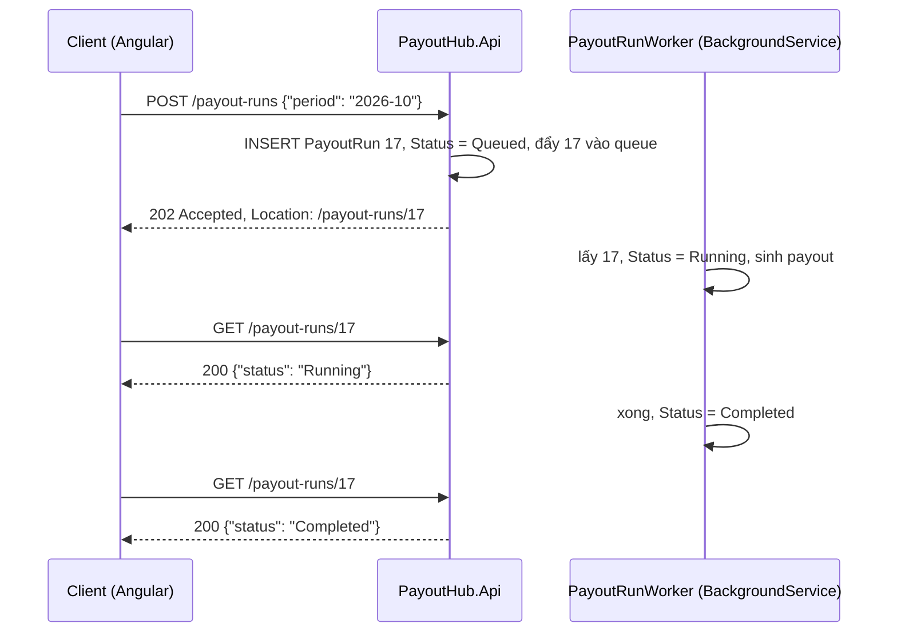

# Thiết kế REST API: status code và idempotency

Một <T>REST</T> API nói chuyện với client qua hai thứ ngoài body: **status code** cho client biết bước tiếp theo phải làm gì, và **tính idempotent** cho client biết gửi lại một request có an toàn không. Trang này đi qua cả hai trên PayoutHub: finance tạo payout (`POST /payouts`), duyệt payout (`POST /payouts/42/approve`) và chạy job sinh payout cả kỳ (`POST /payout-runs`). Đọc kèm: [JWT: mỗi request từ Bearer token tới `[Authorize]`](/aspnet-core/authentication-jwt#per-request) (nguồn của 401 và 403), [EF Core: optimistic concurrency](/data/ef-core#concurrency) (nguồn của 409 và 412).

<svg width="0" height="0" style="position:absolute" aria-hidden="true"><defs><marker id="rInk" viewBox="0 0 10 10" refX="8" refY="5" markerWidth="7" markerHeight="7" orient="auto-start-reverse"><path class="head" d="M0 0L10 5L0 10z"/></marker><marker id="rOk" viewBox="0 0 10 10" refX="8" refY="5" markerWidth="7" markerHeight="7" orient="auto-start-reverse"><path class="headOk" d="M0 0L10 5L0 10z"/></marker><marker id="rBad" viewBox="0 0 10 10" refX="8" refY="5" markerWidth="7" markerHeight="7" orient="auto-start-reverse"><path class="headBad" d="M0 0L10 5L0 10z"/></marker><marker id="rAcc" viewBox="0 0 10 10" refX="8" refY="5" markerWidth="7" markerHeight="7" orient="auto-start-reverse"><path class="headAcc" d="M0 0L10 5L0 10z"/></marker></defs></svg>

## Bản đồ chủ đề {#topic-map}

<div class="fig">
<svg viewBox="0 0 720 470" role="img" aria-label="Bản đồ chủ đề: cột trái là status code theo một luật, cột phải là idempotency từ định nghĩa tới Idempotency-Key và UNIQUE constraint">
<text x="12" y="24" font-size="12.5" font-weight="600" class="muted">Status code · ai phải làm gì tiếp theo?</text>
<text x="367" y="24" font-size="12.5" font-weight="600" class="muted">Idempotency · gửi lại có an toàn không?</text>
<a href="#status-rule" style="text-decoration:none"><rect class="boxAcc" x="10" y="36" width="345" height="52" rx="8"/><circle class="boxAcc" cx="34" cy="62" r="13"/><text x="34" y="67" font-size="13" text-anchor="middle" font-weight="700" class="accT">1</text><text x="56" y="57" font-size="13" font-weight="600" class="accT">Một luật: ai phải hành động?</text><text x="56" y="76" font-size="11.5">2xx đi tiếp · 4xx client sửa · 5xx lỗi của ta</text></a>
<a href="#bad-request" style="text-decoration:none"><rect class="box" x="10" y="96" width="345" height="52" rx="8"/><circle class="boxAcc" cx="34" cy="122" r="13"/><text x="34" y="127" font-size="13" text-anchor="middle" font-weight="700" class="accT">2</text><text x="56" y="117" font-size="13" font-weight="600">400 · body sai hình dạng</text><text x="56" y="136" font-size="11.5">[ApiController] tự trả ValidationProblemDetails</text></a>
<a href="#auth-codes" style="text-decoration:none"><rect class="box" x="10" y="156" width="345" height="52" rx="8"/><circle class="boxAcc" cx="34" cy="182" r="13"/><text x="34" y="187" font-size="13" text-anchor="middle" font-weight="700" class="accT">3</text><text x="56" y="177" font-size="13" font-weight="600">401 chưa biết bạn · 403 không cho</text><text x="56" y="196" font-size="11.5"><tspan class="badT">không phải 400</tspan>: JwtBearer và policy trả</text></a>
<a href="#not-found" style="text-decoration:none"><rect class="box" x="10" y="216" width="345" height="52" rx="8"/><circle class="boxAcc" cx="34" cy="242" r="13"/><text x="34" y="247" font-size="13" text-anchor="middle" font-weight="700" class="accT">4</text><text x="56" y="237" font-size="13" font-weight="600">404 · không có, hoặc không phải của bạn</text><text x="56" y="256" font-size="11.5">không lộ "id 43 có tồn tại"</text></a>
<a href="#conflict" style="text-decoration:none"><rect class="box" x="10" y="276" width="345" height="52" rx="8"/><circle class="boxAcc" cx="34" cy="302" r="13"/><text x="34" y="307" font-size="13" text-anchor="middle" font-weight="700" class="accT">5</text><text x="56" y="297" font-size="13" font-weight="600">409 / 412 · xung đột trạng thái</text><text x="56" y="316" font-size="11.5"><tspan class="badT">không phải 500</tspan>: client tải lại, không ai bị gọi dậy</text></a>
<a href="#created" style="text-decoration:none"><rect class="boxOk" x="10" y="336" width="345" height="52" rx="8"/><circle class="boxAcc" cx="34" cy="362" r="13"/><text x="34" y="367" font-size="13" text-anchor="middle" font-weight="700" class="accT">6</text><text x="56" y="357" font-size="13" font-weight="600" class="okT">201 Created + Location</text><text x="56" y="376" font-size="11.5"><tspan class="badT">không phải 200</tspan>: client biết id mới ở đâu</text></a>
<a href="#accepted" style="text-decoration:none"><rect class="boxOk" x="10" y="396" width="345" height="52" rx="8"/><circle class="boxAcc" cx="34" cy="422" r="13"/><text x="34" y="427" font-size="13" text-anchor="middle" font-weight="700" class="accT">7</text><text x="56" y="417" font-size="13" font-weight="600" class="okT">202 Accepted + Location</text><text x="56" y="436" font-size="11.5">việc dài: nhận ngay, client poll trang status</text></a>
<a href="#method-semantics" style="text-decoration:none"><rect class="boxAcc" x="365" y="36" width="345" height="52" rx="8"/><circle class="boxAcc" cx="389" cy="62" r="13"/><text x="389" y="67" font-size="13" text-anchor="middle" font-weight="700" class="accT">8</text><text x="411" y="57" font-size="13" font-weight="600" class="accT">Idempotent: gọi N lần = gọi 1 lần</text><text x="411" y="76" font-size="11.5">GET PUT DELETE có · POST PATCH không</text></a>
<line class="ln" x1="537" y1="88" x2="537" y2="112" marker-end="url(#rInk)"/>
<a href="#timeout" style="text-decoration:none"><rect class="boxBad" x="365" y="116" width="345" height="52" rx="8"/><circle class="boxAcc" cx="389" cy="142" r="13"/><text x="389" y="147" font-size="13" text-anchor="middle" font-weight="700" class="accT">9</text><text x="411" y="137" font-size="13" font-weight="600" class="badT">Timeout: server đã tạo chưa?</text><text x="411" y="156" font-size="11.5">mất response ≠ mất request → retry ra 2 payout</text></a>
<line class="ln" x1="537" y1="168" x2="537" y2="192" marker-end="url(#rInk)"/>
<a href="#client-id" style="text-decoration:none"><rect class="box" x="365" y="196" width="345" height="52" rx="8"/><circle class="boxAcc" cx="389" cy="222" r="13"/><text x="389" y="227" font-size="13" text-anchor="middle" font-weight="700" class="accT">10</text><text x="411" y="217" font-size="13" font-weight="600">Cách 1: PUT /payouts/{guid}</text><text x="411" y="236" font-size="11.5">client sinh id: gửi lại = ghi đúng chỗ đó</text></a>
<line class="ln" x1="537" y1="248" x2="537" y2="272" marker-end="url(#rInk)"/>
<a href="#idempotency-key" style="text-decoration:none"><rect class="boxOk" x="365" y="276" width="345" height="52" rx="8"/><circle class="boxAcc" cx="389" cy="302" r="13"/><text x="389" y="307" font-size="13" text-anchor="middle" font-weight="700" class="accT">11</text><text x="411" y="297" font-size="13" font-weight="600" class="okT">Cách 2: header Idempotency-Key</text><text x="411" y="316" font-size="11.5">trùng key → phát lại response đã lưu</text></a>
<line class="ln" x1="537" y1="328" x2="537" y2="352" marker-end="url(#rInk)"/>
<a href="#unique-constraint" style="text-decoration:none"><rect class="boxOk" x="365" y="356" width="345" height="52" rx="8"/><circle class="boxAcc" cx="389" cy="382" r="13"/><text x="389" y="387" font-size="13" text-anchor="middle" font-weight="700" class="accT">12</text><text x="411" y="377" font-size="13" font-weight="600" class="okT">DB quyết ai đến trước: UNIQUE</text><text x="411" y="396" font-size="11.5"><tspan class="badT">không check-then-insert</tspan> · lưới cuối</text></a>
<text x="537" y="436" font-size="11.5" text-anchor="middle" class="muted">Cùng ý tưởng quay lại ở message queue:</text>
<text x="537" y="452" font-size="11.5" text-anchor="middle" class="muted">idempotent consumer</text>
</svg>
<p class="fig-caption">Cột trái: mọi status code suy ra từ một câu hỏi. Cột phải: một chuỗi nhân quả, từ định nghĩa tới cách chặn retry tạo trùng. Chữ đỏ là các lỗi hay gặp. Ôn lại: nhìn từng ô và tự giải thích vì sao; ô nào không nói được thì bấm vào.</p>
</div>

## 1. Vấn đề: client phải đoán {#problem}

Bản nháp đầu của `PayoutsController` chạy được, nhưng mỗi status code kể sai chuyện:

```csharp
[HttpPost]                                   // tạo payout
public async Task<IActionResult> Create(CreatePayoutRequest req) { /* ... */ return Ok(payout); }       // 200

[HttpPost("{id:int}/approve")]
public async Task<IActionResult> Approve(int id)
{
    if (!User.IsInRole("Finance")) return BadRequest("Không có quyền");                               // 400
    var payout = await db.Payouts.SingleAsync(p => p.Id == id);
    payout.Approve();                        // đã Approved → InvalidOperationException → 500
    await db.SaveChangesAsync();
    return Ok();
}

[HttpPost("/payout-runs")]                   // sinh payout cho cả kỳ: chạy 3 phút
public async Task<IActionResult> Run(string period) { await generator.RunAsync(period); return Ok(); }
```

Hậu quả nằm ở phía người gọi:

- **Angular** nhận 400 khi user thiếu quyền, nên hiện "dữ liệu không hợp lệ"; user sửa form rồi gửi lại, vẫn hỏng.
- Hai finance cùng bấm Approve: người sau nhận **500**. Lúc 3 giờ sáng alert "tỉ lệ 5xx tăng" gọi người trực dậy vì một chuyện bình thường; client hiện "lỗi hệ thống, thử lại sau" thay vì "người khác vừa duyệt, tải lại".
- Tạo payout trả **200** kèm body: client không biết bản ghi mới nằm ở URL nào, và không phân biệt được "vừa tạo" với "đã có từ trước".
- `POST /payout-runs` giữ request 3 phút. Gateway cắt ở khoảng 30 giây và trả 504, client tưởng lỗi nên **gửi lại**: job chạy hai lần.
- Mạng chập chờn khi `POST /payouts`: client retry, affiliate được **trả hai lần**.

Bốn lỗi đầu là chọn sai status code; lỗi cuối là thiếu idempotency. Mục 2 chữa nhóm đầu, mục 3 chữa lỗi cuối.

## 2. Status code: một luật sinh ra tất cả {#status-codes}

### Một luật: ai phải hành động tiếp theo? {#status-rule}

**Status code trả lời một câu: gửi lại y nguyên request này thì có khác không, và ai phải làm gì?** Ba nhóm suy ra từ câu đó:

- **2xx: thành công, client đi tiếp.** Chọn đúng loại để nói thêm điều gì đã xảy ra: 200 có body, 204 xong mà không có body, 201 vừa tạo một resource mới, 202 mới **nhận** việc chứ chưa làm xong.
- **4xx: client phải đổi request** (sửa body, lấy token mới, xin quyền, tải lại dữ liệu). Gửi lại y nguyên thì hỏng y nguyên, nên client không tự retry, và đây không phải bug của server nên không ai bị gọi dậy.
- **5xx: lỗi của ta** (bug, DB sập, dependency chết). Request có thể đúng, gửi lại sau có thể được. Vì vậy công cụ retry coi 5xx là lỗi tạm thời: `AddStandardResilienceHandler()` của `Microsoft.Extensions.Http.Resilience` mặc định retry khi gặp 5xx, 408, 429; còn monitoring đặt alert theo tỉ lệ 5xx.

Hệ quả: trả 500 cho một xung đột bình thường thì **cả hai cơ chế trên cùng chạy sai**, client retry vô ích và alert bắn nhầm. Trả 400 cho chuyện thiếu quyền thì client sửa nhầm chỗ.

Trong ASP.NET Core, request đi qua các trạm theo thứ tự cố định, mỗi trạm trả một loại 4xx. Đi theo `POST /payouts/42/approve`:

<div class="fig">
<svg viewBox="0 0 720 488" role="img" aria-label="POST /payouts/42/approve đi qua năm trạm: token (401), role (403), body (400), payout tồn tại (404), trạng thái và version (409 hoặc 412); qua hết thì 2xx; lỗi không lường trước là 5xx">
<rect class="box" x="20" y="10" width="680" height="46" rx="8"/>
<text x="34" y="30" font-size="13" font-weight="600" class="mono">POST /payouts/42/approve</text>
<text x="34" y="48" font-size="11.5" class="mono muted">Authorization: Bearer eyJ… · If-Match: "AAAAAAAAB9E="</text>
<line class="ln" x1="120" y1="56" x2="120" y2="74" marker-end="url(#rInk)"/>
<rect class="boxAcc" x="20" y="78" width="360" height="50" rx="8"/>
<text x="34" y="99" font-size="13" font-weight="600">Token hợp lệ?</text>
<text x="34" y="117" font-size="11.5" class="muted">UseAuthentication + JwtBearer</text>
<rect class="boxBad" x="420" y="78" width="280" height="50" rx="8"/>
<text x="434" y="99" font-size="13" font-weight="600" class="badT">401 Unauthorized</text>
<text x="434" y="117" font-size="11.5">client: lấy token mới rồi gửi lại</text>
<line class="lnBad" x1="380" y1="103" x2="416" y2="103" marker-end="url(#rBad)"/>
<text x="398" y="96" font-size="11" text-anchor="middle" class="muted">không</text>
<line class="ln" x1="120" y1="128" x2="120" y2="140" marker-end="url(#rInk)"/>
<text x="128" y="138" font-size="11" class="muted">có</text>
<rect class="boxAcc" x="20" y="144" width="360" height="50" rx="8"/>
<text x="34" y="165" font-size="13" font-weight="600">Có role Finance?</text>
<text x="34" y="183" font-size="11.5" class="muted">UseAuthorization, policy "CanApprovePayout"</text>
<rect class="boxBad" x="420" y="144" width="280" height="50" rx="8"/>
<text x="434" y="165" font-size="13" font-weight="600" class="badT">403 Forbidden <tspan font-weight="400" font-size="11.5">(không phải 400)</tspan></text>
<text x="434" y="183" font-size="11.5">client: báo thiếu quyền, đừng retry</text>
<line class="lnBad" x1="380" y1="169" x2="416" y2="169" marker-end="url(#rBad)"/>
<text x="398" y="162" font-size="11" text-anchor="middle" class="muted">không</text>
<line class="ln" x1="120" y1="194" x2="120" y2="206" marker-end="url(#rInk)"/>
<text x="128" y="204" font-size="11" class="muted">có</text>
<rect class="boxAcc" x="20" y="210" width="360" height="50" rx="8"/>
<text x="34" y="231" font-size="13" font-weight="600">Route và body hợp lệ?</text>
<text x="34" y="249" font-size="11.5" class="muted">model binding + [ApiController]</text>
<rect class="boxBad" x="420" y="210" width="280" height="50" rx="8"/>
<text x="434" y="231" font-size="13" font-weight="600" class="badT">400 Bad Request</text>
<text x="434" y="249" font-size="11.5">ValidationProblemDetails: sai field nào</text>
<line class="lnBad" x1="380" y1="235" x2="416" y2="235" marker-end="url(#rBad)"/>
<text x="398" y="228" font-size="11" text-anchor="middle" class="muted">không</text>
<line class="ln" x1="120" y1="260" x2="120" y2="272" marker-end="url(#rInk)"/>
<text x="128" y="270" font-size="11" class="muted">có</text>
<rect class="boxAcc" x="20" y="276" width="360" height="50" rx="8"/>
<text x="34" y="297" font-size="13" font-weight="600">Payout 42 có, và thuộc tenant của bạn?</text>
<text x="34" y="315" font-size="11.5" class="muted">controller query DB</text>
<rect class="boxBad" x="420" y="276" width="280" height="50" rx="8"/>
<text x="434" y="297" font-size="13" font-weight="600" class="badT">404 Not Found</text>
<text x="434" y="315" font-size="11.5">client: id sai hoặc đã bị xoá</text>
<line class="lnBad" x1="380" y1="301" x2="416" y2="301" marker-end="url(#rBad)"/>
<text x="398" y="294" font-size="11" text-anchor="middle" class="muted">không</text>
<line class="ln" x1="120" y1="326" x2="120" y2="338" marker-end="url(#rInk)"/>
<text x="128" y="336" font-size="11" class="muted">có</text>
<rect class="boxAcc" x="20" y="342" width="360" height="50" rx="8"/>
<text x="34" y="363" font-size="13" font-weight="600">Còn Pending, version khớp If-Match?</text>
<text x="34" y="381" font-size="11.5" class="muted">Status + RowVersion trong WHERE</text>
<rect class="boxBad" x="420" y="342" width="280" height="50" rx="8"/>
<text x="434" y="363" font-size="13" font-weight="600" class="badT">409 / 412 <tspan font-weight="400" font-size="11.5">(không phải 500)</tspan></text>
<text x="434" y="381" font-size="11.5">client: tải lại, người dùng quyết lại</text>
<line class="lnBad" x1="380" y1="367" x2="416" y2="367" marker-end="url(#rBad)"/>
<text x="398" y="360" font-size="11" text-anchor="middle" class="muted">không</text>
<line class="lnOk" x1="120" y1="392" x2="120" y2="406" marker-end="url(#rOk)"/>
<text x="128" y="403" font-size="11" class="muted">có</text>
<rect class="boxOk" x="20" y="410" width="360" height="70" rx="8"/>
<text x="34" y="431" font-size="13" font-weight="600" class="okT">2xx: client đi tiếp</text>
<text x="34" y="450" font-size="11.5">204 duyệt xong · 201 + Location khi tạo mới</text>
<text x="34" y="468" font-size="11.5">202 + Location khi việc chạy nền</text>
<rect class="boxBad dash" x="420" y="410" width="280" height="70" rx="8"/>
<text x="434" y="431" font-size="13" font-weight="600" class="badT">5xx: lỗi của ta</text>
<text x="434" y="450" font-size="11.5">bug, DB sập: ở trạm nào cũng có thể</text>
<text x="434" y="468" font-size="11.5">alert bắn; gửi lại sau có thể được</text>
</svg>
<p class="fig-caption">Mỗi trạm hỏi một câu và có một mã riêng cho câu trả lời "không". Thứ tự là thật: authentication và authorization là middleware chạy trước, validation của <code>[ApiController]</code> là filter chạy trước action, 404 và 409 do code trong action quyết định.</p>
</div>

### 400: request sai hình dạng {#bad-request}

**Với `[ApiController]`, model binding chạy trước action; nếu `ModelState` không hợp lệ, filter `ModelStateInvalidFilter` trả 400 ngay, action không chạy.** Điều kiện: controller có attribute `[ApiController]` (PayoutHub có), DTO có validation attribute (`[Required]`, `[Range]`...), và không ai bật `SuppressModelStateInvalidFilter`. JSON hỏng cú pháp cũng ra 400 theo cùng đường. Body là <T>ProblemDetails</T> loại `ValidationProblemDetails`:

```json
{
  "type": "https://tools.ietf.org/html/rfc9110#section-15.5.1",
  "title": "One or more validation errors occurred.",
  "status": 400,
  "errors": { "Amount": ["The field Amount must be between 1 and 1000000."] },
  "traceId": "00-4bf92f3577b34da6a3ce929d0e0e4736-00f067aa0ba902b7-00"
}
```

Request đúng hình dạng nhưng vi phạm rule nghiệp vụ (vd `Amount` nhỏ hơn `Payout:MinAmount` trong config) thì có hai trường phái: **400** (vẫn là "client gửi sai") hoặc **422 Unprocessable Content** ("hiểu request nhưng không làm được"). Cả hai đều đúng; điều quan trọng là **cả API dùng một quy ước**, để client viết một chỗ xử lý.

### 401 và 403: chưa biết bạn là ai, hay biết nhưng không cho {#auth-codes}

**401 nghĩa là danh tính chưa có hoặc không hợp lệ, 403 nghĩa là danh tính hợp lệ nhưng không đủ quyền.** Vì 401 sửa được bằng một token mới, interceptor phía Angular bắt 401 để [đổi token ngầm](/aspnet-core/authentication-jwt#expiry). Vì 403 không sửa được bằng cách gửi lại, client chỉ báo "bạn không có quyền". Trả 400 cho chuyện thiếu quyền làm client hiểu là "sửa body đi", sai cả hai hướng.

Controller thường **không tự viết** hai mã này: `[Authorize(Policy = "CanApprovePayout")]` để middleware trả. Request không token hoặc token hết hạn thì JwtBearer *challenge* (401, header `WWW-Authenticate: Bearer`); token hợp lệ nhưng thiếu role thì *forbid* (403). Cả luồng từ header tới policy nằm ở [JWT: mỗi request](/aspnet-core/authentication-jwt#per-request).

### 404: không có, hoặc không phải của bạn {#not-found}

**404 nói "URL này không trỏ tới resource nào bạn thấy được".** Vế sau quan trọng: payout 43 thuộc công ty khác thì trả 404 chứ không phải 403, vì 403 xác nhận "id 43 có tồn tại", giúp kẻ dò <T k="idor">IDOR</T> biết id nào đáng thử. Với `[ApiController]`, `return NotFound();` trả body ProblemDetails có sẵn. Xem [IDOR](/aspnet-core/api-security#idor).

### 409 và 412: xung đột trạng thái, không phải 500 {#conflict}

**409 Conflict nói "request đúng, nhưng trạng thái hiện tại của resource không cho phép"; 412 Precondition Failed nói "điều kiện bạn gửi kèm (`If-Match`) không còn đúng".** Duyệt payout đã Approved là 409. Duyệt với `If-Match` mang version cũ là 412; quên gửi `If-Match` mà API bắt buộc thì 428 Precondition Required. Cả ba đều bảo client cùng một việc: **tải lại, cho người dùng xem bản mới, để họ quyết lại**.

Để exception lọt ra thành 500 thì hỏng ở ba chỗ: alert 5xx bắn cho một chuyện bình thường; resilience handler phía client retry một request chắc chắn hỏng lại; client không phân biệt được "server chết" với "người khác vừa sửa". Cách bắt và map: [version đi qua client](/data/ef-core#version-round-trip) (412 từ `DbUpdateConcurrencyException`) và [ExecuteUpdate có điều kiện](/data/ef-core#conditional-update) (0 dòng bị đổi thì 409).

### 201 Created + Location {#created}

**201 nói "đã tạo một resource mới, nó nằm ở URL trong header `Location`".** Client không phải tự ghép URL từ id, và phân biệt được "vừa tạo" với 200 "đọc/làm xong một việc". `CreatedAtAction` sinh cả hai từ route của action `Get`:

```csharp
return CreatedAtAction(nameof(Get), new { id = payout.Id }, dto);
// HTTP/1.1 201 Created
// Location: https://api.payouthub.local/payouts/901
```

Code đầy đủ nằm trong [controller có Idempotency-Key](#idempotency-key-code).

### 202 Accepted: việc chưa xong {#accepted}

**202 nói "đã nhận việc, chưa làm xong; theo dõi ở `Location`".** Dùng khi việc dài hơn thời gian một request được phép sống: gateway, load balancer và client đều có timeout (thường 30 giây tới vài phút), quá hạn là cắt kết nối dù server vẫn đang chạy. `POST /payout-runs` sinh payout cho cả kỳ mất 3 phút, nên server chỉ ghi một dòng `PayoutRun` trạng thái `Queued`, đẩy id vào hàng đợi cho một [`BackgroundService`](/aspnet-core/questions#background-service) xử lý, rồi trả ngay:



202 **không hứa** việc sẽ thành công: job có thể hỏng sau đó, và trang status phải báo được `Failed` kèm lý do. Client hỏi lại theo chu kỳ (polling); server có thể gửi header `Retry-After` để gợi ý khoảng cách.

::: code-group

```csharp [PayoutRunsController.cs]
using Microsoft.AspNetCore.Authorization;
using Microsoft.AspNetCore.Mvc;
using Microsoft.EntityFrameworkCore;
using PayoutHub.Core;
using PayoutHub.Infrastructure;

namespace PayoutHub.Api.Controllers;

public sealed record StartRunRequest(string Period);                  // "2026-10"
public sealed record PayoutRunDto(int Id, string Period, PayoutRunStatus Status);

[ApiController]
[Route("payout-runs")]
[Authorize(Policy = "CanApprovePayout")]
public class PayoutRunsController(PayoutDbContext db, IPayoutRunQueue queue) : ControllerBase
{
    [HttpPost]
    public async Task<IActionResult> Start(StartRunRequest req, CancellationToken ct)
    {
        var run = PayoutRun.Queue(req.Period);          // Status = Queued
        db.PayoutRuns.Add(run);
        await db.SaveChangesAsync(ct);                  // lưu trước: worker chết thì vẫn còn dấu vết
        await queue.EnqueueAsync(run.Id, ct);

        var dto = new PayoutRunDto(run.Id, run.Period, run.Status);
        return AcceptedAtAction(nameof(Get), new { id = run.Id }, dto);   // 202 + Location
    }

    [HttpGet("{id:int}")]
    public async Task<IActionResult> Get(int id, CancellationToken ct)
    {
        var dto = await db.PayoutRuns
            .Where(r => r.Id == id)
            .Select(r => new PayoutRunDto(r.Id, r.Period, r.Status))
            .SingleOrDefaultAsync(ct);

        return dto is null ? NotFound() : Ok(dto);
    }
}
```

```csharp [Program.cs]
// IPayoutRunQueue nằm ở Core; bản implement bọc một Channel<int> (M4)
builder.Services.AddSingleton<IPayoutRunQueue, ChannelPayoutRunQueue>();
builder.Services.AddHostedService<PayoutRunWorker>();
```

:::

## 3. Idempotency: gửi lại có an toàn không {#idempotency}

### Định nghĩa suy ra từ nghĩa của method {#method-semantics}

**Một thao tác là <T>idempotent</T> khi gọi nó N lần để lại server ở cùng trạng thái như gọi 1 lần.** Method nào idempotent không phải danh sách để thuộc, mà suy ra từ nghĩa HTTP gán cho method đó:

- **PUT** nghĩa là "đặt resource ở URL này thành đúng trạng thái này". Đặt lần hai thì vẫn là trạng thái đó, nên idempotent.
- **DELETE** nghĩa là "resource ở URL này không còn nữa". Lần hai nó vẫn không còn. Response có thể khác (204 rồi 404), nhưng **trạng thái server** giống nhau, và định nghĩa chỉ nói về trạng thái.
- **GET, HEAD, OPTIONS** chỉ đọc (còn gọi là *safe*), nên hiển nhiên idempotent.
- **POST** nghĩa là "xử lý request này", thường là "tạo thêm một cái trong collection". Hai lần là hai cái, nên **không** idempotent.
- **PATCH** là "áp các thay đổi này". `{"note": "ok"}` gửi hai lần thì như một lần, nhưng `{"op": "increment", "amount": 10}` thì không; HTTP không hứa, nên coi là **không** idempotent.

Idempotent là lời hứa **của server**: một PUT viết sai (mỗi lần gọi cộng thêm vào số dư) vẫn không idempotent dù dùng method PUT.

### Timeout: client không biết server đã làm chưa {#timeout}

**Khi request không có response, client không phân biệt được ba chuyện: request chưa tới server, server chết giữa chừng, hay server đã làm xong mà response bị mất trên đường về.** Cả ba đều hiện ra là một timeout. Chuyện thứ ba là chuyện nguy hiểm: retry một POST lúc đó tạo bản ghi thứ hai.

<div class="fig">
<svg viewBox="0 0 720 400" role="img" aria-label="Client gửi POST /payouts, server tạo payout 901 và commit, response bị mất. Client timeout, gửi lại, server tạo payout 902: trả hai lần">
<rect class="box" x="30" y="10" width="170" height="34" rx="8"/>
<text x="115" y="32" font-size="13" font-weight="600" text-anchor="middle">Client (Angular)</text>
<rect class="box" x="480" y="10" width="220" height="34" rx="8"/>
<text x="590" y="32" font-size="13" font-weight="600" text-anchor="middle">PayoutHub.Api + DB</text>
<line class="lnMuted dash" x1="115" y1="44" x2="115" y2="380"/>
<line class="lnMuted dash" x1="590" y1="44" x2="590" y2="380"/>
<line class="ln" x1="115" y1="70" x2="586" y2="96" marker-end="url(#rInk)"/>
<text x="350" y="72" font-size="11.5" text-anchor="middle" class="mono">POST /payouts {affiliate 7, 2026-10, 500}</text>
<rect class="boxOk" x="480" y="104" width="220" height="40" rx="8"/>
<text x="590" y="129" font-size="12.5" text-anchor="middle" font-weight="600">INSERT payout 901, COMMIT</text>
<line class="lnBad dash" x1="586" y1="156" x2="119" y2="182" marker-end="url(#rBad)"/>
<path class="lnBad" d="M342 160 l16 16 M358 160 l-16 16"/>
<text x="350" y="198" font-size="11.5" text-anchor="middle" class="badT">201 bị mất: gateway cắt, mạng rớt</text>
<rect class="boxAcc" x="20" y="208" width="300" height="48" rx="8"/>
<text x="34" y="228" font-size="12.5" font-weight="600">Hết 30 giây, không có response.</text>
<text x="34" y="246" font-size="12">Đã tạo chưa? Client không biết.</text>
<line class="ln" x1="115" y1="272" x2="586" y2="298" marker-end="url(#rInk)"/>
<text x="350" y="276" font-size="11.5" text-anchor="middle" class="mono">retry: POST /payouts (y hệt)</text>
<rect class="boxBad" x="480" y="306" width="220" height="40" rx="8"/>
<text x="590" y="331" font-size="12.5" text-anchor="middle" font-weight="600" class="badT">INSERT payout 902</text>
<line class="lnOk" x1="586" y1="356" x2="119" y2="374" marker-end="url(#rOk)"/>
<text x="350" y="360" font-size="11.5" text-anchor="middle" class="okT">201 Created</text>
<text x="350" y="394" font-size="12" text-anchor="middle" font-weight="600" class="badT">Affiliate 7 được trả hai lần cho kỳ 2026-10</text>
</svg>
<p class="fig-caption">Phía client, "request chưa tới" và "response bị mất" trông giống hệt nhau. Không retry thì có thể mất payout; retry mù thì có thể trả trùng. Idempotency cho phép retry mà không phải đoán.</p>
</div>

Retry không chỉ do người bấm lại: resilience handler, SDK, gateway và message queue đều tự gửi lại. `AddStandardResilienceHandler()` **mặc định retry cả POST**; muốn tắt cho method không idempotent thì gọi `options.Retry.DisableForUnsafeHttpMethods()`. Tắt đi thì an toàn nhưng mất khả năng tự phục hồi, nên cách bền hơn là làm cho POST chịu được retry.

### Cách 1: PUT với id do client sinh {#client-id}

**Nếu client tự sinh id (GUID) trước khi gửi, thao tác "tạo" trở thành "đặt resource ở URL này", tức là PUT, và PUT thì idempotent.**

```http
PUT /payouts/3f2c9a7e-1b4d-4c55-9a51-0d7f2a6c8e11
{ "affiliateId": 7, "period": "2026-10", "amount": 500 }
```

Lần đầu server tạo (201), lần retry thấy id đã có và cùng nội dung thì trả 200, không tạo thêm. Dùng được khi **bạn kiểm soát client** (Angular của chính mình, service nội bộ) và resource có thể mang id dạng GUID. Không hợp khi id do server cấp (số tăng dần), hoặc khi thao tác không phải "tạo một resource" (vd "chuyển tiền", "chạy job"), hoặc API công khai mà bạn không bắt client sinh id được.

### Cách 2: header Idempotency-Key {#idempotency-key}

**Client sinh một <T>idempotency key</T> cho mỗi thao tác logic (một lần bấm "Tạo payout"), và gửi lại đúng key đó ở mọi lần retry. Server ghi key cùng response vào DB; gặp lại key thì trả lại response đã lưu thay vì làm lại.** Key thuộc về thao tác, không thuộc về request: user sửa form rồi bấm lại là thao tác mới, key mới.

<div class="fig">
<svg viewBox="0 0 720 430" role="img" aria-label="Luồng Idempotency-Key: INSERT key vào bảng có khoá chính; chèn được thì tạo payout và lưu response; trùng khoá thì đọc bản ghi: hash khác trả 422, đang chạy trả 409, đã xong thì phát lại response">
<rect class="box" x="180" y="10" width="360" height="46" rx="8"/>
<text x="360" y="30" font-size="13" font-weight="600" text-anchor="middle" class="mono">POST /payouts</text>
<text x="360" y="48" font-size="11.5" text-anchor="middle" class="mono">Idempotency-Key: 7f3a… (giữ nguyên khi retry)</text>
<line class="ln" x1="360" y1="56" x2="360" y2="76" marker-end="url(#rInk)"/>
<rect class="boxAcc" x="180" y="80" width="360" height="50" rx="8"/>
<text x="194" y="101" font-size="13" font-weight="600">1. INSERT IdempotencyRecords (Key là PK)</text>
<text x="194" y="119" font-size="11.5">Status = InProgress, RequestHash = SHA-256(body)</text>
<line class="lnOk" x1="250" y1="130" x2="170" y2="170" marker-end="url(#rOk)"/>
<text x="204" y="146" font-size="11.5" text-anchor="end" class="okT">chèn được: đến đầu tiên</text>
<line class="lnBad" x1="470" y1="130" x2="550" y2="170" marker-end="url(#rBad)"/>
<text x="518" y="146" font-size="11.5" class="badT">trùng khoá (SQL 2627)</text>
<rect class="box" x="20" y="174" width="300" height="50" rx="8"/>
<text x="34" y="195" font-size="13" font-weight="600">2. INSERT payout 901</text>
<text x="34" y="213" font-size="11.5">việc thật, cùng transaction với bước 3</text>
<line class="ln" x1="170" y1="224" x2="170" y2="240" marker-end="url(#rInk)"/>
<rect class="box" x="20" y="244" width="300" height="50" rx="8"/>
<text x="34" y="265" font-size="13" font-weight="600">3. UPDATE key: Completed</text>
<text x="34" y="283" font-size="11.5">lưu status 201, body, Location</text>
<line class="lnOk" x1="170" y1="294" x2="170" y2="310" marker-end="url(#rOk)"/>
<rect class="boxOk" x="20" y="314" width="300" height="40" rx="8"/>
<text x="34" y="339" font-size="13" font-weight="600" class="okT">201 Created + Location</text>
<rect class="box" x="380" y="174" width="320" height="40" rx="8"/>
<text x="394" y="199" font-size="13" font-weight="600">Đọc bản ghi đã có của key</text>
<line class="ln" x1="394" y1="214" x2="394" y2="364"/>
<line class="ln" x1="394" y1="254" x2="406" y2="254" marker-end="url(#rInk)"/>
<line class="ln" x1="394" y1="308" x2="406" y2="308" marker-end="url(#rInk)"/>
<line class="ln" x1="394" y1="362" x2="406" y2="362" marker-end="url(#rInk)"/>
<rect class="boxBad" x="410" y="232" width="290" height="44" rx="8"/>
<text x="424" y="250" font-size="12.5" font-weight="600" class="badT">hash khác → 422</text>
<text x="424" y="267" font-size="11.5">cùng key nhưng body khác: lỗi client</text>
<rect class="boxAcc" x="410" y="286" width="290" height="44" rx="8"/>
<text x="424" y="304" font-size="12.5" font-weight="600">InProgress → 409</text>
<text x="424" y="321" font-size="11.5">lần đầu chưa xong, thử lại sau</text>
<rect class="boxOk" x="410" y="340" width="290" height="44" rx="8"/>
<text x="424" y="358" font-size="12.5" font-weight="600" class="okT">Completed → phát lại 201 đã lưu</text>
<text x="424" y="375" font-size="11.5">không chạy lại bước 2</text>
<text x="360" y="414" font-size="11.5" text-anchor="middle" class="muted">Job dọn bản ghi quá 24 giờ: sau thời hạn đó key được coi là mới, client không được dùng lại.</text>
</svg>
<p class="fig-caption">Ai "đến đầu tiên" do câu INSERT quyết định, không do code đọc trước rồi mới ghi. Retry sau khi bước 3 xong nhận đúng response của lần đầu, kể cả id 901.</p>
</div>

Mã trả về theo bản nháp IETF `draft-ietf-httpapi-idempotency-key-header` (chưa thành chuẩn chính thức, nhưng Stripe, Adyen và nhiều payment API làm tương tự): thiếu key ở endpoint bắt buộc thì 400, key đang được xử lý thì 409, key dùng lại với body khác thì 422.

#### Code {#idempotency-key-code}

Giả sử `Payout` (entity ở [trang EF Core](/data/ef-core#problem)) có thêm `Period` và factory `Payout.Create`. Policy `"CanApprovePayout"` đăng ký trong `Program.cs` như ở [trang JWT](/aspnet-core/authentication-jwt#per-request-code); ngoài `DbContext` không cần đăng ký gì thêm.

::: code-group

```csharp [PayoutsController.cs]
using System.Security.Cryptography;
using System.Text.Json;
using Microsoft.AspNetCore.Authorization;
using Microsoft.AspNetCore.Mvc;
using Microsoft.Data.SqlClient;
using Microsoft.EntityFrameworkCore;
using PayoutHub.Core;
using PayoutHub.Infrastructure;

namespace PayoutHub.Api.Controllers;

public sealed record CreatePayoutRequest(int AffiliateId, string Period, decimal Amount);
public sealed record PayoutDto(int Id, int AffiliateId, string Period, decimal Amount);

[ApiController]
[Route("payouts")]
[Authorize(Policy = "CanApprovePayout")]
public class PayoutsController(PayoutDbContext db) : ControllerBase
{
    [HttpGet("{id:int}")]
    public async Task<IActionResult> Get(int id, CancellationToken ct) =>
        await db.Payouts.Where(p => p.Id == id)
            .Select(p => new PayoutDto(p.Id, p.AffiliateId, p.Period, p.Amount))
            .SingleOrDefaultAsync(ct) is { } dto ? Ok(dto) : NotFound();

    [HttpPost]
    public async Task<IActionResult> Create(
        [FromHeader(Name = "Idempotency-Key")] Guid? key, CreatePayoutRequest req, CancellationToken ct)
    {
        if (key is not { } k) return BadRequest("Thiếu header Idempotency-Key");
        var hash = Convert.ToHexString(SHA256.HashData(JsonSerializer.SerializeToUtf8Bytes(req)));

        // Bước 1: giành key. Key là PRIMARY KEY nên DB quyết định ai đến trước.
        var record = IdempotencyRecord.Start(k, hash);
        db.IdempotencyRecords.Add(record);
        try
        {
            await db.SaveChangesAsync(ct);
        }
        catch (DbUpdateException ex) when (ex.InnerException is SqlException { Number: 2627 or 2601 })
        {
            db.ChangeTracker.Clear();
            var seen = await db.IdempotencyRecords.AsNoTracking().SingleAsync(r => r.Key == k, ct);

            if (seen.RequestHash != hash) return UnprocessableEntity("Key đã dùng cho request khác");
            if (seen.Status == IdempotencyStatus.InProgress) return Conflict("Request trước chưa xong");

            Response.Headers.Location = seen.Location;             // phát lại đúng response đã lưu
            return new ContentResult
            {
                StatusCode = seen.ResponseStatus, Content = seen.ResponseBody, ContentType = "application/json",
            };
        }

        // Bước 2 + 3: việc thật và lưu response, cùng một transaction
        try
        {
            await using var tx = await db.Database.BeginTransactionAsync(ct);
            var payout = Payout.Create(req.AffiliateId, req.Period, req.Amount);
            db.Payouts.Add(payout);
            await db.SaveChangesAsync(ct);                         // có payout.Id

            var dto = new PayoutDto(payout.Id, payout.AffiliateId, payout.Period, payout.Amount);
            var location = Url.Action(nameof(Get), new { id = payout.Id });
            record.Complete(StatusCodes.Status201Created, JsonSerializer.Serialize(dto, JsonSerializerOptions.Web), location);
            await db.SaveChangesAsync(ct);
            await tx.CommitAsync(ct);

            return CreatedAtAction(nameof(Get), new { id = payout.Id }, dto);
        }
        catch
        {
            // Hỏng giữa chừng: xoá key để lần retry sau được làm lại từ đầu
            db.ChangeTracker.Clear();
            await db.IdempotencyRecords.Where(r => r.Key == k).ExecuteDeleteAsync(CancellationToken.None);
            throw;
        }
    }
}
```

```csharp [IdempotencyRecord.cs]
namespace PayoutHub.Core;

public enum IdempotencyStatus { InProgress, Completed }

public class IdempotencyRecord
{
    public Guid Key { get; private set; }                  // PRIMARY KEY, tức là UNIQUE
    public string RequestHash { get; private set; } = "";
    public IdempotencyStatus Status { get; private set; }
    public int? ResponseStatus { get; private set; }
    public string? ResponseBody { get; private set; }
    public string? Location { get; private set; }
    public DateTime CreatedAt { get; private set; }         // job dọn bản ghi quá 24 giờ

    public static IdempotencyRecord Start(Guid key, string requestHash) => new()
    {
        Key = key, RequestHash = requestHash, Status = IdempotencyStatus.InProgress, CreatedAt = DateTime.UtcNow,
    };

    public void Complete(int status, string body, string? location)
    {
        Status = IdempotencyStatus.Completed;
        ResponseStatus = status;
        ResponseBody = body;
        Location = location;
    }
}
```

```csharp [Configurations.cs]
using Microsoft.EntityFrameworkCore;
using Microsoft.EntityFrameworkCore.Metadata.Builders;
using PayoutHub.Core;

namespace PayoutHub.Infrastructure;

public class IdempotencyRecordConfiguration : IEntityTypeConfiguration<IdempotencyRecord>
{
    public void Configure(EntityTypeBuilder<IdempotencyRecord> builder)
    {
        builder.ToTable("IdempotencyRecords");
        builder.HasKey(r => r.Key);                       // "Key" không theo convention Id, phải khai báo
        builder.Property(r => r.RequestHash).HasMaxLength(64);
    }
}

public class PayoutConfiguration : IEntityTypeConfiguration<Payout>
{
    public void Configure(EntityTypeBuilder<Payout> builder)
    {
        // Lưới cuối: một affiliate chỉ có một payout mỗi kỳ, dù key có lọt
        builder.HasIndex(p => new { p.AffiliateId, p.Period }).IsUnique();
    }
}
```

:::

Bước 1 commit **riêng** trước khi làm việc thật, để request trùng đến sau thấy ngay bản ghi `InProgress`. Bước 2 và 3 nằm chung transaction, nên không có trạng thái "payout đã tạo mà key chưa lưu response". Vi phạm UNIQUE `(AffiliateId, Period)` ở bước 2 hiện đang ra 500 qua `throw`; nên map nó sang 409 trong exception handler.

### Vì sao phải là UNIQUE constraint, không phải check-then-insert {#unique-constraint}

**Hai request cùng key có thể chạy song song trên hai thread (hoặc hai instance), nên "đọc xem key có chưa, chưa có thì ghi" để hở một khoảng mà cả hai cùng thấy "chưa có".** Retry thường đến khi request đầu vẫn đang chạy (client timeout ở 30 giây, server còn đang xử lý), nên đây không phải ca hiếm:

```text
Request A (lần đầu)                      Request B (retry, cùng key 7f3a)
SELECT key 7f3a → không có
                                          SELECT key 7f3a → không có
INSERT payout 901
                                          INSERT payout 902      ← trả hai lần
```

Câu `INSERT` vào cột có UNIQUE thì khác: DB kiểm và ghi **trong cùng một thao tác nguyên tử**, có khoá trên index, nên chỉ một câu thắng, câu kia nhận lỗi 2627 (vi phạm PRIMARY KEY/UNIQUE constraint) hoặc 2601 (trùng trên unique index). Code ở trên dựa hẳn vào lỗi đó thay vì đọc trước. Cùng nguyên lý với [ExecuteUpdate có điều kiện](/data/ef-core#conditional-update): để DB kiểm và ghi trong một câu.

**Lưới cuối là UNIQUE nghiệp vụ** `(AffiliateId, Period)`: nếu client sinh key mới cho mỗi lần retry (bug phía client), hoặc bản ghi key đã bị dọn, constraint này vẫn chặn payout thứ hai. Idempotency-Key bảo vệ **request**, UNIQUE nghiệp vụ bảo vệ **dữ liệu**; cần cả hai.

Cùng ý tưởng quay lại khi đọc message từ queue như Azure Service Bus: queue giao **ít nhất một lần** (<T>at-least-once</T>), cùng một message có thể tới hai lần, nên consumer lưu message id với UNIQUE và bỏ qua message đã xử lý. Mẫu đó gọi là **idempotent consumer**.

## 4. Biến thể và trade-off {#trade-offs}

- **Vì 4xx nghĩa là "gửi lại y nguyên vẫn hỏng"**, đừng retry tự động trên 4xx, trừ 408 và 429 (hai mã này nói "thử lại sau").
- **Vì 400 hay 422 cho lỗi nghiệp vụ đều đúng**, chọn một và ghi vào quy ước API; trộn cả hai mới là lỗi.
- **Vì 202 chỉ hứa "đã nhận"**, chỉ dùng khi việc thật sự dài hơn timeout của request; việc 200 ms mà dùng 202 thì client phải poll vô ích.
- **Vì Idempotency-Key cần một bảng, một lần ghi thêm và job dọn**, chỉ đặt nó ở thao tác mà trùng là thiệt hại thật (tạo payout, chuyển tiền, gửi email cho khách). `GET` và `PUT` vốn idempotent thì không cần.
- **Vì Cách 1 (PUT với GUID) không cần bảng phụ**, chọn nó khi bạn kiểm soát client và resource có id GUID được.
- **Vì bản ghi `InProgress` có thể kẹt** khi process chết giữa bước 1 và bước 3, cho nó một hạn (vd cột `LockedUntil` 1 phút): quá hạn thì request sau được nhận lại key. Không có hạn thì client nhận 409 mãi tới khi job dọn chạy.

## 5. Quy ước khác {#conventions}

- **URL là danh từ số nhiều**: `/payouts/42`. Hành động nghiệp vụ không khớp CRUD thì dùng sub-resource kiểu động từ: `POST /payouts/42/approve`.
- **PUT thay cả resource, PATCH sửa một phần.** PUT thiếu field thì field đó bị đặt về mặc định.
- **Phân trang**: `?page=2&pageSize=50` cho màn hình nhỏ; cursor (<T>keyset pagination</T>) cho dữ liệu lớn.
- **Versioning**: qua URL `/v1/` (dễ thấy, dễ cache) hoặc header (URL gọn hơn). Chọn một.
- **429 Too Many Requests** cho rate limit, kèm `Retry-After`. Rate limiter của ASP.NET Core mặc định trả 503, phải đặt `RejectionStatusCode = 429`.

## Câu hỏi phỏng vấn {#interview}

### Thiết kế REST API: status code và các quy ước <Badge type="warning" text="hay bị hỏi" /> {#rest-design}

::: tip Trả lời nhanh
Status code cho client biết ai phải làm gì tiếp: 2xx đi tiếp, 4xx client phải đổi request (gửi lại y nguyên vẫn hỏng), 5xx lỗi của server (có thể retry, alert bắn). Theo thứ tự trạm: 401 thiếu hoặc sai token, 403 đủ danh tính nhưng thiếu quyền, 400 body sai (`[ApiController]` tự trả `ValidationProblemDetails`), 404 không có, 409/412 xung đột trạng thái hoặc version. Thành công: 201 + `Location` khi tạo, 202 + `Location` khi việc chạy nền, 204 khi xong không có body. Xem [một luật](#status-rule), [409/412](#conflict), [202](#accepted).
:::

::: details Câu trả lời mẫu (English)
I pick status codes by asking who has to act next. 2xx means success and the client moves on, and I use the specific one: 201 with a Location header when something was created, which in ASP.NET Core is `CreatedAtAction`, 204 when there's nothing to return, and 202 Accepted with a Location to a status endpoint when the work runs in the background, like generating all payouts for a period. 4xx means the client has to change something, so resending the same request won't help and nobody should be paged: 400 for invalid input, which `[ApiController]` returns automatically as `ValidationProblemDetails`, 401 when the token is missing or invalid, 403 when the user is authenticated but lacks the role, 404 when the resource doesn't exist or belongs to another tenant, and 409 or 412 for concurrency conflicts, for example approving a payout that was already approved or sending a stale `If-Match`. 5xx is reserved for our own failures. That matters operationally: retry policies treat 5xx as transient and alerts fire on the 5xx rate, so returning 500 for an expected conflict causes useless retries and false alerts, and the client can't tell it should reload.
:::

::: warning Bẫy & follow-up
**"Không có quyền thì trả 400 được không?"**

Không. 400 bảo client "sửa request đi", trong khi sửa body không giúp gì. 403 nếu đã biết user là ai, 401 nếu chưa. Hai mã này thường do middleware trả, không do controller: xem [JWT: mỗi request](/aspnet-core/authentication-jwt#per-request).

**"Hai người cùng duyệt, người sau bị exception. Trả 500?"**

Không: đó là xung đột trạng thái, trả 409 (hoặc 412 nếu dùng `If-Match`). 500 làm alert bắn nhầm, resilience handler retry vô ích, và client không biết phải tải lại. Xem [409/412](#conflict).

**"Tạo xong trả 200 có sai không?"**

Không sai hẳn, nhưng mất thông tin: 201 + `Location` cho client biết resource mới ở đâu và phân biệt "vừa tạo" với "đã có". Xem [201](#created).

**"Việc mất 3 phút thì trả gì?"**

202 Accepted + `Location` tới endpoint status, client poll. Giữ request 3 phút thì gateway cắt ở timeout, client tưởng lỗi và gửi lại. Xem [202](#accepted).

**"PUT và PATCH khác nhau thế nào?"**

PUT thay toàn bộ resource bằng nội dung gửi lên, nên idempotent; PATCH chỉ sửa một phần và không được HTTP hứa là idempotent. Xem [định nghĩa idempotent](#method-semantics).

**"400 hay 422 cho lỗi nghiệp vụ?"**

Cả hai đều có team dùng; điều quan trọng là nhất quán trong cả API. Xem [400](#bad-request).
:::

### POST tạo payout bị timeout, client retry. Làm sao không tạo trùng? <Badge type="warning" text="câu senior" /> {#idempotent-post-retry}

::: tip Trả lời nhanh
POST không idempotent, và client không biết request bị mất hay chỉ response bị mất. Cách chính: client sinh `Idempotency-Key` một lần cho mỗi thao tác và gửi lại khi retry; server INSERT key vào bảng có UNIQUE (`InProgress`), làm việc, lưu status + body; gặp key đã xong thì phát lại response, đang chạy thì 409, khác body thì 422. Chống trùng dựa vào **UNIQUE constraint**, không check-then-insert. Key hết hạn sau khoảng 24 giờ; thêm UNIQUE nghiệp vụ `(AffiliateId, Period)` làm lưới cuối. Nếu kiểm soát client thì có thể dùng `PUT /payouts/{guid}`. Xem [timeout](#timeout), [Idempotency-Key](#idempotency-key), [UNIQUE](#unique-constraint).
:::

::: details Câu trả lời mẫu (English)
The problem is that on a timeout the client can't tell whether the request never arrived or the payout was created and only the response was lost, so a blind retry of a POST can pay the affiliate twice. If I control the client, the simplest fix is to let it generate the id and use `PUT /payouts/{guid}`, which is idempotent by definition. Otherwise I use an `Idempotency-Key` header. The client generates the key once per logical operation and sends the same key on every retry. On the server I first insert the key into an idempotency table where the key is the primary key, with status in-progress and a hash of the request body. If the insert succeeds I do the work and, in the same transaction, store the response status and body. If the insert fails with a duplicate key, I read the stored record: completed means I replay the stored response, in-progress means 409 so the client retries later, and a different body hash means 422 because the key was reused for another request. The key detail is that deduplication relies on the database unique constraint, not on checking first and inserting afterwards, because two concurrent requests could both pass the check. Records expire after something like 24 hours, and a business unique constraint, one payout per affiliate per period, is the last line of defence. The same idea applies to message consumers with at-least-once delivery.
:::

::: warning Bẫy & follow-up
**"Đọc bảng xem key có chưa rồi mới ghi, được không?"**

Không: hai request song song cùng đọc thấy "chưa có" rồi cùng ghi. Phải để DB quyết bằng UNIQUE constraint. Xem [UNIQUE](#unique-constraint).

**"Ai sinh key, và sinh khi nào?"**

Client, **một lần cho mỗi thao tác logic** (lúc user bấm "Tạo"), rồi gửi lại y nguyên ở mọi lần retry. Sinh key mới cho mỗi lần retry là vô hiệu hoá cả cơ chế.

**"Process chết sau khi ghi `InProgress` thì sao?"**

Key kẹt ở `InProgress`, client nhận 409 mãi. Cho bản ghi một hạn (`LockedUntil`), quá hạn thì request sau được nhận lại key. Xem [trade-off](#trade-offs).

**"Hai user khác nhau dùng trùng key?"**

Nên gắn key với user (khoá chính `(UserId, Key)`); không thì user B có thể nhận lại response chứa dữ liệu của user A.

**"Lỗi 500 có lưu lại để phát lại không?"**

Thường không: 5xx là lỗi tạm thời, lưu lại thì retry không bao giờ thành công. Code mẫu xoá key khi hỏng để lần sau làm lại từ đầu. Lỗi 4xx do validation thì có thể lưu, vì gửi lại y nguyên vẫn hỏng.
:::

## Hỏi đáp

### Idempotency trong thực tế {#idempotency-practice}

::: details "Lưu bảng key trong SQL Server hay Redis?"
Cùng DB với dữ liệu nghiệp vụ thì bước 2 và bước 3 nằm chung một transaction: không có khả năng payout đã tạo mà response chưa lưu. Redis nhanh hơn và tự hết hạn bằng TTL, nhưng không chung transaction với SQL Server, nên còn khe hở giữa hai lần ghi; khi đó UNIQUE nghiệp vụ phải gánh phần còn lại. Với PayoutHub, bảng trong SQL Server là đủ.
:::

::: details "Có nên làm thành filter dùng chung cho mọi POST không?"
Được khi nhiều endpoint cần: một action filter (hoặc endpoint filter ở Minimal API) chạy bước 1 trước action, và sau action thì đọc `ObjectResult` để lưu status + body. Đổi lại, filter khó đặt bước 2 và bước 3 vào chung transaction với code trong action. Chỉ có một hai endpoint thì viết thẳng trong action như trên dễ đọc hơn. Xem [Filter](/aspnet-core/filters).
:::

## Tự kiểm tra {#self-check}

::: details 1. User Ops gọi POST /payouts/42/approve với token hợp lệ. Mã nào, và ai trả nó?
403, do `UseAuthorization` trả khi policy `Finance` không thoả; action không chạy. Không token thì 401, cũng không do action trả.
:::

::: details 2. Vì sao trả 500 cho DbUpdateConcurrencyException làm hại cả client lẫn người trực?
Client và resilience handler coi 5xx là lỗi tạm thời nên retry một request chắc chắn hỏng lại, và không biết phải tải lại dữ liệu. Alert theo tỉ lệ 5xx bắn cho một chuyện nghiệp vụ bình thường.
:::

::: details 3. DELETE /payouts/42 lần hai trả 404. Vậy DELETE có còn idempotent không?
Có. Idempotent nói về trạng thái server sau N lần gọi (payout 42 không còn), không nói response phải giống nhau.
:::

::: details 4. Client sinh Idempotency-Key mới mỗi lần retry. Chuyện gì xảy ra, và gì còn chặn được?
Mỗi lần retry là một key mới nên server coi là thao tác mới và tạo payout mới. Chỉ còn UNIQUE nghiệp vụ `(AffiliateId, Period)` chặn được.
:::

::: details 5. Vì sao bước 1 phải commit riêng, còn bước 2 và 3 lại chung một transaction?
Bước 1 commit sớm để request trùng đến trong lúc đang xử lý thấy `InProgress` và nhận 409. Bước 2 và 3 chung transaction để không bao giờ có payout đã tạo mà key chưa có response (nếu không, retry sẽ thấy `InProgress` mãi hoặc làm lại bước 2).
:::

::: details 6. Job sinh payout cả kỳ mất 3 phút. Trả 200 sau 3 phút thì hỏng ở đâu?
Gateway hoặc client cắt kết nối ở timeout trước khi xong; client tưởng lỗi và gửi lại, job chạy hai lần. Trả 202 + `Location` ngay, client poll endpoint status.
:::
