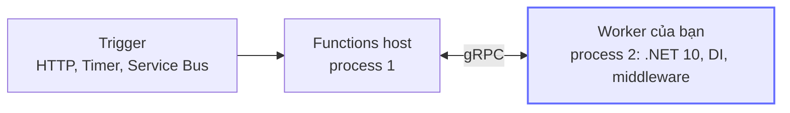
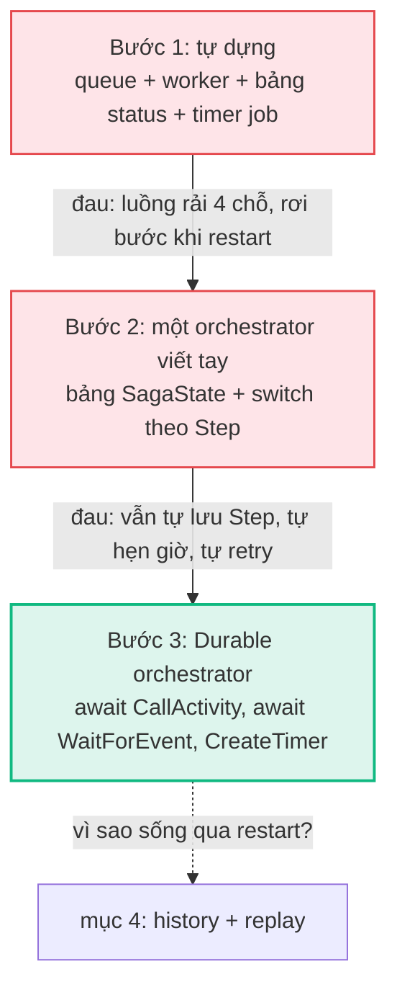
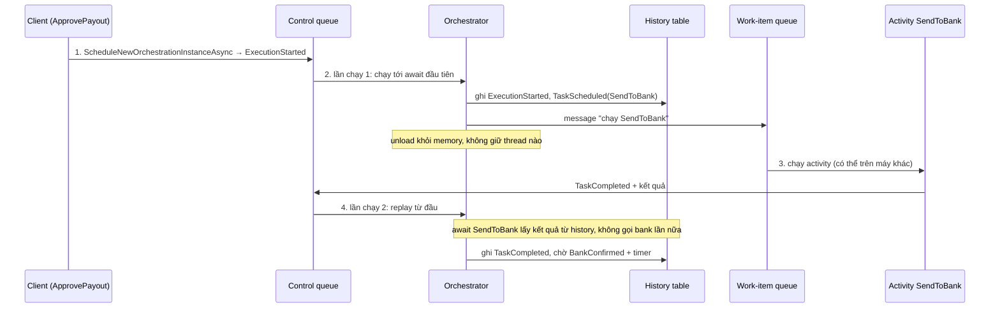
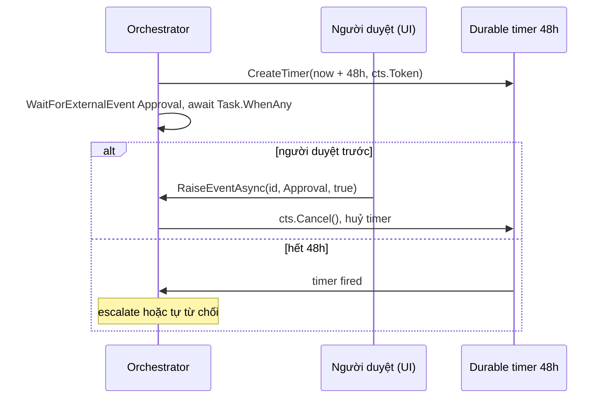

# Azure Functions và Durable Functions

<T>Azure Functions</T> chạy một đoạn code mỗi khi có một trigger (HTTP, timer, message), và mỗi lần chạy phải xong trong vài phút. <T>Durable Functions</T> là phần mở rộng cho phép viết một quy trình dài hàng giờ, hàng ngày (gọi ngân hàng, chờ webhook, chờ người duyệt) thành **code async tuần tự bình thường**, mà vẫn sống sót qua restart. Cơ chế đứng sau là <T>event sourcing</T> + <T>replay</T>: mỗi `await` được ghi thành sự kiện trong history, và code được chạy lại từ đầu để dựng lại trạng thái. Trang đi qua Functions cơ bản, cái đau khi tự dựng workflow dài, cơ chế replay và hệ quả của nó (deterministic, idempotent), các pattern, rồi cách điều khiển một instance đang chạy (pause, resume, đổi hướng), đúng thứ một runtime cho AI agent cần. Đọc trước: [at-least-once và idempotent consumer](/architecture/messaging#at-least-once), [saga và orchestration](/architecture/messaging#saga).

<svg width="0" height="0" style="position:absolute" aria-hidden="true"><defs><marker id="dfInk" viewBox="0 0 10 10" refX="8" refY="5" markerWidth="7" markerHeight="7" orient="auto-start-reverse"><path class="head" d="M0 0L10 5L0 10z"/></marker><marker id="dfOk" viewBox="0 0 10 10" refX="8" refY="5" markerWidth="7" markerHeight="7" orient="auto-start-reverse"><path class="headOk" d="M0 0L10 5L0 10z"/></marker><marker id="dfBad" viewBox="0 0 10 10" refX="8" refY="5" markerWidth="7" markerHeight="7" orient="auto-start-reverse"><path class="headBad" d="M0 0L10 5L0 10z"/></marker><marker id="dfAcc" viewBox="0 0 10 10" refX="8" refY="5" markerWidth="7" markerHeight="7" orient="auto-start-reverse"><path class="headAcc" d="M0 0L10 5L0 10z"/></marker></defs></svg>

## Bản đồ chủ đề {#topic-map}

<div class="fig">
<svg viewBox="0 0 780 565" role="img" aria-label="Bản đồ chủ đề, chín ô. Hàng 1: function gồm trigger và code chạy trong isolated worker; tự dựng workflow là bốn mảnh rời; history và replay. Hàng 2: orchestrator phải deterministic; activity chạy ít nhất một lần; các pattern. Hàng 3: điều khiển instance bằng Suspend, Resume, RaiseEvent, Terminate; audit log do bạn tự ghi; trade-off. Bẫy đỏ: đổi code khi instance đang chạy, giờ máy và Guid trong orchestrator, activity không idempotent, Suspend không dừng activity đang chạy, history không phải audit log.">
<!-- A: functions basics -->
<a href="#functions-basics" style="text-decoration:none">
<rect class="box" x="15" y="15" width="240" height="165" rx="12"/>
<text x="29" y="38" font-size="13" font-weight="600">Function = trigger + code</text>
<path class="boxAcc" d="M49 56 L35 84 L46 84 L39 112 L60 76 L48 76 L56 56 Z"/>
<text x="22" y="130" font-size="10.5" class="muted">HTTP, Timer, Queue</text>
<line class="ln" x1="62" y1="70" x2="122" y2="70" marker-end="url(#dfInk)"/>
<rect class="box" x="126" y="54" width="116" height="30" rx="6"/><text x="184" y="74" font-size="11.5" text-anchor="middle">Functions host</text>
<line class="lnAcc" x1="184" y1="88" x2="184" y2="110" marker-start="url(#dfAcc)" marker-end="url(#dfAcc)"/><text x="192" y="103" font-size="10" class="mono muted">gRPC</text>
<rect class="boxAcc" x="126" y="114" width="116" height="30" rx="6"/><text x="184" y="134" font-size="11.5" text-anchor="middle" class="accT">code của bạn</text>
<text x="29" y="166" font-size="11" class="muted">Consumption: tối đa 10 phút</text>
</a>
<!-- B: problem -->
<a href="#problem" style="text-decoration:none">
<rect class="box" x="270" y="15" width="240" height="165" rx="12"/>
<text x="284" y="38" font-size="13" font-weight="600">Tự dựng: 4 mảnh rời</text>
<rect class="box" x="286" y="54" width="84" height="28" rx="6"/><text x="328" y="72" font-size="11" text-anchor="middle">queue</text>
<rect class="box" x="410" y="54" width="86" height="28" rx="6"/><text x="453" y="72" font-size="11" text-anchor="middle">bảng status</text>
<rect class="box" x="286" y="112" width="84" height="28" rx="6"/><text x="328" y="130" font-size="11" text-anchor="middle">timer job</text>
<rect class="box" x="410" y="112" width="86" height="28" rx="6"/><text x="453" y="130" font-size="11" text-anchor="middle">webhook</text>
<path class="lnMuted" d="M370 70 C 400 120, 390 60, 410 126"/><path class="lnMuted" d="M370 126 C 395 70, 400 130, 410 68"/><path class="lnMuted" d="M328 82 C 360 100, 300 100, 328 112"/><path class="lnMuted" d="M453 82 C 420 98, 486 100, 453 112"/>
<text x="284" y="166" font-size="11" class="muted">restart giữa chừng: rơi một bước</text>
</a>
<!-- C: replay -->
<a href="#replay" style="text-decoration:none">
<rect class="box" x="525" y="15" width="240" height="165" rx="12"/>
<text x="539" y="38" font-size="13" font-weight="600">History + replay</text>
<rect class="boxOk" x="539" y="50" width="96" height="20" rx="4"/><text x="547" y="64" font-size="10" class="mono">Scheduled A</text>
<rect class="boxOk" x="539" y="74" width="96" height="20" rx="4"/><text x="547" y="88" font-size="10" class="mono">Completed A</text>
<rect class="boxAcc" x="539" y="98" width="96" height="20" rx="4"/><text x="547" y="112" font-size="10" class="mono">Scheduled B</text>
<line class="ln" x1="637" y1="84" x2="651" y2="84" marker-end="url(#dfInk)"/>
<rect class="box" x="655" y="50" width="72" height="68" rx="6"/><text x="664" y="72" font-size="10.5" class="mono muted">await A</text><text x="664" y="94" font-size="10.5" class="mono accT" font-weight="600">await B</text><text x="664" y="112" font-size="9.5" class="muted">dừng</text>
<path class="lnAcc" d="M727 108 C 752 108, 752 58, 731 58" marker-end="url(#dfAcc)"/><text x="691" y="136" font-size="10" text-anchor="middle" class="accT">chạy lại từ đầu</text>
<circle class="dotBad" cx="543" cy="162" r="4"/><text x="552" y="166" font-size="11" class="badT">đổi code khi instance đang chạy</text>
</a>
<!-- D: determinism -->
<a href="#determinism" style="text-decoration:none">
<rect class="box" x="15" y="200" width="240" height="165" rx="12"/>
<text x="29" y="223" font-size="13" font-weight="600">Orchestrator: deterministic</text>
<text x="29" y="256" font-size="11.5" class="mono badT">DateTime.UtcNow</text><line class="lnBad" x1="27" y1="252" x2="141" y2="252"/>
<line class="lnOk" x1="60" y1="264" x2="60" y2="290" marker-end="url(#dfOk)"/>
<text x="29" y="308" font-size="11.5" class="mono okT" font-weight="600">context.CurrentUtcDateTime</text>
<text x="29" y="326" font-size="10.5" class="muted">replay ra cùng giá trị</text>
<circle class="dotBad" cx="33" cy="347" r="4"/><text x="42" y="351" font-size="11" class="badT">giờ máy, Guid, I/O trong orchestrator</text>
</a>
<!-- E: activities -->
<a href="#activities" style="text-decoration:none">
<rect class="box" x="270" y="200" width="240" height="165" rx="12"/>
<text x="284" y="223" font-size="13" font-weight="600">Activity: at-least-once</text>
<text x="286" y="254" font-size="10.5" class="muted">lần 1</text><line class="lnBad" x1="318" y1="250" x2="390" y2="268" marker-end="url(#dfBad)"/>
<path class="lnBad" d="M345 249 l8 8 M353 249 l-8 8"/><text x="349" y="245" font-size="9.5" text-anchor="middle" class="badT">crash</text>
<text x="286" y="300" font-size="10.5" class="muted">lần 2</text><line class="lnOk" x1="318" y1="296" x2="390" y2="282" marker-end="url(#dfOk)"/>
<rect class="boxAcc" x="394" y="258" width="102" height="34" rx="6"/><text x="445" y="279" font-size="11" text-anchor="middle" class="mono accT">SendToBank</text>
<text x="284" y="326" font-size="10.5" class="muted">việc chạy lại: phải idempotent</text>
<circle class="dotBad" cx="288" cy="347" r="4"/><text x="297" y="351" font-size="11" class="badT">không idempotent: trả tiền 2 lần</text>
</a>
<!-- F: patterns -->
<a href="#patterns" style="text-decoration:none">
<rect class="box" x="525" y="200" width="240" height="165" rx="12"/>
<text x="539" y="223" font-size="13" font-weight="600">Pattern</text>
<circle class="box" cx="548" cy="270" r="7"/><circle class="box" cx="574" cy="270" r="7"/><circle class="box" cx="600" cy="270" r="7"/><line class="ln" x1="555" y1="270" x2="567" y2="270"/><line class="ln" x1="581" y1="270" x2="593" y2="270"/>
<text x="574" y="300" font-size="10" text-anchor="middle" class="muted">chaining</text>
<circle class="box" cx="626" cy="270" r="6"/><circle class="boxAcc" cx="650" cy="252" r="5"/><circle class="boxAcc" cx="650" cy="270" r="5"/><circle class="boxAcc" cx="650" cy="288" r="5"/><circle class="box" cx="674" cy="270" r="6"/>
<path class="ln" d="M632 268 L645 253 M632 270 L645 270 M632 272 L645 287 M655 253 L668 268 M655 270 L668 270 M655 287 L668 272"/>
<text x="650" y="310" font-size="10" text-anchor="middle" class="muted">fan-out/in</text>
<circle class="box" cx="712" cy="264" r="12"/><path class="ln" d="M712 256 V264 L718 268"/>
<rect class="box" x="729" y="258" width="24" height="16" rx="2"/><path class="ln" d="M729 258 L741 268 L753 258"/>
<text x="732" y="300" font-size="10" text-anchor="middle" class="muted">chờ người</text>
<text x="539" y="340" font-size="10.5" class="muted">+ async HTTP, monitor, entity</text>
</a>
<!-- G: control -->
<a href="#control-api" style="text-decoration:none">
<rect class="box" x="15" y="385" width="240" height="165" rx="12"/>
<text x="29" y="408" font-size="13" font-weight="600">Điều khiển instance</text>
<rect class="boxAcc" x="37" y="432" width="7" height="24" rx="1"/><rect class="boxAcc" x="49" y="432" width="7" height="24" rx="1"/>
<path class="boxAcc" d="M93 432 L113 444 L93 456 Z"/>
<rect class="boxAcc" x="143" y="434" width="30" height="20" rx="2"/><path class="lnAcc" d="M143 434 L158 446 L173 434"/>
<rect class="boxBad" x="204" y="433" width="22" height="22" rx="2"/>
<text x="47" y="476" font-size="9.5" text-anchor="middle">Suspend</text>
<text x="102" y="476" font-size="9.5" text-anchor="middle">Resume</text>
<text x="158" y="476" font-size="9.5" text-anchor="middle">RaiseEvent</text>
<text x="215" y="476" font-size="9.5" text-anchor="middle">Terminate</text>
<text x="29" y="506" font-size="10.5" class="muted">pause, resume, đổi hướng, dừng</text>
<circle class="dotBad" cx="33" cy="532" r="4"/><text x="42" y="536" font-size="11" class="badT">Suspend không dừng activity</text>
</a>
<!-- H: audit -->
<a href="#audit" style="text-decoration:none">
<rect class="box" x="270" y="385" width="240" height="165" rx="12"/>
<text x="284" y="408" font-size="13" font-weight="600">Audit do bạn ghi</text>
<rect class="box" x="290" y="424" width="88" height="70" rx="6"/><text x="334" y="440" font-size="10.5" text-anchor="middle" class="mono">History</text>
<line class="lnMuted" x1="298" y1="452" x2="370" y2="452"/><line class="lnMuted" x1="298" y1="466" x2="370" y2="466"/><line class="lnMuted" x1="298" y1="480" x2="370" y2="480"/>
<text x="334" y="510" font-size="10" text-anchor="middle" class="muted">của framework</text>
<rect class="boxOk" x="402" y="424" width="88" height="70" rx="6"/><text x="446" y="440" font-size="10.5" text-anchor="middle" class="mono okT">AuditLog</text>
<text x="410" y="458" font-size="9.5">ai · bước nào</text><text x="410" y="474" font-size="9.5">lý do · lúc nào</text>
<text x="446" y="510" font-size="10" text-anchor="middle" class="muted">của bạn</text>
<circle class="dotBad" cx="288" cy="532" r="4"/><text x="297" y="536" font-size="11" class="badT">history không phải audit log</text>
</a>
<!-- I: trade-offs -->
<a href="#trade-offs" style="text-decoration:none">
<rect class="box" x="525" y="385" width="240" height="165" rx="12"/>
<text x="539" y="408" font-size="13" font-weight="600">Trade-off</text>
<line class="ln" x1="645" y1="430" x2="645" y2="486"/><path class="box" d="M633 492 L657 492 L645 480 Z"/>
<line class="ln" x1="585" y1="440" x2="705" y2="432"/>
<path class="boxOk" d="M565 452 Q585 470 605 452 Z"/><line class="lnMuted" x1="585" y1="440" x2="568" y2="452"/><line class="lnMuted" x1="585" y1="440" x2="602" y2="452"/>
<path class="boxBad" d="M685 444 Q705 462 725 444 Z"/><line class="lnMuted" x1="705" y1="432" x2="688" y2="444"/><line class="lnMuted" x1="705" y1="432" x2="722" y2="444"/>
<text x="585" y="486" font-size="10" text-anchor="middle" class="okT">state, timer,</text><text x="585" y="499" font-size="10" text-anchor="middle" class="okT">retry sẵn</text>
<text x="705" y="478" font-size="10" text-anchor="middle" class="badT">luật replay,</text><text x="705" y="491" font-size="10" text-anchor="middle" class="badT">lock-in</text>
<text x="539" y="530" font-size="10.5" class="muted">khi nào queue + worker là đủ</text>
</a>
</svg>
<p class="fig-caption">Bấm vào ô để tới mục. Tự hỏi: vì sao code orchestrator được chạy lại nhiều lần mà không gọi ngân hàng nhiều lần? Vậy vì sao activity vẫn phải idempotent?</p>
</div>

## 1. Azure Functions: trigger, host, isolated worker {#functions-basics}

**Một function là một method gắn một trigger; Functions host nghe nguồn sự kiện, gọi method đó, và tự thêm bớt instance theo tải.** Trigger phổ biến: HTTP, Timer (cron), Queue Storage, Service Bus. <T k="function binding">Binding</T> là input/output khai báo bằng attribute (đọc blob, ghi queue) thay cho code SDK.

```csharp
public class Ping
{
    [Function("Ping")]
    public HttpResponseData Run([HttpTrigger(AuthorizationLevel.Function, "get")] HttpRequestData req)
        => req.CreateResponse(HttpStatusCode.OK);
}
```

### Isolated worker: code chạy ở process riêng {#isolated-worker}

**Ở <T>isolated worker</T> model, code của bạn chạy trong một process .NET riêng, nói chuyện với Functions host qua <T>gRPC</T>; host không còn nạp DLL của bạn vào process của nó.**



- **Vì là process riêng**, bạn chọn version .NET (không bị khoá theo version của host), dùng DI, middleware, `IOptions` như app ASP.NET Core thường: `FunctionsApplication.CreateBuilder(args)` (hoặc `HostBuilder` kiểu cũ).
- **In-process model** (DLL chạy chung process với host, `[FunctionName]`, `IDurableOrchestrationContext`) đã hết hỗ trợ ngày **10/11/2026** theo thông báo của Microsoft. Code mới và bài phỏng vấn mặc định là isolated.
- Giá phải trả: thêm một bước gọi qua gRPC giữa hai process. Thường không đáng kể so với I/O.

### Giới hạn thời gian: một function không giữ được workflow dài {#timeouts}

**Mỗi lần chạy bị cắt khi vượt `functionTimeout`, nên một function không thể "ngồi chờ" webhook 24 giờ.** Số liệu theo docs Microsoft lúc viết; đặt trong `host.json`:

| Plan | Mặc định | Tối đa |
|---|---|---|
| Consumption | 5 phút | 10 phút |
| Flex Consumption, Premium, Dedicated | 30 phút | không giới hạn cứng |

- HTTP trigger còn bị giới hạn **230 giây** để trả response (load balancer của Azure), bất kể plan. Việc lâu hơn thì trả 202 rồi làm nền ([async HTTP API](#async-http-api)).
- Consumption scale về 0 khi rảnh, nên request đầu tiên sau đó chịu <T>cold start</T> (nạp process, JIT).

## 2. Vấn đề: workflow dài tự dựng {#problem}

**Một quy trình vừa nhiều bước vừa phải chờ (webhook, người duyệt, hạn chót) cần trạng thái sống lâu hơn mọi process, nên tự dựng thì trạng thái đó bị chia ra nhiều mảnh.** Ví dụ PayoutHub: approve payout, gọi FakeBank chuyển tiền, chờ webhook xác nhận tối đa 24 giờ; quá hạn thì đánh dấu Failed. Một agent run cũng cùng hình: gọi model, gọi tool, chờ người duyệt, lặp lại.

```text
POST /approve      → ghi Payouts.Status = Approved, đẩy message "send" vào queue
Worker             → nhận message, gọi FakeBank, ghi Status = SentToBank, SentAt
Webhook /bank      → tìm payout theo BankRef, ghi Status = Paid
Timer job (5 phút) → SELECT ... WHERE Status = SentToBank AND SentAt < now - 24h → Failed
Retry              → cột Attempts, NextAttemptAt, job khác quét để gửi lại
```

- **Luồng không nằm ở đâu cả**: muốn biết "sau SentToBank là gì" phải đọc bốn chỗ code. Thêm bước "chờ người duyệt nếu > 50 triệu" là sửa cả bốn.
- **Restart giữa hai dòng là rơi bước**: worker gọi FakeBank xong, chết trước khi ghi `SentToBank`; timer job không bao giờ thấy payout này, webhook tới thì không khớp trạng thái.
- **Mọi thứ phụ phải tự viết**: retry có backoff, timeout, correlation webhook với payout, trạng thái cho UI. Đây chính là [saga orchestration](/architecture/messaging#choreography-vs-orchestration) viết tay.

## 3. Ví dụ tiến hoá: từ bảng trạng thái tới code tuần tự {#evolution}

**Mỗi bước dưới đây chữa cái đau của bước trước; bước cuối là cùng quy trình viết thành một method async, framework lo phần "nhớ đang ở đâu".**



Bước 2 là [process manager](/architecture/messaging#choreography-vs-orchestration): một `switch (saga.Step)` đọc từ DB, làm một bước, ghi `Step + 1`. Luồng đã về một chỗ, nhưng code là một state machine băm nhỏ. Bước 3 giữ cùng ý (một coordinator giữ trạng thái) mà viết như code thường. Đủ bốn file, chạy được trên isolated worker:

::: code-group

```csharp [PayoutOrchestrator.cs]
using Microsoft.Azure.Functions.Worker;
using Microsoft.DurableTask;
using Microsoft.Extensions.Logging;

namespace PayoutHub.Functions;

public record PayoutRequest(Guid PayoutId, decimal Amount, string BankAccount);
public record BankConfirmation(string BankRef, bool Success);
public record MarkPayoutInput(Guid PayoutId, string Status);

public static class PayoutOrchestrator
{
    [Function(nameof(PayoutOrchestrator))]
    public static async Task<string> Run([OrchestrationTrigger] TaskOrchestrationContext context)
    {
        var logger = context.CreateReplaySafeLogger(nameof(PayoutOrchestrator)); // không log lặp khi replay
        var request = context.GetInput<PayoutRequest>()!;
        var retry = TaskOptions.FromRetryPolicy(new RetryPolicy(
            maxNumberOfAttempts: 3, firstRetryInterval: TimeSpan.FromSeconds(5)));

        context.SetCustomStatus(new { step = "SendingToBank" });
        await context.CallActivityAsync(nameof(PayoutActivities.SendToBank), request, retry);

        context.SetCustomStatus(new { step = "WaitingForBank" });
        using var cts = new CancellationTokenSource();
        Task<BankConfirmation> confirmation = context.WaitForExternalEvent<BankConfirmation>("BankConfirmed", cts.Token);
        Task deadline = context.CreateTimer(context.CurrentUtcDateTime.AddHours(24), cts.Token);

        Task winner = await Task.WhenAny(confirmation, deadline);
        cts.Cancel(); // huỷ cái còn chờ; timer không huỷ thì instance treo tới hết 24h mới xong

        var status = winner == confirmation && confirmation.Result.Success ? "Paid" : "Failed";
        await context.CallActivityAsync(nameof(PayoutActivities.MarkPayout), new MarkPayoutInput(request.PayoutId, status), retry);

        logger.LogInformation("Payout {PayoutId} kết thúc: {Status}", request.PayoutId, status);
        return status;
    }
}
```

```csharp [PayoutActivities.cs]
using Microsoft.Azure.Functions.Worker;
using Microsoft.Extensions.Logging;

namespace PayoutHub.Functions;

// FakeBankClient, PayoutStore: class của bạn, đăng ký trong Program.cs.
public class PayoutActivities(FakeBankClient bank, PayoutStore store, ILogger<PayoutActivities> logger)
{
    [Function(nameof(SendToBank))]
    public async Task SendToBank([ActivityTrigger] PayoutRequest request)
    {
        // Activity có thể chạy lại: PayoutId làm idempotency key để FakeBank không chuyển tiền hai lần.
        await bank.TransferAsync(idempotencyKey: request.PayoutId, request.Amount, request.BankAccount);
        logger.LogInformation("Đã gửi payout {PayoutId} sang bank", request.PayoutId);
    }

    [Function(nameof(MarkPayout))]
    public Task MarkPayout([ActivityTrigger] MarkPayoutInput input)
        => store.SetStatusAsync(input.PayoutId, input.Status); // gán trạng thái: chạy hai lần vẫn cùng kết quả
}
```

```csharp [PayoutHttp.cs]
using System.Net;
using Microsoft.Azure.Functions.Worker;
using Microsoft.Azure.Functions.Worker.Http;
using Microsoft.DurableTask.Client;

namespace PayoutHub.Functions;

public record BankWebhookBody(Guid PayoutId, string BankRef, bool Success);

public static class PayoutHttp
{
    [Function("ApprovePayout")]
    public static async Task<HttpResponseData> Approve(
        [HttpTrigger(AuthorizationLevel.Function, "post", Route = "payouts/approve")] HttpRequestData req,
        [DurableClient] DurableTaskClient client)
    {
        var input = (await req.ReadFromJsonAsync<PayoutRequest>())!;
        string instanceId = await client.ScheduleNewOrchestrationInstanceAsync(
            nameof(PayoutOrchestrator), input,
            new StartOrchestrationOptions { InstanceId = $"payout-{input.PayoutId}" }); // id do mình đặt: webhook tìm lại được

        return await client.CreateCheckStatusResponseAsync(req, instanceId); // 202 + các URL hỏi trạng thái
    }

    [Function("BankWebhook")]
    public static async Task<HttpResponseData> BankWebhook(
        [HttpTrigger(AuthorizationLevel.Function, "post", Route = "webhooks/bank")] HttpRequestData req,
        [DurableClient] DurableTaskClient client)
    {
        var body = (await req.ReadFromJsonAsync<BankWebhookBody>())!; // thật: verify chữ ký trước
        await client.RaiseEventAsync($"payout-{body.PayoutId}", "BankConfirmed",
            new BankConfirmation(body.BankRef, body.Success));
        return req.CreateResponse(HttpStatusCode.OK);
    }
}
```

```csharp [Program.cs]
using Microsoft.Azure.Functions.Worker.Builder;
using Microsoft.Extensions.DependencyInjection;
using Microsoft.Extensions.Hosting;

var builder = FunctionsApplication.CreateBuilder(args);
builder.ConfigureFunctionsWebApplication(); // HTTP qua ASP.NET Core integration (package ...Worker.Extensions.Http.AspNetCore)

// Durable không cần dòng đăng ký: package Microsoft.Azure.Functions.Worker.Extensions.DurableTask tự gắn extension.
builder.Services.AddHttpClient<FakeBankClient>(c => c.BaseAddress = new Uri(builder.Configuration["FakeBank:Url"]!));
builder.Services.AddScoped<PayoutStore>();

builder.Build().Run();
```

:::

- **Ba loại function**: client (`[DurableClient]`, start và điều khiển instance), <T>orchestrator function</T> (`[OrchestrationTrigger]`, chỉ điều phối), <T>activity function</T> (`[ActivityTrigger]`, làm I/O thật).
- **Webhook tới trước khi orchestrator kịp chờ cũng không mất**: event được lưu vào hàng đợi của instance, `WaitForExternalEvent` sau đó nhận ngay.
- Storage mặc định là connection `AzureWebJobsStorage`; chạy local dùng Azurite. Đổi backend cấu hình trong `host.json` (`extensions.durableTask`).

## 4. Cơ chế: event sourcing và replay {#replay}

**Durable không lưu biến cục bộ hay stack của orchestrator; nó lưu một danh sách sự kiện (history), và mỗi khi có tin mới thì chạy lại orchestrator từ dòng đầu, trả kết quả cũ từ history cho các `await` đã xong.** Đây là <T>Durable Task Framework</T> bên dưới Durable Functions. Theo payout ở mục 3 qua bốn chặng:



Backend mặc định là **Azure Storage** (table cho history và trạng thái instance, queue cho message, blob cho lease). Có thể đổi sang MSSQL, Netherite, hoặc **Durable Task Scheduler** (backend do Azure quản lý, có dashboard). Tất cả instance của một app nằm chung một <T>task hub</T>.

### Chặng 1: start ghi một message, không chạy code ngay {#stage-start}

**`ScheduleNewOrchestrationInstanceAsync` chỉ đặt message `ExecutionStarted` vào control queue rồi trả về instance id; client không chờ orchestrator chạy.** Vì vậy HTTP starter trả 202 ngay. Đặt `InstanceId` bằng id nghiệp vụ (`payout-{id}`) thì webhook và UI tìm lại được instance mà không cần bảng map.

### Chặng 2: chạy tới await đầu, ghi history, unload {#stage-checkpoint}

**Khi orchestrator gặp một `await` trên task chưa có kết quả, framework ghi các sự kiện mới vào history, gửi message cho activity, rồi bỏ orchestrator khỏi memory.**

```text
History sau lần chạy 1 (rút gọn)
#  Event                 Name
0  ExecutionStarted      PayoutOrchestrator   input = {PayoutId: 42, ...}
1  TaskScheduled         SendToBank
```

- Vì không có gì giữ trong memory, nên chờ 24 giờ không tốn thread, không tốn tiền compute (trên Consumption), và không chạm `functionTimeout`: mỗi lần chạy orchestrator chỉ vài mili giây.
- Process chết lúc này cũng không sao: message vẫn nằm trong queue, history vẫn trong table.

### Chặng 3: activity chạy, kết quả quay về như một message {#stage-activity}

**Activity là function thường được kích hoạt bởi message trong work-item queue; xong thì kết quả thành message `TaskCompleted` gửi về control queue của instance.** Activity có thể chạy trên bất kỳ instance nào của app, nên fan-out ra nhiều máy là tự nhiên. Activity bị `functionTimeout` giới hạn như function thường.

### Chặng 4: replay, các await đã xong trả kết quả từ history {#stage-replay}

**Có message mới thì orchestrator chạy lại từ dòng đầu; mỗi `await` tra history theo thứ tự: có kết quả thì trả ngay, gặp chỗ chưa có thì ghi sự kiện mới và dừng lần nữa.**

<div class="fig">
<svg viewBox="0 0 780 342" role="img" aria-label="Ba lần chạy của cùng một orchestrator. Lần 1 do ExecutionStarted: dòng await SendToBank chạy thật, ghi TaskScheduled, dừng; hai dòng sau chưa tới. Lần 2 do TaskCompleted: dòng 1 lấy kết quả từ history, dòng 2 đăng ký chờ BankOk, dừng. Lần 3 do EventRaised: dòng 1 và 2 lấy từ history, dòng 3 schedule MarkPaid. History lớn dần bên dưới mỗi cột.">
<!-- column 1 -->
<circle cx="30" cy="22" r="12" style="fill:var(--vp-c-bg)"/><circle class="boxAcc" cx="30" cy="22" r="12"/><text x="30" y="26.5" font-size="13" text-anchor="middle" font-weight="700" class="accT">1</text>
<text x="50" y="20" font-size="12.5" font-weight="600">Lần chạy 1</text><text x="50" y="35" font-size="10.5" class="muted mono">← ExecutionStarted</text>
<rect class="box" x="15" y="46" width="240" height="106" rx="8"/>
<text x="27" y="72" font-size="11.5" class="mono accT" font-weight="700">await Call("SendToBank")</text>
<text x="27" y="88" font-size="10" class="accT">chạy thật: ghi TaskScheduled, dừng</text>
<g style="opacity:.35"><text x="27" y="112" font-size="11.5" class="mono">await WaitEvent("BankOk")</text><text x="27" y="132" font-size="11.5" class="mono">await Call("MarkPaid")</text></g>
<text x="15" y="176" font-size="11" font-weight="600" class="muted">History sau lần 1</text>
<rect class="boxAcc" x="15" y="184" width="240" height="22" rx="4"/><text x="25" y="199" font-size="10.5" class="mono">ExecutionStarted</text>
<rect class="boxAcc" x="15" y="210" width="240" height="22" rx="4"/><text x="25" y="225" font-size="10.5" class="mono">TaskScheduled SendToBank</text>
<!-- column 2 -->
<circle cx="285" cy="22" r="12" style="fill:var(--vp-c-bg)"/><circle class="boxAcc" cx="285" cy="22" r="12"/><text x="285" y="26.5" font-size="13" text-anchor="middle" font-weight="700" class="accT">2</text>
<text x="305" y="20" font-size="12.5" font-weight="600">Lần chạy 2</text><text x="305" y="35" font-size="10.5" class="muted mono">← TaskCompleted</text>
<rect class="box" x="270" y="46" width="240" height="106" rx="8"/>
<text x="282" y="68" font-size="11.5" class="mono muted">await Call("SendToBank")</text>
<text x="282" y="82" font-size="10" class="okT">lấy từ history, không gọi bank</text>
<text x="282" y="106" font-size="11.5" class="mono accT" font-weight="700">await WaitEvent("BankOk")</text>
<text x="282" y="120" font-size="10" class="accT">đăng ký chờ + timer, dừng</text>
<g style="opacity:.35"><text x="282" y="136" font-size="11.5" class="mono">await Call("MarkPaid")</text></g>
<text x="270" y="176" font-size="11" font-weight="600" class="muted">History sau lần 2</text>
<rect class="box" x="270" y="184" width="240" height="22" rx="4"/><text x="280" y="199" font-size="10.5" class="mono muted">ExecutionStarted</text>
<rect class="box" x="270" y="210" width="240" height="22" rx="4"/><text x="280" y="225" font-size="10.5" class="mono muted">TaskScheduled SendToBank</text>
<rect class="boxAcc" x="270" y="236" width="240" height="22" rx="4"/><text x="280" y="251" font-size="10.5" class="mono">TaskCompleted SendToBank</text>
<!-- column 3 -->
<circle cx="540" cy="22" r="12" style="fill:var(--vp-c-bg)"/><circle class="boxAcc" cx="540" cy="22" r="12"/><text x="540" y="26.5" font-size="13" text-anchor="middle" font-weight="700" class="accT">3</text>
<text x="560" y="20" font-size="12.5" font-weight="600">Lần chạy 3</text><text x="560" y="35" font-size="10.5" class="muted mono">← EventRaised BankOk</text>
<rect class="box" x="525" y="46" width="240" height="106" rx="8"/>
<text x="537" y="68" font-size="11.5" class="mono muted">await Call("SendToBank")</text>
<text x="537" y="92" font-size="11.5" class="mono muted">await WaitEvent("BankOk")</text>
<text x="537" y="106" font-size="10" class="okT">cả hai lấy từ history</text>
<text x="537" y="126" font-size="11.5" class="mono accT" font-weight="700">await Call("MarkPaid")</text>
<text x="537" y="138" font-size="10" class="accT">chạy thật: schedule, dừng</text>
<text x="525" y="176" font-size="11" font-weight="600" class="muted">History sau lần 3</text>
<rect class="box" x="525" y="184" width="240" height="22" rx="4"/><text x="535" y="199" font-size="10.5" class="mono muted">ExecutionStarted</text>
<rect class="box" x="525" y="210" width="240" height="22" rx="4"/><text x="535" y="225" font-size="10.5" class="mono muted">TaskScheduled SendToBank</text>
<rect class="box" x="525" y="236" width="240" height="22" rx="4"/><text x="535" y="251" font-size="10.5" class="mono muted">TaskCompleted SendToBank</text>
<rect class="boxAcc" x="525" y="262" width="240" height="22" rx="4"/><text x="535" y="277" font-size="10.5" class="mono">EventRaised BankOk</text>
<rect class="boxAcc" x="525" y="288" width="240" height="22" rx="4"/><text x="535" y="303" font-size="10.5" class="mono">TaskScheduled MarkPaid</text>
<!-- arrows between columns -->
<line class="lnMuted dash" x1="258" y1="94" x2="266" y2="94"/><line class="lnMuted dash" x1="513" y1="94" x2="521" y2="94"/>
<text x="390" y="332" font-size="11" text-anchor="middle" class="muted">giữa các lần chạy, orchestrator không nằm trong memory; chỉ còn history</text>
</svg>
<p class="fig-caption">Đậm = dòng chạy thật ở lần này; xám = trả kết quả từ history; mờ = chưa tới. Code rút gọn tên method. Tự hỏi: ở lần 3, nếu dòng 1 đọc <code>DateTime.UtcNow</code> và rẽ nhánh khác lần 1 thì history còn khớp không?</p>
</div>

- **Replay chỉ đúng nếu code đi đúng đường cũ**: framework so lệnh `await` thứ n với sự kiện thứ n trong history. Đây là gốc của [luật deterministic](#determinism).
- Vì history chỉ tăng, nên instance chạy rất nhiều vòng sẽ replay chậm dần: dùng [`ContinueAsNew`](#monitor) để bắt đầu lại với history rỗng.
- `context.IsReplaying` cho biết đang replay hay chạy thật; logger tạo từ `CreateReplaySafeLogger` dựa vào đó để không in lặp log.

## 5. Hệ quả 1: orchestrator phải deterministic {#determinism}

**Vì orchestrator được chạy lại nhiều lần và mỗi lần phải ra đúng chuỗi lệnh như lần trước, nên mọi giá trị thay đổi giữa các lần chạy phải lấy từ context (được ghi vào history), còn I/O thì đẩy vào activity.**

| Đừng viết trong orchestrator | Thay bằng | Vì sao |
|---|---|---|
| `DateTime.UtcNow` | `context.CurrentUtcDateTime` | giờ máy mỗi lần replay một khác; giờ của context lấy từ history |
| `Guid.NewGuid()`, `Random` | `context.NewGuid()`, hoặc sinh trong activity | id phải giống nhau ở mọi lần replay |
| HTTP, DB, đọc file, đọc config thay đổi | `CallActivityAsync` | I/O chạy lại mỗi lần replay, và kết quả có thể khác |
| `Task.Delay`, `Thread.Sleep` | `context.CreateTimer` | timer bền được ghi vào history, sống qua restart |
| `Task.Run`, `ConfigureAwait(false)`, thread riêng | chỉ await task do context tạo | orchestrator chạy trên một thread do framework điều khiển |

- Chỉ áp cho **orchestrator**. Activity là code thường: gọi HTTP, DB, `DateTime.UtcNow` thoải mái.
- Vi phạm thường không báo lỗi lúc compile: instance rẽ nhánh khác lúc replay, báo lỗi non-deterministic hoặc treo. Package analyzer `Microsoft.DurableTask.Analyzers` cảnh báo sớm một số trường hợp.

### Versioning: đổi code khi instance đang chạy {#versioning}

**History ghi theo code cũ; deploy code mới thì instance đang chờ sẽ replay bằng code mới, và nếu thứ tự `await` đổi, history không còn khớp.** Payout đang chờ webhook 24 giờ thì deploy bản thêm `await CallActivity("CheckFraud")` trước `SendToBank`: lần replay tới, lệnh thứ nhất là `CheckFraud` nhưng history ghi `SendToBank`.

- **An toàn**: sửa code bên trong activity, thêm bước **sau** điểm mọi instance đang chờ (cẩn thận), sửa log.
- **Nguy hiểm**: đổi thứ tự, thêm, bớt `await`; đổi tên activity; đổi kiểu input/output.
- **Cách xử lý**: tạo orchestrator mới với tên mới (`PayoutOrchestratorV2`) cho instance mới, để bản cũ chạy hết; hoặc deploy song song sang task hub hoặc slot khác; hoặc chờ drain hết instance rồi mới deploy. Bản extension mới có hỗ trợ version cho orchestration (cấu hình version trong `host.json`, đọc `context.Version`); kiểm tra version package trước khi dựa vào.

## 6. Hệ quả 2: activity chạy ít nhất một lần {#activities}

**Activity được kích hoạt bằng message, và framework ghi "đã xong" sau khi activity chạy; process chết ở giữa thì message được giao lại và activity chạy lần nữa, nên activity là <T>at-least-once</T> và phải <T>idempotent</T>.** Đây là đúng luật của [message broker](/architecture/messaging#at-least-once), vì bên dưới chính là queue.

- **Gọi API ngoài**: gửi idempotency key ổn định (`PayoutId`), như `SendToBank` ở mục 3. Cách làm chi tiết: [idempotent consumer](/architecture/messaging#idempotent-consumer).
- **Ghi DB**: gán trạng thái (`Status = Paid`) thay vì cộng dồn; hoặc UNIQUE trên khoá nghiệp vụ.
- Orchestrator cũng có thể chạy một "lần chạy" hai lần (message giao lại), nhưng vô hại vì nó deterministic và không làm I/O.

### Retry: khai báo ở chỗ gọi {#retry}

**Activity throw thì `await CallActivityAsync` throw `TaskFailedException` trong orchestrator; truyền retry policy thì framework tự gọi lại, mỗi lần chờ là một durable timer.**

```csharp
var retry = TaskOptions.FromRetryPolicy(new RetryPolicy(
    maxNumberOfAttempts: 3,
    firstRetryInterval: TimeSpan.FromSeconds(5),
    backoffCoefficient: 2.0));               // 5s, 10s: exponential backoff
await context.CallActivityAsync(nameof(PayoutActivities.SendToBank), request, retry);
```

- Hết lượt thì exception lên orchestrator: `try/catch` để chạy compensation (vd đánh dấu Failed, hoàn lại hạn mức), đúng như [saga](/architecture/messaging#compensation).
- Vì retry chờ bằng durable timer, nên chờ 1 giờ giữa hai lần thử cũng không giữ thread nào. Retry ngắn trong một lần gọi HTTP thì vẫn để `Microsoft.Extensions.Http.Resilience` trong activity lo.

## 7. Các pattern {#patterns}

**Mọi pattern dưới đây chỉ là cách sắp xếp ba loại task mà context tạo ra: activity, timer, external event.**

### Function chaining {#chaining}

**Các bước chạy nối tiếp, output bước trước là input bước sau.** Chính là payout ở mục 3: `SendToBank` → chờ → `MarkPayout`. Lợi so với nối các queue: luồng đọc được từ trên xuống, `try/catch` bao được nhiều bước.

### Fan-out/fan-in {#fan-out-fan-in}

**Tạo nhiều activity task trước rồi mới `await Task.WhenAll`, các activity chạy song song trên nhiều instance; kết quả gom lại khi tất cả xong.**

```csharp
var tasks = payouts.Select(p => context.CallActivityAsync<decimal>("CalcCommission", p)).ToList();
decimal[] amounts = await Task.WhenAll(tasks);   // durable: replay trả lại cả mảng từ history
await context.CallActivityAsync("WriteMonthlyReport", amounts.Sum());
```

- Một activity lỗi thì `await Task.WhenAll` ném **exception đầu tiên**, các task còn lại vẫn chạy xong; muốn biết hết lỗi thì xem từng task. Cơ chế: [exception trong `Task.WhenAll`](/runtime/async#async-exceptions).
- Fan-out hàng nghìn task làm history to: chia lô, hoặc gom bằng sub-orchestration (`CallSubOrchestratorAsync`).

### Async HTTP API {#async-http-api}

**Việc lâu hơn giới hạn HTTP thì endpoint start instance rồi trả 202 Accepted cùng URL hỏi trạng thái; client poll URL đó tới khi xong.** `client.CreateCheckStatusResponseAsync(req, instanceId)` tạo sẵn response đó (header `Location`, body có `statusQueryGetUri`, `sendEventPostUri`, `terminatePostUri`...). Đây là [202 Accepted](/aspnet-core/rest-api) có sẵn, không phải tự viết bảng job.

### Monitor và eternal orchestration {#monitor}

**Vòng lặp "kiểm tra, ngủ bằng durable timer, kiểm tra lại" thay cho timer job; chạy mãi thì gọi `ContinueAsNew` để bắt đầu lần mới với history rỗng.**

```csharp
var status = await context.CallActivityAsync<string>("GetBankStatus", payoutId);
if (status == "Pending" && context.CurrentUtcDateTime < deadline)
{
    await context.CreateTimer(context.CurrentUtcDateTime.AddMinutes(10), CancellationToken.None);
    context.ContinueAsNew(new PollInput(payoutId, deadline)); // không return giá trị: instance chạy lại từ đầu
}
```

Không `ContinueAsNew` mà lặp `while (true)` thì history tăng mãi, replay chậm dần và tốn storage.

### Human interaction: chờ người, có hạn chót {#human-interaction}

**Đua một external event với một durable timer bằng `Task.WhenAny`; bên nào xong trước quyết định nhánh, rồi huỷ bên còn lại.** Ví dụ: payout trên 50 triệu cần người duyệt trong 48 giờ, hoặc agent cần người đồng ý trước khi gọi tool nguy hiểm.



- Code giống hệt đoạn chờ webhook ở [mục 3](#evolution): event và timer dùng chung một `CancellationTokenSource`.
- Không huỷ timer thì instance không chuyển sang Completed tới khi timer hết hạn.
- Có overload `WaitForExternalEvent<T>(name, timeout)` ném `TaskCanceledException` khi hết hạn, gọn hơn khi không cần nhánh riêng.

### Durable entities: biết là có {#durable-entities}

**Entity là một object nhỏ có id và state bền (vd hạn mức chi tiêu của một affiliate), nhận operation tuần tự từng cái một, nên không có race condition trên state đó.** Gọi từ orchestrator hoặc client bằng `SignalEntityAsync` / `CallEntityAsync`. Dùng khi cần một bộ đếm hay khoá phân tán nhỏ; đừng dựng cả domain bằng entity.

## 8. Điều khiển instance đang chạy: runtime cho AI agent {#control-api}

**Một agent run dài (model → tool → model, có lúc chờ người) chính là một orchestrator; pause, resume, đổi hướng, dừng là các lệnh `DurableTaskClient` gửi vào instance qua control queue.**

| Động từ | API trên `DurableTaskClient` | Chuyện xảy ra |
|---|---|---|
| pause | `SuspendInstanceAsync(id, reason)` | status `Suspended`; orchestrator không xử lý message mới tới khi resume. Activity **đang chạy vẫn chạy xong**, kết quả chờ trong queue |
| resume | `ResumeInstanceAsync(id, reason)` | xử lý các message đã dồn, chạy tiếp |
| override, redirect | `RaiseEventAsync(id, "Instruction", payload)` | chỉ có tác dụng nếu orchestrator **có chờ hoặc kiểm tra** event đó; không thì event nằm yên |
| stop | `TerminateInstanceAsync(id, ...)` | status `Terminated`; activity đang chạy không bị huỷ, kết quả bị bỏ |
| xem trạng thái | `GetInstanceAsync(id, getInputsAndOutputs: true)` | `RuntimeStatus`, input/output, custom status do `context.SetCustomStatus` đặt |

Override hay redirect là phần phải thiết kế: orchestrator đăng ký chờ event một lần, rồi kiểm tra **giữa hai bước**.

```csharp
var instruction = context.WaitForExternalEvent<string>("Instruction");
for (var step = 0; step < 20; step++)                       // trần số vòng của agent
{
    if (instruction.IsCompleted)                            // có lệnh mới giữa hai bước
    {
        state = state with { Goal = instruction.Result };   // redirect: đổi mục tiêu
        instruction = context.WaitForExternalEvent<string>("Instruction"); // chờ lệnh kế
    }
    context.SetCustomStatus(new { step, state.Goal });
    var next = await context.CallActivityAsync<AgentStep>("CallModel", state);
    if (next.IsFinal) return next.Answer;
    var output = await context.CallActivityAsync<string>("RunTool", next);
    state = state.With(next, output);
}
```

- Kiểm tra `IsCompleted` là deterministic: event đã nằm ở một vị trí cố định trong history, nên replay thấy đúng như lần đầu.
- Pause có độ hạt **bước**: không cắt ngang được một lời gọi model đang chạy. Muốn dừng nhanh hơn thì activity tự kiểm tra cờ huỷ (DB, cache) giữa các chunk.
- Agent chạy hàng trăm vòng thì `ContinueAsNew` mỗi N vòng, mang state tóm tắt sang lần mới.

### Audit: history không phải audit log {#audit}

**History là log thực thi của framework (sự kiện kỹ thuật, input/output serialize), có thể bị purge, không ghi ai ra lệnh; <T>audit log</T> nghiệp vụ phải do bạn ghi.**

- **Bước của agent**: một activity `WriteAudit` append-only sau mỗi bước (instance id, bước, tool, tóm tắt kết quả, `context.CurrentUtcDateTime`). Activity có thể chạy lại, nên audit cần khoá chống trùng (`InstanceId + Step`).
- **Lệnh của người**: endpoint pause/override ghi "ai, lệnh gì, lý do" **trước** khi gọi `SuspendInstanceAsync` / `RaiseEventAsync`; `reason` của Suspend chỉ là chuỗi, không phải danh tính.
- History chứa input/output nguyên bản (prompt, dữ liệu khách): cân nhắc PII, đặt chính sách `PurgeInstanceAsync` sau N ngày.

## 9. Tự làm lại bản mini {#mini-replay}

**Replay chỉ cần hai thứ: một danh sách kết quả đã lưu, và một context trả kết quả theo thứ tự hoặc báo "dừng ở đây".** Pseudo-code khoảng 15 dòng:

```csharp
class MiniContext(List<object> history)
{
    int _next;                                            // await thứ mấy trong lần chạy này
    public Task<T> CallActivity<T>(Func<T> activity)
    {
        if (_next < history.Count)                        // đã có trong history: trả kết quả cũ
            return Task.FromResult((T)history[_next++]);
        throw new Suspend(() => activity()!);             // chưa có: dừng orchestrator ở đây
    }
}

while (true)                                              // driver
{
    try { var result = await orchestrator(new MiniContext(history)); Save(result); break; }
    catch (Suspend s) { history.Add(s.Run()); SaveHistory(history); } // chạy activity, lưu, replay từ đầu
}
```

Bản thật không throw: nó trả một task chưa hoàn thành để orchestrator "treo" ở `await`, rồi bỏ cả lần chạy đó; activity chạy ở máy khác qua queue thay vì gọi trực tiếp. Nhưng luật thì y hệt: đổi thứ tự `CallActivity` giữa hai lần chạy là `history[_next]` trả nhầm kết quả.

## 10. Biến thể và trade-off {#trade-offs}

**Durable đổi "tự viết state, retry, timer, status" lấy "tuân luật replay và gắn với Azure Functions".**

- **Vì history + replay lưu sẵn mọi bước**, nên state, retry có backoff, timer dài, trạng thái cho UI, pause/resume đều có sẵn; so với `Channel` + `BackgroundService` của PayoutHub (M4), mất process là mất việc đang làm dở, còn Durable thì chạy tiếp.
- **Vì code được replay**, mỗi dev phải thuộc luật deterministic, deploy phải tính [versioning](#versioning), debug khó hơn (breakpoint dừng nhiều lần cho cùng một dòng).
- **Vì backend Azure Storage poll queue và ghi table cho từng sự kiện**, chi phí storage transaction tăng theo số bước, kể cả lúc rảnh; throughput cao cần Netherite hoặc Durable Task Scheduler.
- **Vì API gắn với Durable Task Framework**, đổi cloud nghĩa là viết lại orchestrator.

**Khi nào không dùng:**

- Việc một bước, ngắn: một Service Bus trigger + consumer [idempotent](/architecture/messaging#idempotent-consumer) là đủ, rẻ hơn và throughput cao hơn.
- Rất nhiều event đơn giản (telemetry, click): mỗi event một instance là lãng phí history.
- Cần chạy ngoài Azure Functions hoặc nhiều ngôn ngữ trên nhiều cloud: **Temporal** (cùng ý replay, tự host hoặc cloud, SDK .NET), **Dapr Workflow** (dựng trên Durable Task, chạy trên Kubernetes), **MassTransit saga** (state machine trên broker, không replay code). Talksum (API TypeScript) muốn cùng ý thì Durable Functions có SDK JavaScript/TypeScript, hoặc Temporal.

## Câu hỏi phỏng vấn {#interview}

### Isolated worker và in-process khác nhau thế nào? <Badge type="warning" text="hay bị hỏi" /> {#isolated-vs-in-process}

::: tip Trả lời nhanh
In-process: DLL của bạn chạy chung process với Functions host, phải dùng đúng version .NET host hỗ trợ. Isolated: code chạy ở process .NET riêng, nói chuyện với host qua gRPC; chọn version .NET tự do, có DI, middleware, `FunctionsApplication.CreateBuilder` như ASP.NET Core. In-process đã hết hỗ trợ ngày 10/11/2026. Xem [isolated worker](#isolated-worker).
:::

::: details Câu trả lời mẫu (English)
- In-process: my assembly is loaded into the host process, so I'm tied to the host's .NET version and its dependencies.
- Isolated worker: my code runs in its own .NET process; the host talks to it over gRPC.
- Benefits: pick any supported .NET version, normal DI and middleware, no assembly conflicts with the host.
- Cost: an extra hop between processes, usually negligible next to I/O.
- In-process support ended on 10 November 2026, so isolated is the default for anything new.
:::

::: warning Bẫy & follow-up
**"Durable Functions dùng API nào ở isolated?"**

`TaskOrchestrationContext`, `DurableTaskClient`, package `Microsoft.Azure.Functions.Worker.Extensions.DurableTask`. `IDurableOrchestrationContext` là API của in-process: nói nhầm là lộ chưa dùng bản mới.

**"Function chạy được bao lâu?"**

Consumption: mặc định 5 phút, tối đa 10. HTTP còn giới hạn 230 giây cho response. Vì vậy workflow dài phải dùng Durable hoặc queue. Xem [giới hạn thời gian](#timeouts).
:::

### Durable Functions sống sót qua restart thế nào? <Badge type="warning" text="câu under the hood" /> {#how-replay-works}

::: tip Trả lời nhanh
Event sourcing + replay. Mỗi `await` trên activity, timer, event được ghi thành sự kiện trong history (mặc định Azure Storage table), rồi orchestrator bị unload. Có kết quả mới thì orchestrator chạy lại từ đầu; các `await` đã xong trả kết quả từ history thay vì chạy lại, tới chỗ chưa có thì ghi sự kiện mới và dừng. Không lưu stack hay biến cục bộ. Xem [cơ chế replay](#replay).
:::

::: details Câu trả lời mẫu (English)
- The framework never persists the call stack; it persists an append-only history of events.
- At each await on a durable task it records e.g. TaskScheduled, sends a message to run the activity, and unloads the orchestrator.
- When the result arrives, the orchestrator replays from the top; completed awaits are satisfied from history, so the bank isn't called again.
- When it reaches a task with no result yet, it records new events and suspends again.
- Waiting 24 hours costs no thread and no compute; a crash just means the next message triggers another replay.
:::

::: warning Bẫy & follow-up
**"Vậy history có lớn mãi không?"**

Có, nếu orchestrator lặp mãi. Dùng `ContinueAsNew` để bắt đầu lần mới với history rỗng; purge instance cũ. Xem [monitor](#monitor).

**"Orchestrator chạy bao nhiêu lần?"**

Mỗi lần có message mới là một lần replay từ đầu, nên một dòng log thường bị in nhiều lần: dùng `CreateReplaySafeLogger`.
:::

### Vì sao code orchestrator phải deterministic? <Badge type="warning" text="câu senior" /> {#why-deterministic}

::: tip Trả lời nhanh
Vì orchestrator được replay nhiều lần và framework khớp lệnh `await` thứ n với sự kiện thứ n trong history. Giá trị đổi giữa các lần chạy (giờ máy, `Guid.NewGuid`, kết quả HTTP) làm code rẽ nhánh khác, history không khớp. Dùng `context.CurrentUtcDateTime`, `context.NewGuid()`, `context.CreateTimer`; mọi I/O vào activity. Xem [deterministic](#determinism).
:::

::: details Câu trả lời mẫu (English)
- Replay re-executes the orchestrator from the start and matches each durable call against the recorded history, in order.
- Anything that differs between runs breaks that: DateTime.UtcNow, Guid.NewGuid, random, direct HTTP or DB calls.
- Replacements: context.CurrentUtcDateTime and context.NewGuid come from history; CreateTimer instead of Task.Delay.
- All I/O goes into activities, which are normal code and run once per attempt, not on every replay.
- The Durable analyzers package flags some violations at build time.
:::

::: warning Bẫy & follow-up
**"Đọc config trong orchestrator được không?"**

Không an toàn nếu config đổi được lúc chạy: hai lần replay đọc hai giá trị. Đọc trong activity hoặc truyền vào input.

**"Activity có phải deterministic không?"**

Không. Activity là code thường; luật chỉ áp cho orchestrator. Activity cần **idempotent**, đó là luật khác. Xem [activity](#activities).
:::

### Activity có thể chạy hai lần không? Retry thế nào? <Badge type="warning" text="câu senior" /> {#activity-idempotency-retry}

::: tip Trả lời nhanh
Có. Activity chạy theo message, at-least-once: crash sau khi làm xong nhưng trước khi kết quả được ghi thì activity chạy lại. Nên activity phải idempotent: idempotency key khi gọi API ngoài (`PayoutId`), gán trạng thái thay vì cộng dồn, UNIQUE trên khoá nghiệp vụ. Retry khai báo bằng `TaskOptions.FromRetryPolicy(new RetryPolicy(...))` ở chỗ gọi; hết lượt thì `TaskFailedException` lên orchestrator để chạy compensation. Xem [activity](#activities), [retry](#retry).
:::

::: details Câu trả lời mẫu (English)
- Durable runs on queues, so activities are at-least-once, exactly like a message consumer.
- I make them idempotent: a stable idempotency key for external calls, set-status instead of increment, unique constraints.
- Retry is declared at the call site with a RetryPolicy: attempts, first interval, backoff coefficient.
- Waits between retries are durable timers, so a one-hour backoff holds no thread.
- When retries are exhausted the orchestrator gets a TaskFailedException and runs compensation, saga-style.
:::

::: warning Bẫy & follow-up
**"Retry policy có làm activity idempotent không?"**

Không, ngược lại: retry là thêm lý do để chạy lại. Idempotent vẫn là việc của activity.

**"Retry bằng Polly trong activity hay bằng Durable?"**

Lỗi tạm thời ngắn (vài trăm ms) trong một lời gọi HTTP: Polly / `Http.Resilience` trong activity. Chờ lâu giữa các lần thử, hoặc cần thấy lượt thử trong history: retry policy của Durable.
:::

### Làm sao để pause, resume, override một agent run đang chạy? <Badge type="warning" text="câu của vị trí" /> {#control-agent-run}

::: tip Trả lời nhanh
Agent run là một orchestrator instance. Pause/resume: `SuspendInstanceAsync` / `ResumeInstanceAsync`. Override/redirect: `RaiseEventAsync(id, "Instruction", payload)`, và orchestrator phải chủ động kiểm tra event đó giữa hai bước. Dừng hẳn: `TerminateInstanceAsync`. Trạng thái: `GetInstanceAsync` + `SetCustomStatus`. Audit: activity append-only mỗi bước + ghi ai ra lệnh ở endpoint điều khiển. Xem [điều khiển instance](#control-api).
:::

::: details Câu trả lời mẫu (English)
- I'd model each agent run as one orchestration; the instance id is the run id.
- Pause and resume map to SuspendInstanceAsync and ResumeInstanceAsync; messages queue up while suspended.
- Override or redirect is an external event: the orchestrator registers WaitForExternalEvent once and checks it between steps.
- Status for the UI comes from GetInstanceAsync plus SetCustomStatus with the current step.
- Audit is my own append-only table: one row per step from an activity, and one row per operator command with who and why.
- Honest framing: I haven't run Durable in production; this is how I'd map the mechanism to the requirement.
:::

::: warning Bẫy & follow-up
**"Pause có dừng ngay lời gọi model đang chạy không?"**

Không. Suspend dừng orchestrator ở điểm `await` kế; activity đang chạy vẫn chạy xong. Muốn cắt nhanh hơn thì activity tự kiểm tra cờ huỷ giữa các chunk.

**"Terminate thì sao?"**

Instance thành `Terminated`, nhưng activity đang chạy không bị huỷ; tác dụng phụ (đã gọi tool) vẫn xảy ra. Cần compensation riêng.

**"Sao không đọc history làm audit?"**

History là log kỹ thuật, có thể purge, không có danh tính người ra lệnh. Xem [audit](#audit).
:::

### Chờ người duyệt nhưng có hạn chót, viết thế nào? {#human-in-the-loop-timeout}

::: tip Trả lời nhanh
`WaitForExternalEvent<T>("Approval", cts.Token)` và `CreateTimer(context.CurrentUtcDateTime.AddHours(48), cts.Token)`, rồi `await Task.WhenAny`. Bên nào thắng quyết định nhánh; gọi `cts.Cancel()` để huỷ bên còn lại, nếu không instance không Completed được tới khi timer hết. UI gửi quyết định bằng `RaiseEventAsync`. Xem [human interaction](#human-interaction).
:::

::: details Câu trả lời mẫu (English)
- Race an external event against a durable timer with Task.WhenAny.
- Both share one CancellationTokenSource; I cancel after the race so the timer doesn't keep the instance alive.
- Use context.CurrentUtcDateTime for the deadline, never DateTime.UtcNow.
- The approval UI calls RaiseEventAsync with the instance id; an event that arrives early is buffered, not lost.
- On timeout: escalate or auto-reject, and write an audit row either way.
:::

::: warning Bẫy & follow-up
**"Dùng `Task.Delay(48h)` được không?"**

Không: không bền (restart là mất), giữ worker, phá determinism. Phải là durable timer.

**"Người duyệt bấm hai lần?"**

Lần hai là event thứ hai, không ai chờ thì nằm yên; nhưng endpoint nên kiểm tra trạng thái instance và idempotent theo id quyết định.
:::

### Durable Functions hay queue + worker tự viết? <Badge type="warning" text="câu trade-off" /> {#durable-vs-queue-worker}

::: tip Trả lời nhanh
Một bước, ngắn, throughput cao: Service Bus trigger + consumer idempotent. Nhiều bước, có chờ (webhook, người, hạn chót), cần trạng thái và retry dài: Durable, vì state, timer, retry, status API có sẵn. Giá: luật deterministic, versioning, chi phí storage, gắn với Azure. Thẳng thắn: chưa chạy Durable ở production; PayoutHub dùng `Channel` + `BackgroundService` và thấy rõ chỗ nó mất việc khi restart. Xem [trade-off](#trade-offs).
:::

::: details Câu trả lời mẫu (English)
- In my learning project the background work is a Channel plus a BackgroundService: simple, but a restart loses in-flight work and there's no timer or status.
- A hand-rolled multi-step flow needs a queue, a status table, a timer job and webhook correlation; state ends up in four places.
- Durable gives me that as plain sequential code: state, durable timers, retries, a status endpoint.
- Costs: determinism rules, careful versioning of in-flight instances, storage transactions per step, lock-in to the Durable Task model.
- For single-step, high-volume events I'd still use a plain Service Bus trigger with an idempotent handler.
- I haven't run Durable in production; this is the mechanism and trade-off as I understand it.
:::

::: warning Bẫy & follow-up
**"Ngoài Azure thì dùng gì?"**

Temporal (cùng ý replay), Dapr Workflow (dựng trên Durable Task), MassTransit saga (state machine trên broker).

**"Durable có thay được Service Bus không?"**

Không thay; bên dưới nó cũng là queue. Durable là lớp điều phối, Service Bus vẫn là kênh giữa các service.
:::

### Deploy code mới khi còn instance đang chạy thì sao? <Badge type="warning" text="câu senior" /> {#orchestration-versioning}

::: tip Trả lời nhanh
Instance đang chờ sẽ replay bằng code mới trên history cũ. Đổi thứ tự hoặc thêm bớt `await`, đổi tên activity, đổi kiểu input làm history không khớp, instance lỗi. Cách xử lý: orchestrator mới tên mới cho instance mới, để bản cũ chạy hết; deploy song song task hub hoặc slot khác; hoặc drain rồi deploy. Bản mới của extension có hỗ trợ version orchestration. Xem [versioning](#versioning).
:::

::: details Câu trả lời mẫu (English)
- In-flight instances replay with the new code against old history.
- Safe: changes inside activities, logging. Breaking: reordering or adding awaits, renaming activities, changing payload types.
- Options: a new orchestrator name for new instances while old ones drain; side-by-side deployment to a separate task hub or slot; or wait for drain.
- Newer extension versions add orchestration versioning support; I'd check the package version before relying on it.
- Long waits (24h webhooks, human approvals) make this a real deployment concern, so I'd plan it upfront.
:::

::: warning Bẫy & follow-up
**"Thêm một bước ở cuối có an toàn không?"**

Thường an toàn cho instance đang chờ ở bước trước: các `await` cũ vẫn khớp history, tới cuối thì chạy thêm bước mới. Rủi ro là khi bước mới chen vào chỗ mà instance đã đi qua. Cách chắc nhất: test bằng cách replay history thật của instance đang chạy.
:::

## Tự kiểm tra {#self-check}

::: details 1. Orchestrator chờ webhook 24 giờ. Trong 24 giờ đó có thread nào bị giữ không? Function timeout 10 phút có cắt nó không?
Không thread nào: sau khi ghi history, orchestrator bị unload; chỉ còn message trong queue và dòng trong table. Timeout không cắt vì mỗi lần chạy orchestrator chỉ vài mili giây; timeout chỉ áp cho từng lần chạy (và cho activity).
:::

::: details 2. Vì sao orchestrator chạy lại từ đầu nhiều lần mà FakeBank không bị gọi nhiều lần?
Vì lời gọi bank nằm trong activity. Lúc replay, `await CallActivityAsync("SendToBank")` thấy `TaskCompleted` trong history và trả kết quả cũ, không gửi message chạy activity nữa.
:::

::: details 3. Vậy vì sao SendToBank vẫn phải idempotent?
Activity chạy theo message, at-least-once: crash sau khi bank đã chuyển tiền nhưng trước khi `TaskCompleted` được ghi thì activity chạy lại. Replay bảo vệ khỏi việc chạy lại *do replay*, không bảo vệ khỏi giao lại message.
:::

::: details 4. Orchestrator đọc DateTime.UtcNow: trước 12 giờ thì gọi activity A, sau đó thì gọi B. Chạy lúc 11:59, activity xong lúc 12:01. Chuyện gì xảy ra?
Lần 1 schedule A. Lần replay lúc 12:01 rẽ sang B, nhưng history ghi A: không khớp, instance lỗi non-deterministic (hoặc chạy sai). Dùng `context.CurrentUtcDateTime`.
:::

::: details 5. Webhook của bank tới trước khi orchestrator chạy tới WaitForExternalEvent. Event có mất không?
Không: event được lưu cho instance, `WaitForExternalEvent` sau đó nhận ngay. Nhưng nếu instance id sai hoặc instance chưa tồn tại thì không ai nhận, nên đặt instance id theo id nghiệp vụ.
:::

::: details 6. Thắng event duyệt nhưng quên cts.Cancel(). Hậu quả?
Logic chạy đúng nhánh, nhưng timer vẫn còn: instance không Completed tới khi hết 48 giờ, status sai trên UI.
:::

::: details 7. Operator bấm Pause khi agent đang trong một lời gọi model dài 40 giây. Bao lâu sau agent dừng, và lời gọi đó có bị bỏ không?
Lời gọi model chạy xong (activity không bị dừng). Orchestrator không xử lý kết quả cho tới khi Resume; lúc resume, kết quả được dùng như thường. Độ hạt pause là một bước.
:::

::: details 8. Agent chạy 500 vòng, mỗi vòng hai activity. Vì sao càng về sau mỗi bước càng chậm, và sửa thế nào?
History khoảng vài nghìn sự kiện, mỗi lần chạy phải replay hết. `ContinueAsNew` mỗi N vòng với state tóm tắt để history về rỗng.
:::
