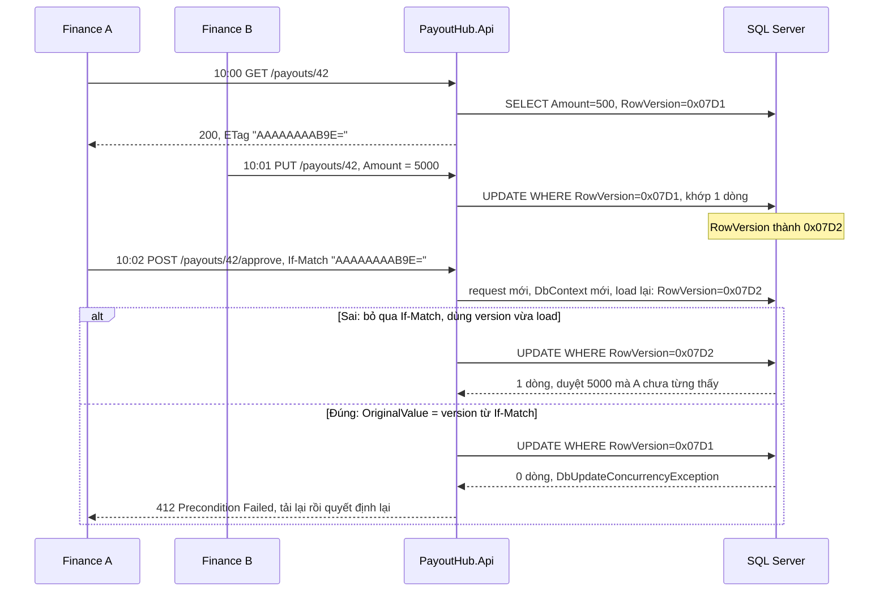

# EF Core: query, tracking, concurrency

<T>EF Core</T> dịch LINQ thành SQL và giữ dấu các object nó đã load để biết phải ghi gì xuống. Hai việc đó sinh ra ba lỗi hay gặp nhất khi làm backend: **N+1 query**, **ghi đè dữ liệu do tracking dùng sai chỗ**, và **lost update khi hai người sửa cùng lúc**. Trang này đi qua cả ba trên cùng một màn hình của PayoutHub: trang finance liệt kê payout chờ duyệt, nút Approve, và hai người finance cùng bấm. Đọc trước nếu cần: [IEnumerable vs IQueryable](/dotnet/collections-linq#ienumerable-vs-iqueryable), [vì sao `DbContext` là scoped](/aspnet-core/dependency-injection#lifetime-cache). Phần index và query chậm phía SQL nằm ở [SQL chậm](/data/sql-performance).

<svg width="0" height="0" style="position:absolute" aria-hidden="true"><defs><marker id="eAcc" viewBox="0 0 10 10" refX="8" refY="5" markerWidth="7" markerHeight="7" orient="auto-start-reverse"><path class="headAcc" d="M0 0L10 5L0 10z"/></marker><marker id="eInk" viewBox="0 0 10 10" refX="8" refY="5" markerWidth="7" markerHeight="7" orient="auto-start-reverse"><path class="head" d="M0 0L10 5L0 10z"/></marker><marker id="eOk" viewBox="0 0 10 10" refX="8" refY="5" markerWidth="7" markerHeight="7" orient="auto-start-reverse"><path class="headOk" d="M0 0L10 5L0 10z"/></marker><marker id="eBad" viewBox="0 0 10 10" refX="8" refY="5" markerWidth="7" markerHeight="7" orient="auto-start-reverse"><path class="headBad" d="M0 0L10 5L0 10z"/></marker></defs></svg>

## Bản đồ chủ đề {#topic-map}

<div class="fig">
<svg viewBox="0 0 720 500" role="img" aria-label="Bản đồ chủ đề EF Core: trang list và N+1, nút Approve và change tracking, hai người cùng duyệt và optimistic concurrency"><rect class="box dash" x="10" y="8" width="226" height="480" rx="10"/><text x="22" y="28" font-size="12.5" font-weight="600" class="muted">Trang list · 50 payout Pending</text><a href="#n-plus-one" style="text-decoration:none"><rect class="boxBad" x="10" y="48" width="226" height="74" rx="8"/><circle cx="30" cy="70" r="12" style="fill:var(--vp-c-bg)"/><circle class="boxAcc" cx="30" cy="70" r="12"/><text x="30" y="75" font-size="13" text-anchor="middle" font-weight="700" class="accT">1</text><text x="50" y="75" font-size="13" font-weight="600" class="badT">N+1: 51 query</text><text x="24" y="98" font-size="11.5">lazy loading bật, hoặc</text><text x="24" y="114" font-size="11.5">query nằm trong vòng lặp</text></a><line class="ln" x1="123" y1="122" x2="123" y2="134" marker-end="url(#eInk)"/><a href="#include" style="text-decoration:none"><rect class="boxOk" x="10" y="136" width="226" height="74" rx="8"/><circle cx="30" cy="158" r="12" style="fill:var(--vp-c-bg)"/><circle class="boxAcc" cx="30" cy="158" r="12"/><text x="30" y="163" font-size="13" text-anchor="middle" font-weight="700" class="accT">2</text><text x="50" y="163" font-size="13" font-weight="600" class="okT">Include = eager loading</text><text x="24" y="186" font-size="11.5">1 query JOIN: là thuốc chữa N+1,</text><text x="24" y="202" font-size="11.5">không phải nguyên nhân</text></a><line class="ln" x1="123" y1="210" x2="123" y2="222" marker-end="url(#eInk)"/><a href="#projection" style="text-decoration:none"><rect class="boxOk" x="10" y="224" width="226" height="74" rx="8"/><circle cx="30" cy="246" r="12" style="fill:var(--vp-c-bg)"/><circle class="boxAcc" cx="30" cy="246" r="12"/><text x="30" y="251" font-size="13" text-anchor="middle" font-weight="700" class="accT">3</text><text x="50" y="251" font-size="13" font-weight="600" class="okT">Select sang DTO</text><text x="24" y="274" font-size="11.5">1 query, chỉ các cột cần,</text><text x="24" y="290" font-size="11.5">không track: tốt nhất cho list</text></a><line class="ln" x1="123" y1="298" x2="123" y2="310" marker-end="url(#eInk)"/><a href="#split-query" style="text-decoration:none"><rect class="box" x="10" y="312" width="226" height="74" rx="8"/><circle cx="30" cy="334" r="12" style="fill:var(--vp-c-bg)"/><circle class="boxAcc" cx="30" cy="334" r="12"/><text x="30" y="339" font-size="13" text-anchor="middle" font-weight="700" class="accT">4</text><text x="50" y="339" font-size="13" font-weight="600">AsSplitQuery</text><text x="24" y="362" font-size="11.5">Include collection nhân số dòng</text><text x="24" y="378" font-size="11.5">→ tách thành vài query</text></a><line class="ln" x1="123" y1="386" x2="123" y2="398" marker-end="url(#eInk)"/><a href="#detect-n-plus-one" style="text-decoration:none"><rect class="box" x="10" y="400" width="226" height="74" rx="8"/><circle cx="30" cy="422" r="12" style="fill:var(--vp-c-bg)"/><circle class="boxAcc" cx="30" cy="422" r="12"/><text x="30" y="427" font-size="13" text-anchor="middle" font-weight="700" class="accT">5</text><text x="50" y="427" font-size="13" font-weight="600">Đếm query trong log</text><text x="24" y="450" font-size="11.5">"Executed DbCommand"</text><text x="24" y="466" font-size="11.5">mỗi request bao nhiêu dòng?</text></a><rect class="boxAcc dash" x="247" y="8" width="226" height="480" rx="10"/><text x="259" y="28" font-size="12.5" font-weight="600" class="muted">Nút Approve · payout 42</text><a href="#change-tracking" style="text-decoration:none"><rect class="boxAcc" x="247" y="48" width="226" height="74" rx="8"/><circle cx="267" cy="70" r="12" style="fill:var(--vp-c-bg)"/><circle class="boxAcc" cx="267" cy="70" r="12"/><text x="267" y="75" font-size="13" text-anchor="middle" font-weight="700" class="accT">6</text><text x="287" y="75" font-size="13" font-weight="600" class="accT">Snapshot + DetectChanges</text><text x="261" y="98" font-size="11.5">so object với bản chụp lúc load</text><text x="261" y="114" font-size="11.5">→ UPDATE chỉ cột đã đổi</text></a><line class="ln" x1="360" y1="122" x2="360" y2="134" marker-end="url(#eInk)"/><a href="#tracking-cost" style="text-decoration:none"><rect class="boxOk" x="247" y="136" width="226" height="74" rx="8"/><circle cx="267" cy="158" r="12" style="fill:var(--vp-c-bg)"/><circle class="boxAcc" cx="267" cy="158" r="12"/><text x="267" y="163" font-size="13" text-anchor="middle" font-weight="700" class="accT">7</text><text x="287" y="163" font-size="13" font-weight="600" class="okT">AsNoTracking khi chỉ đọc</text><text x="261" y="186" font-size="11.5">không snapshot: bớt RAM, CPU</text><text x="261" y="202" font-size="11.5">đổi lại: SaveChanges không thấy</text></a><line class="ln" x1="360" y1="210" x2="360" y2="222" marker-end="url(#eInk)"/><a href="#no-tracking-trap" style="text-decoration:none"><rect class="boxBad" x="247" y="224" width="226" height="74" rx="8"/><circle cx="267" cy="246" r="12" style="fill:var(--vp-c-bg)"/><circle class="boxAcc" cx="267" cy="246" r="12"/><text x="267" y="251" font-size="13" text-anchor="middle" font-weight="700" class="accT">8</text><text x="287" y="251" font-size="13" font-weight="600" class="badT">NoTracking + Update()</text><text x="261" y="274" font-size="11.5">không có snapshot → SET mọi cột</text><text x="261" y="290" font-size="11.5">→ xoá mất Note người khác vừa ghi</text></a><line class="ln" x1="360" y1="298" x2="360" y2="310" marker-end="url(#eInk)"/><a href="#same-key" style="text-decoration:none"><rect class="boxBad" x="247" y="312" width="226" height="74" rx="8"/><circle cx="267" cy="334" r="12" style="fill:var(--vp-c-bg)"/><circle class="boxAcc" cx="267" cy="334" r="12"/><text x="267" y="339" font-size="13" text-anchor="middle" font-weight="700" class="accT">9</text><text x="287" y="339" font-size="13" font-weight="600" class="badT">Hai object cùng Id 42</text><text x="261" y="362" font-size="11.5">một context giữ 1 object/khoá</text><text x="261" y="378" font-size="11.5">→ InvalidOperationException</text></a><rect class="box dash" x="484" y="8" width="226" height="480" rx="10"/><text x="496" y="28" font-size="12.5" font-weight="600" class="muted">Hai finance cùng duyệt</text><a href="#rowversion" style="text-decoration:none"><rect class="boxAcc" x="484" y="48" width="226" height="74" rx="8"/><circle cx="504" cy="70" r="12" style="fill:var(--vp-c-bg)"/><circle class="boxAcc" cx="504" cy="70" r="12"/><text x="504" y="75" font-size="13" text-anchor="middle" font-weight="700" class="accT">10</text><text x="524" y="75" font-size="13" font-weight="600" class="accT">WHERE RowVersion = gốc</text><text x="498" y="98" font-size="11.5">0 dòng bị UPDATE →</text><text x="498" y="114" font-size="11.5">DbUpdateConcurrencyException</text></a><line class="ln" x1="597" y1="122" x2="597" y2="134" marker-end="url(#eInk)"/><a href="#version-round-trip" style="text-decoration:none"><rect class="boxBad" x="484" y="136" width="226" height="74" rx="8"/><circle cx="504" cy="158" r="12" style="fill:var(--vp-c-bg)"/><circle class="boxAcc" cx="504" cy="158" r="12"/><text x="504" y="163" font-size="13" text-anchor="middle" font-weight="700" class="accT">11</text><text x="524" y="163" font-size="13" font-weight="600" class="badT">Version đi qua client</text><text x="498" y="186" font-size="11.5">load lại trong POST = check rỗng;</text><text x="498" y="202" font-size="11.5">ETag → If-Match → OriginalValue</text></a><line class="ln" x1="597" y1="210" x2="597" y2="222" marker-end="url(#eInk)"/><a href="#conditional-update" style="text-decoration:none"><rect class="boxOk" x="484" y="224" width="226" height="74" rx="8"/><circle cx="504" cy="246" r="12" style="fill:var(--vp-c-bg)"/><circle class="boxAcc" cx="504" cy="246" r="12"/><text x="504" y="251" font-size="13" text-anchor="middle" font-weight="700" class="accT">12</text><text x="524" y="251" font-size="13" font-weight="600" class="okT">409 / 412, hoặc</text><text x="498" y="274" font-size="11.5">ExecuteUpdate WHERE Status =</text><text x="498" y="290" font-size="11.5">Pending, kiểm số dòng bị đổi</text></a><text x="597" y="342" font-size="11.5" text-anchor="middle" class="muted">Tracking chỉ cứu cột khác nhau.</text><text x="597" y="360" font-size="11.5" text-anchor="middle" class="muted">Hai người sửa cùng một cột</text><text x="597" y="376" font-size="11.5" text-anchor="middle" class="muted">(Status) thì cần cột 3.</text></svg>
<p class="fig-caption">Ba cột là ba việc trên cùng một màn hình. Đỏ là cái đau, xanh lá là cách chữa. Ôn lại: nhìn từng ô và tự giải thích vì sao; ô nào không nói được thì bấm vào.</p>
</div>

## 1. Một màn hình, ba cái đau {#problem}

Entity dùng xuyên suốt trang (rút gọn, cấu hình EF đặt ở Infrastructure bằng Fluent API):

```csharp
namespace PayoutHub.Core;

public enum PayoutStatus { Pending, Approved, Rejected, Paid }

public class Payout
{
    public int Id { get; private set; }
    public int AffiliateId { get; private set; }
    public Affiliate Affiliate { get; private set; } = null!;   // navigation
    public decimal Amount { get; private set; }
    public PayoutStatus Status { get; private set; }
    public string Note { get; set; } = "";
    public DateTime CreatedAt { get; private set; }
    public byte[] RowVersion { get; private set; } = [];        // dùng ở mục 4

    public void Approve()
    {
        if (Status != PayoutStatus.Pending)
            throw new InvalidOperationException($"Payout {Id} đang {Status}, không duyệt được");
        Status = PayoutStatus.Approved;
    }
}
```

Màn hình finance có ba việc, mỗi việc một cái đau:

- **Trang list** hiện 50 payout `Pending` kèm tên affiliate. Mở trang thấy chậm, log có **51 câu SQL** cho một request.
- **Nút Approve** của payout 42. Có người đọc payout bằng `AsNoTracking` cho nhanh, bấm Approve không lưu gì; "sửa" bằng `db.Update(payout)` thì lưu được, nhưng ghi chú người khác vừa thêm **biến mất**.
- **Hai người finance** cùng mở payout 42. Người B sửa `Amount` từ 500 thành 5.000, người A vẫn đang nhìn số 500 và bấm Approve: hệ thống **duyệt 5.000 mà A chưa từng thấy**.

Ba mục tiếp theo chữa lần lượt từng cái.

## 2. N+1: 50 payout thành 51 query {#n-plus-one}

**Navigation property (`p.Affiliate`) không tự có dữ liệu: EF chỉ lấy bảng `Affiliates` khi query yêu cầu.** Nếu query không yêu cầu mà code vẫn cần, thì có hai khả năng: hoặc navigation là `null`, hoặc có thứ gì đó chạy thêm một query cho **từng dòng**. Trường hợp sau là <T>N+1</T>: 1 query lấy list, N query lấy dữ liệu liên quan.

### Hai cách gây ra N+1 {#n-plus-one-causes}

**Cách 1: lazy loading.** Proxy của EF chặn lần đọc `p.Affiliate` đầu tiên và chạy một `SELECT` ngay lúc đó. Vì lần đọc nằm trong vòng lặp nên mỗi vòng một query. Lazy loading **tắt mặc định** trong EF Core; phải tự bật đủ ba thứ: package `Microsoft.EntityFrameworkCore.Proxies`, gọi `UseLazyLoadingProxies()`, và navigation khai báo `virtual`. Không bật thì `p.Affiliate` là `null` và dòng dưới ném `NullReferenceException`, không có N+1. (<T>EF6</T> trên .NET Framework bật lazy loading mặc định, nên code cũ hay dính N+1 mà không ai viết query trong vòng lặp.)

**Cách 2: tự query trong vòng lặp.** Không cần proxy, chỉ cần một `await db...` nằm trong `foreach`.

::: code-group

```csharp [Lazy loading]
// Program.cs: options.UseSqlServer(cs).UseLazyLoadingProxies();
// Payout:     public virtual Affiliate Affiliate { get; private set; }
var payouts = await db.Payouts
    .Where(p => p.Status == PayoutStatus.Pending)
    .OrderBy(p => p.CreatedAt).Take(50)
    .ToListAsync(ct);                                   // query 1

var rows = payouts
    .Select(p => new PayoutRow(p.Id, p.Amount, p.Affiliate.Name)) // mỗi p: thêm 1 query
    .ToList();
```

```csharp [Query trong vòng lặp]
var payouts = await db.Payouts
    .Where(p => p.Status == PayoutStatus.Pending)
    .OrderBy(p => p.CreatedAt).Take(50)
    .ToListAsync(ct);                                   // query 1

var rows = new List<PayoutRow>();
foreach (var p in payouts)
{
    var name = await db.Affiliates                      // query 2..51
        .Where(a => a.Id == p.AffiliateId)
        .Select(a => a.Name)
        .SingleAsync(ct);
    rows.Add(new PayoutRow(p.Id, p.Amount, name));
}
```

:::

Mỗi query riêng lẻ đều nhanh (1–2 ms), nên chạy thử với 5 dòng thì không thấy gì. Cái giá là **số round-trip nối đuôi nhau**: 51 lần đi về DB, cộng thêm 51 lần mượn connection từ <T>connection pool</T>. Trang 50 dòng mất 100 ms; trang 500 dòng mất 1 giây, và DB bị gọi gấp 500 lần dưới tải.

::: warning Bẫy: "lúc chạy được, lúc null"
Không bật lazy loading mà `p.Affiliate` lúc có lúc không: đó là **relationship fix-up**. Nếu affiliate đó đã được load trước trong cùng `DbContext`, EF tự gắn nó vào navigation. Code chạy đúng trong test (đã load sẵn) và null trên production. Đừng dựa vào nó; hỏi rõ dữ liệu cần bằng `Include` hoặc `Select`.
:::

### Chữa: từ 51 query về 1 {#n-plus-one-fixes}

Cả hai cách chữa đều làm một việc: **nói trước cho EF biết cần bảng nào**, để EF gộp vào một câu SQL có JOIN.

<div class="fig">
<svg viewBox="0 0 720 344" role="img" aria-label="Ba nấc chữa N+1: lazy loading 51 query, Include 1 query JOIN, Select sang DTO 1 query 3 cột, nhánh collection dùng AsSplitQuery">
<rect class="boxBad" x="20" y="10" width="680" height="70" rx="8"/>
<text x="36" y="34" font-size="14" font-weight="600" class="badT">Nấc 0 · Lazy loading / query trong vòng lặp</text>
<text x="36" y="60" font-size="11" class="mono">foreach (var p in payouts) … p.Affiliate.Name</text>
<text x="460" y="58" font-size="12" font-weight="600" class="badT">1 + 50 = 51 query</text>
<line class="ln" x1="580" y1="80" x2="580" y2="92" marker-end="url(#eInk)"/>
<rect class="boxOk" x="20" y="94" width="680" height="70" rx="8"/>
<text x="36" y="118" font-size="14" font-weight="600" class="okT">Nấc 1 · Include = eager loading</text>
<text x="36" y="144" font-size="11" class="mono">db.Payouts.Include(p =&gt; p.Affiliate)</text>
<text x="460" y="118" font-size="12" font-weight="600" class="okT">1 query, JOIN Affiliates</text>
<text x="460" y="140" font-size="12" class="muted">còn: mọi cột của cả 2 bảng,</text>
<text x="460" y="156" font-size="12" class="muted">mọi object bị track</text>
<line class="ln" x1="580" y1="164" x2="580" y2="176" marker-end="url(#eInk)"/>
<rect class="boxOk" x="20" y="178" width="680" height="70" rx="8"/>
<text x="36" y="202" font-size="14" font-weight="600" class="okT">Nấc 2 · Select sang DTO (projection)</text>
<text x="36" y="228" font-size="11" class="mono">.Select(p =&gt; new PayoutRow(p.Id, p.Affiliate.Name))</text>
<text x="460" y="202" font-size="12" font-weight="600" class="okT">1 query, chỉ các cột cần</text>
<text x="460" y="224" font-size="12" class="muted">không track: DTO không phải entity</text>
<text x="460" y="240" font-size="12" class="muted">tốt nhất cho trang list</text>
<rect class="box dash" x="20" y="264" width="680" height="70" rx="8"/>
<text x="36" y="288" font-size="14" font-weight="600">Nhánh · Include hai collection</text>
<text x="36" y="314" font-size="11" class="mono">Include(a =&gt; a.Payouts).Include(a =&gt; a.Conversions)</text>
<text x="460" y="288" font-size="12">1 query: 50 × 200 = 10.000 dòng</text>
<text x="460" y="304" font-size="12">cho mỗi affiliate</text>
<text x="460" y="324" font-size="12" class="accT">→ AsSplitQuery: 3 query nhỏ</text>
</svg>
<p class="fig-caption">Đọc từ trên xuống: mỗi nấc chữa phần "còn" của nấc trên. Eager loading (Include) nằm ở nấc chữa, không phải ở nấc gây bệnh. Nhánh dưới là trường hợp riêng khi load collection.</p>
</div>

### Include: eager loading là thuốc, không phải bệnh {#include}

**Eager loading** nghĩa là "load trước, ngay trong query chính": `Include` thêm JOIN vào câu SQL đầu tiên, nên khi vòng lặp đọc `p.Affiliate` thì dữ liệu đã nằm sẵn trong RAM, không còn gì để query thêm. Ngược với lazy loading ("load lúc cần, từng cái một"), chính là thứ gây N+1.

```csharp
var payouts = await db.Payouts
    .Include(p => p.Affiliate)                          // eager: JOIN ngay trong query 1
    .Where(p => p.Status == PayoutStatus.Pending)
    .OrderBy(p => p.CreatedAt).Take(50)
    .ToListAsync(ct);
```

```sql
-- SQL EF sinh ra (rút gọn): MỘT câu
SELECT TOP(@p) p.Id, p.AffiliateId, p.Amount, p.CreatedAt, p.Note, p.RowVersion, p.Status,
       a.Id, a.Name, a.Email, a.BankAccount, ...
FROM Payouts p
INNER JOIN Affiliates a ON p.AffiliateId = a.Id
WHERE p.Status = N'Pending'
ORDER BY p.CreatedAt;
```

Phần "còn" của nấc này: `Include` lấy **cả entity**, mọi cột của cả hai bảng, kể cả `Note` dài và `BankAccount` mà trang list không hiện; và mọi object đều bị [change tracking](#change-tracking) giữ snapshot. Hợp lý khi bạn load để **sửa** (trang chi tiết, nút Approve); thừa khi chỉ để **hiển thị**.

### Select sang DTO: tốt nhất cho trang list {#projection}

**Projection**: `Select` sang một class chỉ chứa thứ màn hình cần. EF đọc biểu thức `Select`, thấy `p.Affiliate.Name` thì tự thêm JOIN, và chỉ đưa vào `SELECT` những cột được nhắc tới. Không cần `Include`: `Include` chỉ có nghĩa khi trả về entity, có `Select` thì EF bỏ qua nó.

```csharp
public sealed record PayoutRow(int Id, decimal Amount, DateTime CreatedAt, string AffiliateName);

var rows = await db.Payouts
    .Where(p => p.Status == PayoutStatus.Pending)
    .OrderBy(p => p.CreatedAt)
    .Select(p => new PayoutRow(p.Id, p.Amount, p.CreatedAt, p.Affiliate.Name))
    .Take(50)
    .ToListAsync(ct);
```

```sql
SELECT TOP(@p) p.Id, p.Amount, p.CreatedAt, a.Name
FROM Payouts p
INNER JOIN Affiliates a ON p.AffiliateId = a.Id
WHERE p.Status = N'Pending'
ORDER BY p.CreatedAt;
```

Vì `PayoutRow` không phải entity nên EF **không track** nó: không snapshot, không cần `AsNoTracking`. Ít cột còn mở đường cho SQL Server trả lời bằng index mà không phải quay lại bảng, xem [INCLUDE và covering index](/data/sql-performance#covering).

### Include collection: AsSplitQuery {#split-query}

**JOIN trả về một bảng phẳng: mỗi dòng con lặp lại toàn bộ cột của dòng cha.** Với navigation một-một (`p.Affiliate`) thì không sao. Với collection thì số dòng nhân lên: trang chi tiết affiliate `Include(a => a.Payouts)` (50 payout) thì cột affiliate bị lặp 50 lần; thêm `.Include(a => a.Conversions)` (200 conversion) ngang hàng thì SQL trả **50 × 200 = 10.000 dòng** cho một affiliate. Đó là <T>cartesian explosion</T>.

```csharp
var affiliate = await db.Affiliates
    .Include(a => a.Payouts)
    .Include(a => a.Conversions)
    .AsSplitQuery()                                     // 3 query: Affiliates, Payouts, Conversions
    .SingleAsync(a => a.Id == id, ct);
```

`AsSplitQuery` tách mỗi collection thành một query riêng, tổng 1 + 50 + 200 dòng. Đổi lại: nhiều round-trip hơn, và các query chạy ở những thời điểm khác nhau nên **không cùng một snapshot dữ liệu** nếu không bọc transaction. Khi một query `Include` từ hai collection trở lên mà không chọn chế độ, EF Core ghi một warning vào log gợi ý chuyện này. Muốn đổi mặc định cho cả context: `UseQuerySplittingBehavior(QuerySplittingBehavior.SplitQuery)` trong `UseSqlServer(...)`.

### Phát hiện: đếm query trong log {#detect-n-plus-one}

**Mỗi câu SQL EF chạy là một dòng log `Executed DbCommand` ở mức Information, category `Microsoft.EntityFrameworkCore.Database.Command`.** Đếm số dòng đó cho một request là biết có N+1 hay không.

- **Trong PayoutHub**: khi `AddDbContext` được đăng ký, EF ghi log qua `ILogger` của app. `appsettings.json` hiện tại để `Default: Information` và chỉ hạ `Microsoft.AspNetCore` xuống Warning, nên dòng này **sẽ hiện** trong console (dạng JSON, vì `Program.cs` dùng `AddJsonConsole`). Giá trị tham số hiện là `?` trừ khi bật `EnableSensitiveDataLogging()`; chỉ bật ở Development.
- **Console app, test, hoặc muốn chữ thường không qua logger của app**: `LogTo`.

```csharp
builder.Services.AddDbContext<PayoutDbContext>(o => o
    .UseSqlServer(cs)
    .LogTo(Console.WriteLine, LogLevel.Information));   // in thẳng SQL và thời gian ra console
```

```
info: Microsoft.EntityFrameworkCore.Database.Command[20101]
      Executed DbCommand (2ms) [Parameters=[@id='?' (DbType = Int32)], CommandType='Text', CommandTimeout='30']
      SELECT TOP(2) a.Name FROM Affiliates AS a WHERE a.Id = @id
```

Thấy cùng một câu SQL lặp lại 50 lần chỉ khác tham số là N+1. Trong integration test có thể khoá lại bằng một `DbCommandInterceptor` đếm số lệnh và assert "trang list ≤ 2 query".

## 3. Change tracking: EF biết cột nào đã đổi bằng cách nào {#change-tracking}

**Khi load entity có tracking, `DbContext` cất một bản chụp (snapshot) giá trị gốc của từng property. `SaveChanges` gọi `DetectChanges`, so object hiện tại với bản chụp, và chỉ đưa những cột khác vào `UPDATE`.** Bạn không cần báo "tôi đã sửa Status": EF tự so ra. Mọi hành vi ở mục này suy ra từ câu đó.

<div class="fig">
<svg viewBox="0 0 720 366" role="img" aria-label="Change tracking: load payout 42, DbContext giữ object và snapshot, SaveChanges so sánh và sinh UPDATE chỉ cột Status">
<path class="box" d="M20 74 L20 226 A70 14 0 0 0 160 226 L160 74 A70 14 0 0 0 20 74 Z"/>
<ellipse class="box" cx="90" cy="74" rx="70" ry="14"/>
<text x="90" y="112" font-size="13" font-weight="600" text-anchor="middle">SQL Server</text>
<text x="90" y="136" font-size="11" text-anchor="middle" class="mono">Payouts · Id 42</text>
<text x="90" y="160" font-size="11" text-anchor="middle" class="mono">Status: Pending</text>
<text x="90" y="178" font-size="11" text-anchor="middle" class="mono">Note: urgent</text>
<text x="90" y="196" font-size="11" text-anchor="middle" class="mono">Amount: 500</text>
<rect class="boxAcc dash" x="206" y="14" width="296" height="314" rx="10"/>
<text x="222" y="36" font-size="13" font-weight="600" class="accT">DbContext của request này</text>
<rect class="box" x="222" y="50" width="264" height="96" rx="8"/>
<text x="236" y="70" font-size="12" font-weight="600">Object Payout#42 (code bạn giữ)</text>
<text x="236" y="94" font-size="12" class="mono accT">Status = Approved</text>
<text x="236" y="114" font-size="12" class="mono">Note   = urgent</text>
<text x="236" y="134" font-size="12" class="mono">Amount = 500</text>
<rect class="boxOk" x="222" y="200" width="264" height="96" rx="8"/>
<text x="236" y="220" font-size="12" font-weight="600" class="okT">Snapshot gốc (ChangeTracker)</text>
<text x="236" y="244" font-size="12" class="mono">Status = Pending</text>
<text x="236" y="264" font-size="12" class="mono">Note   = urgent</text>
<text x="236" y="284" font-size="12" class="mono">Amount = 500</text>
<line class="lnAcc dash" x1="300" y1="148" x2="300" y2="198"/>
<text x="312" y="170" font-size="11.5" class="accT">DetectChanges: so từng cột</text>
<text x="312" y="188" font-size="11.5" class="accT">chỉ Status khác → Modified</text>
<text x="354" y="318" font-size="11" text-anchor="middle" class="muted">State: Unchanged → Modified</text>
<line class="ln" x1="162" y1="104" x2="218" y2="98" marker-end="url(#eInk)"/>
<line class="ln" x1="162" y1="196" x2="218" y2="240" marker-end="url(#eInk)"/>
<rect class="boxOk" x="534" y="150" width="172" height="80" rx="8"/>
<text x="546" y="174" font-size="11.5" class="mono">UPDATE Payouts</text>
<text x="546" y="194" font-size="11.5" class="mono">SET Status = @p0</text>
<text x="546" y="214" font-size="11.5" class="mono">WHERE Id = @p1</text>
<line class="lnAcc" x1="504" y1="190" x2="530" y2="190" marker-end="url(#eAcc)"/>
<path class="lnOk" d="M620 230 L620 352 L90 352 L90 246" fill="none" marker-end="url(#eOk)"/><text x="630" y="300" font-size="11.5" class="okT">gửi xuống DB</text>
<g font-size="13" font-weight="700" text-anchor="middle">
<circle cx="190" cy="88" r="12" style="fill:var(--vp-c-bg)"/><circle class="boxAcc" cx="190" cy="88" r="12"/><text x="190" y="93" class="accT">1</text>
<circle cx="190" cy="232" r="12" style="fill:var(--vp-c-bg)"/><circle class="boxAcc" cx="190" cy="232" r="12"/><text x="190" y="237" class="accT">2</text>
<circle cx="486" cy="94" r="12" style="fill:var(--vp-c-bg)"/><circle class="boxAcc" cx="486" cy="94" r="12"/><text x="486" y="99" class="accT">3</text>
<circle cx="300" cy="148" r="12" style="fill:var(--vp-c-bg)"/><circle class="boxAcc" cx="300" cy="148" r="12"/><text x="300" y="153" class="accT">4</text>
<circle cx="534" cy="150" r="12" style="fill:var(--vp-c-bg)"/><circle class="boxAcc" cx="534" cy="150" r="12"/><text x="534" y="155" class="accT">5</text>
</g>
<text x="620" y="130" font-size="11.5" text-anchor="middle" class="accT">SaveChanges()</text>
</svg>
<p class="fig-caption">Nút Approve của payout 42. Snapshot (xanh lá) không đổi từ lúc load; object (trên) là thứ code bạn sửa. UPDATE chỉ mang cột khác nhau giữa hai bản.</p>
</div>

1. **Load**: `db.Payouts.SingleAsync(p => p.Id == 42)` chạy `SELECT`, EF tạo object `Payout`.
2. **Chụp snapshot**: cùng lúc, `ChangeTracker` cất giá trị gốc của từng property, state `Unchanged`. Context cũng ghi nhớ "khoá 42 ↔ object này" (identity map), nên load lại payout 42 trong cùng context trả về **đúng object cũ**.
3. **Code sửa object**: `payout.Approve()` đổi `Status`. EF chưa biết gì; đây chỉ là gán property trên object C# thường.
4. **`SaveChanges` gọi `DetectChanges`**: so từng property của từng entity đang được track với snapshot. `Status` khác, nên property đó thành Modified và entity thành `Modified`.
5. **Sinh SQL**: `UPDATE Payouts SET Status = @p0 WHERE Id = @p1`. `Note`, `Amount` không có mặt vì không đổi. Xong thì snapshot được cập nhật theo giá trị mới.

### Tự viết một change tracker mini {#mini-tracker}

Bỏ hết tối ưu đi thì cơ chế chỉ còn chừng này:

```csharp
namespace MiniEf;

public sealed class MiniTracker
{
    // khoá entity → (object, snapshot giá trị gốc)
    private readonly Dictionary<int, (object Entity, Dictionary<string, object?> Snapshot)> _entries = [];

    public void Track(int id, object entity) =>
        _entries[id] = (entity, entity.GetType().GetProperties().ToDictionary(p => p.Name, p => p.GetValue(entity)));

    // DetectChanges + sinh UPDATE chỉ với cột khác snapshot
    public IEnumerable<string> BuildUpdates(string table)
    {
        foreach (var (id, (entity, snapshot)) in _entries)
        {
            var changed = entity.GetType().GetProperties()
                .Where(p => !Equals(p.GetValue(entity), snapshot[p.Name]))
                .Select(p => $"{p.Name} = '{p.GetValue(entity)}'")
                .ToList();
            if (changed.Count > 0)
                yield return $"UPDATE {table} SET {string.Join(", ", changed)} WHERE Id = {id}";
        }
    }
}
```

Đọc code là thấy luôn hai hệ quả của mục tiếp theo: `_entries` lớn theo **số entity được track** (RAM), và `BuildUpdates` duyệt **mọi property của mọi entity** mỗi lần save (CPU). Entity không nằm trong `_entries` thì không bao giờ được ghi.

### Cái giá: snapshot và DetectChanges {#tracking-cost}

**Tracking tốn RAM cho snapshot và CPU cho `DetectChanges`, cả hai tăng theo số entity đang được track.** Trang list 50 dòng thì không đáng kể; job đọc 100.000 conversion để tổng hợp thì gấp đôi bộ nhớ và mỗi `SaveChanges` phải duyệt cả 100.000. Vì vậy query **chỉ để đọc** thì tắt tracking:

```csharp
var payouts = await db.Payouts
    .AsNoTracking()                                     // không snapshot, không identity map
    .Where(p => p.Status == PayoutStatus.Pending)
    .ToListAsync(ct);
```

- **`AsNoTracking`**: không snapshot, không identity map. Hệ quả của việc không có identity map: `Include(p => p.Affiliate)` cho 50 payout của 3 affiliate tạo ra **50 object `Affiliate`**, mỗi dòng một bản, thay vì 3.
- **`AsNoTrackingWithIdentityResolution`**: vẫn không track sau khi query xong, nhưng trong lúc dựng kết quả thì gộp các dòng cùng khoá thành một object (3 affiliate). Dùng khi kết quả có nhiều dữ liệu lặp và bạn cần so sánh object theo reference.
- **`Select` sang DTO**: không track sẵn, vì DTO không phải entity. Đây là lý do [projection](#projection) thường là lựa chọn mặc định cho đọc.
- Cả context mặc định không track: `UseQueryTrackingBehavior(QueryTrackingBehavior.NoTracking)`, rồi chỗ nào cần sửa thì gọi `AsTracking()`.

### Bẫy: đọc AsNoTracking rồi sửa {#no-tracking-trap}

Cùng nguyên lý, đặt sai chỗ: **entity không có trong ChangeTracker thì `SaveChanges` không biết nó tồn tại.**

**Bước 1: lưu không được, và không báo lỗi.**

```csharp
var payout = await db.Payouts.AsNoTracking().SingleAsync(p => p.Id == id, ct);
payout.Approve();                       // Status = Approved trên object C#
var n = await db.SaveChangesAsync(ct);  // n == 0: không có UPDATE nào, không exception
```

API trả 204, finance thấy "đã duyệt", DB vẫn `Pending`.

**Bước 2: "sửa" bằng `db.Update(payout)`, và làm mất dữ liệu.** `Update` gắn object vào context với state `Modified`. Nhưng context **không có snapshot** của object này, nên không thể biết cột nào đã đổi; nó đánh dấu **mọi cột là Modified** và `UPDATE` ghi lại mọi cột bằng giá trị đang nằm trong object. Giá trị đó cũ bao nhiêu thì ghi đè bấy nhiêu.

Cụ thể với payout 42. Object trong tay A được đọc lúc 10:00 (bằng `AsNoTracking`, hoặc client gửi nguyên object đã nhận lúc 10:00 lên trong body):

<Compare :labels="['Update() trên object cũ', 'Load lại có tracking']" caption="Cùng một chuỗi sự kiện. Update() không có snapshot nên ghi lại mọi cột từ object 10:00, xoá Note của B. Load có tracking lúc 10:02 có snapshot chứa Note mới nhất, nên UPDATE chỉ đụng Status.">
<template #a>
<svg viewBox="0 0 720 270" role="img" aria-label="Timeline: 10:00 A đọc Note rỗng, 10:01 B ghi Note urgent, 10:02 A gọi Update ghi lại mọi cột, Note bị xoá">
<g font-size="12" font-weight="600" class="muted"><text x="20" y="22">Giờ</text><text x="84" y="22">Finance A (bạn)</text><text x="340" y="22">Finance B</text><text x="516" y="22">Dòng 42 trong DB</text></g>
<line class="lnMuted" x1="20" y1="32" x2="700" y2="32"/>
<g font-size="13" font-weight="700"><text x="20" y="58">10:00</text><text x="20" y="118">10:01</text><text x="20" y="178">10:02</text></g>
<text x="84" y="56" font-size="11.5">đọc payout 42 bằng AsNoTracking</text>
<text x="84" y="74" font-size="11.5" class="mono">trong tay: Note = ""</text>
<rect class="box" x="516" y="40" width="184" height="44" rx="6"/><text x="528" y="58" font-size="11.5" class="mono">Pending</text><text x="528" y="76" font-size="11.5" class="mono">Note = ""</text>
<line class="lnMuted" x1="20" y1="92" x2="700" y2="92"/>
<text x="84" y="118" font-size="11.5" class="muted">đang xem màn hình</text>
<text x="340" y="112" font-size="11.5">ghi Note = "urgent"</text>
<text x="340" y="130" font-size="11.5" class="okT">SaveChanges, 1 dòng</text>
<rect class="box" x="516" y="100" width="184" height="44" rx="6"/><text x="528" y="118" font-size="11.5" class="mono">Pending</text><text x="528" y="136" font-size="11.5" class="mono okT">Note = "urgent"</text>
<line class="lnMuted" x1="20" y1="152" x2="700" y2="152"/>
<text x="84" y="172" font-size="11.5" class="mono">payout.Approve();</text>
<text x="84" y="190" font-size="11.5" class="mono badT">db.Update(payout); Save</text>
<text x="340" y="180" font-size="11.5" class="muted">không làm gì</text>
<rect class="boxBad" x="516" y="160" width="184" height="44" rx="6"/><text x="528" y="178" font-size="11.5" class="mono">Approved</text><text x="528" y="196" font-size="11.5" class="mono badT">Note = ""  (mất)</text>
<rect class="boxBad" x="20" y="222" width="680" height="38" rx="6"/>
<text x="32" y="246" font-size="11" class="mono">UPDATE Payouts SET AffiliateId=@p0, Amount=@p1, CreatedAt=@p2, Note=@p3, Status=@p4 WHERE Id=@p5</text>
</svg>
</template>
<template #b>
<svg viewBox="0 0 720 270" role="img" aria-label="Timeline: 10:02 A load lại có tracking, snapshot có Note urgent, UPDATE chỉ cột Status, Note được giữ">
<g font-size="12" font-weight="600" class="muted"><text x="20" y="22">Giờ</text><text x="84" y="22">Finance A (bạn)</text><text x="340" y="22">Finance B</text><text x="516" y="22">Dòng 42 trong DB</text></g>
<line class="lnMuted" x1="20" y1="32" x2="700" y2="32"/>
<g font-size="13" font-weight="700"><text x="20" y="58">10:00</text><text x="20" y="118">10:01</text><text x="20" y="178">10:02</text></g>
<text x="84" y="56" font-size="11.5">mở màn hình, thấy payout 42</text>
<text x="84" y="74" font-size="11.5" class="mono">Note = ""</text>
<rect class="box" x="516" y="40" width="184" height="44" rx="6"/><text x="528" y="58" font-size="11.5" class="mono">Pending</text><text x="528" y="76" font-size="11.5" class="mono">Note = ""</text>
<line class="lnMuted" x1="20" y1="92" x2="700" y2="92"/>
<text x="84" y="118" font-size="11.5" class="muted">đang xem màn hình</text>
<text x="340" y="112" font-size="11.5">ghi Note = "urgent"</text>
<text x="340" y="130" font-size="11.5" class="okT">SaveChanges, 1 dòng</text>
<rect class="box" x="516" y="100" width="184" height="44" rx="6"/><text x="528" y="118" font-size="11.5" class="mono">Pending</text><text x="528" y="136" font-size="11.5" class="mono okT">Note = "urgent"</text>
<line class="lnMuted" x1="20" y1="152" x2="700" y2="152"/>
<text x="84" y="172" font-size="11.5">POST approve: load lại, có tracking</text>
<text x="84" y="190" font-size="11.5" class="mono okT">snapshot: Note = "urgent"</text>
<text x="340" y="180" font-size="11.5" class="muted">không làm gì</text>
<rect class="boxOk" x="516" y="160" width="184" height="44" rx="6"/><text x="528" y="178" font-size="11.5" class="mono">Approved</text><text x="528" y="196" font-size="11.5" class="mono okT">Note = "urgent"</text>
<rect class="boxOk" x="20" y="222" width="680" height="38" rx="6"/>
<text x="32" y="246" font-size="11" class="mono">UPDATE Payouts SET Status=@p0 WHERE Id=@p1</text>
</svg>
</template>
</Compare>

- Với `Update()`: `UPDATE` mang **mọi cột**, `Note=@p3` là chuỗi rỗng đọc từ lúc 10:00, nên ghi chú "urgent" B vừa lưu lúc 10:01 bị xoá. Không ai nhận được lỗi. `Update` còn lan theo navigation: nếu `payout.Affiliate` đã được load thì affiliate đó cũng bị `UPDATE` mọi cột.
- Với load có tracking: request approve lúc 10:02 load lại payout 42, snapshot chứa `Note = "urgent"`. `Approve()` chỉ đổi `Status`, `DetectChanges` chỉ thấy `Status` khác, `UPDATE` chỉ có `SET Status`. Ghi chú của B được giữ.

Kết luận thực hành: **load để sửa thì load có tracking, rồi gọi method nghiệp vụ trên entity**. `Update()` chỉ dành cho trường hợp bạn cố ý thay **toàn bộ** entity bằng dữ liệu bạn chắc là đầy đủ và mới nhất.

Tracking chỉ cứu khi hai người sửa **hai cột khác nhau**. Nếu cả hai cùng sửa `Status` (A duyệt, B từ chối cùng lúc), hoặc A quyết định dựa trên `Amount` cũ, thì vẫn mất dữ liệu: đó là việc của [optimistic concurrency](#concurrency).

### Hai object cùng khoá: InvalidOperationException {#same-key}

**Một `DbContext` chỉ giữ tối đa một object cho mỗi khoá** (identity map ở bước 2 của [hình trên](#change-tracking)). Gắn object thứ hai cùng khoá vào thì EF không biết bản nào là thật, nên từ chối:

```csharp
var current = await db.Payouts.FindAsync([id], ct);                         // context đang track Payout 42
var stale = await db.Payouts.AsNoTracking().SingleAsync(p => p.Id == id, ct); // object khác, cùng Id 42
db.Update(stale);
// InvalidOperationException: The instance of entity type 'Payout' cannot be tracked because
// another instance with the key value '{Id: 42}' is already being tracked.
```

Hay gặp khi một request vừa load entity để kiểm tra, vừa nhận một object cùng Id từ body rồi `Update`/`Attach` nó. Sửa: chỉ giữ một object, chép giá trị cần đổi vào object đang được track (gọi method nghiệp vụ), không gắn object thứ hai. Cũng là lý do `DbContext` sống lâu (singleton, hoặc dùng lại qua nhiều job) hay nổ lỗi này: context tích luỹ object qua thời gian. Mỗi request một context, xem [Lifetime](/aspnet-core/dependency-injection#lifetime-cache).

## 4. Optimistic concurrency: hai người cùng duyệt {#concurrency}

**Optimistic concurrency không khoá gì lúc đọc. Nó chỉ kiểm tra lúc ghi: dòng này có còn đúng là phiên bản tôi đã đọc không? EF làm việc đó bằng cách thêm version gốc vào `WHERE` của `UPDATE`; nếu có người đã sửa thì không dòng nào khớp, 0 dòng bị đổi, EF ném `DbUpdateConcurrencyException`.** "Optimistic" vì giả định xung đột hiếm: không trả giá khoá cho mọi lần đọc, chỉ xử lý khi xung đột thật sự xảy ra.

Không có nó thì người ghi sau thắng (last write wins): A duyệt, B từ chối cùng lúc, kết quả là của ai `SaveChanges` sau, người kia không biết. Đó là <T>lost update</T>.

### Cơ chế: version nằm trong WHERE {#rowversion}

Trên SQL Server, cột <T>rowversion</T> do DB tự tăng mỗi lần dòng bị `UPDATE`, bất kể cột nào đổi. Khai báo trong cấu hình EF:

::: code-group

```csharp [SQL Server]
// Payout: public byte[] RowVersion { get; private set; } = [];
// PayoutConfiguration : IEntityTypeConfiguration<Payout>
builder.Property(p => p.RowVersion).IsRowVersion();     // hoặc [Timestamp] trên property
```

```csharp [PostgreSQL (Npgsql)]
// Postgres không có rowversion; dùng cột hệ thống xmin (id transaction ghi dòng gần nhất).
// Payout: public uint Version { get; private set; }
builder.Property(p => p.Version).IsRowVersion();        // Npgsql map uint + IsRowVersion sang xmin
```

:::

Từ đó, mọi `UPDATE` của entity này có thêm điều kiện:

```sql
-- SQL EF sinh khi SaveChanges (rút gọn)
UPDATE Payouts SET Status = @p0
OUTPUT INSERTED.RowVersion            -- lấy version mới về object
WHERE Id = @p1 AND RowVersion = @p2;  -- @p2 = version GỐC trong snapshot
```

<div class="fig">
<svg viewBox="0 0 720 230" role="img" aria-label="B và A cùng đọc version 07D1. B ghi trước: khớp 1 dòng, version thành 07D2. A ghi sau với 07D1: 0 dòng, DbUpdateConcurrencyException">
<rect class="box" x="20" y="14" width="200" height="56" rx="8"/>
<text x="34" y="36" font-size="12" font-weight="600">Dòng 42 lúc cả hai đọc</text>
<text x="34" y="58" font-size="12" class="mono">RowVersion = 0x07D1</text>
<rect class="boxOk" x="260" y="14" width="440" height="80" rx="8"/>
<text x="274" y="36" font-size="12.5" font-weight="600" class="okT">B ghi trước</text>
<text x="274" y="58" font-size="11.5" class="mono">UPDATE … WHERE Id = 42 AND RowVersion = 0x07D1</text>
<text x="274" y="80" font-size="12">khớp <tspan font-weight="700">1 dòng</tspan> → DB tăng RowVersion thành <tspan class="mono">0x07D2</tspan></text>
<rect class="boxBad" x="260" y="120" width="440" height="96" rx="8"/>
<text x="274" y="142" font-size="12.5" font-weight="600" class="badT">A ghi sau, vẫn mang version đã đọc</text>
<text x="274" y="164" font-size="11.5" class="mono">UPDATE … WHERE Id = 42 AND RowVersion = 0x07D1</text>
<text x="274" y="186" font-size="12">dòng giờ là <tspan class="mono">0x07D2</tspan> → khớp <tspan font-weight="700">0 dòng</tspan></text>
<text x="274" y="206" font-size="12" class="badT">EF thấy 0 ≠ 1 → DbUpdateConcurrencyException</text>
<path class="lnOk" d="M220 42 L256 42" marker-end="url(#eOk)"/>
<path class="lnBad" d="M120 70 L120 168 L256 168" marker-end="url(#eBad)"/>
</svg>
<p class="fig-caption">Không có khoá nào. DB chỉ đánh giá một điều kiện WHERE; người đến sau thấy 0 dòng và EF biến con số 0 đó thành exception.</p>
</div>

Vì version đổi khi **bất kỳ cột nào** đổi, nên A bị chặn kể cả khi B chỉ sửa `Note`. Đó thường là điều finance muốn ("duyệt đúng cái tôi đã xem"). Nếu quá chặt, đánh dấu riêng vài cột bằng `[ConcurrencyCheck]` / `.IsConcurrencyToken()` (vd `Amount`, `Status`): EF đưa giá trị gốc của chính các cột đó vào `WHERE`.

### Bẫy lớn nhất trong Web API: version phải đi qua client {#version-round-trip}

**Mỗi HTTP request có một `DbContext` mới, nên snapshot chỉ sống trong một request.** Request approve lúc 10:02 load lại payout 42 thì snapshot chứa version **mới nhất** (`0x07D2`), `WHERE RowVersion = 0x07D2` luôn khớp, check không bao giờ nổ. Thứ cần so là version **lúc người dùng nhìn thấy dữ liệu** (10:00), và chỉ client còn giữ nó. Nên version phải đi một vòng: server trả ra khi GET, client gửi lại khi ghi, server đặt nó làm giá trị gốc trước `SaveChanges`.



Hai cách mang version qua client:

- **<T>ETag</T> + `If-Match`** (chuẩn HTTP): GET trả header `ETag`, client gửi lại trong `If-Match`. Không khớp thì trả **412 Precondition Failed**. Không gửi `If-Match` thì có thể trả **428 Precondition Required** để bắt client phải gửi.
- **Field `version` trong DTO**: GET trả `"version": "AAAAAAAAB9E="` trong body, PUT gửi lại trong body. Không khớp thì trả **409 Conflict**. Dễ làm hơn với client đơn giản.

Code với ETag, cả controller:

```csharp
using Microsoft.AspNetCore.Mvc;
using Microsoft.EntityFrameworkCore;
using PayoutHub.Core;
using PayoutHub.Infrastructure;

namespace PayoutHub.Api.Controllers;

public sealed record PayoutDto(int Id, decimal Amount, PayoutStatus Status, string Note);

[ApiController]
[Route("payouts")]
public class PayoutsController(PayoutDbContext db) : ControllerBase
{
    [HttpGet("{id:int}")]
    public async Task<IActionResult> Get(int id, CancellationToken ct)
    {
        var row = await db.Payouts
            .Where(p => p.Id == id)
            .Select(p => new { Dto = new PayoutDto(p.Id, p.Amount, p.Status, p.Note), p.RowVersion })
            .SingleOrDefaultAsync(ct);
        if (row is null) return NotFound();

        Response.Headers.ETag = $"\"{Convert.ToBase64String(row.RowVersion)}\"";   // version ra client
        return Ok(row.Dto);
    }

    [HttpPost("{id:int}/approve")]
    public async Task<IActionResult> Approve(
        int id, [FromHeader(Name = "If-Match")] string? ifMatch, CancellationToken ct)
    {
        if (string.IsNullOrEmpty(ifMatch))
            return StatusCode(StatusCodes.Status428PreconditionRequired);

        var payout = await db.Payouts.SingleOrDefaultAsync(p => p.Id == id, ct); // có tracking
        if (payout is null) return NotFound();

        // Thay version gốc trong snapshot bằng version client đã thấy (header sai định dạng: nên trả 400)
        db.Entry(payout).Property(p => p.RowVersion).OriginalValue =
            Convert.FromBase64String(ifMatch.Trim('"'));

        payout.Approve();                  // rule nghiệp vụ: chỉ duyệt từ Pending

        try
        {
            await db.SaveChangesAsync(ct); // WHERE Id = @id AND RowVersion = <version của client>
        }
        catch (DbUpdateConcurrencyException)
        {
            return StatusCode(StatusCodes.Status412PreconditionFailed);
        }
        return NoContent();
    }
}
```

Dòng quan trọng là `OriginalValue = ...`: EF lấy giá trị gốc từ snapshot để đặt vào `WHERE`, nên ghi đè giá trị gốc chính là "đổi version mà `WHERE` sẽ so". Gán vào `payout.RowVersion` (giá trị hiện tại) thì không có tác dụng, vì `WHERE` không dùng giá trị hiện tại.

Phía client, khi nhận 412/409: **tải lại payout, cho người dùng xem bản mới, để họ quyết định lại**. Không tự động thử lại với version mới: làm vậy chính là bỏ qua check. Exception có `ex.Entries` để đọc giá trị hiện tại trong DB nếu muốn trả kèm bản mới trong body.

### Chuyển trạng thái đơn giản: ExecuteUpdate có điều kiện {#conditional-update}

**Nếu điều kiện "còn hợp lệ không" nằm gọn trong một cột, cho DB kiểm tra điều kiện đó và ghi trong cùng một câu `UPDATE`.** Một câu `UPDATE` là nguyên tử: hai request cùng chạy thì chỉ một cái khớp `Status = Pending`, cái kia thấy 0 dòng.

```csharp
var rows = await db.Payouts
    .Where(p => p.Id == id && p.Status == PayoutStatus.Pending)
    .ExecuteUpdateAsync(s => s.SetProperty(p => p.Status, PayoutStatus.Approved), ct);

return rows == 1 ? NoContent() : Conflict();   // 0 dòng: không tồn tại, hoặc đã có người xử lý
```

`ExecuteUpdateAsync` (EF Core 7+) chạy thẳng `UPDATE ... WHERE ...`, không load entity, không qua change tracker. Đổi lại:

- Rule "chỉ duyệt từ Pending" bị chép ra khỏi `Payout.Approve()` vào câu query, hai chỗ phải sửa cùng nhau.
- Nó chặn được **duyệt trùng**, nhưng không chặn được **"duyệt số tiền tôi chưa thấy"**: B đổi `Amount` thì `Status` vẫn là `Pending`. Muốn chặn cả cái đó thì thêm `&& p.RowVersion == clientVersion` vào `Where`, tức là quay lại version.
- Object nào đang được track trong context không biết về thay đổi này.

### Pessimistic locking: ít khi cần {#pessimistic}

**Pessimistic locking khoá dòng ngay lúc đọc, người khác phải chờ tới khi transaction kết thúc.** SQL Server: `SELECT ... WITH (UPDLOCK, ROWLOCK)` trong một transaction (viết bằng `FromSql`); PostgreSQL: `SELECT ... FOR UPDATE`. Vì khoá chỉ sống trong một transaction, nó **không trải qua được hai HTTP request** (lúc A đang nhìn màn hình thì không có transaction nào mở), và giữ khoá lâu thì sinh blocking, deadlock. Dùng khi xung đột thường xuyên và làm lại rất đắt, vd nhiều worker cùng nhận việc từ một bảng hàng đợi (`READPAST` / `FOR UPDATE SKIP LOCKED`). Với màn hình duyệt payout, optimistic là đủ.

## 5. Biến thể và trade-off {#trade-offs}

- **Vì `Include` lấy cả entity và track nó**, dùng `Include` khi load để sửa; trang chỉ hiển thị thì `Select` sang DTO.
- **Vì lazy loading chạy query ở chỗ không nhìn thấy** (một dòng đọc property), không bật nó trong web API. Trong app desktop nhỏ, ít dữ liệu, nó tiện và chấp nhận được.
- **Vì `AsSplitQuery` chạy nhiều query ở các thời điểm khác nhau**, chỉ dùng khi có collection lớn hoặc nhiều collection ngang hàng; một navigation một-một thì JOIN luôn tốt hơn.
- **Vì `AsNoTracking` bỏ snapshot**, đừng dùng cho entity bạn sắp sửa. Không có snapshot thì hoặc `SaveChanges` không làm gì, hoặc `Update()` ghi đè mọi cột.
- **Vì rowversion tăng khi bất kỳ cột nào đổi**, nó chặt hơn mức nhiều màn hình cần; khi đó dùng `IsConcurrencyToken()` trên các cột quan trọng. Bảng chỉ insert (log, audit) hoặc chỉ một writer (một job duy nhất) thì không cần concurrency token.
- **Vì DB kiểm điều kiện trong một câu `UPDATE` là nguyên tử**, chuyển trạng thái đơn giản có thể dùng `ExecuteUpdate` có điều kiện thay cho version; cần chặn "quyết định trên dữ liệu cũ" thì vẫn cần version đi qua client.

## Câu hỏi phỏng vấn {#interview}

### Trang list có 50 dòng mà chạy 51 query. Vì sao, sửa thế nào? <Badge type="warning" text="gần như chắc chắn bị hỏi" /> {#n-plus-one-51-queries}

::: tip Trả lời nhanh
Đó là N+1: 1 query lấy list, rồi mỗi dòng một query lấy dữ liệu liên quan. Nguyên nhân là lazy loading (phải tự bật trong EF Core) hoặc query nằm trong vòng lặp. Sửa bằng cách nói trước cho EF cần gì: `Select` sang DTO cho trang list (1 query, chỉ cột cần, không track), hoặc `Include` (eager loading, JOIN) khi cần cả entity để sửa. Phát hiện bằng cách đếm dòng `Executed DbCommand` trong log. Xem [N+1](#n-plus-one) và [cách chữa](#n-plus-one-fixes).
:::

::: details Câu trả lời mẫu (English)
That's the N+1 problem: one query for the list, then one more query per row to fetch related data, here the affiliate name. In EF Core it usually comes from lazy loading, which is opt-in through the proxies package, or from an `await` inside a loop. Each query is fast, but 50 sequential round-trips add up and hammer the database under load. I fix it by telling EF up front what I need. For a read-only list I project with `Select` into a DTO, which gives one query with a JOIN, only the columns the screen shows, and no change tracking. If I need the full entities to modify them, I use `Include`, which is eager loading. For several collection includes I add `AsSplitQuery` to avoid a cartesian explosion. To catch it, I look at the EF command log and count queries per request, and in integration tests I can assert the query count with an interceptor.
:::

::: warning Bẫy & follow-up
**"Eager loading gây ra N+1 đúng không?"**

Ngược lại. Eager loading (`Include`) load dữ liệu liên quan **ngay trong query đầu** bằng JOIN, nên nó là cách chữa. Thứ gây N+1 là lazy loading: load từng cái khi được đọc tới. Xem [Include](#include).

**"Include rồi Select thì sao?"**

`Include` bị bỏ qua khi có `Select`: projection đã tự JOIN theo những gì được nhắc tới trong `Select`.

**"Include nhiều collection có vấn đề gì?"**

JOIN nhân số dòng (cartesian explosion): 50 payout × 200 conversion = 10.000 dòng cho một affiliate. Dùng `AsSplitQuery`, chấp nhận nhiều round-trip và không cùng snapshot dữ liệu. Xem [AsSplitQuery](#split-query).
:::

### Tracking và AsNoTracking khác nhau thế nào? Dùng sai chỗ thì hỏng gì? {#tracking-vs-no-tracking}

::: tip Trả lời nhanh
Load có tracking thì `DbContext` giữ một snapshot giá trị gốc; `SaveChanges` gọi `DetectChanges` so object với snapshot và chỉ `UPDATE` các cột đã đổi. Cái giá là RAM và CPU tăng theo số entity được track, nên đọc thuần thì `AsNoTracking` hoặc `Select` sang DTO. Dùng `AsNoTracking` cho entity định sửa thì `SaveChanges` không lưu gì; "chữa" bằng `Update()` thì EF không có snapshot nên `UPDATE` mọi cột, ghi đè thay đổi người khác vừa lưu. Xem [Change tracking](#change-tracking) và [Bẫy](#no-tracking-trap).
:::

::: details Câu trả lời mẫu (English)
When EF loads an entity with tracking, the `DbContext` keeps a snapshot of its original values. On `SaveChanges` it runs `DetectChanges`, compares each tracked entity with its snapshot and generates an `UPDATE` with only the changed columns. That costs memory for the snapshots and CPU for the comparison, and both grow with the number of tracked entities, so for read-only queries I use `AsNoTracking` or, better, project into a DTO, which is never tracked. The trap is using no-tracking for something you then modify. `SaveChanges` silently does nothing because the entity isn't in the change tracker. If someone works around that with `Update()`, EF has no snapshot, so it marks every column as modified and overwrites the whole row with whatever the object holds. If another user changed the note in between, their change is gone. So for writes I load with tracking and call the domain method on the entity.
:::

::: warning Bẫy & follow-up
**"Vậy `Update()` dùng khi nào?"**

Khi bạn cố ý thay **toàn bộ** entity bằng dữ liệu bạn biết là đầy đủ và mới nhất. Nó cũng lan sang navigation đã load, nên dễ `UPDATE` cả bảng liên quan.

**"Attach một object cùng Id với object đang được track thì sao?"**

`InvalidOperationException`: một context chỉ giữ một object cho mỗi khoá. Xem [Hai object cùng khoá](#same-key).

**"`AsNoTrackingWithIdentityResolution` để làm gì?"**

Không track, nhưng các dòng cùng khoá trong kết quả dùng chung một object (3 affiliate thay vì 50 bản sao).

**"Tracking có chặn được hai người cùng sửa không?"**

Chỉ khi họ sửa **cột khác nhau**. Cùng một cột thì người ghi sau vẫn thắng; cần [optimistic concurrency](#concurrency).
:::

### Hai user cùng sửa một payout qua API. Chặn lost update thế nào? <Badge type="warning" text="câu senior" /> {#lost-update-api}

::: tip Trả lời nhanh
Optimistic concurrency: thêm cột version (`rowversion` trên SQL Server, `xmin` trên PostgreSQL). EF đưa version gốc vào `WHERE` của `UPDATE`; có người sửa trước thì 0 dòng khớp, EF ném `DbUpdateConcurrencyException`, API trả 409 (hoặc 412 nếu dùng `If-Match`), client tải lại rồi làm lại. Trong Web API, version phải **đi qua client** (ETag/`If-Match` hoặc field trong DTO) và đặt vào `OriginalValue`, vì load lại trong request ghi thì luôn ra version mới nhất. Xem [rowversion](#rowversion) và [version qua client](#version-round-trip).
:::

::: details Câu trả lời mẫu (English)
I use optimistic concurrency. On SQL Server I add a `rowversion` column and configure it with `IsRowVersion`, on PostgreSQL I map the `xmin` system column. EF then adds the original version to the `WHERE` clause of every `UPDATE`. If someone else changed the row since it was read, no row matches, EF sees zero rows affected and throws `DbUpdateConcurrencyException`. The important part in a Web API is that every request gets a new `DbContext`. If the approve request simply reloads the payout, the original value is already the latest version and the check never fails. So the version has to round-trip through the client: the GET returns it as an ETag, the client sends it back in `If-Match`, and before `SaveChanges` I set it as the property's `OriginalValue`. I map the exception to 412, or 409 if the version is in the body, and the client reloads and lets the user decide again. For a simple state transition I can also use a conditional `ExecuteUpdate` with `WHERE Status = Pending` and check the number of affected rows. Pessimistic locks are rarely needed, because they can't span the user's think time between two requests.
:::

::: warning Bẫy & follow-up
**"Bọc trong transaction là đủ?"**

Không. Ở mức mặc định READ COMMITTED, hai transaction cùng đọc `Pending` rồi cùng `UPDATE`, người sau vẫn ghi đè. Và transaction không thể mở từ lúc A xem màn hình tới lúc A bấm, vì đó là hai request. Xem [Hỏi đáp](#transaction-vs-concurrency).

**"Gán version của client vào `payout.RowVersion` được không?"**

Không có tác dụng: `WHERE` dùng **giá trị gốc** trong snapshot. Phải gán vào `db.Entry(payout).Property(p => p.RowVersion).OriginalValue`.

**"Nhận exception rồi tự retry với version mới?"**

Đó là bỏ qua check. Retry tự động chỉ đúng khi thao tác không phụ thuộc vào dữ liệu người dùng đã thấy (vd cộng một bộ đếm). Với duyệt tiền thì trả về cho người dùng quyết định.
:::

## Hỏi đáp

### Transaction và concurrency {#transaction-vs-concurrency}

::: details "Sao không dùng transaction cho xong?"
Transaction đảm bảo **nhóm câu lệnh** cùng thành công hoặc cùng huỷ; nó không tự chặn lost update. Ở READ COMMITTED (mặc định của SQL Server), khoá đọc nhả ngay sau khi đọc xong, nên A và B cùng đọc `Pending`, cùng `UPDATE`; B chờ khoá ghi của A rồi ghi đè. Nâng lên REPEATABLE READ thì cả hai giữ khoá đọc rồi cùng xin khoá ghi: deadlock, một bên bị huỷ. Có "chặn" nhưng bằng lỗi deadlock và blocking. Lý do lớn hơn: khoảng thời gian cần bảo vệ là lúc người dùng nhìn màn hình, trải qua hai HTTP request, và không transaction nào nên mở lâu như vậy. Version đi qua client giải quyết đúng khoảng đó mà không giữ khoá.
:::

::: details "SaveChanges của EF có transaction không?"
Có: mỗi lần `SaveChanges` gói mọi `INSERT/UPDATE/DELETE` của lần đó trong một transaction (nếu chưa có transaction bên ngoài). Đó là lý do một request dùng chung một `DbContext` scoped thì `SaveChanges` một lần là ghi hết hoặc không ghi gì. Nhưng nó không bao gồm câu `SELECT` lúc load, nên không thay được concurrency check.
:::

## Tự kiểm tra {#self-check}

::: details 1. Không bật lazy loading, không có Include, đọc p.Affiliate.Name trong vòng lặp. Chuyện gì xảy ra?
`p.Affiliate` là `null`, ném `NullReferenceException`, không có N+1. Trừ khi affiliate đó đã được load trước trong cùng context: relationship fix-up gắn nó vào, nên có dòng chạy được có dòng không.
:::

::: details 2. Vì sao Select sang DTO không cần AsNoTracking?
Change tracker chỉ track entity. DTO không phải entity, nên không có gì để chụp snapshot.
:::

::: details 3. Load AsNoTracking, gọi Approve(), SaveChanges. DB đổi gì? Có lỗi không?
Không đổi gì, không lỗi, `SaveChanges` trả 0: entity không có trong ChangeTracker nên `DetectChanges` không thấy nó.
:::

::: details 4. Vì sao db.Update(payout) lại ghi đè Note của người khác, còn load có tracking thì không?
`Update` không có snapshot để so, nên đánh dấu mọi cột Modified và `UPDATE` ghi lại cả `Note` cũ trong object. Load có tracking thì snapshot chứa `Note` mới nhất, `DetectChanges` chỉ thấy `Status` khác, `UPDATE` chỉ có `SET Status`.
:::

::: details 5. Đã có RowVersion, request approve load lại payout rồi SaveChanges. Vì sao check vô dụng?
Request mới có DbContext mới, snapshot chứa version **mới nhất** vừa load, nên `WHERE RowVersion = @mới` luôn khớp. Phải lấy version client đã thấy (If-Match hoặc DTO) và gán vào `OriginalValue`.
:::

::: details 6. ExecuteUpdate WHERE Status = Pending chặn được gì, không chặn được gì?
Chặn duyệt trùng (chỉ một request khớp `Pending`). Không chặn "duyệt số tiền đã bị người khác sửa", vì `Status` vẫn là `Pending`; cần thêm version vào điều kiện.
:::
