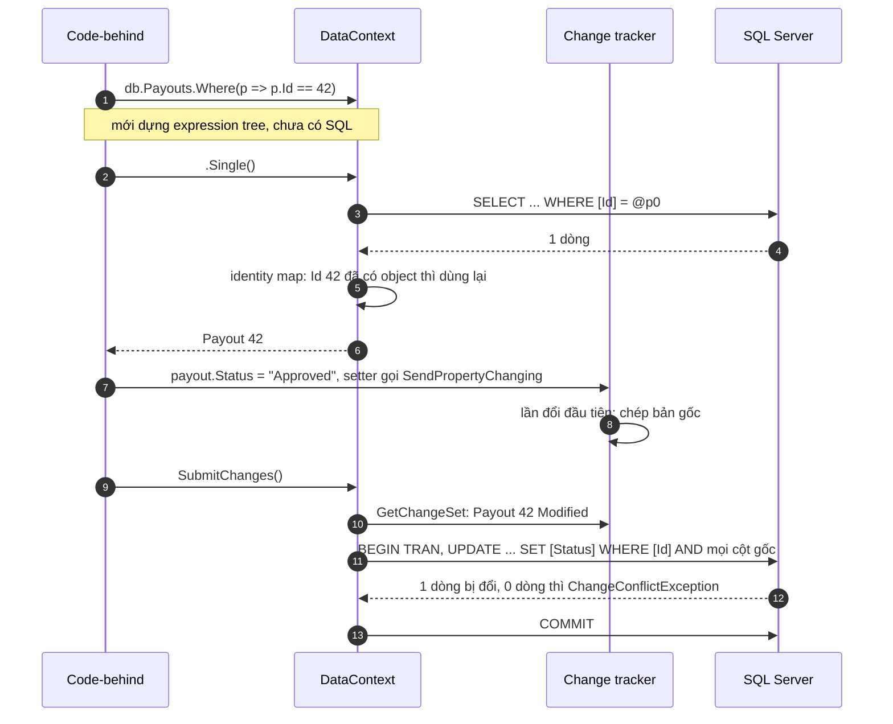

# LINQ to SQL: ORM trước EF, đặt cạnh EF Core

**LINQ to SQL** (namespace `System.Data.Linq`) là <T>ORM</T> đầu tiên của Microsoft, ra cùng .NET Framework 3.5 năm 2007, trước Entity Framework một năm. Nó làm đúng việc của <T>EF Core</T>: map bảng SQL Server sang class, dịch <T>LINQ</T> thành SQL, giữ dấu object đã load để `SubmitChanges` biết phải ghi gì. Trang này đi qua cách một project LINQ to SQL được dựng (file `.dbml`, code sinh ra, `DataContext`), một lần duyệt payout chạy bên trong nó ra sao, và đặt từng phần cạnh thứ tương ứng trong EF Core. Cuối trang có cách giới thiệu nó trong 10 giây cho người phỏng vấn chưa từng nghe tên. Đọc trước nếu cần: [IEnumerable vs IQueryable](/dotnet/collections-linq#ienumerable-vs-iqueryable), [EF Core](/data/ef-core).

<svg width="0" height="0" style="position:absolute" aria-hidden="true"><defs><marker id="lInk" viewBox="0 0 10 10" refX="8" refY="5" markerWidth="7" markerHeight="7" orient="auto-start-reverse"><path class="head" d="M0 0L10 5L0 10z"/></marker><marker id="lAcc" viewBox="0 0 10 10" refX="8" refY="5" markerWidth="7" markerHeight="7" orient="auto-start-reverse"><path class="headAcc" d="M0 0L10 5L0 10z"/></marker><marker id="lOk" viewBox="0 0 10 10" refX="8" refY="5" markerWidth="7" markerHeight="7" orient="auto-start-reverse"><path class="headOk" d="M0 0L10 5L0 10z"/></marker><marker id="lBad" viewBox="0 0 10 10" refX="8" refY="5" markerWidth="7" markerHeight="7" orient="auto-start-reverse"><path class="headBad" d="M0 0L10 5L0 10z"/></marker></defs></svg>

## Bản đồ chủ đề {#topic-map}

<div class="fig">
<svg viewBox="0 0 720 395" role="img" aria-label="Bản đồ chủ đề LINQ to SQL: không phải LINQ in-memory, database-first, query track submit, lazy loading bật sẵn, concurrency kiểm mọi cột, lên EF Core">
<a href="#provider" style="text-decoration:none">
<rect class="boxBad" x="10" y="10" width="226" height="180" rx="10"/>
<text x="24" y="34" font-size="13" font-weight="600" class="badT">Không phải LINQ in-memory</text>
<rect class="box" x="38" y="50" width="170" height="26" rx="5"/>
<text x="123" y="67" font-size="11" text-anchor="middle" class="mono">db.Payouts.Where(…)</text>
<line class="lnBad dash" x1="92" y1="78" x2="66" y2="118" marker-end="url(#lBad)"/>
<line class="lnOk" x1="154" y1="78" x2="180" y2="114" marker-end="url(#lOk)"/>
<rect class="box" x="34" y="122" width="56" height="34" rx="4"/>
<text x="62" y="144" font-size="12" text-anchor="middle" font-weight="600">RAM</text>
<line class="lnBad" x1="38" y1="126" x2="86" y2="152"/><line class="lnBad" x1="86" y1="126" x2="38" y2="152"/>
<path class="boxOk" d="M160 126 v26 a26 7 0 0 0 52 0 v-26"/><ellipse class="boxOk" cx="186" cy="126" rx="26" ry="7"/>
<text x="186" y="149" font-size="11" text-anchor="middle" font-weight="600" class="okT">SQL</text>
<text x="62" y="176" font-size="10.5" text-anchor="middle" class="muted">lọc trong C#</text>
<text x="186" y="176" font-size="10.5" text-anchor="middle" class="muted">dịch ra SQL</text>
</a>
<a href="#setup" style="text-decoration:none">
<rect class="box" x="247" y="10" width="226" height="180" rx="10"/>
<text x="261" y="34" font-size="13" font-weight="600">Database-first, không migration</text>
<path class="boxAcc" d="M280 56 v22 a24 6 0 0 0 48 0 v-22"/><ellipse class="boxAcc" cx="304" cy="56" rx="24" ry="6"/>
<path class="box" d="M392 56 v22 a24 6 0 0 0 48 0 v-22"/><ellipse class="box" cx="416" cy="56" rx="24" ry="6"/>
<line class="lnAcc" x1="304" y1="88" x2="304" y2="118" marker-end="url(#lAcc)"/>
<line class="ln" x1="416" y1="122" x2="416" y2="92" marker-end="url(#lInk)"/>
<rect class="boxAcc" x="280" y="122" width="48" height="36" rx="3"/>
<line class="lnAcc" x1="288" y1="132" x2="320" y2="132"/><line class="lnAcc" x1="288" y1="140" x2="320" y2="140"/><line class="lnAcc" x1="288" y1="148" x2="312" y2="148"/>
<rect class="box" x="392" y="122" width="48" height="36" rx="3"/>
<line class="ln" x1="400" y1="132" x2="432" y2="132"/><line class="ln" x1="400" y1="140" x2="432" y2="140"/><line class="ln" x1="400" y1="148" x2="424" y2="148"/>
<text x="304" y="176" font-size="10.5" text-anchor="middle" class="accT">L2S: DB → .dbml</text>
<text x="416" y="176" font-size="10.5" text-anchor="middle" class="muted">EF: code → DB</text>
</a>
<a href="#request-flow" style="text-decoration:none">
<rect class="boxAcc" x="484" y="10" width="226" height="180" rx="10"/>
<text x="498" y="34" font-size="13" font-weight="600" class="accT">query → track → Submit</text>
<line class="ln" x1="540" y1="84" x2="575" y2="84" marker-end="url(#lInk)"/>
<line class="ln" x1="617" y1="84" x2="652" y2="84" marker-end="url(#lInk)"/>
<circle cx="520" cy="84" r="18" style="fill:var(--vp-c-bg)"/><circle class="boxAcc" cx="520" cy="84" r="18"/><text x="520" y="89" font-size="14" text-anchor="middle" font-weight="700" class="accT">1</text>
<circle cx="597" cy="84" r="18" style="fill:var(--vp-c-bg)"/><circle class="boxAcc" cx="597" cy="84" r="18"/><text x="597" y="89" font-size="14" text-anchor="middle" font-weight="700" class="accT">2</text>
<circle cx="674" cy="84" r="18" style="fill:var(--vp-c-bg)"/><circle class="boxAcc" cx="674" cy="84" r="18"/><text x="674" y="89" font-size="14" text-anchor="middle" font-weight="700" class="accT">3</text>
<text x="520" y="120" font-size="10.5" text-anchor="middle" class="muted">SELECT</text>
<text x="597" y="120" font-size="10.5" text-anchor="middle" class="muted">chụp bản gốc</text>
<text x="674" y="120" font-size="10.5" text-anchor="middle" class="muted">UPDATE</text>
<rect class="boxBad" x="520" y="140" width="154" height="28" rx="6"/>
<text x="597" y="159" font-size="12" text-anchor="middle" font-weight="600" class="badT">không có async</text>
</a>
<a href="#loading" style="text-decoration:none">
<rect class="boxBad" x="10" y="205" width="226" height="180" rx="10"/>
<text x="24" y="229" font-size="13" font-weight="600" class="badT">Lazy bật sẵn → N+1</text>
<rect class="box" x="28" y="244" width="66" height="14" rx="2"/><rect class="box" x="28" y="264" width="66" height="14" rx="2"/><rect class="box" x="28" y="284" width="66" height="14" rx="2"/><rect class="box" x="28" y="304" width="66" height="14" rx="2"/><rect class="box" x="28" y="324" width="66" height="14" rx="2"/>
<line class="lnBad" x1="96" y1="251" x2="156" y2="280" marker-end="url(#lBad)"/>
<line class="lnBad" x1="96" y1="271" x2="156" y2="286" marker-end="url(#lBad)"/>
<line class="lnBad" x1="96" y1="291" x2="156" y2="292" marker-end="url(#lBad)"/>
<line class="lnBad" x1="96" y1="311" x2="156" y2="298" marker-end="url(#lBad)"/>
<line class="lnBad" x1="96" y1="331" x2="156" y2="304" marker-end="url(#lBad)"/>
<path class="box" d="M162 276 v32 a28 7 0 0 0 56 0 v-32"/><ellipse class="box" cx="190" cy="276" rx="28" ry="7"/>
<text x="61" y="364" font-size="10.5" text-anchor="middle" class="muted">mỗi dòng grid</text>
<text x="190" y="364" font-size="11" text-anchor="middle" font-weight="600" class="badT">1 + N query</text>
</a>
<a href="#concurrency" style="text-decoration:none">
<rect class="box" x="247" y="205" width="226" height="180" rx="10"/>
<text x="261" y="229" font-size="13" font-weight="600">Mặc định: WHERE mọi cột</text>
<text x="263" y="256" font-size="11" class="mono">UPDATE … SET Status</text>
<text x="263" y="276" font-size="11" class="mono accT">WHERE Id = 42</text>
<text x="263" y="293" font-size="11" class="mono accT">AND Amount = 500</text>
<text x="263" y="310" font-size="11" class="mono accT">AND Status = 'Pending'</text>
<text x="263" y="327" font-size="11" class="mono accT">AND Note = '…'</text>
<text x="263" y="362" font-size="11.5" font-weight="600" class="badT">EF Core: mặc định không check</text>
</a>
<a href="#migrate" style="text-decoration:none">
<rect class="box" x="484" y="205" width="226" height="180" rx="10"/>
<text x="498" y="229" font-size="13" font-weight="600">Lên EF Core: default đổi ngầm</text>
<rect class="box" x="500" y="244" width="70" height="28" rx="5"/><text x="535" y="263" font-size="12" text-anchor="middle" font-weight="600">L2S</text>
<line class="lnAcc" x1="572" y1="258" x2="616" y2="258" marker-end="url(#lAcc)"/>
<rect class="boxAcc" x="620" y="244" width="76" height="28" rx="5"/><text x="658" y="263" font-size="12" text-anchor="middle" font-weight="600" class="accT">EF Core</text>
<circle class="dotBad" cx="504" cy="295" r="4"/><text x="514" y="299" font-size="11">lazy → null</text>
<circle class="dotBad" cx="604" cy="295" r="4"/><text x="614" y="299" font-size="11">check → mất</text>
<circle class="dotBad" cx="504" cy="323" r="4"/><text x="514" y="323" font-size="11" dy="4">LoadWith →</text>
<text x="514" y="341" font-size="11">Include</text>
<circle class="dotBad" cx="604" cy="323" r="4"/><text x="614" y="327" font-size="11">sync → async</text>
</a>
</svg>
<p class="fig-caption">Đỏ là chỗ hay bị hỏi hoặc hay gây lỗi. Ôn lại: nhìn từng ô và tự giải thích vì sao; ô nào không nói được thì bấm vào.</p>
</div>

## 1. Vấn đề: "LINQ" bị nghe thành lọc trong memory {#provider}

**Cùng một dòng `Where`, nơi nó chạy do kiểu của nguồn quyết định, không do cú pháp LINQ.** Nguồn là `List<T>` thì `Where` nhận <T>delegate</T> và lặp trong RAM (LINQ to Objects). Nguồn là `Table<T>` của LINQ to SQL hay `DbSet<T>` của EF Core thì nguồn implement `IQueryable<T>`, `Where` nhận <T>expression tree</T>, và provider dịch nó thành SQL chạy trong SQL Server. Vì vậy khi nói "hệ thống dùng LINQ", người nghe chỉ thấy cú pháp và đoán là in-memory; phải nói tên **nguồn** (`DataContext`, `Table<T>`) để họ biết đó là ORM.

<div class="fig">
<svg viewBox="0 0 720 316" role="img" aria-label="Cùng một Where trên ba nguồn: List chạy trong RAM, Table của LINQ to SQL và DbSet của EF Core dịch ra SQL">
<rect class="box" x="200" y="10" width="320" height="38" rx="6"/>
<text x="360" y="34" font-size="12.5" text-anchor="middle" class="mono">source.Where(p =&gt; p.Status == "Pending")</text>
<line class="ln" x1="300" y1="48" x2="125" y2="96" marker-end="url(#lInk)"/>
<line class="lnAcc" x1="360" y1="48" x2="360" y2="96" marker-end="url(#lAcc)"/>
<line class="lnAcc" x1="420" y1="48" x2="595" y2="96" marker-end="url(#lAcc)"/>
<rect class="boxAcc dash" x="250" y="84" width="460" height="226" rx="10" style="fill:none"/>
<text x="700" y="298" font-size="11" text-anchor="end" class="accT">ORM: cùng một cơ chế</text>
<rect class="box" x="20" y="100" width="210" height="46" rx="6"/>
<text x="125" y="120" font-size="12.5" text-anchor="middle" font-weight="600" class="mono">List&lt;Payout&gt;</text>
<text x="125" y="138" font-size="11" text-anchor="middle" class="muted">LINQ to Objects</text>
<rect class="boxAcc" x="262" y="100" width="196" height="46" rx="6"/>
<text x="360" y="120" font-size="12.5" text-anchor="middle" font-weight="600" class="mono">Table&lt;Payout&gt;</text>
<text x="360" y="138" font-size="11" text-anchor="middle" class="accT">LINQ to SQL · DataContext</text>
<rect class="boxAcc" x="490" y="100" width="210" height="46" rx="6"/>
<text x="595" y="120" font-size="12.5" text-anchor="middle" font-weight="600" class="mono">DbSet&lt;Payout&gt;</text>
<text x="595" y="138" font-size="11" text-anchor="middle" class="accT">EF Core · DbContext</text>
<text x="125" y="172" font-size="11" text-anchor="middle" class="muted">IEnumerable → Func delegate</text>
<text x="360" y="172" font-size="11" text-anchor="middle" class="muted">IQueryable → expression tree</text>
<text x="595" y="172" font-size="11" text-anchor="middle" class="muted">IQueryable → expression tree</text>
<line class="ln" x1="125" y1="180" x2="125" y2="204" marker-end="url(#lInk)"/>
<line class="lnAcc" x1="360" y1="180" x2="360" y2="204" marker-end="url(#lAcc)"/>
<line class="lnAcc" x1="595" y1="180" x2="595" y2="204" marker-end="url(#lAcc)"/>
<rect class="box" x="20" y="208" width="210" height="66" rx="6"/>
<path class="ln" d="M44 236 a12 12 0 1 1 5 10" marker-end="url(#lInk)"/>
<text x="76" y="236" font-size="11.5">foreach trong RAM</text>
<text x="76" y="254" font-size="11" class="muted">mọi dòng đã ở RAM</text>
<rect class="boxOk" x="262" y="208" width="196" height="66" rx="6"/>
<text x="360" y="234" font-size="11" text-anchor="middle" class="mono">SELECT … WHERE</text>
<text x="360" y="250" font-size="11" text-anchor="middle" class="mono">[Status] = @p0</text>
<text x="360" y="266" font-size="10.5" text-anchor="middle" class="okT">chỉ SQL Server</text>
<rect class="boxOk" x="490" y="208" width="210" height="66" rx="6"/>
<text x="595" y="234" font-size="11" text-anchor="middle" class="mono">SELECT … WHERE</text>
<text x="595" y="250" font-size="11" text-anchor="middle" class="mono">[Status] = @p0</text>
<text x="595" y="266" font-size="10.5" text-anchor="middle" class="okT">SQL Server, PostgreSQL, …</text>
</svg>
<p class="fig-caption">Tự hỏi: vì sao hai lane bên phải cùng một khung? Nếu gọi .ToList() ngay sau db.Payouts rồi mới Where thì câu đó chuyển sang lane nào?</p>
</div>

- **Bằng chứng nhanh nhất** khi bị nghi ngờ: gán `db.Log = Console.Out` (hoặc mở SQL Profiler) và chỉ ra câu `SELECT ... WHERE` mà `DataContext` gửi đi.
- **Vì cùng cơ chế**, mọi bẫy của `IQueryable` trong EF Core cũng có ở đây: `.ToList()` đặt quá sớm thì phần sau chạy trong RAM, gọi method C# tự viết trong `Where` thì không dịch được (LINQ to SQL ném `NotSupportedException: Method '...' has no supported translation to SQL`).
- **Về lịch sử**: LINQ to SQL ra trước (.NET 3.5, 2007), EF ra sau một năm (.NET 3.5 SP1, 2008), và cuối 2008 Microsoft tuyên bố EF là hướng đi tiếp; LINQ to SQL chỉ còn sửa lỗi, không bao giờ có trên .NET Core. Nói "bản tiền nhiệm của EF" là đúng ý, chính xác hơn là "ORM đầu tiên, bị EF thay thế".

## 2. Setup: database có trước, code được sinh ra {#setup}

**LINQ to SQL đi theo chiều database-first: bảng đã có trong SQL Server, công cụ đọc schema rồi sinh class; EF Core mặc định đi chiều ngược lại.** Mọi khác biệt về setup suy ra từ chiều mũi tên đó:

<div class="fig">
<svg viewBox="0 0 720 300" role="img" aria-label="LINQ to SQL: SQL Server sinh ra .dbml rồi designer.cs. EF Core: entity và DbContext sinh ra migration rồi tới SQL Server, scaffold là tuỳ chọn">
<rect class="box dash" x="10" y="4" width="340" height="290" rx="10" style="fill:none"/>
<text x="24" y="24" font-size="12.5" font-weight="600" class="accT">LINQ to SQL: DB có trước</text>
<rect class="box dash" x="370" y="4" width="340" height="290" rx="10" style="fill:none"/>
<text x="384" y="24" font-size="12.5" font-weight="600">EF Core: code có trước</text>
<path class="boxAcc" d="M120 64 v44 a60 10 0 0 0 120 0 v-44"/><ellipse class="boxAcc" cx="180" cy="64" rx="60" ry="10"/>
<text x="180" y="98" font-size="12.5" text-anchor="middle" font-weight="600">SQL Server</text>
<line class="lnAcc" x1="180" y1="122" x2="180" y2="146" marker-end="url(#lAcc)"/>
<text x="192" y="140" font-size="11" class="muted">O/R Designer / SqlMetal</text>
<rect class="boxAcc" x="60" y="150" width="240" height="44" rx="6"/>
<text x="180" y="168" font-size="12.5" text-anchor="middle" font-weight="600" class="mono">PayoutDb.dbml</text>
<text x="180" y="185" font-size="11" text-anchor="middle" class="muted">XML mô tả bảng ↔ class</text>
<line class="lnAcc" x1="180" y1="196" x2="180" y2="232" marker-end="url(#lAcc)"/>
<text x="192" y="218" font-size="11" class="muted">sinh code mỗi lần lưu</text>
<rect class="boxAcc" x="60" y="236" width="240" height="48" rx="6"/>
<text x="180" y="256" font-size="12.5" text-anchor="middle" font-weight="600" class="mono">PayoutDb.designer.cs</text>
<text x="180" y="274" font-size="11" text-anchor="middle" class="muted">DataContext + entity partial</text>
<path class="box" d="M460 64 v44 a60 10 0 0 0 120 0 v-44"/><ellipse class="box" cx="520" cy="64" rx="60" ry="10"/>
<text x="520" y="98" font-size="12.5" text-anchor="middle" font-weight="600">SQL Server</text>
<line class="ln" x1="520" y1="150" x2="520" y2="124" marker-end="url(#lInk)"/>
<text x="532" y="140" font-size="11" class="muted">database update</text>
<rect class="box" x="400" y="150" width="240" height="44" rx="6"/>
<text x="520" y="168" font-size="12.5" text-anchor="middle" font-weight="600" class="mono">Migrations/*.cs</text>
<text x="520" y="185" font-size="11" text-anchor="middle" class="muted">mỗi thay đổi schema một file</text>
<line class="ln" x1="520" y1="236" x2="520" y2="198" marker-end="url(#lInk)"/>
<text x="532" y="218" font-size="11" class="muted">migrations add</text>
<rect class="box" x="400" y="236" width="240" height="48" rx="6"/>
<text x="520" y="256" font-size="12.5" text-anchor="middle" font-weight="600">Entity + DbContext</text>
<text x="520" y="274" font-size="11" text-anchor="middle" class="muted">bạn tự viết, Fluent API</text>
<path class="lnMuted dash" d="M582 76 H684 V260 H646" marker-end="url(#lInk)"/>
<text x="696" y="168" font-size="10.5" text-anchor="middle" class="muted" transform="rotate(90 696 168)">Scaffold-DbContext (tuỳ chọn)</text>
</svg>
<p class="fig-caption">Tự hỏi: thêm một cột vào bảng Payouts thì bên trái phải làm gì, bên phải làm gì? Bên nào có lịch sử thay đổi schema trong git?</p>
</div>

- **Vì code là sản phẩm sinh ra**, không sửa tay `designer.cs` (lần lưu `.dbml` sau sẽ ghi đè). Logic thêm vào bằng `partial class` ở file khác.
- **Vì schema sống trong DB**, LINQ to SQL **không có migration**: đổi bảng bằng script SQL, rồi xoá bảng khỏi designer và kéo vào lại (hoặc chạy lại SqlMetal). EF Core giữ lịch sử schema thành file migration trong git.
- **Vì mapping chỉ biết SQL Server**, LINQ to SQL không chạy trên DB khác (chỉ SQL Server và SQL Server Compact). EF Core đổi DB bằng cách đổi provider.

### File .dbml và code sinh ra {#dbml}

Trong Visual Studio: **Add New Item → LINQ to SQL Classes** tạo ba file: `PayoutDb.dbml` (XML mapping), `PayoutDb.dbml.layout` (vị trí các hộp trên designer) và `PayoutDb.designer.cs` (code). Kéo bảng từ Server Explorer vào designer là có class; kéo stored procedure vào là có method. Bản dòng lệnh là <T>SqlMetal</T>: `sqlmetal /server:. /database:PayoutHub /code:PayoutDb.cs /namespace:PayoutHub.Data`.

Connection string nằm trong `Web.config`, constructor không tham số của `DataContext` sinh ra đọc nó:

```xml
<connectionStrings>
  <add name="PayoutHubConnectionString"
       connectionString="Data Source=.;Initial Catalog=PayoutHub;Integrated Security=True"
       providerName="System.Data.SqlClient" />
</connectionStrings>
```

### DataContext và entity: hai project đặt cạnh nhau {#structure}

**`DataContext` đóng vai `DbContext`: giữ connection, theo dõi object, và mỗi bảng là một property `Table<T>` như `DbSet<T>`. Khác ở chỗ mapping nằm trên attribute của class sinh ra, không phải Fluent API.** Bản rút gọn của code sinh ra (giữ đúng hình dạng thật, bỏ bớt cột):

::: code-group

```csharp [L2S: PayoutDb.designer.cs]
// File sinh tự động từ PayoutDb.dbml. Không sửa tay.
using System.ComponentModel;
using System.Configuration;
using System.Data.Linq;
using System.Data.Linq.Mapping;

namespace PayoutHub.Data
{
    [Database(Name = "PayoutHub")]
    public partial class PayoutDbDataContext : DataContext
    {
        private static MappingSource mappingSource = new AttributeMappingSource();

        // Hook để bạn viết thêm trong partial class khác
        partial void OnCreated();
        partial void UpdatePayout(Payout instance);

        public PayoutDbDataContext()
            : base(ConfigurationManager.ConnectionStrings["PayoutHubConnectionString"].ConnectionString,
                   mappingSource)
        {
            OnCreated();
        }

        public Table<Payout> Payouts { get { return GetTable<Payout>(); } }
        public Table<Affiliate> Affiliates { get { return GetTable<Affiliate>(); } }
    }

    [Table(Name = "dbo.Payouts")]
    public partial class Payout : INotifyPropertyChanging, INotifyPropertyChanged
    {
        private int _Id;
        private int _AffiliateId;
        private decimal _Amount;
        private string _Status;
        private EntityRef<Affiliate> _Affiliate;      // navigation một-một, load lười

        public event PropertyChangingEventHandler PropertyChanging;
        public event PropertyChangedEventHandler PropertyChanged;

        partial void OnValidate(ChangeAction action); // gọi trong SubmitChanges

        [Column(Storage = "_Id", DbType = "Int NOT NULL IDENTITY",
                IsPrimaryKey = true, IsDbGenerated = true, AutoSync = AutoSync.OnInsert)]
        public int Id { get { return _Id; } }

        [Column(Storage = "_AffiliateId", DbType = "Int NOT NULL")]
        public int AffiliateId { get { return _AffiliateId; } set { /* như Status */ } }

        [Column(Storage = "_Amount", DbType = "Decimal(18,2) NOT NULL")]
        public decimal Amount { get { return _Amount; } set { /* như Status */ } }

        [Column(Storage = "_Status", DbType = "NVarChar(20) NOT NULL", CanBeNull = false)]
        public string Status
        {
            get { return _Status; }
            set
            {
                if (_Status != value)
                {
                    SendPropertyChanging();            // báo tracker: chụp bản gốc trước khi đổi
                    _Status = value;
                    SendPropertyChanged("Status");
                }
            }
        }

        [Association(Name = "Affiliate_Payout", Storage = "_Affiliate",
                     ThisKey = "AffiliateId", OtherKey = "Id", IsForeignKey = true)]
        public Affiliate Affiliate
        {
            get { return _Affiliate.Entity; }          // đọc lần đầu = thêm 1 query
        }

        protected virtual void SendPropertyChanging()
        {
            if (PropertyChanging != null)
                PropertyChanging(this, new PropertyChangingEventArgs(string.Empty));
        }

        protected virtual void SendPropertyChanged(string name)
        {
            if (PropertyChanged != null)
                PropertyChanged(this, new PropertyChangedEventArgs(name));
        }
    }
}
```

```csharp [L2S: Payout.cs (partial, bạn viết)]
using System;
using System.Data.Linq;

namespace PayoutHub.Data
{
    // Cùng tên, cùng namespace với class sinh ra: compiler gộp hai nửa lại.
    public partial class Payout
    {
        public void Approve()
        {
            if (Status != "Pending")
                throw new InvalidOperationException("Payout " + Id + " đang " + Status);
            Status = "Approved";
        }

        partial void OnValidate(ChangeAction action)
        {
            if (action == ChangeAction.Update && Amount <= 0)
                throw new InvalidOperationException("Amount phải dương");
        }
    }
}
```

```csharp [EF Core: PayoutDbContext.cs]
using Microsoft.EntityFrameworkCore;
using PayoutHub.Core;

namespace PayoutHub.Infrastructure;

public class PayoutDbContext(DbContextOptions<PayoutDbContext> options) : DbContext(options)
{
    public DbSet<Payout> Payouts => Set<Payout>();
    public DbSet<Affiliate> Affiliates => Set<Affiliate>();

    protected override void OnModelCreating(ModelBuilder b)
    {
        // Mapping nằm ở đây thay vì attribute trên entity
        b.Entity<Payout>(e =>
        {
            e.ToTable("Payouts");
            e.Property(p => p.Amount).HasPrecision(18, 2);
            e.Property(p => p.Status).HasConversion<string>().HasMaxLength(20);
            e.HasOne(p => p.Affiliate).WithMany().HasForeignKey(p => p.AffiliateId);
        });
    }
}

// Program.cs:
// builder.Services.AddDbContext<PayoutDbContext>(o =>
//     o.UseSqlServer(builder.Configuration.GetConnectionString("PayoutHub")));
```

:::

Code dùng trong một trang Web Forms, đặt cạnh bản EF Core:

::: code-group

```csharp [L2S: Payouts.aspx.cs]
protected void ApproveButton_Click(object sender, EventArgs e)
{
    int payoutId = int.Parse(PayoutIdHidden.Value);

    using (var db = new PayoutDbDataContext())        // một context cho một lần bấm
    {
        var payout = db.Payouts.Single(p => p.Id == payoutId);   // SELECT ... WHERE Id = @p0
        payout.Approve();                                         // tracker chụp bản gốc
        db.SubmitChanges();                                       // UPDATE ... WHERE ...
    }
}
```

```csharp [EF Core: PayoutsController.cs]
[HttpPost("{id:int}/approve")]
public async Task<IActionResult> Approve(int id, CancellationToken ct)
{
    // db được DI tiêm vào, scoped theo request
    var payout = await db.Payouts.SingleAsync(p => p.Id == id, ct);
    payout.Approve();
    await db.SaveChangesAsync(ct);
    return NoContent();
}
```

:::

- **Vì `DataContext` giữ mọi object nó đã load** (xem [identity map](#identity-map)), nó là một <T>unit of work</T> ngắn: một `using` cho một lần bấm, giống `DbContext` scoped theo request. Không có DI container trong Web Forms nên tự `new`.
- **Vì entity phải theo hình dạng designer sinh** (`EntityRef<T>`, `EntitySet<T>`, setter gọi `SendPropertyChanging`), entity LINQ to SQL gắn chặt với ORM. EF Core cho entity là class thường có `private set`, xem [Entity giàu hành vi](/data/ef-core#rich-entity).

## 3. Bên trong một lần duyệt payout {#request-flow}

**`DataContext` làm ba việc nối nhau: dịch query khi được enumerate, giữ một object cho mỗi khoá và chép bản gốc trước lần sửa đầu tiên, rồi `SubmitChanges` so bản gốc với hiện tại để sinh `UPDATE`.** Đây cũng là ba việc của `DbContext`; khác nhau nằm ở mặc định của từng chặng. Theo chiếc `ApproveButton_Click` ở trên:



### Bước 1 đến 4: query thành SQL lúc enumerate {#translate}

**`Table<T>` là `IQueryable<T>`, nên `Where` chỉ ghép thêm vào expression tree; SQL chỉ được sinh và gửi khi có ai đó cần kết quả** (`Single`, `ToList`, `foreach`, bind vào grid). Đây là <T>deferred execution</T>, giống hệt EF Core.

- Xem SQL: `db.Log = Console.Out;` (hoặc một `TextWriter` ghi ra file), hay `db.GetCommand(query).CommandText`. EF Core dùng `LogTo` hoặc `ILogger`.
- Tham số luôn đi dạng `@p0`, nên LINQ không bị SQL injection; chỉ nguy hiểm khi tự nối chuỗi vào `db.ExecuteQuery<T>(...)` (xem [stored procedure](#stored-procedures)).
- Mỗi query mở và đóng connection (connection lấy từ <T>connection pool</T>), trừ khi bạn tự mở `db.Connection`.

### Bước 5: identity map, một object cho mỗi khoá {#identity-map}

**Mỗi `DataContext` giữ một bảng tra khoá chính → object; dòng nào đã có object thì query sau trả lại đúng object cũ, không ghi đè bằng dữ liệu mới từ DB.** Từ đó suy ra:

- **Context sống lâu thì dữ liệu cũ dần**: người khác sửa payout 42, context của bạn vẫn trả object cũ. Và bảng tra chỉ lớn lên, nên RAM tăng mãi.
- Vì vậy anti-pattern kinh điển của code Web Forms cũ là một `DataContext` **static** hoặc để trong `Session`: dữ liệu cũ, RAM phình, và nhiều request dùng chung một context không <T>thread-safe</T>. Chữa: một context cho một đơn vị công việc.

### Bước 7 và 8: change tracking chép bản gốc khi bị sửa lần đầu {#change-tracking}

**Setter sinh ra gọi `SendPropertyChanging` trước khi đổi giá trị; tracker nghe event đó và chép bản gốc của object ngay lúc ấy (copy-on-write).** Object không bị sửa thì không tốn bản sao nào. Class không implement `INotifyPropertyChanging` thì tracker phải chụp sẵn mọi object lúc load, như snapshot của EF Core ([cách EF Core làm](/data/ef-core#change-tracking)).

- **Chỉ đọc**: tắt cho cả context bằng `db.ObjectTrackingEnabled = false`, phải đặt **trước query đầu tiên**. Sau đó `SubmitChanges` ném lỗi, và lazy loading cũng tắt theo. EF Core tắt theo từng query bằng `AsNoTracking()`.
- **Xem sẽ ghi gì**: `db.GetChangeSet()` trả ba danh sách Inserts, Updates, Deletes.

### Bước 9 đến 13: SubmitChanges {#submit-changes}

**`SubmitChanges` lấy change set, mở transaction nếu chưa có, chạy từng `INSERT/UPDATE/DELETE`, rồi commit; một câu lỗi thì rollback cả lần.** Thêm và xoá phải báo trước:

```csharp
db.Payouts.InsertOnSubmit(newPayout);    // EF Core: db.Payouts.Add(newPayout)
db.Payouts.DeleteOnSubmit(oldPayout);    // EF Core: db.Payouts.Remove(oldPayout)
db.SubmitChanges();                      // EF Core: await db.SaveChangesAsync(ct)
```

- **Không có bản async**: không có `SubmitChangesAsync`, không có `ToListAsync`. Mỗi query giữ thread trong lúc chờ DB. Trên .NET Framework với lượng người dùng back-office thì chịu được; dưới tải cao thì đó là lý do thread pool cạn, xem [vì sao await giải phóng thread](/runtime/async-flow).
- Mặc định dừng ở conflict đầu tiên; `SubmitChanges(ConflictMode.ContinueOnConflict)` chạy hết rồi báo mọi conflict một lần.

### Load dữ liệu liên quan: lazy loading bật sẵn {#loading}

**`EntityRef<T>` và `EntitySet<T>` tự chạy một query lúc được đọc lần đầu, vì `DeferredLoadingEnabled` mặc định là `true`.** Đây là chỗ khác EF Core quan trọng nhất về hiệu năng:

- **Grid 50 dòng bind `Eval("Affiliate.Name")`** = 1 query lấy payout + 50 query lấy affiliate: <T>N+1</T>, mà không ai viết query trong vòng lặp. Cơ chế giống lazy loading proxy ở [EF Core N+1](/data/ef-core#n-plus-one-causes), chỉ khác là ở đây nó bật sẵn.
- **Chữa bằng `DataLoadOptions`** (bản tương đương `Include`), phải gắn vào context **trước query đầu tiên** và áp cho **mọi query** của context đó:

  ```csharp
  var opts = new DataLoadOptions();
  opts.LoadWith<Payout>(p => p.Affiliate);  // EF Core: .Include(p => p.Affiliate), theo từng query
  db.LoadOptions = opts;
  ```

  Hoặc `Select` sang kiểu ẩn danh / DTO: một câu SQL có JOIN, giống [projection](/data/ef-core#projection) bên EF Core.
- **Giới hạn hay bị bỏ quên**: `LoadWith` hai collection một-nhiều ngang hàng thì chỉ một cái được JOIN, cái còn lại vẫn query theo từng dòng cha. Và đọc navigation sau khi context đã dispose thì ném `ObjectDisposedException`.

### Concurrency: mặc định kiểm mọi cột {#concurrency}

**Mỗi `[Column]` có `UpdateCheck`, mặc định là `Always`, nên câu `UPDATE` đưa giá trị gốc của mọi cột vào `WHERE`; ai đó sửa bất kỳ cột nào trước bạn thì 0 dòng khớp và `SubmitChanges` ném `ChangeConflictException`.** Đây là optimistic concurrency có sẵn mà không phải bật gì. Từ đó:

- **Bảng có cột `rowversion`**: designer đánh dấu nó `IsVersion = true`, và `WHERE` chỉ còn `Id` + version, gọn hơn và nhanh hơn.
- **Cột `text`, `ntext`, `image` không so sánh được** trong `WHERE`, nên phải đặt `UpdateCheck = Never` cho chúng nếu không có version.
- **Xử lý conflict**: duyệt `db.ChangeConflicts`, gọi `Resolve(RefreshMode.KeepChanges)` (giữ thay đổi của mình, lấy phần còn lại từ DB), `KeepCurrentValues` hoặc `OverwriteCurrentValues`. Với duyệt tiền thì như EF Core: trả lại cho người dùng quyết định.
- **EF Core mặc định ngược lại**: không có concurrency token thì `WHERE` chỉ có khoá chính, người ghi sau thắng. Phải tự thêm `IsRowVersion()`, xem [rowversion trong EF Core](/data/ef-core#rowversion).

Disconnected (postback mới = context mới): gắn lại object bằng `db.Payouts.Attach(current, original)` hoặc `Attach(entity, true)` (cần cột version). Cùng bài toán [version phải đi qua client](/data/ef-core#version-round-trip) của Web API, và nổi tiếng là khó dùng trong LINQ to SQL.

### Stored procedure và SQL viết tay {#stored-procedures}

**Kéo stored procedure vào designer thì nó thành một method trên `DataContext`, kết quả map vào class sinh sẵn.** Hệ thống back-office cũ thường dùng cái này nhiều hơn cả query LINQ:

```csharp
// Sinh ra: [Function(Name = "dbo.usp_GetPendingPayouts")] trả ISingleResult<usp_GetPendingPayoutsResult>
var rows = db.usp_GetPendingPayouts(affiliateId).ToList();

// SQL tay: {0} được chuyển thành @p0, không phải nối chuỗi
var big = db.ExecuteQuery<Payout>("SELECT * FROM dbo.Payouts WHERE Amount > {0}", 1000m).ToList();
int n = db.ExecuteCommand("UPDATE dbo.Payouts SET Status = 'Expired' WHERE CreatedAt < {0}", cutoff);
```

EF Core tương ứng: `db.Payouts.FromSql($"EXEC dbo.usp_GetPendingPayouts {affiliateId}")`, `db.Database.SqlQuery<T>(...)` và `db.Database.ExecuteSql(...)`; chuỗi interpolated cũng thành tham số.

## 4. Bảng tra: cùng việc, tên khác {#name-map}

Dùng khi đọc code cũ hoặc khi cần nói "cái này bên EF gọi là gì":

| Việc | LINQ to SQL | EF Core |
|---|---|---|
| Unit of work | `DataContext` | `DbContext` |
| Một bảng | `Table<T>` | `DbSet<T>` |
| Mapping | attribute `[Table]`, `[Column]`, `[Association]` hoặc file XML | Fluent API trong `OnModelCreating`, hoặc attribute |
| Sinh code từ DB | O/R Designer, SqlMetal (`.dbml`) | `Scaffold-DbContext` / `dotnet ef dbcontext scaffold` |
| Đổi schema | script SQL + kéo lại bảng | migration |
| Thêm, xoá | `InsertOnSubmit`, `DeleteOnSubmit` | `Add`, `Remove` |
| Ghi | `SubmitChanges()` | `SaveChanges()` / `SaveChangesAsync()` |
| Load kèm | `DataLoadOptions.LoadWith`, cả context | `Include`, từng query |
| Lazy loading | **bật sẵn** (`DeferredLoadingEnabled`) | tắt, phải bật Proxies |
| Chỉ đọc | `ObjectTrackingEnabled = false`, cả context | `AsNoTracking()`, từng query |
| Concurrency | **mặc định kiểm mọi cột** (`UpdateCheck.Always`), hoặc `IsVersion` | mặc định không; `IsRowVersion()` / `IsConcurrencyToken()` |
| Lỗi conflict | `ChangeConflictException` | `DbUpdateConcurrencyException` |
| Xem SQL | `db.Log` | `LogTo`, `ILogger` |
| Navigation | `EntityRef<T>`, `EntitySet<T>` | property thường, `ICollection<T>` |
| Kế thừa | chỉ TPH | TPH, TPT, TPC |
| Database | SQL Server | SQL Server, PostgreSQL, SQLite, ... |
| Async | không | có |

## 5. Lên EF Core: query giữ nguyên, mặc định đổi ngầm {#migrate}

**Vì cả hai đều là `IQueryable` dịch sang SQL, phần lớn câu query LINQ chép sang chạy được; thứ vỡ là những mặc định khác nhau, và chúng vỡ không báo lỗi lúc compile.** Theo thứ tự nguy hiểm:

1. **Concurrency check biến mất.** LINQ to SQL kiểm mọi cột mà không ai viết gì; EF Core không kiểm gì. Không thêm `rowversion` hoặc `IsConcurrencyToken()` thì lost update xảy ra âm thầm. Đây là bẫy duy nhất làm **sai dữ liệu** mà không có exception nào.
2. **Lazy loading tắt.** Chỗ nào đang dựa vào `payout.Affiliate` tự load thì giờ là `null` → `NullReferenceException`. Mặt tốt: N+1 ẩn biến mất. Sửa bằng `Include` hoặc `Select`, đừng bật lại Proxies cho nhanh.
3. **`DataLoadOptions` → `Include`.** Từ cấu hình cả context sang từng query: phải tìm từng query đang được hưởng `LoadWith`.
4. **Sync → async.** `SubmitChanges()` thành `await SaveChangesAsync()`, và `async` lan ngược lên cả chuỗi gọi.
5. **`.dbml` → scaffold.** Chạy `Scaffold-DbContext` trên DB hiện có, rồi tạo migration đầu tiên làm baseline (DB đã có bảng nên không chạy lại `CREATE TABLE`); từ đó schema đổi bằng migration.
6. **Stored procedure** giữ nguyên, gọi qua `FromSql` / `ExecuteSql`.

Kế hoạch tổng thể khi chuyển cả app .NET Framework lên .NET hiện đại (chạy song song, chuyển dần) nằm ở [Migrate lên .NET 8](/dotnet/framework-vs-core#migration-strategy) và [schema qua EF Core model](/dotnet/framework-vs-core#db-schema).

## 6. Biến thể và trade-off {#trade-offs}

- **Vì LINQ to SQL đã đóng băng và không có trên .NET Core**, chỉ giữ nó trong app .NET Framework đang chạy ổn; không chọn nó cho code mới.
- **Vì nó nhỏ, database-first, chỉ SQL Server**, với app back-office có schema ổn định nó gọn hơn <T>EF6</T> (không EDMX, ít cấu hình). Nhiều hệ thống cũ chạy nó hơn mười năm không có vấn đề.
- **Vì lazy loading bật sẵn**, review code LINQ to SQL luôn bắt đầu bằng câu hỏi "grid này chạy bao nhiêu query", bật `db.Log` để đếm.
- **Vì `UpdateCheck.Always` đưa mọi cột vào `WHERE`**, bảng rộng sinh câu `UPDATE` dài; thêm cột `rowversion` vừa gọn vừa giữ check.
- **Vì không async**, dưới tải cao nó giữ thread trong lúc chờ DB; đó là một lý do thật (không chỉ "cho mới") để chuyển sang EF Core.

## Câu hỏi phỏng vấn {#interview}

### "Hệ thống bạn dùng ORM gì?" Giới thiệu LINQ to SQL cho người chưa nghe tên <Badge type="warning" text="từng bị hiểu nhầm" /> {#what-is-linq-to-sql}

::: tip Trả lời nhanh
Công thức: **tên + loại + so với thứ họ biết + bằng chứng**. "LINQ to SQL, `System.Data.Linq`, là ORM đầu tiên của Microsoft, ra trước Entity Framework, giống một EF đời đầu chỉ chạy SQL Server. Không phải LINQ in-memory: `DataContext` trả `Table<T>` là `IQueryable`, query được dịch thành SQL, tôi xem SQL đó bằng `db.Log` hoặc Profiler." Xem [vì sao bị nghe nhầm](#provider) và [bảng tra tên](#name-map).
:::

::: details Câu trả lời mẫu (English)
- 10 seconds: "We use LINQ to SQL, Microsoft's first ORM, `System.Data.Linq`. It came out with .NET 3.5, a year before Entity Framework. Think of it as an early, SQL Server only Entity Framework."
- If they hear "in-memory LINQ": not LINQ to Objects. The `DataContext` exposes `Table<T>`, which is `IQueryable`, so queries become expression trees and are translated to SQL. I can show the SQL with `DataContext.Log` or SQL Profiler.
- Same ideas as EF: `DataContext` = `DbContext`, `Table<T>` = `DbSet<T>`, `SubmitChanges` = `SaveChanges`. Change tracking, identity map, optimistic concurrency.
- Pick two differences: database-first with a `.dbml` designer and no migrations, lazy loading on by default, concurrency checks every column by default, no async.
- Status: Microsoft made EF the recommended path in 2008, LINQ to SQL never came to .NET Core, so moving to EF Core is part of any modernization.
:::

::: warning Bẫy & follow-up
**"Vậy nó là EF phiên bản cũ?"**

Không phải cùng sản phẩm. Hai ORM khác nhau, LINQ to SQL ra trước một năm, rồi Microsoft chọn EF đi tiếp. Nói "predecessor of Entity Framework" là đủ ý.

**"Có bị SQL injection không?"**

Query LINQ luôn có tham số `@p0`. `ExecuteQuery` với placeholder `{0}` cũng thành tham số; chỉ nguy hiểm khi tự nối chuỗi. Xem [stored procedure và SQL tay](#stored-procedures).

**"Sao không nâng cấp lên EF Core?"**

Không có đường nâng cấp tại chỗ: LINQ to SQL không chạy trên .NET Core, nên chuyển ORM đi cùng việc chuyển framework. Nêu đúng các chỗ đổi hành vi ở [Lên EF Core](#migrate) cho thấy bạn hiểu rủi ro.
:::

### LINQ to SQL khác EF Core thế nào? {#linq-to-sql-vs-ef-core}

::: tip Trả lời nhanh
Cùng ba việc (dịch query, track object, ghi bằng một lệnh), khác ở mặc định và phạm vi: database-first `.dbml` không migration, chỉ SQL Server, không async, lazy loading **bật sẵn**, concurrency **kiểm mọi cột sẵn**, `DataLoadOptions` và `ObjectTrackingEnabled` cấu hình cho cả context thay vì từng query. Xem [một lần duyệt payout](#request-flow) và [bảng tra](#name-map).
:::

::: details Câu trả lời mẫu (English)
- Same core: LINQ over `IQueryable` translated to SQL, a unit of work with change tracking and identity map, one call to write everything in a transaction.
- Setup: LINQ to SQL is database-first. A designer or SqlMetal generates attribute-mapped partial classes; no migrations. EF Core is usually code-first with Fluent API and migrations, and can scaffold from an existing database.
- Defaults: LINQ to SQL lazy-loads navigations by default, so N+1 is easy; EF Core doesn't. LINQ to SQL checks all original column values on update by default; EF Core has no concurrency check unless you add a rowversion or concurrency token.
- Scope: eager loading and no-tracking are context-wide in LINQ to SQL, per query in EF Core. No async in LINQ to SQL. SQL Server only.
:::

::: warning Bẫy & follow-up
**"Cái nào nhanh hơn?"**

Câu SQL sinh ra cho query đơn giản gần như nhau. Khác biệt thật nằm ở N+1 do lazy loading mặc định, `WHERE` dài khi kiểm mọi cột, và việc giữ thread vì không async.

**"Change tracking của LINQ to SQL khác gì?"**

Entity sinh ra báo `PropertyChanging`, nên tracker chỉ chép bản gốc khi object bị sửa lần đầu. EF Core mặc định chụp snapshot mọi entity lúc load. Xem [change tracking](#change-tracking).
:::

### Migrate từ LINQ to SQL sang EF Core cần chú ý gì? <Badge type="warning" text="câu senior" /> {#migrate-linq-to-sql}

::: tip Trả lời nhanh
Query chép sang gần như nguyên; thứ vỡ là **mặc định**, và vỡ không báo compile: concurrency check biến mất (lost update âm thầm, phải thêm rowversion), lazy loading tắt (navigation thành `null`, sửa bằng `Include`/`Select`), `LoadWith` cả context thành `Include` từng query, sync thành async lan cả chuỗi gọi. Schema: scaffold từ DB rồi tạo migration baseline. Xem [Lên EF Core](#migrate).
:::

::: details Câu trả lời mẫu (English)
- Scaffold an EF Core model from the existing database, then add a baseline migration so future changes go through migrations.
- Most LINQ queries port as they are, because both are `IQueryable` providers. The risk is in the defaults.
- Concurrency: LINQ to SQL checked every column on update; EF Core checks nothing. Without adding a rowversion we would silently get lost updates. That's the first thing I'd add.
- Loading: lazy loading was on; in EF Core navigations come back null, so each screen needs `Include` or a projection. That also removes hidden N+1 queries.
- `SubmitChanges` becomes `SaveChangesAsync`, and async propagates up the call chain. Stored procedures stay and are called with `FromSql` or `ExecuteSql`.
- Do it screen by screen alongside the framework migration, with integration tests on the critical writes.
:::

::: warning Bẫy & follow-up
**"Bật lazy loading proxies trong EF Core cho giống cũ, đỡ sửa?"**

Chạy được nhưng mang nguyên N+1 sang và cần mọi navigation `virtual`. Sửa từng màn hình bằng `Include`/`Select` là lúc rẻ nhất để chữa.

**"Kiểm thế nào là không sót chỗ concurrency?"**

Liệt kê các bảng có ghi đồng thời (duyệt, số dư), thêm `rowversion`, viết integration test hai context cùng sửa một dòng và mong `DbUpdateConcurrencyException`.
:::

## Tự kiểm tra {#self-check}

::: details 1. Người phỏng vấn nói "LINQ thì lọc trong memory mà". Bạn chứng minh ngược lại bằng gì?
`db.Payouts` là `Table<T>`, implement `IQueryable<T>`, nên `Where` thành expression tree và được dịch sang SQL. Bằng chứng: `db.Log = Console.Out` in ra `SELECT ... WHERE [Status] = @p0`. Chỉ khi gọi `.ToList()` hoặc `AsEnumerable()` trước thì phần sau mới chạy trong RAM.
:::

::: details 2. Một grid 50 dòng bind Eval("Affiliate.Name") chạy chậm. Vì sao, và chữa thế nào trong LINQ to SQL?
`DeferredLoadingEnabled` mặc định `true`, nên mỗi lần đọc `Affiliate` là một query: 1 + 50. Chữa: `DataLoadOptions.LoadWith<Payout>(p => p.Affiliate)` gắn trước query đầu, hoặc `Select` sang kiểu chỉ có cột cần.
:::

::: details 3. Vì sao một DataContext static dùng chung cho cả app là sai, dù code chạy được?
Identity map giữ mọi object đã load và trả lại object cũ dù DB đã đổi: dữ liệu cũ, RAM tăng mãi. Và `DataContext` không thread-safe, nhiều request dùng chung sẽ hỏng change tracker.
:::

::: details 4. Code LINQ to SQL không có dòng nào về concurrency, chuyển sang EF Core giữ nguyên logic. Hai người cùng sửa một payout thì khác gì trước?
Trước: `WHERE` có giá trị gốc mọi cột, người sau nhận `ChangeConflictException`. Sau: `WHERE` chỉ có `Id`, người sau ghi đè im lặng. Phải thêm `IsRowVersion()`.
:::

::: details 5. Thêm cột Currency vào bảng Payouts. Việc phải làm ở project LINQ to SQL và ở project EF Core khác nhau thế nào?
LINQ to SQL: chạy script `ALTER TABLE`, rồi cập nhật `.dbml` (kéo lại bảng hoặc chạy lại SqlMetal) để sinh lại code. EF Core: thêm property vào entity, `dotnet ef migrations add AddCurrency`, `database update`; thay đổi nằm trong git dưới dạng migration.
:::
