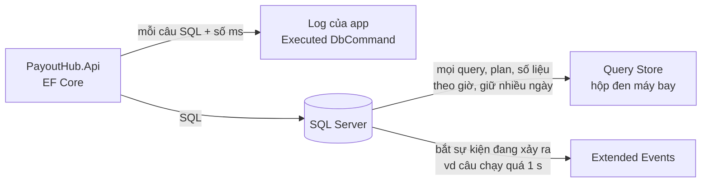

# SQL chậm: tìm nguyên nhân và thêm index

Trang này là một quy trình làm được ngay khi gặp query chậm: **đo** xem thời gian đi đâu, **đọc** execution plan để biết DB đang làm gì thừa, **sửa** bằng đúng index, rồi **đo lại**. Ví dụ xuyên suốt là trang finance của PayoutHub, câu `SELECT * FROM Payouts WHERE Status = 'Pending' ORDER BY CreatedAt` trên bảng 5 triệu dòng. Ví dụ dùng SQL Server; chỗ nào PostgreSQL khác thì có một dòng riêng. Phía EF Core (N+1, projection) nằm ở [EF Core](/data/ef-core).

Cùng hình dạng với hệ thống đặt phòng: bảng `Bookings` lọc `HotelId = @h` và khoảng `CheckIn` thì `HotelId` đóng vai `Status`, `CheckIn` đóng vai `CreatedAt`; mọi lập luận trên trang giữ nguyên.

<svg width="0" height="0" style="position:absolute" aria-hidden="true"><defs><marker id="eAcc" viewBox="0 0 10 10" refX="8" refY="5" markerWidth="7" markerHeight="7" orient="auto-start-reverse"><path class="headAcc" d="M0 0L10 5L0 10z"/></marker><marker id="eInk" viewBox="0 0 10 10" refX="8" refY="5" markerWidth="7" markerHeight="7" orient="auto-start-reverse"><path class="head" d="M0 0L10 5L0 10z"/></marker><marker id="eOk" viewBox="0 0 10 10" refX="8" refY="5" markerWidth="7" markerHeight="7" orient="auto-start-reverse"><path class="headOk" d="M0 0L10 5L0 10z"/></marker><marker id="eBad" viewBox="0 0 10 10" refX="8" refY="5" markerWidth="7" markerHeight="7" orient="auto-start-reverse"><path class="headBad" d="M0 0L10 5L0 10z"/></marker></defs></svg>

## Bản đồ chủ đề {#topic-map}

<div class="fig">
<svg viewBox="0 0 720 624" role="img" aria-label="Bản đồ chủ đề SQL chậm: đo, đọc plan, sửa bằng index (thứ tự cột, sargable, INCLUDE), đo lại; ORDER BY Id và giá của index"><rect class="box dash" x="10" y="8" width="226" height="480" rx="10"/><text x="22" y="28" font-size="12.5" font-weight="600" class="muted">Bước 1 · Đo: thời gian đi đâu</text><a href="#measure" style="text-decoration:none"><rect class="box" x="10" y="48" width="226" height="92" rx="8"/><circle cx="30" cy="70" r="12" style="fill:var(--vp-c-bg)"/><circle class="boxAcc" cx="30" cy="70" r="12"/><text x="30" y="75" font-size="13" text-anchor="middle" font-weight="700" class="accT">1</text><text x="50" y="75" font-size="13" font-weight="600">Query nào chậm?</text><text x="24" y="98" font-size="11.5">log EF: Executed DbCommand (ms)</text><text x="24" y="114" font-size="11.5">Query Store: hộp đen máy bay</text><text x="24" y="130" font-size="11.5">đang chậm: Extended Events</text></a><line class="ln" x1="123" y1="140" x2="123" y2="152" marker-end="url(#eInk)"/><a href="#statistics-io" style="text-decoration:none"><rect class="boxAcc" x="10" y="154" width="226" height="74" rx="8"/><circle cx="30" cy="176" r="12" style="fill:var(--vp-c-bg)"/><circle class="boxAcc" cx="30" cy="176" r="12"/><text x="30" y="181" font-size="13" text-anchor="middle" font-weight="700" class="accT">2</text><text x="50" y="181" font-size="13" font-weight="600" class="accT">Logical reads</text><text x="24" y="204" font-size="11.5">SET STATISTICS IO, TIME ON</text><text x="24" y="220" font-size="11.5">số page đọc: ổn định hơn giây</text></a><rect class="box dash" x="247" y="8" width="226" height="480" rx="10"/><text x="259" y="28" font-size="12.5" font-weight="600" class="muted">Bước 2 · Đọc execution plan</text><a href="#plan-direction" style="text-decoration:none"><rect class="box" x="247" y="48" width="226" height="74" rx="8"/><circle cx="267" cy="70" r="12" style="fill:var(--vp-c-bg)"/><circle class="boxAcc" cx="267" cy="70" r="12"/><text x="267" y="75" font-size="13" text-anchor="middle" font-weight="700" class="accT">3</text><text x="287" y="75" font-size="13" font-weight="600">Đọc từ phải sang trái</text><text x="261" y="98" font-size="11.5">mũi tên dày = nhiều dòng chảy</text><text x="261" y="114" font-size="11.5" class="badT">đọc 5 triệu để trả 50 = cờ đỏ</text></a><line class="ln" x1="360" y1="122" x2="360" y2="134" marker-end="url(#eInk)"/><a href="#red-flags" style="text-decoration:none"><rect class="boxBad" x="247" y="136" width="226" height="74" rx="8"/><circle cx="267" cy="158" r="12" style="fill:var(--vp-c-bg)"/><circle class="boxAcc" cx="267" cy="158" r="12"/><text x="267" y="163" font-size="13" text-anchor="middle" font-weight="700" class="accT">4</text><text x="287" y="163" font-size="13" font-weight="600" class="badT">Bốn cờ đỏ</text><text x="261" y="186" font-size="11.5">Scan · Sort · Key Lookup</text><text x="261" y="202" font-size="11.5">ước lượng ≠ thực tế</text></a><line class="ln" x1="360" y1="210" x2="360" y2="222" marker-end="url(#eInk)"/><a href="#missing-index-hint" style="text-decoration:none"><rect class="box" x="247" y="224" width="226" height="74" rx="8"/><circle cx="267" cy="246" r="12" style="fill:var(--vp-c-bg)"/><circle class="boxAcc" cx="267" cy="246" r="12"/><text x="267" y="251" font-size="13" text-anchor="middle" font-weight="700" class="accT">5</text><text x="287" y="251" font-size="13" font-weight="600">Missing index hint</text><text x="261" y="274" font-size="11.5">gợi ý cho 1 query,</text><text x="261" y="290" font-size="11.5">không áp dụng mù</text></a><rect class="boxOk dash" x="484" y="8" width="226" height="480" rx="10"/><text x="496" y="28" font-size="12.5" font-weight="600" class="muted">Bước 3 · Sửa bằng index</text><a href="#btree" style="text-decoration:none"><rect class="boxOk" x="484" y="48" width="226" height="74" rx="8"/><circle cx="504" cy="70" r="12" style="fill:var(--vp-c-bg)"/><circle class="boxAcc" cx="504" cy="70" r="12"/><text x="504" y="75" font-size="13" text-anchor="middle" font-weight="700" class="accT">6</text><text x="524" y="75" font-size="13" font-weight="600" class="okT">Danh bạ đã sắp xếp</text><text x="498" y="98" font-size="11.5">(Status, CreatedAt): seek tới</text><text x="498" y="114" font-size="11.5">Pending, đọc ra đã đúng thứ tự</text></a><line class="ln" x1="597" y1="122" x2="597" y2="134" marker-end="url(#eInk)"/><a href="#column-order" style="text-decoration:none"><rect class="boxOk" x="484" y="136" width="226" height="74" rx="8"/><circle cx="504" cy="158" r="12" style="fill:var(--vp-c-bg)"/><circle class="boxAcc" cx="504" cy="158" r="12"/><text x="504" y="163" font-size="13" text-anchor="middle" font-weight="700" class="accT">7</text><text x="524" y="163" font-size="13" font-weight="600" class="okT">Bằng trước, range sau</text><text x="498" y="186" font-size="11.5">cột bằng đầu, range/ORDER BY sau</text><text x="498" y="202" font-size="11.5" class="badT">đảo vế trong WHERE: không sao</text></a><line class="ln" x1="597" y1="210" x2="597" y2="222" marker-end="url(#eInk)"/><a href="#sargable" style="text-decoration:none"><rect class="boxOk" x="484" y="224" width="226" height="74" rx="8"/><circle cx="504" cy="246" r="12" style="fill:var(--vp-c-bg)"/><circle class="boxAcc" cx="504" cy="246" r="12"/><text x="504" y="251" font-size="13" text-anchor="middle" font-weight="700" class="accT">8</text><text x="524" y="251" font-size="13" font-weight="600" class="okT">Cột trần mới seek được</text><text x="498" y="274" font-size="11.5" class="badT">YEAR(CreatedAt) = 2026 → Scan</text><text x="498" y="290" font-size="11.5">→ CreatedAt &gt;= … AND &lt; …</text></a><line class="ln" x1="597" y1="298" x2="597" y2="310" marker-end="url(#eInk)"/><a href="#covering" style="text-decoration:none"><rect class="boxOk" x="484" y="312" width="226" height="74" rx="8"/><circle cx="504" cy="334" r="12" style="fill:var(--vp-c-bg)"/><circle class="boxAcc" cx="504" cy="334" r="12"/><text x="504" y="339" font-size="13" text-anchor="middle" font-weight="700" class="accT">9</text><text x="524" y="339" font-size="13" font-weight="600" class="okT">INCLUDE, bỏ SELECT *</text><text x="498" y="362" font-size="11.5">danh bạ chép thêm cột</text><text x="498" y="378" font-size="11.5">→ hết lật sang bảng (Key Lookup)</text></a><line class="ln" x1="597" y1="386" x2="597" y2="398" marker-end="url(#eInk)"/><a href="#filtered-index" style="text-decoration:none"><rect class="box" x="484" y="400" width="226" height="74" rx="8"/><circle cx="504" cy="422" r="12" style="fill:var(--vp-c-bg)"/><circle class="boxAcc" cx="504" cy="422" r="12"/><text x="504" y="427" font-size="13" text-anchor="middle" font-weight="700" class="accT">10</text><text x="524" y="427" font-size="13" font-weight="600">Filtered index · keyset</text><text x="498" y="450" font-size="11.5">WHERE Status = 'Pending';</text><text x="498" y="466" font-size="11.5">TOP + WHERE CreatedAt &gt; @last</text></a><line class="lnAcc" x1="236" y1="85" x2="245" y2="85" marker-end="url(#eAcc)"/><line class="lnAcc" x1="473" y1="85" x2="482" y2="85" marker-end="url(#eAcc)"/><a href="#re-measure" style="text-decoration:none"><rect class="boxAcc" x="10" y="502" width="700" height="44" rx="8"/><circle cx="30" cy="524" r="12" style="fill:var(--vp-c-bg)"/><circle class="boxAcc" cx="30" cy="524" r="12"/><text x="30" y="529" font-size="13" text-anchor="middle" font-weight="700" class="accT">11</text><text x="52" y="529" font-size="13" font-weight="600" class="accT">Đo lại</text><text x="110" y="529" font-size="11.5">so logical reads trước / sau: 62.500 → khoảng 100. Không giảm thì quay lại bước 2.</text></a><path class="lnAcc dash" d="M597 488 L597 500" marker-end="url(#eAcc)"/><path class="lnAcc dash" d="M123 502 L123 490" marker-end="url(#eAcc)"/><a href="#order-by-id" style="text-decoration:none"><rect class="boxBad" x="10" y="558" width="344" height="58" rx="8"/><circle cx="30" cy="580" r="12" style="fill:var(--vp-c-bg)"/><circle class="boxAcc" cx="30" cy="580" r="12"/><text x="30" y="585" font-size="13" text-anchor="middle" font-weight="700" class="accT">12</text><text x="52" y="585" font-size="13" font-weight="600" class="badT">ORDER BY Id cho khỏi Sort?</text><text x="24" y="606" font-size="11.5">hết Sort, nhưng vẫn quét tìm Pending và đổi nghĩa query</text></a><a href="#index-cost" style="text-decoration:none"><rect class="box" x="366" y="558" width="344" height="58" rx="8"/><circle cx="386" cy="580" r="12" style="fill:var(--vp-c-bg)"/><circle class="boxAcc" cx="386" cy="580" r="12"/><text x="386" y="585" font-size="13" text-anchor="middle" font-weight="700" class="accT">13</text><text x="408" y="585" font-size="13" font-weight="600">Giá của index</text><text x="380" y="606" font-size="11.5">mỗi INSERT / UPDATE ghi thêm vào từng index</text></a></svg>
<p class="fig-caption">Ba bước trái sang phải, rồi đo lại. Hai thẻ dưới đứng riêng: một ý tưởng hay gặp và cái giá phải trả. Chữ đỏ là bẫy hay bị hỏi. Ôn lại: nhìn từng ô, tự nói được "làm gì, vì sao"; ô nào không nói được thì bấm vào.</p>
</div>

## 1. Vấn đề: một query, 5 triệu dòng {#problem}

Bảng `Payouts` có khoá chính `Id` (identity, clustered index, mặc định khi EF tạo khoá chính trên SQL Server) và chưa có index nào khác. Trong 5 triệu dòng, khoảng 20.000 dòng đang `Pending` (0,4%), phần lớn là payout mới tạo gần đây.

```sql
SELECT *
FROM Payouts
WHERE Status = 'Pending'
ORDER BY CreatedAt;
```

Trên máy dev với 1.000 dòng, query trả về tức thì. Trên production nó mất hơn 1 giây, và chậm hơn nữa lúc nhiều người mở trang cùng lúc. Không có index nào giúp tìm `Pending`, nên DB làm ba việc thừa:

1. **Đọc cả bảng** (5 triệu dòng) để lọc ra 20.000 dòng `Pending`.
2. **Sắp xếp** 20.000 dòng đó theo `CreatedAt` trong bộ nhớ, vì không có gì cho sẵn thứ tự.
3. **Trả về mọi cột**, kể cả `Note` dài mà màn hình không hiện.

Ba mục tiếp theo đi đúng thứ tự bạn sẽ làm khi gặp chuyện này: đo, đọc plan, sửa.

## 2. Bước 1: đo xem thời gian đi đâu {#measure}

**Phần lớn thời gian của một query đọc dữ liệu là đọc page.** SQL Server lưu dữ liệu thành các page 8 KB; query đọc càng nhiều page thì càng chậm. Vì vậy con số cần theo dõi là **số page đọc** (logical reads), không chỉ số giây: số giây đổi theo việc page đã nằm sẵn trong RAM hay chưa (cache "nóng" hay "nguội") và theo tải của server, còn số page đọc thì gần như không đổi giữa các lần chạy.

Không cần đoán query nào chậm rồi tự thêm log: ba chỗ dưới đây đã ghi sẵn, chỉ cần biết bật và mở ở đâu.



### Từ app: EF Core đã log sẵn mọi câu {#ef-log}

**EF Core ghi mỗi câu SQL nó gửi đi kèm thời gian chạy, ở category `Microsoft.EntityFrameworkCore.Database.Command`, mức Information.** `appsettings.json` hiện tại của PayoutHub để `Default: Information`, nên dòng này hiện ra ngay khi đã đăng ký `DbContext`, không phải bật gì (console mặc định in dạng text như dưới; `Program.cs` có thêm `AddJsonConsole` nên cùng dòng in thêm một bản JSON):

```
info: Microsoft.EntityFrameworkCore.Database.Command[20101]
      Executed DbCommand (1,523ms) [Parameters=[], CommandType='Text', CommandTimeout='30']
      SELECT p.Id, p.AffiliateId, p.Amount, p.CreatedAt, p.Note, p.Status
      FROM Payouts AS p
      WHERE p.Status = N'Pending'
      ORDER BY p.CreatedAt
```

- Copy **đúng câu SQL này** (không phải câu bạn nghĩ EF sẽ sinh) sang SSMS để đo tiếp. Giá trị tham số chỉ hiện khi bật `EnableSensitiveDataLogging()`, chỉ bật ở Development.
- Vì log mọi câu ở Information quá ồn trên production, nên production thường đặt category đó lên `Warning` và dùng một <T>DbCommandInterceptor</T> chỉ log câu chạy quá N ms.
- `eventData.Duration` là thời gian tới lúc có kết quả đầu tiên, chưa gồm thời gian app đọc hết các dòng. Interceptor dưới chỉ bắt câu trả về reader (SELECT); `NonQueryExecutedAsync`, `ScalarExecutedAsync` override tương tự.

::: code-group

```csharp [SlowQueryInterceptor.cs]
using System.Data.Common;
using Microsoft.EntityFrameworkCore.Diagnostics;
using Microsoft.Extensions.Logging;

namespace PayoutHub.Infrastructure;

public sealed class SlowQueryInterceptor(ILogger<SlowQueryInterceptor> logger) : DbCommandInterceptor
{
    private static readonly TimeSpan Threshold = TimeSpan.FromMilliseconds(500);

    public override ValueTask<DbDataReader> ReaderExecutedAsync(
        DbCommand command,
        CommandExecutedEventData eventData,
        DbDataReader result,
        CancellationToken cancellationToken = default)
    {
        if (eventData.Duration > Threshold)
        {
            logger.LogWarning("Slow query ({ElapsedMs} ms): {Sql}",
                eventData.Duration.TotalMilliseconds, command.CommandText);
        }

        return base.ReaderExecutedAsync(command, eventData, result, cancellationToken);
    }
}
```

```csharp [Program.cs]
builder.Services.AddSingleton<SlowQueryInterceptor>();
builder.Services.AddDbContext<PayoutDbContext>((sp, options) => options
    .UseSqlServer(builder.Configuration.GetConnectionString("PayoutDb"))
    .AddInterceptors(sp.GetRequiredService<SlowQueryInterceptor>()));
```

```json [appsettings.Production.json]
{
  "Logging": {
    "LogLevel": {
      "Microsoft.EntityFrameworkCore.Database.Command": "Warning"
    }
  }
}
```

:::

### Trong SSMS: logical reads và actual plan {#statistics-io}

**Có câu SQL rồi thì chạy lại nó trong <T>SSMS</T> với số đo page và plan thật.** Bật **Include Actual Execution Plan** (Ctrl+M), rồi chạy:

```sql
SET STATISTICS IO, TIME ON;

SELECT * FROM Payouts WHERE Status = 'Pending' ORDER BY CreatedAt;
```

Tab **Messages** cho ra (số minh hoạ):

```
Table 'Payouts'. Scan count 1, logical reads 62500, physical reads 0, read-ahead reads 0, ...
 SQL Server Execution Times:
   CPU time = 1450 ms,  elapsed time = 1523 ms.
```

- **logical reads 62500**: đọc 62.500 page (khoảng 490 MB) từ <T>buffer pool</T>. Đây là con số bạn sẽ so trước/sau khi sửa.
- **physical reads**: page phải đọc từ đĩa vì chưa có trong RAM. Chạy lần hai thường về 0, đó là lý do số giây lần đầu và lần sau khác nhau.
- Tab **Execution plan** là thứ đọc ở bước 2.

### Trên production: Query Store, hộp đen máy bay {#query-store}

**<T>Query Store</T> giống hộp đen máy bay: nó ghi liên tục từng query, plan query đó dùng và số liệu chạy (thời gian, logical reads, CPU) theo từng khoảng giờ, lưu ngay trong database.** Vì đã ghi sẵn nên sau sự cố vẫn hỏi được "14h hôm qua câu nào tốn nhất", không cần tái hiện.

- Có từ SQL Server 2016. Bật mặc định với database mới trên SQL Server 2022 và Azure SQL Database; bản cũ hơn phải bật: `ALTER DATABASE PayoutHub SET QUERY_STORE = ON;`.
- SSMS: database → **Query Store** → **Top Resource Consuming Queries** (sắp theo logical reads hoặc duration: tìm câu tốn nhất) và **Regressed Queries** (câu chậm đi so với trước, thường vì **đổi plan**, vd sau khi thống kê cập nhật). Đó là manh mối cho "hôm qua còn nhanh".
- Thấy plan cũ tốt hơn thì **Force Plan** ngay trong report để chữa cháy, rồi mới tìm nguyên nhân.

### Đang chậm lúc này: Extended Events {#extended-events}

**<T>Extended Events</T> bắt sự kiện ngay khi nó xảy ra (vd mỗi câu chạy quá 1 giây) với chi phí thấp; nó thay cho SQL Profiler, vốn đã deprecated và nặng tới mức làm chậm chính server production.** Query Store trả lời "đã xảy ra gì", Extended Events trả lời "đang xảy ra gì, câu nào, từ app nào".

```sql
CREATE EVENT SESSION SlowQueries ON SERVER
ADD EVENT sqlserver.rpc_completed       (WHERE duration > 1000000),   -- micro giây: > 1 s; EF gửi câu có tham số dạng RPC (sp_executesql)
ADD EVENT sqlserver.sql_batch_completed (WHERE duration > 1000000)    -- câu không tham số
ADD TARGET package0.event_file (SET filename = N'SlowQueries.xel');

ALTER EVENT SESSION SlowQueries ON SERVER STATE = START;
```

Xem kết quả trong SSMS: **Management** → **Extended Events** → **Sessions** → `SlowQueries` → **Watch Live Data**.

::: info PostgreSQL
`EXPLAIN (ANALYZE, BUFFERS) SELECT ...` chạy query và in plan kèm thời gian thật và số buffer (`shared hit` = trong RAM, `read` = từ đĩa), tương đương actual plan + STATISTICS IO. Trên production dùng extension `pg_stat_statements` thay cho Query Store, và `log_min_duration_statement` để log câu chậm.
:::

## 3. Bước 2: đọc execution plan {#read-plan}

**<T>Execution plan</T> là một cây operator; dữ liệu đi từ lá (đọc bảng, đọc index) lên gốc (`SELECT`).** SSMS vẽ gốc ở bên trái, nên đọc từ **phải sang trái**. Giá của một plan chủ yếu là số page nó đọc, nên cờ đỏ chung của mọi plan xấu là **đọc hàng triệu dòng để trả về vài dòng**.

### Cách đọc: mũi tên dày và cost cao {#plan-direction}

**Độ dày mũi tên tỉ lệ với số dòng chảy qua nó, nên chỗ đáng ngờ là nơi một mũi tên dày đi vào và một mũi tên mảnh đi ra.** Ví dụ: trang đầu của màn hình finance chỉ cần 50 payout `Pending` cũ nhất, `SELECT TOP (50) * FROM Payouts WHERE Status = 'Pending' ORDER BY CreatedAt`.

<div class="fig">
<svg viewBox="0 0 720 372" role="img" aria-label="Trước và sau khi có index cho TOP 50 payout Pending: trước, Clustered Index Scan đọc 5 triệu dòng, mũi tên dày 20.000 dòng vào Sort, 62.500 logical reads; sau, Index Seek 50 dòng và Key Lookup 50 lần vào Nested Loops, khoảng 150 logical reads">
<text x="20" y="22" font-size="13" font-weight="600" class="badT">Trước: chưa có index</text>
<rect class="box" x="20" y="48" width="96" height="54" rx="6"/>
<text x="68" y="80" font-size="13" font-weight="600" text-anchor="middle">SELECT</text>
<rect class="boxBad" x="236" y="40" width="146" height="70" rx="6"/>
<text x="250" y="66" font-size="13" font-weight="600">Sort (Top N)</text>
<text x="250" y="88" font-size="11" class="mono">ORDER BY CreatedAt</text>
<rect class="boxBad" x="490" y="40" width="210" height="70" rx="6"/>
<text x="504" y="66" font-size="12.5" font-weight="600">Clustered Index Scan</text>
<text x="504" y="90" font-size="12" font-weight="700" class="badT">đọc 5.000.000 dòng</text>
<path class="boxBad" d="M486 62 L408 62 L408 52 L386 75 L408 98 L408 88 L486 88 Z"/>
<text x="446" y="80" font-size="11" font-weight="600" text-anchor="middle" class="badT">20.000</text>
<line class="lnAcc" x1="232" y1="75" x2="122" y2="75" marker-end="url(#eAcc)"/>
<text x="177" y="66" font-size="11" text-anchor="middle" class="accT">50</text>
<rect class="boxBad" x="490" y="122" width="210" height="28" rx="6"/>
<text x="595" y="141" font-size="12" font-weight="600" text-anchor="middle" class="badT">logical reads ≈ 62.500</text>
<line class="lnMuted" x1="20" y1="166" x2="700" y2="166"/>
<text x="20" y="190" font-size="13" font-weight="600" class="okT">Sau: index (Status, CreatedAt)</text>
<rect class="box" x="20" y="232" width="96" height="54" rx="6"/>
<text x="68" y="264" font-size="13" font-weight="600" text-anchor="middle">SELECT</text>
<rect class="box" x="236" y="232" width="146" height="54" rx="6"/>
<text x="309" y="264" font-size="12.5" font-weight="600" text-anchor="middle">Nested Loops</text>
<rect class="boxOk" x="490" y="204" width="210" height="54" rx="6"/>
<text x="504" y="226" font-size="12.5" font-weight="600">Index Seek</text>
<text x="504" y="246" font-size="11" class="mono">IX (Status, CreatedAt)</text>
<rect class="box" x="490" y="270" width="210" height="54" rx="6"/>
<text x="504" y="292" font-size="12.5" font-weight="600">Key Lookup × 50</text>
<text x="504" y="312" font-size="11" class="mono">PK_Payouts (theo Id)</text>
<path class="lnAcc" d="M486 231 L388 252" marker-end="url(#eAcc)"/>
<path class="lnAcc" d="M486 297 L388 268" marker-end="url(#eAcc)"/>
<text x="440" y="232" font-size="11" text-anchor="middle" class="accT">50</text>
<text x="440" y="300" font-size="11" text-anchor="middle" class="accT">50</text>
<line class="lnAcc" x1="232" y1="259" x2="122" y2="259" marker-end="url(#eAcc)"/>
<text x="177" y="250" font-size="11" text-anchor="middle" class="accT">50</text>
<rect class="boxOk" x="20" y="300" width="210" height="28" rx="6"/>
<text x="125" y="319" font-size="12" font-weight="600" text-anchor="middle" class="okT">logical reads ≈ 150</text>
<line class="lnAcc" x1="690" y1="346" x2="40" y2="346" marker-end="url(#eAcc)"/>
<text x="365" y="366" font-size="12" text-anchor="middle" class="accT">đọc từ phải sang trái: dữ liệu được đọc ở bên phải, chảy về SELECT</text>
</svg>
<p class="fig-caption">Cùng một câu, trước và sau khi có index (rút gọn, bỏ operator Top). Trước: đọc 5 triệu dòng, lọc còn 20.000, sắp xếp cả 20.000 chỉ để lấy 50. Sau: seek thẳng tới 50 dòng, mỗi dòng nhảy về bảng lấy các cột còn thiếu: 50 lần × khoảng 3 page.</p>
</div>

1. **Mũi tên dày nhất** và số trong operator bên phải nhất: rê chuột vào operator xem `Number of Rows Read` so với `Actual Number of Rows`. Đọc 5.000.000, trả 20.000, dùng 50: đó là cờ đỏ.
2. **Operator có cost % cao nhất**. Cost % là con số **ước lượng** của optimizer, kể cả trong actual plan; ước lượng sai (cờ đỏ 4) thì cost % cũng sai. Mũi tên và số dòng thật mới là số đo.
3. **Icon cảnh báo** (tam giác vàng): spill, implicit conversion, thiếu thống kê. Plan "sau" vẫn có Key Lookup, nhưng 50 lần là rẻ; nó chỉ thành vấn đề khi hàng chục nghìn lần, xem [INCLUDE](#covering).

### Bốn cờ đỏ {#red-flags}

<div class="fig">
<svg viewBox="0 0 720 250" role="img" aria-label="Execution plan của query: Clustered Index Scan đọc 5 triệu dòng, Sort có cảnh báo spill, rồi SELECT; gợi ý missing index ở trên">
<text x="20" y="22" font-size="10.5" class="mono okT">Missing Index (Impact 97.8): CREATE NONCLUSTERED INDEX [&lt;Name of Missing Index&gt;]</text>
<text x="20" y="38" font-size="10.5" class="mono okT">ON [dbo].[Payouts] ([Status]) INCLUDE ([AffiliateId],[Amount],[CreatedAt],[Note])</text>
<rect class="box" x="20" y="74" width="100" height="70" rx="6"/>
<text x="70" y="114" font-size="13" font-weight="600" text-anchor="middle">SELECT</text>
<rect class="boxBad" x="224" y="64" width="170" height="90" rx="6"/>
<text x="238" y="88" font-size="13" font-weight="600">Sort</text>
<text x="238" y="108" font-size="11.5">Cost: 78 %</text>
<text x="238" y="126" font-size="11" class="mono">ORDER BY CreatedAt</text>
<path d="M362 74 L380 104 L344 104 Z" style="fill:var(--vp-c-warning-soft);stroke:var(--vp-c-warning-1);stroke-width:1.5"/>
<text x="362" y="100" font-size="13" font-weight="700" text-anchor="middle">!</text>
<text x="238" y="146" font-size="10.5" class="badT">spill xuống tempdb</text>
<rect class="boxBad" x="490" y="64" width="210" height="90" rx="6"/>
<text x="504" y="88" font-size="12.5" font-weight="600">Clustered Index Scan</text>
<text x="504" y="108" font-size="11" class="mono">Payouts.PK_Payouts</text>
<text x="504" y="126" font-size="11.5">Cost: 22 %</text>
<text x="504" y="146" font-size="10.5" class="badT">Rows read: 5.000.000</text>
<path class="boxAcc" d="M484 102 L410 102 L410 96 L398 109 L410 122 L410 116 L484 116 Z"/>
<path class="boxAcc" d="M218 102 L136 102 L136 96 L124 109 L136 122 L136 116 L218 116 Z"/>
<text x="442" y="90" font-size="10.5" text-anchor="middle" class="accT">20.000</text>
<text x="176" y="90" font-size="10.5" text-anchor="middle" class="accT">20.000</text>
<text x="309" y="174" font-size="11" text-anchor="middle" class="badT">20.000 of 1.200 (1666%)</text>
<text x="595" y="174" font-size="11" text-anchor="middle" class="badT">20.000 of 1.200 (1666%)</text>
<line class="lnAcc" x1="690" y1="204" x2="40" y2="204" marker-end="url(#eAcc)"/>
<text x="365" y="226" font-size="12" text-anchor="middle" class="accT">đọc từ phải sang trái: dữ liệu được đọc ở bên phải, chảy về SELECT</text>
</svg>
<p class="fig-caption">Plan thật của câu không có TOP (rút gọn), đọc theo bốn cờ đỏ dưới đây. Hai ô đỏ là hai cờ đỏ: Scan đọc cả bảng, Sort tự sắp xếp và tràn xuống tempdb. Dòng "20.000 of 1.200" là số dòng thật / số dòng ước lượng.</p>
</div>

**Cờ 1: Clustered Index Scan / Table Scan, nghĩa là đọc cả bảng.** Clustered index chính là bảng (dữ liệu sắp theo `Id`); "scan" nó là đọc từ đầu tới cuối. Table Scan là cùng chuyện trên bảng không có clustered index (heap). Xảy ra khi không có index nào bắt đầu bằng cột trong `WHERE`. Scan không phải lúc nào cũng xấu: bảng nhỏ, hoặc query cần phần lớn các dòng, thì scan là cách rẻ nhất. Nó là cờ đỏ khi đọc 5 triệu để lấy 20.000. **Index Scan** (trên index phụ) cũng là đọc từ đầu tới cuối, chỉ là trên bản sao nhỏ hơn: có index mà vẫn thấy Scan thì thường do điều kiện bọc cột trong hàm, xem [Sargable](#sargable).

**Cờ 2: Sort, nghĩa là không có index nào cho sẵn thứ tự.** Dữ liệu ra khỏi Scan theo thứ tự `Id`, nên muốn `ORDER BY CreatedAt` thì phải sắp lại. Sort cần một vùng nhớ (memory grant) được cấp **trước khi chạy**, dựa trên số dòng ước lượng. Ước lượng 1.200 dòng mà thật là 20.000 thì không đủ chỗ, Sort tràn ra <T>tempdb</T> trên đĩa: đó là tam giác vàng "Operator used tempdb to spill data".

**Cờ 3: Key Lookup, nghĩa là index tìm được dòng nhưng thiếu cột.** Index phụ (nonclustered) chỉ chứa các cột của nó cộng với `Id`; cột nào `SELECT` cần thêm thì **mỗi dòng** phải nhảy về bảng theo `Id` (khoảng 3 page mỗi lần). 50 lần như plan "sau" ở trên là rẻ; 20.000 lần là khoảng 60.000 logical reads, ngang đọc cả bảng, nên optimizer bỏ luôn index và quay về Scan. Hình danh bạ và cách sửa ở [INCLUDE và covering](#covering).

**Cờ 4: số dòng ước lượng lệch xa số dòng thật.** Optimizer chọn plan (dùng index nào, join kiểu gì, cấp bao nhiêu RAM) dựa trên **thống kê** (statistics): bảng phân bố giá trị của cột. Thống kê cũ thì ước lượng sai, plan sai theo. SSMS in dưới mỗi operator dạng `20.000 of 1.200 (1666%)`: thật 20.000, ước lượng 1.200. Thống kê tự cập nhật khi đủ nhiều dòng đổi; với bảng 5 triệu dòng, ngưỡng là khoảng 70.000 dòng (SQL Server 2016+, compatibility level 130+), nên vừa insert 18.000 payout `Pending` thì thống kê chưa kịp biết. Sửa ngay: `UPDATE STATISTICS dbo.Payouts;`. Ước lượng lệch còn có thể do <T>parameter sniffing</T>: plan được dựng cho giá trị tham số lần đầu và dùng lại cho giá trị khác hẳn.

### Missing index hint: gợi ý, không phải đáp án {#missing-index-hint}

Dòng chữ xanh trên plan là gợi ý của optimizer, kèm sẵn câu `CREATE INDEX`. Nó được sinh khi optimizer thấy một index sẽ giúp **riêng query này**, và có ba giới hạn:

- **Không xét `ORDER BY`**: gợi ý ở hình trên chỉ có `(Status)` làm khoá và đẩy `CreatedAt` vào INCLUDE. Tạo đúng như vậy thì vẫn còn Sort.
- **Hay nhét mọi cột vào INCLUDE** (vì `SELECT *`), thành một bản sao gần bằng cả bảng.
- **Không biết các index đã có** hay các query khác: áp từng gợi ý một sẽ sinh ra nhiều index trùng nhau.

Dùng nó như manh mối "cột nào đang thiếu index", rồi tự thiết kế theo bước 3.

## 4. Bước 3: sửa bằng index {#fix}

### Index là một danh bạ đã sắp xếp {#btree}

**Index là một bản sao của vài cột, được sắp theo thứ tự các cột khoá, lưu dạng cây <T>B-tree</T>.** Vì đã sắp xếp, DB không phải đọc từ đầu: nó đi từ gốc cây xuống (3–4 page với 5 triệu dòng) để tới đúng chỗ giá trị cần tìm bắt đầu (**seek**), rồi đọc tiếp tuần tự ở tầng lá. Giống danh bạ điện thoại sắp theo họ rồi tới tên: tìm họ "Nguyễn" thì mở thẳng tới chữ N, và các "Nguyễn" nằm liền nhau, **đã sắp sẵn theo tên**. Mỗi dòng danh bạ chỉ ghi khoá và một "số trang" (`Id`) trỏ sang bảng; cột khác muốn xem thì phải lật sang bảng.

Áp vào query: index sắp theo `(Status, CreatedAt)` thì toàn bộ `Pending` nằm thành **một khối liền nhau**, và trong khối đó các dòng **đã sắp theo `CreatedAt`**. Một lần seek tới đầu khối, đọc tới cuối khối, xong: hết Scan, hết Sort.

<div class="fig">
<svg viewBox="0 0 720 360" role="img" aria-label="So sánh index (Status, CreatedAt): Pending liền một khối đã sắp theo CreatedAt; index (CreatedAt, Status): Pending rải khắp index">
<text x="20" y="22" font-size="13" font-weight="600" class="okT">Index (Status, CreatedAt)</text>
<text x="380" y="22" font-size="13" font-weight="600" class="badT">Index (CreatedAt, Status)</text>
<g font-size="10.5" font-weight="600" class="muted"><text x="60" y="44">Status</text><text x="150" y="44">CreatedAt</text><text x="262" y="44">Id</text><text x="420" y="44">CreatedAt</text><text x="530" y="44">Status</text><text x="622" y="44">Id</text></g>
<g font-size="11" class="mono">
<text x="60" y="66">Approved</text><text x="150" y="66">2024-03-05</text><text x="262" y="66">17</text>
<text x="60" y="86" class="muted">…  2,9 triệu dòng</text>
<text x="60" y="106">Paid</text><text x="150" y="106">2026-10-30</text><text x="262" y="106">4.978.112</text>
</g>
<rect class="boxOk" x="54" y="114" width="286" height="122" rx="4"/>
<g font-size="11" class="mono">
<text x="60" y="130">Pending</text><text x="150" y="130">2026-01-04</text><text x="262" y="130">3.201.540</text>
<text x="60" y="150">Pending</text><text x="150" y="150">2026-09-30</text><text x="262" y="150">4.950.002</text>
<text x="60" y="170">Pending</text><text x="150" y="170">2026-10-01</text><text x="262" y="170">4.951.877</text>
<text x="60" y="190" class="muted">…  20.000 dòng, đã theo ngày</text>
<text x="60" y="210">Pending</text><text x="150" y="210">2026-11-02</text><text x="262" y="210">4.999.998</text>
<text x="60" y="230">Pending</text><text x="150" y="230">2026-11-02</text><text x="262" y="230">4.999.999</text>
<text x="60" y="254">Rejected</text><text x="150" y="254">2024-02-11</text><text x="262" y="254">902</text>
<text x="60" y="274" class="muted">…  Rejected tiếp</text>
</g>
<path class="lnOk" d="M22 52 C 22 100, 30 124, 50 125" marker-end="url(#eOk)"/>
<text x="18" y="296" font-size="11.5" class="okT">seek: 3–4 page là tới dòng Pending đầu tiên,</text>
<text x="18" y="314" font-size="11.5" class="okT">đọc liền một khối, ra đúng thứ tự CreatedAt</text>
<text x="18" y="332" font-size="11.5" class="okT">→ không Scan, không Sort</text>
<line class="lnMuted" x1="362" y1="30" x2="362" y2="340"/>
<g font-size="11" class="mono">
<text x="420" y="66">2024-02-11</text><text x="530" y="66">Rejected</text><text x="622" y="66">902</text>
<text x="420" y="86">2024-03-05</text><text x="530" y="86">Approved</text><text x="622" y="86">17</text>
</g>
<rect class="boxBad" x="414" y="94" width="286" height="18" rx="3"/>
<g font-size="11" class="mono">
<text x="420" y="107">2026-01-04</text><text x="530" y="107">Pending</text><text x="622" y="107">3.201.540</text>
<text x="420" y="127">2026-01-04</text><text x="530" y="127">Paid</text><text x="622" y="127">3.201.541</text>
<text x="420" y="147" class="muted">…  vài triệu dòng</text>
</g>
<rect class="boxBad" x="414" y="155" width="286" height="18" rx="3"/>
<g font-size="11" class="mono">
<text x="420" y="168">2026-09-30</text><text x="530" y="168">Pending</text><text x="622" y="168">4.950.002</text>
<text x="420" y="188">2026-09-30</text><text x="530" y="188">Approved</text><text x="622" y="188">4.950.003</text>
</g>
<rect class="boxBad" x="414" y="196" width="286" height="18" rx="3"/>
<g font-size="11" class="mono">
<text x="420" y="209">2026-10-01</text><text x="530" y="209">Pending</text><text x="622" y="209">4.951.877</text>
<text x="420" y="229">2026-10-01</text><text x="530" y="229">Paid</text><text x="622" y="229">4.951.878</text>
<text x="420" y="249" class="muted">…</text>
</g>
<text x="380" y="296" font-size="11.5" class="badT">Pending rải khắp index (ô đỏ): đọc theo</text>
<text x="380" y="314" font-size="11.5" class="badT">CreatedAt thì không cần Sort, nhưng phải</text>
<text x="380" y="332" font-size="11.5" class="badT">quét gần hết index để lọc ra Pending</text>
</svg>
<p class="fig-caption">Cùng hai cột, khác thứ tự. Bên trái: cột so sánh bằng (Status) đứng đầu gom Pending thành một khối, cột sắp xếp (CreatedAt) đứng sau nên trong khối đã đúng thứ tự. Bên phải: CreatedAt đứng đầu làm Pending rải rác.</p>
</div>

Nhìn cột `Id` bên trái: trong cùng `Status` và `CreatedAt`, dòng vẫn được sắp theo `Id`. Đó là vì trên SQL Server, index phụ không unique luôn mang theo khoá của clustered index (`Id`) như cột khoá cuối. Chi tiết này có ích ở [phân trang keyset](#keyset).

### Thứ tự cột: so sánh bằng trước, khoảng và sắp xếp sau {#column-order}

**Cột đứng đầu quyết định các dòng khớp có nằm liền nhau hay không; cột sau chỉ được sắp liên tục bên trong một giá trị cố định của cột trước.** Mọi quy tắc về thứ tự cột suy ra từ câu này và hình danh bạ ở trên:

1. **Cột so sánh bằng đứng đầu** (`Status = 'Pending'`, `HotelId = @h`): tất cả dòng khớp gom thành một khối, và trong khối đó cột thứ hai đã sắp sẵn. Nên seek tới `(Pending, @from)`, đọc tới là xong, không Sort.
2. **Cột range đứng đầu thì hỏng**: index `(CreatedAt, Status)` sắp theo ngày trước, các trạng thái xen kẽ nhau (bên phải hình), nên phải đọc cả khoảng ngày rồi lọc `Pending`. Vì vậy "bằng trước, range / `ORDER BY` sau" là hệ quả, không cần học thuộc.
3. **Thứ tự viết trong `WHERE` không liên quan**: optimizer nhận cả biểu thức rồi tự ghép với cột của index, nên `WHERE CreatedAt >= @from AND Status = 'Pending'` dùng index `(Status, CreatedAt)` y hệt. Chỉ thứ tự cột **trong index** quyết định.

| Query | Index |
|---|---|
| `WHERE Status = @s ORDER BY CreatedAt` | `(Status, CreatedAt)` |
| `WHERE Status = @s AND CreatedAt >= @from ORDER BY CreatedAt` | `(Status, CreatedAt)` |
| `WHERE AffiliateId = @a AND Status = @s ORDER BY CreatedAt DESC` | `(AffiliateId, Status, CreatedAt)`; DESC đọc ngược được, không cần index riêng |
| `WHERE HotelId = @h AND CheckIn >= @from AND CheckIn < @to ORDER BY CheckIn` | `(HotelId, CheckIn)` |

Một index `(Status, CreatedAt)` cũng phục vụ luôn query chỉ lọc `WHERE Status = @s` (dùng phần đầu của khoá), nên không cần thêm index riêng cho `(Status)`.

### Sargable: đừng bọc cột trong hàm {#sargable}

**Index chỉ seek được khi DB biết giá trị cần tìm nằm ở đoạn nào trong thứ tự đã sắp; bọc cột trong hàm thì thứ được so sánh là một giá trị mới mà index không chứa, nên DB phải tính nó cho từng dòng.** Điều kiện seek được gọi là <T>sargable</T>. Giả sử có index trên `CreatedAt` cho báo cáo theo năm:

<div class="fig">
<svg viewBox="0 0 720 290" role="img" aria-label="Index sắp theo CreatedAt: điều kiện khoảng seek tới 2026-01-01 và đọc liền một khối; YEAR(CreatedAt) phải tính cho từng dòng của cả index">
<text x="20" y="22" font-size="12" font-weight="600" class="mono okT">CreatedAt &gt;= '2026-01-01' AND &lt; '2027-01-01'</text>
<text x="20" y="42" font-size="11.5" class="muted">như tìm họ bắt đầu bằng "Ng": mở thẳng tới N</text>
<g font-size="11" class="mono">
<text x="60" y="70">2025-11-30</text>
<text x="60" y="90">2025-12-31</text>
</g>
<rect class="boxOk" x="52" y="98" width="230" height="84" rx="4"/>
<g font-size="11" class="mono">
<text x="60" y="114">2026-01-01</text>
<text x="60" y="134">2026-03-15</text>
<text x="60" y="154" class="muted">… cả năm 2026, liền nhau</text>
<text x="60" y="174">2026-12-31</text>
<text x="60" y="200">2027-01-02</text>
<text x="60" y="220">2027-02-10</text>
</g>
<path class="lnOk" d="M24 56 C 24 90, 30 108, 48 109" marker-end="url(#eOk)"/>
<text x="196" y="200" font-size="11" class="okT">← dừng ở đây</text>
<text x="20" y="252" font-size="11.5" class="okT">seek tới 2026-01-01, đọc liền một khối,</text>
<text x="20" y="270" font-size="11.5" class="okT">gặp 2027 thì dừng</text>
<line class="lnMuted" x1="362" y1="10" x2="362" y2="280"/>
<text x="380" y="22" font-size="12" font-weight="600" class="mono badT">YEAR(CreatedAt) = 2026</text>
<text x="380" y="42" font-size="11.5" class="muted">như tìm tên có chữ thứ 3 là "n": lật cả cuốn</text>
<g font-size="11" class="mono">
<text x="420" y="70">2025-11-30</text><text x="530" y="70" class="badT">→ 2025</text>
<text x="420" y="90">2025-12-31</text><text x="530" y="90" class="badT">→ 2025</text>
<text x="420" y="114">2026-01-01</text><text x="530" y="114" class="okT">→ 2026</text>
<text x="420" y="134">2026-03-15</text><text x="530" y="134" class="okT">→ 2026</text>
<text x="420" y="154" class="muted">…</text><text x="530" y="154" class="muted">…</text>
<text x="420" y="174">2026-12-31</text><text x="530" y="174" class="okT">→ 2026</text>
<text x="420" y="200">2027-01-02</text><text x="530" y="200" class="badT">→ 2027</text>
<text x="420" y="220">2027-02-10</text><text x="530" y="220" class="badT">→ 2027</text>
</g>
<line class="lnBad" x1="396" y1="56" x2="396" y2="228" marker-end="url(#eBad)"/>
<text x="610" y="134" font-size="11" class="badT">tính YEAR()</text>
<text x="610" y="150" font-size="11" class="badT">cho từng dòng</text>
<text x="380" y="252" font-size="11.5" class="badT">SQL không biết YEAR() giữ thứ tự:</text>
<text x="380" y="270" font-size="11.5" class="badT">tính lại cho cả 5 triệu dòng → Scan</text>
</svg>
<p class="fig-caption">Cùng một index sắp theo CreatedAt, cùng kết quả. Bên trái so sánh trên cột trần nên biết khối 2026 bắt đầu và kết thúc ở đâu. Bên phải so sánh trên kết quả của YEAR(), thứ không có trong index.</p>
</div>

- **Sửa: viết lại thành khoảng nửa mở trên cột trần**, `WHERE CreatedAt >= '2026-01-01' AND CreatedAt < '2027-01-01'`. Phía EF Core cũng vậy: `p.CreatedAt.Year == 2026` được dịch thành `DATEPART(year, [p].[CreatedAt]) = 2026`, cũng không seek được; viết `p.CreatedAt >= from && p.CreatedAt < to`.
- **Cùng họ, cùng lý do**: `LIKE 'Ng%'` seek được (biết tiền tố, như mở tới chữ N), `LIKE '%son'` thì không (EF: `StartsWith` ra `LIKE 'x%'`, `EndsWith`/`Contains` thì không seek). `ISNULL(Col, 0) = 0`, `Amount * 2 > @x` cũng là bọc cột.
- **Implicit conversion**: cột `varchar` so với tham số `nvarchar` (kiểu mặc định EF gửi cho `string` khi không khai báo `IsUnicode(false)`) thì SQL convert **cột** sang `nvarchar`, tức là bọc cột trong hàm; plan có tam giác vàng `CONVERT_IMPLICIT`. Mức độ hỏng tuỳ collation, nhưng cách sửa luôn là khai báo đúng kiểu cột trong EF để tham số cùng kiểu.

### INCLUDE: index trả lời được cả câu hỏi (covering) {#covering}

**Danh bạ chỉ ghi khoá và "số trang" (`Id`); cột nào query cần mà danh bạ không có thì phải lật sang sổ chính (bảng) cho từng dòng: đó là [Key Lookup](#red-flags).** `INCLUDE` chép thêm cột vào tầng lá của index (không sắp theo chúng, không đưa lên các tầng trên của cây), nên index chứa đủ mọi cột query cần: **covering index**, hết lật.

<div class="fig">
<svg viewBox="0 0 720 300" role="img" aria-label="Key Lookup như lật từ danh bạ sang sổ chính cho từng dòng; INCLUDE chép thêm cột vào danh bạ nên không phải lật">
<text x="20" y="22" font-size="13" font-weight="600" class="badT">Chưa INCLUDE: mỗi dòng lật sang sổ chính</text>
<rect class="box" x="20" y="40" width="168" height="150" rx="6"/>
<text x="30" y="60" font-size="11.5" font-weight="600">Danh bạ = index</text>
<g font-size="10.5" class="mono">
<text x="30" y="84">Pending 01-04 Id 17</text>
<text x="30" y="108">Pending 01-05 Id 902</text>
<text x="30" y="132">Pending 01-05 Id 4950</text>
<text x="30" y="156" class="muted">… 50 dòng</text>
</g>
<text x="30" y="180" font-size="10" class="muted">chỉ có khoá + số trang (Id)</text>
<rect class="box" x="262" y="40" width="88" height="150" rx="6"/>
<rect class="boxAcc" x="266" y="44" width="80" height="142" rx="4" style="fill:none"/>
<text x="306" y="60" font-size="11.5" font-weight="600" text-anchor="middle">Sổ chính</text>
<text x="306" y="76" font-size="10" text-anchor="middle" class="muted">= bảng, đủ cột</text>
<g class="lnMuted"><line x1="274" y1="96" x2="338" y2="96"/><line x1="274" y1="112" x2="338" y2="112"/><line x1="274" y1="128" x2="338" y2="128"/><line x1="274" y1="144" x2="338" y2="144"/><line x1="274" y1="160" x2="338" y2="160"/><line x1="274" y1="176" x2="338" y2="176"/></g>
<path class="lnBad" d="M176 80 C 220 70, 230 92, 258 96" marker-end="url(#eBad)"/>
<path class="lnBad" d="M184 104 C 220 112, 232 140, 258 144" marker-end="url(#eBad)"/>
<path class="lnBad" d="M188 128 C 222 150, 236 170, 258 172" marker-end="url(#eBad)"/>
<text x="20" y="218" font-size="12" class="okT">50 lần lật ≈ 150 page: ổn</text>
<text x="20" y="240" font-size="12" class="badT">20.000 lần lật ≈ đọc cả sổ</text>
<text x="20" y="262" font-size="12" class="badT">→ optimizer bỏ danh bạ, chọn Scan</text>
<line class="lnMuted" x1="372" y1="10" x2="372" y2="286"/>
<text x="392" y="22" font-size="13" font-weight="600" class="okT">INCLUDE: danh bạ chép sẵn cột cần</text>
<rect class="boxOk" x="392" y="40" width="308" height="150" rx="6"/>
<text x="402" y="60" font-size="11.5" font-weight="600">Danh bạ = index (covering)</text>
<g font-size="10.5" class="mono">
<text x="402" y="84">Pending 01-04 Id 17</text><text x="562" y="84" class="okT">A-8   1.200.000</text>
<text x="402" y="108">Pending 01-05 Id 902</text><text x="562" y="108" class="okT">A-3     450.000</text>
<text x="402" y="132">Pending 01-05 Id 4950</text><text x="562" y="132" class="okT">A-8     900.000</text>
<text x="402" y="156" class="muted">… 50 dòng</text>
</g>
<text x="562" y="180" font-size="10" class="okT">AffiliateId, Amount</text>
<text x="392" y="218" font-size="12" class="okT">không lật: Index Seek là xong, ≈ 4 page</text>
<text x="392" y="240" font-size="12" class="muted">giá: index to hơn, mỗi lần ghi</text>
<text x="392" y="262" font-size="12" class="muted">phải chép thêm các cột đó</text>
</svg>
<p class="fig-caption">Bên trái: Index Seek tìm đúng dòng nhưng mỗi dòng phải nhảy về bảng (Key Lookup). Bên phải: các cột màn hình cần đã nằm sẵn trong index.</p>
</div>

- **Số lần lật quyết định tất cả**: optimizer ước lượng số dòng; vài chục lần thì Seek + Key Lookup rẻ, vài chục nghìn lần thì Scan rẻ hơn và nó **bỏ qua index** của bạn. Đó là lý do "đã có index mà plan vẫn Scan".
- **Muốn phủ được thì query không được đòi mọi cột**: `SELECT *` cần cả `Note` (chuỗi dài), index phủ được nó sẽ to gần bằng bảng. Màn hình list chỉ hiện 4 cột, nên chỉ lấy 4 cột.
- **Giá**: index to hơn (đĩa, RAM), và mỗi INSERT / UPDATE các cột INCLUDE phải ghi thêm vào index. Chỉ INCLUDE cột query nóng thật sự cần.

```sql
CREATE NONCLUSTERED INDEX IX_Payouts_Status_CreatedAt
    ON dbo.Payouts (Status, CreatedAt)
    INCLUDE (AffiliateId, Amount);

SELECT Id, AffiliateId, Amount, CreatedAt     -- Id có sẵn trong index
FROM Payouts
WHERE Status = 'Pending'
ORDER BY CreatedAt;
```

Phía EF Core, "chỉ lấy 4 cột" chính là [Select sang DTO](/data/ef-core#projection), còn index khai báo trong cấu hình entity để migration tạo ra:

```csharp
// PayoutConfiguration : IEntityTypeConfiguration<Payout> (Infrastructure)
builder.HasIndex(p => new { p.Status, p.CreatedAt })
       .IncludeProperties(p => new { p.AffiliateId, p.Amount });   // SQL Server và Npgsql đều có
```

### Filtered index: chỉ index phần nhỏ cần tìm {#filtered-index}

**Filtered index chỉ chứa những dòng khớp điều kiện `WHERE` của nó.** `Pending` chỉ là 0,4% bảng, nên index chỉ chứa 20.000 dòng thay vì 5 triệu: nhỏ hơn khoảng 250 lần, và INSERT/UPDATE các dòng không phải `Pending` không phải động tới nó.

```sql
CREATE NONCLUSTERED INDEX IX_Payouts_Pending_CreatedAt
    ON dbo.Payouts (CreatedAt)
    INCLUDE (AffiliateId, Amount)
    WHERE Status = 'Pending';
```

```csharp
builder.HasIndex(p => p.CreatedAt)
       .IncludeProperties(p => new { p.AffiliateId, p.Amount })
       .HasFilter("[Status] = 'Pending'");
```

Điều kiện để SQL Server dùng được nó: điều kiện trong query phải **là hằng số khớp với filter**. `WHERE Status = @status` (tham số) thì không dùng được, vì plan phải đúng cho mọi giá trị của `@status`. Với EF, viết `p.Status == PayoutStatus.Pending` (hằng số ngay trong biểu thức) thì EF đưa thẳng `N'Pending'` vào SQL; gán vào biến rồi so `p.Status == status` thì EF sinh tham số và filtered index bị bỏ qua. PostgreSQL gọi đây là partial index, cú pháp `CREATE INDEX ... WHERE status = 'Pending'`.

Dùng khi giá trị cần tìm là phần nhỏ và cố định (`Pending`, `IsDeleted = 0`). Nếu màn hình còn lọc `Approved`, `Rejected` thì index `(Status, CreatedAt)` thường gọn hơn là mỗi trạng thái một filtered index.

### Phân trang: TOP và keyset thay vì OFFSET sâu {#keyset}

**Index cho ra dòng đã sắp xếp, nên DB dừng được ngay khi đủ số dòng cần.** `TOP 50` trên index `(Status, CreatedAt)` đọc đúng 50 dòng đầu khối `Pending`, vài page. Nhưng `OFFSET 10000 ROWS FETCH NEXT 50` vẫn phải **đọc rồi bỏ** 10.000 dòng trước đó, trang càng sâu càng chậm.

**Keyset pagination** (seek method) nhớ dòng cuối của trang trước và seek thẳng tới sau nó:

```sql
SELECT TOP (50) Id, AffiliateId, Amount, CreatedAt
FROM Payouts
WHERE Status = 'Pending'
  AND (CreatedAt > @lastCreatedAt
       OR (CreatedAt = @lastCreatedAt AND Id > @lastId))   -- Id phá hoà khi trùng CreatedAt
ORDER BY CreatedAt, Id;
```

```csharp
var page = await db.Payouts
    .Where(p => p.Status == PayoutStatus.Pending
             && (p.CreatedAt > lastCreatedAt || (p.CreatedAt == lastCreatedAt && p.Id > lastId)))
    .OrderBy(p => p.CreatedAt).ThenBy(p => p.Id)
    .Select(p => new PayoutRow(p.Id, p.Amount, p.CreatedAt, p.AffiliateId))
    .Take(50)
    .ToListAsync(ct);
```

`Id` có mặt vì `CreatedAt` có thể trùng; thiếu nó thì dòng trùng thời điểm ở ranh giới trang bị mất hoặc lặp. Index `(Status, CreatedAt)` đã mang sẵn `Id` ở cuối khoá (như hình danh bạ), nên câu này vẫn là một lần seek. Đổi lại: không nhảy thẳng tới "trang 37" được, chỉ "trang sau". Hợp với cuộn vô hạn và API; màn hình cần số trang thì giữ `OFFSET` cho vài trang đầu.

### Đo lại {#re-measure}

Chạy lại với `SET STATISTICS IO ON` sau mỗi thay đổi, so **logical reads**. Đây là chuyện của query ví dụ qua từng nấc (số minh hoạ, cỡ độ lớn; máy bạn sẽ khác):

| Nấc | Thay đổi | Plan | Logical reads |
|---|---|---|---|
| 0 | Chưa có index | Clustered Index Scan + Sort | ~62.500 |
| 1 | Index `(Status)`, vẫn `SELECT *` | Seek + Key Lookup × 20.000 + Sort; optimizer thường bỏ index, quay về Scan | ~60.000 |
| 2 | Index `(Status, CreatedAt)`, vẫn `SELECT *` | Seek + Key Lookup, **hết Sort** | ~60.000 |
| 3 | Thêm `TOP 50` (trang đầu), vẫn `SELECT *` | Seek + Key Lookup × 50 (hình [plan trước/sau](#plan-direction)) | ~150 |
| 4 | Thêm `INCLUDE (AffiliateId, Amount)`, chỉ lấy 4 cột | Index Seek, hết Lookup, dừng sau 50 dòng (không `TOP` thì ~120) | ~4 |

Hai nấc 1 và 2 cho thấy vì sao "đã thêm index mà không nhanh hơn": index đúng thứ tự nhưng chưa phủ cột, Key Lookup ăn hết phần lợi. Logical reads không giảm thì quay lại đọc plan, đừng đoán.

## 5. "ORDER BY Id cho khỏi Sort?" {#order-by-id}

Ý tưởng: clustered index trên `Id` vốn đã sắp xếp, `Id` identity tăng dần theo lúc insert, vậy `ORDER BY Id` thay cho `ORDER BY CreatedAt` là hết Sort mà không cần index mới.

**Phần đúng:** clustered index chính là bảng sắp theo `Id`, nên đọc nó theo thứ tự là ra đúng `ORDER BY Id`, operator Sort biến mất. Và với dữ liệu insert theo thời gian thực, thứ tự `Id` gần trùng thứ tự `CreatedAt`.

**Phần sai:** nó chỉ chữa cờ đỏ Sort, không chữa cờ đỏ Scan.

<div class="fig">
<svg viewBox="0 0 720 270" role="img" aria-label="Clustered index theo Id: Pending nằm gần cuối, ORDER BY Id phải đi từ đầu bảng; đoạn Id import có CreatedAt cũ làm thứ tự Id khác thứ tự CreatedAt">
<text x="20" y="22" font-size="12.5" font-weight="600">Clustered index = cả bảng, sắp theo Id (mỗi ô ≈ 125.000 dòng)</text>
<g>
<rect class="box" x="20" y="36" width="16" height="30"/><rect class="box" x="36" y="36" width="16" height="30"/><rect class="box" x="52" y="36" width="16" height="30"/><rect class="box" x="68" y="36" width="16" height="30"/><rect class="box" x="84" y="36" width="16" height="30"/><rect class="box" x="100" y="36" width="16" height="30"/><rect class="box" x="116" y="36" width="16" height="30"/><rect class="box" x="132" y="36" width="16" height="30"/><rect class="box" x="148" y="36" width="16" height="30"/><rect class="box" x="164" y="36" width="16" height="30"/>
<rect class="box" x="180" y="36" width="16" height="30"/><rect class="box" x="196" y="36" width="16" height="30"/><rect class="box" x="212" y="36" width="16" height="30"/><rect class="box" x="228" y="36" width="16" height="30"/><rect class="box" x="244" y="36" width="16" height="30"/><rect class="box" x="260" y="36" width="16" height="30"/><rect class="box" x="276" y="36" width="16" height="30"/><rect class="box" x="292" y="36" width="16" height="30"/><rect class="box" x="308" y="36" width="16" height="30"/><rect class="box" x="324" y="36" width="16" height="30"/>
<rect class="box" x="340" y="36" width="16" height="30"/><rect class="box" x="356" y="36" width="16" height="30"/><rect class="box" x="372" y="36" width="16" height="30"/><rect class="box" x="388" y="36" width="16" height="30"/><rect class="box" x="404" y="36" width="16" height="30"/><rect class="box" x="420" y="36" width="16" height="30"/><rect class="box" x="436" y="36" width="16" height="30"/><rect class="box" x="452" y="36" width="16" height="30"/><rect class="box" x="468" y="36" width="16" height="30"/><rect class="box" x="484" y="36" width="16" height="30"/>
<rect class="box" x="500" y="36" width="16" height="30"/><rect class="box" x="516" y="36" width="16" height="30"/><rect class="box" x="532" y="36" width="16" height="30"/><rect class="box" x="548" y="36" width="16" height="30"/><rect class="box" x="564" y="36" width="16" height="30"/><rect class="box" x="580" y="36" width="16" height="30"/><rect class="boxAcc" x="596" y="36" width="16" height="30"/><rect class="boxAcc" x="612" y="36" width="16" height="30"/><rect class="box" x="628" y="36" width="16" height="30"/><rect class="boxBad" x="644" y="36" width="16" height="30"/>
</g>
<text x="20" y="84" font-size="11" class="mono">Id 1</text>
<text x="660" y="84" font-size="11" class="mono" text-anchor="end">Id 5.000.000</text>
<text x="652" y="30" font-size="11" text-anchor="middle" class="badT">Pending</text>
<text x="612" y="30" font-size="11" text-anchor="end" class="accT">import</text>
<line class="lnBad" x1="20" y1="104" x2="624" y2="104" marker-end="url(#eBad)"/>
<text x="20" y="124" font-size="12" class="badT">WHERE Status = 'Pending' ORDER BY Id: đi từ Id 1, đọc từng dòng và lọc.</text>
<text x="20" y="142" font-size="12" class="badT">TOP 50 cũng chỉ dừng khi gặp đủ 50 Pending, tức là gần cuối bảng: vẫn ~4,8 triệu dòng.</text>
<rect class="boxAcc" x="20" y="166" width="680" height="88" rx="8"/>
<text x="34" y="188" font-size="12.5" font-weight="600" class="accT">Id order ≠ CreatedAt order</text>
<text x="34" y="208" font-size="11.5">Ô xanh: 250.000 dòng import từ hệ thống cũ tuần trước, Id lớn nhưng CreatedAt = 2023.</text>
<text x="34" y="226" font-size="11.5">ORDER BY Id xếp chúng sau payout tháng trước; ORDER BY CreatedAt xếp chúng lên đầu.</text>
<text x="34" y="244" font-size="11.5">CreatedAt là giờ nghiệp vụ (client gửi, sửa tay, backfill) cũng làm lệch như vậy.</text>
</svg>
<p class="fig-caption">Ô đỏ là vùng có gần hết các dòng Pending, dồn về cuối vì là payout mới. Không có index trên Status thì không có cách nào nhảy thẳng tới chúng.</p>
</div>

- **Vẫn phải quét để tìm `Pending`**: không có index bắt đầu bằng `Status` thì DB đi clustered index theo thứ tự `Id` và lọc từng dòng. Không có `TOP` thì vẫn đọc cả 5 triệu. Có `TOP 50` thì dừng khi đủ 50 dòng `Pending`, nhưng `Pending` là payout mới nên nằm ở cuối: vẫn đọc gần hết bảng. (Nếu đã có index `(Status)` thì `ORDER BY Id` mới thật sự hết Sort và hết Scan, vì index đó mang `Id` ở cuối khoá. Nhưng lúc đó index `(Status, CreatedAt)` cũng tốn y như vậy.)
- **Thứ tự `Id` không phải thứ tự `CreatedAt`**: dữ liệu import, backfill, `CreatedAt` là thời điểm nghiệp vụ do client gửi hoặc bị sửa tay, nhiều nguồn insert song song. Chỉ cần một đợt import là thứ tự lệch.
- **Đổi nghĩa query một cách lặng lẽ**: yêu cầu là "sắp theo ngày tạo", code thành "sắp theo thứ tự insert". Test với dữ liệu seed thì kết quả giống hệt, nên lỗi lộ ra trên production khi đã có dữ liệu import, và người review không thấy gì khác thường.

Chấp nhận được khi đó là **quyết định có chủ đích**: hai thứ tự thật sự tương đương (bảng chỉ insert, `CreatedAt` do server gán `= now`, không bao giờ import), hoặc yêu cầu thật sự là "thứ tự vào hệ thống"; và ghi lại lý do trong code. Còn mục tiêu là "query nhanh" thì sửa bằng index, không bằng đổi ý nghĩa.

## 6. Giá của index {#index-cost}

**Mỗi index là một bản sao đã sắp xếp mà DB phải giữ cho đúng ở mọi lần ghi.** Từ đó:

- **INSERT** một payout phải ghi vào bảng **và** vào từng index. 6 index là 7 chỗ ghi, cộng log cho từng chỗ.
- **UPDATE** cột nằm trong index thì entry trong index phải chuyển chỗ. Approve một payout đổi `Status` từ `Pending` sang `Approved`: với index `(Status, CreatedAt)`, entry bị xoá khỏi khối `Pending` và chèn vào khối `Approved`. Với filtered index `Pending`, entry rời khỏi index. Update cột không nằm trong index nào (`Note`) thì không tốn thêm gì.
- **Dung lượng và RAM**: index chiếm đĩa, và khi được dùng thì chiếm <T>buffer pool</T>, tranh chỗ với dữ liệu khác.
- **Index trùng nhau**: `(Status)` thừa khi đã có `(Status, CreatedAt)`, vì index sau dùng được phần đầu khoá.

Nên chỉ tạo index cho query **thật sự chạy thường xuyên và thật sự chậm** (Query Store cho biết là query nào), và định kỳ xem index nào không ai đọc:

```sql
-- Index được đọc bao nhiêu lần, bị ghi bao nhiêu lần, từ lần khởi động SQL Server gần nhất
SELECT i.name, s.user_seeks, s.user_scans, s.user_lookups, s.user_updates
FROM sys.dm_db_index_usage_stats s
JOIN sys.indexes i ON i.object_id = s.object_id AND i.index_id = s.index_id
WHERE s.database_id = DB_ID() AND s.object_id = OBJECT_ID('dbo.Payouts');
```

`user_updates` cao mà seek/scan/lookup gần 0 là index chỉ tốn tiền.

**Cột ít giá trị khác nhau (selectivity thấp) không đáng index một mình.** `Status` chỉ có 4 giá trị. Index `(Status)` để tìm `Approved` (4,9 triệu dòng) thì vẫn là đọc gần cả bảng cộng Key Lookup, optimizer sẽ chọn Scan. Nhưng làm **cột đầu so sánh bằng** của index ghép thì nó tốt: nó gom các dòng cần tìm thành một khối, cột sau (`CreatedAt`) lo thứ tự và giới hạn. Câu hỏi đúng không phải "cột này có selective không" mà là "index này có đưa query tới một khối nhỏ, đúng thứ tự không".

## Câu hỏi phỏng vấn {#interview}

### Một query chậm trên production. Bạn điều tra thế nào? <Badge type="warning" text="gần như chắc chắn bị hỏi" /> {#slow-query}

::: tip Trả lời nhanh
Đo trước, không đoán. Tìm câu chậm ở chỗ đã ghi sẵn: Query Store (Top Resource Consuming, Regressed Queries), log `Executed DbCommand` của EF hoặc interceptor log câu quá N ms, Extended Events nếu đang chậm lúc này. Chạy lại đúng câu SQL đó với `SET STATISTICS IO, TIME ON` và actual plan. Đọc plan phải sang trái, tìm chỗ đọc triệu dòng để trả vài dòng: Scan, Sort, Key Lookup nhiều, ước lượng lệch thật. Sửa bằng index đúng thứ tự cột, INCLUDE, điều kiện sargable, cập nhật thống kê. Đo lại bằng logical reads. Xem [Đo](#measure), [Đọc plan](#read-plan), [Sửa](#fix).
:::

::: details Câu trả lời mẫu (English)
Ý để nói, không phải văn để thuộc:

- Measure, don't guess. Find the query where it's already recorded: Query Store (top resource consuming, regressed queries), the EF Core command log or a slow-query interceptor, Extended Events if it's slow right now.
- Re-run that exact SQL with `SET STATISTICS IO, TIME ON` and the actual plan. Compare logical reads, not seconds: seconds depend on the cache.
- Read the plan right to left. Red flag: reading millions of rows to return a few. Scan, sort, thousands of key lookups, estimated vs actual rows far apart.
- Fix: composite index in the right column order, INCLUDE the needed columns, sargable predicates, update statistics.
- Example: top 50 pending payouts. Scan of 5M rows plus sort, 62,500 reads. Index on `(Status, CreatedAt)`: one seek, about 150 reads.
- Re-measure, and check the write cost of the new index.
:::

::: warning Bẫy & follow-up
**"Missing index hint trong plan gợi ý index rồi, tạo luôn được không?"**

Không nên tạo nguyên văn: nó không xét `ORDER BY`, hay nhét mọi cột vào INCLUDE, và không biết các index đã có. Xem [Missing index hint](#missing-index-hint).

**"Thêm index rồi mà vẫn chậm?"**

Xem lại plan: có thể còn Key Lookup cho từng dòng (index chưa phủ cột), optimizer bỏ index vì quá nhiều lookup, điều kiện bọc cột trong hàm hoặc lệch kiểu nên không seek được ([Sargable](#sargable)), filtered index không khớp vì query dùng tham số, hoặc thống kê cũ. Xem [Đo lại](#re-measure).

**"Lúc nhanh lúc chậm với cùng một query?"**

Cache nóng/nguội (so logical reads thay vì giây), blocking do transaction khác giữ khoá, hoặc parameter sniffing. Query Store cho thấy plan có đổi không. Ở mức API, xem thêm [API chậm dần khi tải tăng](/aspnet-core/questions#slow-api).
:::

### `WHERE Status = 'Pending' ORDER BY CreatedAt`: tạo index gì? {#index-where-order-by}

::: tip Trả lời nhanh
Index ghép `(Status, CreatedAt)`: cột so sánh bằng đứng trước, cột sắp xếp đứng sau. Vì index sắp theo `Status` rồi tới `CreatedAt`, các dòng `Pending` nằm thành một khối đã đúng thứ tự: một lần seek, không Sort. Thêm `INCLUDE` các cột màn hình cần và bỏ `SELECT *` để hết Key Lookup. `Pending` chỉ là phần nhỏ thì có thể dùng filtered index `WHERE Status = 'Pending'`. Xem [Danh bạ](#btree), [Thứ tự cột](#column-order), [INCLUDE](#covering).
:::

::: details Câu trả lời mẫu (English)
Ý để nói, không phải văn để thuộc:

- `(Status, CreatedAt)`: equality column first, range or sort column second.
- Why: an index is a sorted copy, like a phone book. All pending rows sit together, already ordered by `CreatedAt`. One seek, read forward, no sort.
- Reversed, `(CreatedAt, Status)`: pending rows are scattered across dates, so it reads the whole range and filters.
- The order of conditions in `WHERE` doesn't matter, the optimizer matches them to the index. Only the index key order matters.
- INCLUDE the displayed columns and stop `SELECT *`, otherwise every row needs a key lookup. Filtered index if pending is a small slice; keyset instead of deep `OFFSET`.
:::

::: warning Bẫy & follow-up
**"Đảo thành `(CreatedAt, Status)` có được không?"**

Không cần Sort nhưng `Pending` rải khắp index, phải quét gần hết để lọc. Xem [hình danh bạ](#btree).

**"Đổi sang `ORDER BY Id` vì clustered index đã sắp sẵn?"**

Hết Sort nhưng vẫn phải quét tìm `Pending`, và `Id` không phải `CreatedAt` khi có import/backfill: đổi nghĩa query. Xem [ORDER BY Id](#order-by-id).

**"Viết `WHERE CreatedAt >= @from AND Status = 'Pending'` (đảo vế) thì còn dùng index không?"**

Còn. Optimizer tự ghép điều kiện với cột của index; chỉ thứ tự cột trong index quan trọng. Xem [Thứ tự cột](#column-order).

**"Index riêng trên `Status` và riêng trên `CreatedAt` có thay được không?"**

Không tốt bằng: mỗi index chỉ giải một nửa (tìm hoặc sắp xếp), optimizer thường chỉ dùng một rồi Sort hoặc Lookup phần còn lại.
:::

### Vì sao `WHERE YEAR(CheckIn) = 2026` chậm? {#sargable-question}

::: tip Trả lời nhanh
Index sắp theo `CheckIn`, không theo `YEAR(CheckIn)`. Bọc cột trong hàm thì thứ được so sánh là giá trị mới, SQL phải tính cho từng dòng và không biết hàm có giữ thứ tự không, nên không seek được: thành Scan. Sửa: khoảng nửa mở trên cột trần, `CheckIn >= '2026-01-01' AND CheckIn < '2027-01-01'`. Cùng họ: `LIKE '%son'`, implicit conversion, `b.CheckIn.Year == 2026` trong EF. Xem [Sargable](#sargable).
:::

::: details Câu trả lời mẫu (English)
Ý để nói, không phải văn để thuộc:

- The index is sorted by `CheckIn`, not by `YEAR(CheckIn)`.
- A function on the column produces a new value. SQL has to compute it for every row and doesn't assume the function keeps the order, so it scans instead of seeking.
- Phone book: names starting with "Ng" is fast; names whose third letter is "n" means reading the whole book.
- Fix: a half-open range on the bare column, `CheckIn >= '2026-01-01' AND CheckIn < '2027-01-01'`.
- Same family: `LIKE '%son'`, `ISNULL(col, ...)`, nvarchar parameter against a varchar column. In EF, `.Year == 2026` becomes `DATEPART`, same problem.
:::

::: warning Bẫy & follow-up
**"Sao không viết `BETWEEN '2026-01-01' AND '2026-12-31'`?"**

Với cột `datetime`, `'2026-12-31'` là 00:00 ngày 31/12, nên bỏ sót mọi booking trong ngày đó. Khoảng nửa mở `>= ... <` đúng với mọi kiểu ngày giờ.

**"`CAST(CheckIn AS date) = @d` cũng là bọc hàm, có Scan không?"**

SQL Server có ngoại lệ riêng cho `CAST(... AS date)` trên cột `datetime`: vẫn seek được. Đừng dựa vào ngoại lệ đó để suy ra các hàm khác; mặc định coi hàm trên cột là mất seek.

**"Tạo computed column `YEAR(CheckIn)` rồi index nó được không?"**

Được, index trên computed column seek được đúng biểu thức đó. Nhưng đó là thêm một index phải ghi ở mọi INSERT; viết lại điều kiện thành khoảng thì miễn phí. Xem [Giá của index](#index-cost).
:::

### Sao không index hết các cột cho nhanh? {#too-many-indexes}

::: tip Trả lời nhanh
Mỗi index là một bản sao đã sắp xếp phải cập nhật ở mọi INSERT, UPDATE cột của nó, và DELETE; thêm dung lượng, RAM, log. Bảng ghi nhiều như `Payouts` (tạo, duyệt, trả) sẽ chậm ghi. Index cột ít giá trị như `Status` một mình gần như vô dụng. Chỉ index query thường xuyên và chậm, gộp index trùng, và xoá index không ai đọc (`sys.dm_db_index_usage_stats`). Xem [Giá của index](#index-cost).
:::

::: details Câu trả lời mẫu (English)
Because every index is another sorted copy that the database has to keep in sync. Each insert writes to the table and to every index, and an update moves the entry in every index that contains the changed column. For example, approving a payout changes its status, so the entry moves from the pending block to the approved block. Indexes also cost disk, buffer pool memory and log volume. On a write-heavy table that adds up. And many single-column indexes don't help much anyway: an index on status alone has four distinct values, so the optimizer usually prefers a scan. I add indexes for queries that are frequent and slow, based on Query Store, I design composite indexes that serve several queries, I avoid duplicates where one index is a prefix of another, and I periodically check index usage stats to drop indexes that are written but never read.
:::

::: warning Bẫy & follow-up
**"Vậy cột selectivity thấp không bao giờ nên index?"**

Một mình thì yếu, nhưng làm cột đầu so sánh bằng của index ghép thì tốt: `(Status, CreatedAt)`. Xem [Giá của index](#index-cost).

**"Index có làm chậm SELECT không?"**

Không trực tiếp; nhưng nhiều index tương tự làm optimizer tốn thời gian chọn hơn, và chiếm RAM của buffer pool mà dữ liệu khác cần.
:::

## Hỏi đáp

### Vì sao số giây không đáng tin bằng logical reads {#seconds-vs-reads}

::: details "Chạy lần đầu 3 giây, lần hai 0,2 giây. Index có tác dụng chưa?"
Chưa biết. Lần đầu page phải đọc từ đĩa (physical reads), lần hai đã nằm trong buffer pool. Nhìn logical reads: nếu cả hai lần đều 62.500 thì query vẫn đọc cả bảng, chỉ là đọc từ RAM. Production có lúc RAM bị dữ liệu khác chiếm, khi đó lại về 3 giây. Index có tác dụng khi logical reads giảm.
:::

::: details "Clustered index có phải luôn là khoá chính không?"
Mặc định trên SQL Server thì khoá chính được tạo thành clustered index, và EF Core làm theo mặc định đó. Nhưng hai thứ độc lập: có thể đặt clustered index lên cột khác và để khoá chính là nonclustered. Bảng chỉ có một clustered index vì dữ liệu chỉ sắp được theo một thứ tự. Khoá `Id` identity tăng dần là lựa chọn an toàn vì insert luôn nối vào cuối, không phải chen giữa.
:::

## Tự kiểm tra {#self-check}

::: details 1. Vì sao so logical reads chứ không so số giây?
Số giây đổi theo cache nóng/nguội và tải của server; logical reads là số page query cần đọc, gần như cố định giữa các lần chạy.
:::

::: details 2. Plan có Index Seek nhưng vẫn chậm, kèm Nested Loops và Key Lookup. Chuyện gì xảy ra, sửa thế nào?
Index tìm được dòng nhưng thiếu cột, nên mỗi dòng nhảy về clustered index lấy phần còn lại. Thêm cột cần vào `INCLUDE` và bỏ `SELECT *` để index phủ được query.
:::

::: details 3. Index (CreatedAt, Status) cho query WHERE Status = 'Pending' ORDER BY CreatedAt: có Sort không? Có nhanh không?
Không Sort, vì đọc index theo `CreatedAt` là đúng thứ tự. Nhưng không nhanh: `Pending` rải khắp index nên phải quét gần hết để lọc.
:::

::: details 4. Có filtered index WHERE Status = 'Pending', query EF viết p.Status == status (biến). Có dùng được index không?
Không: biến thành tham số SQL, plan phải đúng với mọi giá trị nên không dùng được index chỉ chứa `Pending`. Viết hằng số `PayoutStatus.Pending` trong biểu thức thì EF đưa literal vào SQL.
:::

::: details 5. Đổi ORDER BY CreatedAt thành ORDER BY Id: được gì, mất gì?
Được: hết Sort (clustered index đã sắp theo `Id`). Mất: vẫn quét tìm `Pending`; thứ tự sai khi có dữ liệu import hoặc `CreatedAt` là giờ nghiệp vụ; nghĩa query đổi mà không ai thấy.
:::

::: details 6. Index (Status) và index (Status, CreatedAt) cùng tồn tại. Nên làm gì?
Xoá `(Status)`: index sau dùng được phần đầu khoá cho mọi query chỉ lọc `Status`, còn index trước chỉ làm chậm ghi.
:::

::: details 7. Có index (CreatedAt), query EF viết p.CreatedAt.Year == 2026. Plan ra Seek hay Scan? Tại sao?
Scan: EF dịch thành `DATEPART(year, CreatedAt) = 2026`, giá trị phải tính cho từng dòng và không có trong index. Viết `p.CreatedAt >= from && p.CreatedAt < to` để so trên cột trần.
:::

::: details 8. Plan "sau" có Key Lookup × 50. Có cần thêm INCLUDE không? Nếu query trả 30.000 dòng thì sao?
50 lần lật khoảng 150 page, chấp nhận được. 30.000 lần thì optimizer sẽ chọn Scan và bỏ index; lúc đó mới cần INCLUDE và bỏ `SELECT *`.
:::
