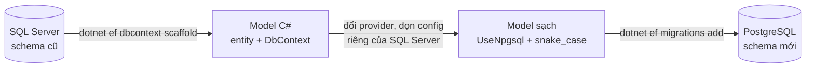

# .NET Framework vs .NET

CV của bạn là Web Forms 4.8, nên interviewer sẽ thử xem bạn còn bắt nhịp được .NET hiện đại không. Đây là phần cần nói trôi nhất.

## Bản đồ phiên bản {#version-map}

- **.NET Framework 4.8.1** là bản cuối. Chỉ còn sửa lỗi bảo mật, chỉ chạy Windows, cài chung toàn máy và đi theo OS.
- **.NET Core 1.0 → 3.1**, sau đó đổi tên thành **.NET 5** (2020) và bỏ chữ "Core". Riêng tên _ASP.NET Core_ và _EF Core_ vẫn giữ.
- Mỗi tháng 11 ra một bản. Số chẵn là <T>LTS</T>, số lẻ là <T>STS</T>.
- **.NET 8** LTS (11/2023, hết hỗ trợ 11/2026) và **.NET 10** LTS (11/2025). Khi phỏng vấn, nói theo .NET 8/10 là an toàn.

## Bảng đối chiếu: thứ bạn dùng hằng ngày → thứ thay thế {#framework-to-core-map}

| Web Forms / Framework 4.8 | ASP.NET Core / .NET |
|---|---|
| `Web.config` + transforms | `appsettings.json`, `appsettings.{Env}.json`, env vars, user secrets → `IConfiguration` / `IOptions<T>` |
| `Global.asax` (`Application_Start`, `BeginRequest`) | `Program.cs`: đăng ký service + dựng middleware pipeline |
| HttpModule / HttpHandler | Middleware / endpoint |
| `HttpContext.Current` (static) | `HttpContext` được truyền vào; `IHttpContextAccessor` khi thật sự cần |
| Page lifecycle, ViewState, postback, server controls | Không có tương đương. Gần nhất về mô hình là Razor Pages; hoặc API + React/Vue |
| Session in-proc mặc định | Phải bật `AddSession()`, lưu qua `IDistributedCache`, chỉ lưu byte/string |
| Forms Authentication, `<authorization>` trong web.config | Cookie authentication / ASP.NET Core Identity / JWT; `[Authorize(Policy)]` + FallbackPolicy ([map chi tiết](/aspnet-core/authorization#webforms-to-core)) |
| `System.Web.Caching.Cache` | `IMemoryCache`, `IDistributedCache`, `HybridCache` (.NET 9) |
| Unity / Autofac / tự `new` | <T>DI</T> container dựng sẵn |
| log4net / NLog trực tiếp | `ILogger<T>` (log4net/Serilog chỉ còn là provider phía sau) |
| <T>IIS</T> + `System.Web` | <T>Kestrel</T>, có hoặc không có IIS/Nginx phía trước |
| ASMX / WCF service | Web API, <T>gRPC</T>, CoreWCF (bản cộng đồng) |
| `packages.config`, csproj kiểu cũ | <T>SDK-style</T> csproj + `PackageReference` |
| AppDomain, Remoting | `AssemblyLoadContext`; Remoting bị bỏ hẳn |

## .NET Framework và .NET (Core) khác nhau thế nào? <Badge type="warning" text="gần như chắc chắn bị hỏi" /> {#framework-vs-core}

::: tip Trả lời nhanh
.NET Framework chỉ chạy Windows, cài chung toàn máy và gắn chặt với <T>IIS</T> qua `System.Web`. .NET là bản viết lại: cross-platform, mỗi app mang runtime và version riêng, modular qua <T>NuGet</T>, có sẵn <T>DI</T>, config, logging, và nhanh hơn đáng kể. Framework 4.8 vẫn được support nhưng không còn tính năng mới.
:::

::: info Bản chất
- **Side-by-side**: nhiều app trên cùng server có thể chạy .NET 8 và .NET 10 song song. Framework thì nâng lên là ảnh hưởng mọi app trên máy.
- **Deploy**: framework-dependent hoặc self-contained (đóng gói luôn runtime), chạy trên Docker/Linux được.
- **Không còn `System.Web`**: đây là lý do gốc khiến Web Forms không port sang được.
- **Hiệu năng**: <T>Kestrel</T>, `Span<T>`, tiered <T>JIT</T>, Dynamic <T>PGO</T>; framework cũng được tối ưu lại từ đầu với async.
- Open-source và phát hành mỗi năm một bản.
:::

::: details Ở dự án thật
Có thể nói: "Ở dự án hiện tại, app chạy Framework 4.8 trên IIS. Muốn nâng runtime là phải tính tới Windows Server, và các app khác trên cùng máy. Với .NET hiện đại, app tự mang runtime, nâng version theo từng service và chạy trong container được. Khác biệt lớn nhất khi chuyển không nằm ở C#, mà ở chỗ phải bỏ những thứ dựa vào `System.Web`: `HttpContext.Current`, Session, page lifecycle."
:::

::: warning Bẫy & follow-up
**"Web Forms có chạy trên .NET 8 được không?"**

Không. `System.Web` không tồn tại trên .NET hiện đại. Phần UI phải viết lại; business logic tách ra được thì mang theo.

**"Thư viện viết cho Framework có dùng lại được không?"**

Nếu target **.NET Standard 2.0** thì dùng được ở cả hai bên, đây là cách chuẩn khi migrate từng bước. Thư viện target thẳng `net48` thì .NET có thể load nhờ compatibility shim, nhưng sẽ lỗi lúc chạy nếu nó gọi API không còn (<T>System.Web</T>, WCF server, AppDomain).

**".NET Standard là gì, giờ còn cần không?"**

Là một "hợp đồng API" chung để thư viện chạy được trên nhiều runtime. Từ .NET 5 thì không còn version mới. Nay chỉ còn dùng .NET Standard 2.0 cho thư viện phải chia sẻ với Framework; code mới thì target thẳng `net8.0`/`net10.0`.
:::

## Kestrel là gì? Có còn cần IIS không? {#kestrel}

::: tip Trả lời nhanh
Kestrel là web server cross-platform dựng sẵn trong ASP.NET Core. App luôn có server bên trong nó; <T>IIS</T> hoặc Nginx chỉ là <T>reverse proxy</T> tùy chọn đặt phía trước, lo <T>TLS</T>, load balancing, chia port 80/443 cho nhiều app và quản lý process.
:::

::: info Bản chất
Trên IIS, ASP.NET Core chạy qua <T k="ancm">ASP.NET Core Module (ANCM)</T> theo 2 kiểu:

- **In-process** (mặc định): app chạy ngay trong <T k="w3wp">worker process</T> `w3wp.exe` của IIS, dùng IIS HTTP Server thay cho Kestrel. Nhanh hơn vì không qua thêm một hop.
- **Out-of-process**: IIS chỉ forward request tới Kestrel đang chạy trong process riêng.

Trên Linux/container: thường là Kestrel, đặt sau Nginx, load balancer hoặc ingress.
:::

::: warning Bẫy & follow-up
**"Expose Kestrel thẳng ra internet được không?"**

Được, Kestrel đủ ổn định để làm edge server. Nhưng thực tế vẫn hay đặt sau proxy để terminate TLS tập trung, có <T>WAF</T>, và gom nhiều app về một port.

**"Đặt sau proxy thì cần chú ý gì?"**

Bật Forwarded Headers middleware để app biết scheme (https) và IP thật của client. Không có nó, redirect sang http sai và log IP toàn là IP của proxy.
:::

## Tại sao không còn `HttpContext.Current`? {#httpcontext-current}

::: tip Trả lời nhanh
Vì truy cập static ngầm như vậy khó test, che giấu dependency, và trong Framework nó phải dựa vào SynchronizationContext để "đi theo" request qua các thread. ASP.NET Core truyền `HttpContext` vào một cách tường minh: controller có sẵn property, middleware nhận làm tham số. Service ở tầng dưới mà thật sự cần thì dùng `IHttpContextAccessor`.
:::

::: details Ở dự án thật
Code Web Forms hay có helper static gọi `HttpContext.Current.Session["UserId"]` ở tầng business. Khi migrate đây là chỗ đau nhất. Cách xử lý sạch là đẩy thông tin cần (user id, tenant, culture) lên thành tham số, hoặc gom vào một service kiểu `ICurrentUser` được inject. Business logic như vậy cũng test được mà không cần web.
:::

::: warning Bẫy & follow-up
**"Dùng `IHttpContextAccessor` trong singleton có sao không?"**

Inject accessor thì được, vì nó đọc qua `AsyncLocal` nên luôn ra đúng request hiện tại. Nhưng không được lưu `HttpContext` vào field, và không dùng ở background thread chạy sau khi request đã xong: lúc đó context là null hoặc đã bị tái sử dụng.
:::

## Config hoạt động thế nào? Thay `Web.config` bằng gì? {#configuration}

::: tip Trả lời nhanh
Config là nhiều nguồn chồng lên nhau theo thứ tự, nguồn sau ghi đè nguồn trước: `appsettings.json` → `appsettings.{Environment}.json` → user secrets (chỉ Development) → environment variables → command-line. Đọc qua `IConfiguration`, hoặc tốt hơn là bind vào class bằng Options pattern.
:::

::: info Bản chất
```csharp
// appsettings.json: { "Payout": { "MinAmount": 50, "Currency": "AUD" } }
public sealed class PayoutOptions { public decimal MinAmount { get; init; } public string Currency { get; init; } = ""; }

builder.Services.Configure<PayoutOptions>(builder.Configuration.GetSection("Payout"));

public class PayoutService(IOptions<PayoutOptions> options) { /* options.Value.MinAmount */ }
```

| Interface | Lifetime | Reload khi file đổi |
|---|---|---|
| `IOptions<T>` | Singleton | Không, đọc 1 lần |
| `IOptionsSnapshot<T>` | Scoped | Có, mỗi request đọc lại |
| `IOptionsMonitor<T>` | Singleton | Có, kèm callback `OnChange` |
:::

::: details Ở dự án thật
`Web.Release.config` transform tương ứng với `appsettings.Production.json` cộng env vars được set trong pipeline deploy. Connection string và API key không commit vào repo: dev dùng user secrets, môi trường thật dùng env vars hoặc Key Vault.
:::

::: warning Bẫy & follow-up
**"Set key lồng nhau bằng environment variable thế nào?"**

Dùng hai dấu gạch dưới: `Payout__MinAmount=100`, `ConnectionStrings__Default=...`.

**"Inject `IOptionsSnapshot` vào singleton được không?"**

Không: nó là scoped, sẽ lỗi scope validation. Singleton cần giá trị mới nhất thì dùng `IOptionsMonitor`. Chi tiết và timeline ở [Options pattern](/aspnet-core/options-pattern#options-interfaces).
:::

## Migrate một app .NET Framework lên .NET 8 thế nào? <Badge type="warning" text="cả 2 job hỏi" /> {#migration-strategy}

Migrate thật thường là **hai bài toán chồng lên nhau**: chuyển code (Framework → .NET) và có khi chuyển luôn data (đổi engine, vd SQL Server → PostgreSQL). Cả hai theo cùng một nguyên lý: **chia thành lát nhỏ, mỗi lát kiểm chứng được và lùi lại được**. Mục này đi qua 5 chặng trong hình; bấm vào một ô để tới phần chi tiết.

<svg width="0" height="0" style="position:absolute" aria-hidden="true"><defs><marker id="mgInk" viewBox="0 0 10 10" refX="8" refY="5" markerWidth="7" markerHeight="7" orient="auto-start-reverse"><path class="head" d="M0 0L10 5L0 10z"/></marker><marker id="mgAcc" viewBox="0 0 10 10" refX="8" refY="5" markerWidth="7" markerHeight="7" orient="auto-start-reverse"><path class="headAcc" d="M0 0L10 5L0 10z"/></marker><marker id="mgOk" viewBox="0 0 10 10" refX="8" refY="5" markerWidth="7" markerHeight="7" orient="auto-start-reverse"><path class="headOk" d="M0 0L10 5L0 10z"/></marker><marker id="mgBad" viewBox="0 0 10 10" refX="8" refY="5" markerWidth="7" markerHeight="7" orient="auto-start-reverse"><path class="headBad" d="M0 0L10 5L0 10z"/></marker></defs></svg>

<div class="fig">
<svg viewBox="0 0 720 156" role="img" aria-label="Năm chặng migrate: strangler, chạy song song, schema, chuyển và kiểm data, cutover">
<text x="143" y="20" font-size="12" font-weight="600" text-anchor="middle" class="muted">Code · Framework → .NET</text>
<line class="lnMuted" x1="10" y1="28" x2="276" y2="28"/>
<text x="498" y="20" font-size="12" font-weight="600" text-anchor="middle" class="muted">Data · SQL Server → PostgreSQL</text>
<line class="lnMuted" x1="294" y1="28" x2="702" y2="28"/>
<a href="#why-strangler" style="text-decoration:none"><rect class="boxAcc" x="10" y="44" width="124" height="100" rx="8"/><text x="72" y="72" font-size="13" font-weight="600" text-anchor="middle">Strangler</text><text x="72" y="92" font-size="11" text-anchor="middle">từng route một</text><text x="72" y="108" font-size="11" text-anchor="middle">rollback từng lát</text><text x="72" y="130" font-size="10.5" text-anchor="middle" class="badT">không big-bang</text><circle cx="10" cy="44" r="12" style="fill:var(--vp-c-bg)"/><circle class="boxAcc" cx="10" cy="44" r="12"/><text x="10" y="49" font-size="13" font-weight="700" text-anchor="middle" class="accT">1</text></a>
<line class="ln" x1="136" y1="94" x2="148" y2="94" marker-end="url(#mgInk)"/>
<a href="#side-by-side" style="text-decoration:none"><rect class="boxAcc" x="152" y="44" width="124" height="100" rx="8"/><text x="214" y="72" font-size="13" font-weight="600" text-anchor="middle">Chạy song song</text><text x="214" y="92" font-size="11" text-anchor="middle">YARP + adapters</text><text x="214" y="108" font-size="11" text-anchor="middle">chia session, auth</text><text x="214" y="130" font-size="10.5" text-anchor="middle" class="badT">session qua HTTP</text><circle cx="152" cy="44" r="12" style="fill:var(--vp-c-bg)"/><circle class="boxAcc" cx="152" cy="44" r="12"/><text x="152" y="49" font-size="13" font-weight="700" text-anchor="middle" class="accT">2</text></a>
<line class="ln" x1="278" y1="94" x2="290" y2="94" marker-end="url(#mgInk)"/>
<a href="#db-schema" style="text-decoration:none"><rect class="boxOk" x="294" y="44" width="124" height="100" rx="8"/><text x="356" y="72" font-size="13" font-weight="600" text-anchor="middle">Schema</text><text x="356" y="92" font-size="11" text-anchor="middle">scaffold → model</text><text x="356" y="108" font-size="11" text-anchor="middle">→ migrations</text><text x="356" y="130" font-size="10.5" text-anchor="middle" class="badT">bẫy: tên, UTC, id</text><circle cx="294" cy="44" r="12" style="fill:var(--vp-c-bg)"/><circle class="boxAcc" cx="294" cy="44" r="12"/><text x="294" y="49" font-size="13" font-weight="700" text-anchor="middle" class="accT">3</text></a>
<line class="ln" x1="420" y1="94" x2="432" y2="94" marker-end="url(#mgInk)"/>
<a href="#data-verify" style="text-decoration:none"><rect class="boxOk" x="436" y="44" width="124" height="100" rx="8"/><text x="498" y="72" font-size="13" font-weight="600" text-anchor="middle">Chuyển + kiểm</text><text x="498" y="92" font-size="11" text-anchor="middle">count → aggregate</text><text x="498" y="108" font-size="11" text-anchor="middle">→ diff query</text><text x="498" y="130" font-size="10.5" text-anchor="middle" class="badT">sample ≠ bằng chứng</text><circle cx="436" cy="44" r="12" style="fill:var(--vp-c-bg)"/><circle class="boxAcc" cx="436" cy="44" r="12"/><text x="436" y="49" font-size="13" font-weight="700" text-anchor="middle" class="accT">4</text></a>
<line class="ln" x1="562" y1="94" x2="574" y2="94" marker-end="url(#mgInk)"/>
<a href="#cutover" style="text-decoration:none"><rect class="boxOk" x="578" y="44" width="124" height="100" rx="8"/><text x="640" y="72" font-size="13" font-weight="600" text-anchor="middle">Cutover</text><text x="640" y="92" font-size="11" text-anchor="middle">downtime hoặc CDC</text><text x="640" y="108" font-size="11" text-anchor="middle">giữ DB cũ để lùi</text><text x="640" y="130" font-size="10.5" text-anchor="middle" class="badT">đừng dual write</text><circle cx="578" cy="44" r="12" style="fill:var(--vp-c-bg)"/><circle class="boxAcc" cx="578" cy="44" r="12"/><text x="578" y="49" font-size="13" font-weight="700" text-anchor="middle" class="accT">5</text></a>
</svg>
<p class="fig-caption">Ôn lại: nói được mỗi ô giải quyết rủi ro gì và dòng đỏ là bẫy gì. Hai nhánh độc lập: có thể đổi code mà giữ SQL Server, hoặc đổi DB mà chưa đụng Web Forms.</p>
</div>

::: tip Trả lời nhanh
Không <T>big-bang</T>. Chuyển dần theo <T>strangler fig</T>: dựng một app ASP.NET Core mới đứng trước (reverse proxy bằng <T>YARP</T>); route nào đã chuyển thì vào app mới, còn lại proxy về app cũ; <T>System.Web adapters</T> chia session/auth giữa hai app. Thứ tự: thư viện dùng chung sang <T k="net standard">.NET Standard 2.0</T> / multi-target trước, rồi data access (<T>EF6</T> → <T>EF Core</T>), rồi từng nhóm endpoint. Nếu đổi luôn DB: schema sinh bằng EF Core migrations, data kiểm 3 tầng (count → aggregate → diff query), cutover bằng cửa sổ downtime hoặc <T>CDC</T>, luôn giữ DB cũ để rollback.
:::

### 1. Vì sao strangler fig, không big-bang {#why-strangler}

Rủi ro của một lần release tỉ lệ với lượng thay đổi **chưa từng chạy trên production**. Big-bang dồn toàn bộ thay đổi vào một release, nên nó gánh ba cái đau cùng lúc:

- **Mọi rủi ro dồn vào một ngày**: lỗi của hàng trăm màn hình lộ ra cùng lúc, và lùi lại nghĩa là lùi cả hệ thống.
- **Hàng tháng không giao giá trị**: user không nhận được gì cho tới go-live, business khó chấp nhận ngân sách kiểu đó.
- **Nuôi hai codebase trong lúc chờ**: app cũ vẫn phải sửa bug và thêm tính năng, mỗi thay đổi phải làm lại bên bản mới, bản mới đuổi theo một mục tiêu đang chạy.

Strangler đảo lại: mỗi lần chỉ chuyển một lát (một route, một màn hình), ship lên production ngay, lỗi thì trả **riêng route đó** về app cũ.

<div class="fig">
<svg viewBox="0 0 720 250" role="img" aria-label="Big-bang: một khối viết lại dài rồi một ngày go-live. Strangler: tám lát nhỏ, mỗi lát ship riêng">
<text x="20" y="62" font-size="14" font-weight="600" class="badT">Big-bang</text>
<rect class="boxBad" x="130" y="40" width="470" height="32" rx="6"/>
<text x="365" y="61" font-size="12" text-anchor="middle">viết lại toàn bộ: chưa ship gì cho user</text>
<rect class="box dash" x="130" y="78" width="470" height="24" rx="6"/>
<text x="365" y="94" font-size="11" text-anchor="middle" class="muted">trong lúc đó: sửa bug và thêm tính năng ở cả hai codebase</text>
<line class="lnBad" x1="610" y1="34" x2="610" y2="106"/>
<text x="618" y="52" font-size="12" font-weight="600" class="badT">go-live</text>
<text x="618" y="70" font-size="11" class="badT">mọi rủi ro dồn</text>
<text x="618" y="86" font-size="11" class="badT">vào 1 ngày</text>
<text x="20" y="162" font-size="14" font-weight="600" class="okT">Strangler</text>
<rect class="boxOk" x="130" y="140" width="60" height="32" rx="6"/><text x="160" y="161" font-size="11" text-anchor="middle">lát 1</text>
<rect class="boxOk" x="202" y="140" width="60" height="32" rx="6"/><text x="232" y="161" font-size="11" text-anchor="middle">lát 2</text>
<rect class="boxOk" x="274" y="140" width="60" height="32" rx="6"/><text x="304" y="161" font-size="11" text-anchor="middle">lát 3</text>
<rect class="boxOk" x="346" y="140" width="60" height="32" rx="6"/><text x="376" y="161" font-size="11" text-anchor="middle">lát 4</text>
<rect class="boxBad" x="418" y="140" width="60" height="32" rx="6"/><text x="448" y="161" font-size="11" text-anchor="middle">lát 5</text>
<rect class="boxOk" x="490" y="140" width="60" height="32" rx="6"/><text x="520" y="161" font-size="11" text-anchor="middle">lát 5'</text>
<rect class="boxOk" x="562" y="140" width="60" height="32" rx="6"/><text x="592" y="161" font-size="11" text-anchor="middle">lát 6</text>
<rect class="boxOk" x="634" y="140" width="60" height="32" rx="6"/><text x="664" y="161" font-size="11" text-anchor="middle">…</text>
<path class="lnBad dash" d="M448 140 C 448 120, 520 120, 520 136" fill="none" marker-end="url(#mgBad)"/>
<text x="484" y="116" font-size="10.5" text-anchor="middle" class="badT">lỗi: route về app cũ, sửa, ship lại</text>
<text x="415" y="196" font-size="11.5" text-anchor="middle" class="okT">mỗi lát: thêm endpoint ở app mới; lỗi thì chỉ lùi đúng lát đó</text>
<text x="415" y="214" font-size="11" text-anchor="middle" class="muted">user nhận giá trị từ lát đầu, rủi ro chia nhỏ theo từng lần ship</text>
<line class="ln" x1="130" y1="236" x2="700" y2="236" marker-end="url(#mgInk)"/>
<text x="124" y="240" font-size="11" text-anchor="end" class="muted">thời gian</text>
</svg>
<p class="fig-caption">Cùng một khối việc. Big-bang trả hết rủi ro ở cuối; strangler trả từng phần nhỏ, và một lát hỏng không kéo theo các lát khác.</p>
</div>

Strangler cũng có giá, vì cơ chế của nó là **hai app cùng sống**: thêm một hop proxy, phải chia session/auth (chặng 2), và cái đuôi vài route cuối hay bị bỏ dở. Nên **không cần** strangler khi app nhỏ (vài màn hình, viết lại trong vài tuần), hoặc app sắp bị bỏ: lúc đó viết lại một lần rẻ hơn.

### 2. App cũ và app mới chạy song song thế nào {#side-by-side}

Client chỉ thấy **một host** là app mới; app mới quyết định route nào tự xử lý, route nào forward về app cũ. Vì vậy "chuyển một route" chỉ là thêm endpoint ở app mới: URL phía client không đổi, và lùi lại là xoá endpoint đó.

<div class="fig">
<svg viewBox="0 0 720 320" role="img" aria-label="Browser gọi app ASP.NET Core mới; route đã chuyển và trang Vue xử lý tại chỗ; route còn lại forward qua YARP về app Web Forms; System.Web adapters lấy session và user từ app cũ">
<rect class="box" x="20" y="132" width="130" height="52" rx="8"/>
<text x="85" y="154" font-size="13" font-weight="600" text-anchor="middle">Browser</text>
<text x="85" y="172" font-size="11" text-anchor="middle" class="muted">1 domain duy nhất</text>
<line class="ln" x1="150" y1="158" x2="196" y2="158" marker-end="url(#mgInk)"/>
<rect class="boxAcc" x="200" y="20" width="250" height="284" rx="10"/>
<text x="325" y="42" font-size="13" font-weight="600" text-anchor="middle" class="accT">App mới · ASP.NET Core</text>
<rect class="boxOk" x="216" y="56" width="218" height="44" rx="6"/>
<text x="325" y="74" font-size="12" font-weight="600" text-anchor="middle">Route đã chuyển</text>
<text x="325" y="91" font-size="11" text-anchor="middle" class="mono">/api/payouts → controller</text>
<rect class="boxOk" x="216" y="108" width="218" height="44" rx="6"/>
<text x="325" y="126" font-size="12" font-weight="600" text-anchor="middle">Trang Vue (SPA)</text>
<text x="325" y="143" font-size="11" text-anchor="middle" class="mono">/app/* → static files</text>
<text x="325" y="172" font-size="11" text-anchor="middle" class="muted">không khớp route nào ở trên ↓</text>
<rect class="box dash" x="216" y="182" width="218" height="52" rx="6"/>
<text x="325" y="202" font-size="12" font-weight="600" text-anchor="middle">YARP forwarder</text>
<text x="325" y="220" font-size="11" text-anchor="middle" class="mono">/{**catch-all}, ưu tiên thấp nhất</text>
<rect class="boxAcc dash" x="216" y="244" width="218" height="44" rx="6"/>
<text x="325" y="262" font-size="12" font-weight="600" text-anchor="middle">System.Web adapters</text>
<text x="325" y="279" font-size="11" text-anchor="middle" class="muted">client: hỏi session, user</text>
<path class="boxOk" d="M560 40 L560 82 A50 8 0 0 0 660 82 L660 40 A50 8 0 0 0 560 40 Z"/>
<ellipse class="boxOk" cx="610" cy="40" rx="50" ry="8"/>
<text x="610" y="66" font-size="12" text-anchor="middle">SQL Server</text>
<text x="610" y="80" font-size="10.5" text-anchor="middle" class="muted">dùng chung</text>
<line class="ln dash" x1="450" y1="60" x2="556" y2="60" marker-end="url(#mgInk)"/>
<rect class="box" x="520" y="140" width="180" height="164" rx="10"/>
<text x="610" y="162" font-size="13" font-weight="600" text-anchor="middle">App cũ · Web Forms</text>
<text x="610" y="180" font-size="11" text-anchor="middle" class="muted">IIS, .NET Framework 4.8</text>
<rect class="boxAcc dash" x="534" y="244" width="152" height="44" rx="6"/>
<text x="610" y="262" font-size="12" font-weight="600" text-anchor="middle">adapters (server)</text>
<text x="610" y="279" font-size="11" text-anchor="middle" class="muted">trả session + user</text>
<line class="ln dash" x1="610" y1="140" x2="610" y2="94" marker-end="url(#mgInk)"/>
<line class="ln" x1="434" y1="208" x2="516" y2="208" marker-end="url(#mgInk)"/>
<text x="476" y="200" font-size="11" text-anchor="middle">HTTP</text>
<line class="lnAcc dash" x1="434" y1="266" x2="530" y2="266" marker-end="url(#mgAcc)"/>
<text x="482" y="258" font-size="10.5" text-anchor="middle" class="accT">session/auth</text>
</svg>
<p class="fig-caption">Request vào app mới trước. Route đã chuyển và trang Vue được xử lý tại chỗ; còn lại rơi xuống catch-all và được forward về app cũ. Khi app cũ hết route thì tắt nó và bỏ forwarder.</p>
</div>

Phần proxy dùng direct forwarding của YARP (package `Yarp.ReverseProxy`, từ bản 2.0 có `MapForwarder`); phần chia session/auth dùng package `Microsoft.AspNetCore.SystemWebAdapters`. Đây cũng là khung mà .NET Upgrade Assistant dựng sẵn khi chọn kiểu migrate từng bước:

```csharp
// Program.cs của app mới
var builder = WebApplication.CreateBuilder(args);

builder.Services.AddControllers();
builder.Services.AddHttpForwarder();
builder.Services.AddSystemWebAdapters()
    .AddJsonSessionSerializer(o => o.RegisterKey<int>("UserId")) // mỗi key session phải khai báo kiểu
    .AddRemoteAppClient(o =>
    {
        o.RemoteAppUrl = new(builder.Configuration["ProxyTo"]!);   // địa chỉ app cũ
        o.ApiKey = builder.Configuration["RemoteAppApiKey"]!;      // khớp key cấu hình ở app cũ
    })
    .AddSessionClient()
    .AddAuthenticationClient(isDefaultScheme: true);

var app = builder.Build();
app.UseRouting();
app.UseAuthentication();
app.UseAuthorization();
app.UseSystemWebAdapters();

app.MapControllers().RequireSystemWebAdapterSession(); // chỉ endpoint cần session mới phải gọi app cũ
app.MapForwarder("/{**catch-all}", app.Configuration["ProxyTo"]!)
   .Add(static b => ((RouteEndpointBuilder)b).Order = int.MaxValue); // chạy sau mọi route khác

app.Run();
```

Hệ quả suy ra từ cơ chế:

- **Session phải serialize được**, vì nó đi qua HTTP giữa hai process. Web Forms hay nhét cả object (`DataTable`, entity) vào session; trước khi chia được phải đổi thành kiểu đơn giản và đăng ký từng key.
- **Mỗi request cần session tốn thêm một lượt gọi sang app cũ**, nên chỉ bật session cho endpoint thật sự cần. Đây là cầu nối tạm, tắt khi app cũ ra đi.
- **Auth chung** nhờ remote authentication: app mới hỏi app cũ "cookie Forms auth này là ai", nên user không phải login lại khi đi từ trang cũ sang trang mới.
- App cũ cũng phải cài package và bật phần server (session server, authentication server) với cùng API key; không có phía server thì client không hỏi được ai.

**Code: thay gì, theo thứ tự nào.** Thư viện dùng chung chuyển trước (target `netstandard2.0` hoặc multi-target `net48;net8.0`) để cả hai app cùng reference; sau đó data access; cuối cùng là từng nhóm endpoint.

| .NET Framework | .NET 8 |
|---|---|
| `System.Web`, `HttpContext.Current` | `HttpContext` được truyền vào / `IHttpContextAccessor` ([chi tiết](/dotnet/framework-vs-core#httpcontext-current)) |
| `Web.config` | `appsettings.json` + Options pattern ([chi tiết](/dotnet/framework-vs-core#configuration)) |
| `Global.asax`, HTTP modules | `Program.cs` + middleware |
| MVC 5 / Web API 2 | ASP.NET Core MVC (controller MVC và API đã gộp làm một) |
| EF6 (EDMX) | EF Core: code-first, hoặc `dotnet ef dbcontext scaffold` từ DB có sẵn |
| WCF server | <T>gRPC</T> / REST, hoặc CoreWCF nếu client không đổi được |
| Session, Forms auth | Cookie auth; chia sẻ với app cũ qua System.Web adapters |

**EF6 → EF Core không phải đổi namespace là xong**, vì EF Core là bản viết lại với mặc định khác:

| EF6 | EF Core |
|---|---|
| Lazy loading bật mặc định | Tắt; muốn có phải cài Proxies và bật tay. Thiếu `Include` là navigation bị null |
| Có EDMX designer | Không có EDMX; model nằm trong code |
| Query không dịch được sang SQL thì có thể lặng lẽ chạy trên memory | Từ EF Core 3: ném exception (chỉ cho phép ở projection cuối) |
| `GroupBy` tương đối thoải mái | `GroupBy` chỉ dịch tốt khi đi kèm aggregate (`Count`, `Sum`...) |

### 3. Đổi DB engine: schema đi qua EF Core model {#db-schema}

Ví dụ thật: ở Jabil, một project chuyển từ SQL Server sang PostgreSQL vì **chi phí license**. Nguyên lý: **EF Core model là bản trung gian không phụ thuộc engine**. Scaffold đọc schema cũ thành model C#, migrations sinh schema mới từ model đó; schema Postgres vì vậy được sinh ra chứ không viết tay, và từ đó trở đi DB đi theo code.



```bash
# 1. Đọc schema cũ thành code (database-first)
dotnet ef dbcontext scaffold "Server=.;Database=Legacy;Trusted_Connection=True;TrustServerCertificate=True" \
  Microsoft.EntityFrameworkCore.SqlServer -o Data/Entities --context AppDbContext --no-onconfiguring

# 2. Đổi provider trong Program.cs, dọn config, rồi tạo schema mới (code-first từ đây)
dotnet ef migrations add InitialPostgres
dotnet ef database update
```

Bước dọn config là bắt buộc, vì scaffold chép nguyên chi tiết của SQL Server vào model: `HasColumnType("datetime")`, `HasDefaultValueSql("(getdate())")`, `newid()`. Để nguyên thì migration trên Postgres lỗi; thay bằng kiểu và hàm của Postgres (`now()`, `gen_random_uuid()` có sẵn từ PostgreSQL 13) hoặc bỏ để Npgsql tự chọn.

**Stored procedure** chia theo cỡ, vì cái giá của mỗi cách khác nhau:

- **SP nhỏ** (vài câu `SELECT`/`UPDATE`) viết lại thành method C#/LINQ: có unit test, đi cùng version với code, không phải port cú pháp T-SQL.
- **SP lớn** (hàng trăm dòng, nhiều bảng tạm) giữ logic trong DB, port sang PL/pgSQL. Viết lại lớn là rủi ro sai nghiệp vụ cao hơn rủi ro cú pháp. SP trả result set thì port thành **function** `RETURNS TABLE`, vì `PROCEDURE` của Postgres không trả result set như SQL Server; gọi bằng `FromSql` vào class kết quả **keyless** (`HasNoKey()`).

### Bẫy khi sang Postgres {#postgres-gotchas}

Phần lớn bẫy có chung một gốc: **SQL Server và Postgres có mặc định khác nhau, và khác biệt không phải lúc nào cũng thành lỗi**; có cái ném exception ngay, có cái chỉ lặng lẽ cho kết quả khác.

**Tên không quote bị hạ thành chữ thường.** Postgres không "phân biệt hoa thường" theo nghĩa đơn giản: nó đổi mọi tên **không có ngoặc kép** về chữ thường, còn tên trong ngoặc kép giữ nguyên. EF Core luôn quote, nên với tên PascalCase nó tạo bảng `"Orders"` cột `"OrderId"`. Hệ quả: SQL viết tay, report, BI tool gõ `SELECT OrderId FROM Orders` sẽ tìm `orders.orderid` và báo không có bảng; phải gõ `"Orders"."OrderId"` khắp nơi. Cách chữa: package `EFCore.NamingConventions`, gọi `UseSnakeCaseNamingConvention()` để EF tạo `orders.order_id`, gõ không cần quote.

**`DateTime` phải là UTC.** Từ Npgsql 6, `DateTime` mặc định map vào `timestamp with time zone`, và ghi một `DateTime` có `Kind` khác `Utc` sẽ **ném exception**. Data đọc từ cột `datetime` của SQL Server có `Kind = Unspecified`, nên đây là lỗi đầu tiên hay gặp. Cách chữa, theo thứ tự nên chọn:

- Lưu UTC: đổi lúc import (`DateTime.SpecifyKind` nếu biết data cũ là giờ nào), code mới dùng `DateTime.UtcNow` / `DateTimeOffset`.
- Cột thật sự là giờ địa phương không có múi giờ (giờ mở cửa kho) thì map rõ `HasColumnType("timestamp without time zone")`.
- `AppContext.SetSwitch("Npgsql.EnableLegacyTimestampBehavior", true)` đưa về hành vi trước bản 6. Chỉ là lối thoát tạm, không nên để lâu.

`timestamptz` không lưu múi giờ; nó lưu một thời điểm UTC và đổi theo `TimeZone` của session khi hiển thị.

**Copy id cũ thì phải reset sequence.** Cột identity của Postgres lấy số từ một sequence. Import dòng **kèm id có sẵn** không đẩy sequence lên, nên sequence vẫn ở 1 và lần insert đầu tiên sau cutover bị `duplicate key`. Sau khi load xong, đặt lại cho từng bảng:

```sql
SELECT setval(pg_get_serial_sequence('orders', 'id'), (SELECT MAX(id) FROM orders));
```

**So sánh chuỗi đổi hành vi mà không báo lỗi.** Collation mặc định của SQL Server (vd `SQL_Latin1_General_CP1_CI_AS`, `CI` = case-insensitive) coi `'A@x.com'` bằng `'a@x.com'`; collation mặc định của Postgres thì không. Câu `WHERE Email = @email` vẫn chạy, chỉ lặng lẽ không tìm thấy: login thất bại, kiểm tra trùng email bỏ lọt, unique index cho phép cả hai. Ba cách chữa:

- Kiểu <T>citext</T> (extension của Postgres): cột so sánh không phân biệt hoa thường, đổi ít code nhất.
- `lower(email)` khi so và lưu, kèm **expression index** `CREATE UNIQUE INDEX ux_users_email ON users (lower(email));`, nếu không index thường sẽ không được dùng.
- Collation **nondeterministic** của ICU (thư viện Unicode mà Postgres dùng cho collation): `HasCollation("ci", locale: "und-u-ks-level2", provider: "icu", deterministic: false)` rồi `UseCollation("ci")` trên cột. Đổi lại, một số thao tác như `LIKE` bị giới hạn tuỳ version Postgres.

**Map kiểu dữ liệu.** Phần lớn Npgsql tự chọn; cần để ý các chỗ khác nghĩa:

| SQL Server | PostgreSQL | Để ý |
|---|---|---|
| `bit` | `boolean` | SQL viết tay `WHERE active = 1` phải thành `= true` |
| `uniqueidentifier` | `uuid` | thứ tự `ORDER BY` theo guid khác nhau giữa hai engine |
| `nvarchar(n)` / `nvarchar(max)` | `varchar(n)` / `text` | Postgres lưu UTF-8, không có kiểu "N" riêng |
| `datetime` | `timestamp` / `timestamptz` | `datetime` làm tròn tới ~3 ms; `datetime2` và Postgres tới micro giây |
| `tinyint` | `smallint` | Postgres không có `tinyint` |
| `money` | `numeric(19,4)` | |
| `varbinary(max)` | `bytea` | |

**Encoding chữ có dấu.** Cột `varchar` (không N) của SQL Server lưu theo code page của collation, nên tiếng Việt có thể đã thành `?` ngay trong DB cũ. Postgres phải tạo với `ENCODING 'UTF8'`, file export phải là UTF-8 hoặc UTF-16 (`bcp -w`; `-c` dùng code page). Kiểm tra bằng cách đếm dòng chứa ký tự ngoài ASCII ở cả hai bên và tìm dấu hiệu lỗi font như `?` hay `Ã`.

### 4. Chuyển data và kiểm tra đúng {#data-verify}

Schema do migrations tạo đã có foreign key, nên **thứ tự load bị ràng buộc**: bảng cha trước, bảng con sau (`merchants` → `orders` → `order_lines`). Không sắp được thứ tự (bảng tự tham chiếu, vòng tham chiếu) thì tạo FK `DEFERRABLE` và `SET CONSTRAINTS ALL DEFERRED` trong transaction load, hoặc load xong mới thêm FK. Công cụ:

- `bcp` xuất từ SQL Server ra file → `COPY ... FROM` (hoặc `\copy` của `psql`) nạp vào Postgres; nhanh nhất cho bảng lớn.
- <T>pgloader</T>: đọc thẳng từ SQL Server ghi sang Postgres, tự đổi kiểu. Schema đã có từ migrations thì chỉ dùng phần data.
- Một console C# đọc qua `DbContext` cũ, ghi bằng binary COPY của Npgsql (`BeginBinaryImport`): chậm hơn nhưng chuyển đổi được dữ liệu (đổi `Kind` sang UTC) ngay trong code.

Xong thì chạy `setval` cho mọi sequence như ở [Bẫy khi sang Postgres](#postgres-gotchas).

**Kiểm tra theo 3 tầng.** Mỗi tầng bắt được loại lỗi mà tầng trước bỏ sót, nên đi từ rẻ tới đắt:

<div class="fig">
<svg viewBox="0 0 720 244" role="img" aria-label="Ba tầng kiểm tra data: đếm dòng, aggregate theo cột, chạy cùng query trên hai DB và diff">
<rect class="box" x="20" y="12" width="680" height="64" rx="8"/>
<circle cx="20" cy="12" r="12" style="fill:var(--vp-c-bg)"/><circle class="boxAcc" cx="20" cy="12" r="12"/><text x="20" y="17" font-size="13" font-weight="700" text-anchor="middle" class="accT">1</text>
<text x="44" y="38" font-size="13" font-weight="600">Đếm dòng từng bảng</text>
<text x="44" y="60" font-size="10.5" class="mono">SELECT COUNT(*) FROM orders</text>
<text x="420" y="38" font-size="11.5" class="okT">bắt: thiếu cả batch, bảng quên copy</text>
<text x="420" y="60" font-size="11.5" class="badT">sót: đủ dòng nhưng sai giá trị</text>
<line class="ln" x1="60" y1="76" x2="60" y2="88" marker-end="url(#mgInk)"/>
<rect class="box" x="20" y="92" width="680" height="64" rx="8"/>
<circle cx="20" cy="92" r="12" style="fill:var(--vp-c-bg)"/><circle class="boxAcc" cx="20" cy="92" r="12"/><text x="20" y="97" font-size="13" font-weight="700" text-anchor="middle" class="accT">2</text>
<text x="44" y="118" font-size="13" font-weight="600">Aggregate theo từng cột</text>
<text x="44" y="140" font-size="10.5" class="mono">SUM(amount), MIN/MAX(created_at), COUNT(DISTINCT email)</text>
<text x="420" y="118" font-size="11.5" class="okT">bắt: làm tròn, lệch giờ, null, cắt chuỗi</text>
<text x="420" y="140" font-size="11.5" class="badT">sót: data đúng, query hiểu khác</text>
<line class="ln" x1="60" y1="156" x2="60" y2="168" marker-end="url(#mgInk)"/>
<rect class="boxOk" x="20" y="172" width="680" height="64" rx="8"/>
<circle cx="20" cy="172" r="12" style="fill:var(--vp-c-bg)"/><circle class="boxAcc" cx="20" cy="172" r="12"/><text x="20" y="177" font-size="13" font-weight="700" text-anchor="middle" class="accT">3</text>
<text x="44" y="198" font-size="13" font-weight="600">Cùng query, hai DB, diff</text>
<text x="44" y="220" font-size="10.5" class="mono">MonthlyTotals(sqlDb) vs MonthlyTotals(pgDb)</text>
<text x="420" y="198" font-size="11.5" class="okT">bắt: collation, ranh giới ngày, rounding</text>
<text x="420" y="220" font-size="11.5" class="muted">kiểm đúng thứ report và user thấy</text>
</svg>
<p class="fig-caption">Tầng 1 và 2 so data; tầng 3 so hành vi. Data giống hệt mà report vẫn lệch là chuyện có thật, vd do collation hoặc múi giờ.</p>
</div>

Tầng 3 có một mẹo: viết query **một lần bằng LINQ**, chạy qua hai `DbContext` cùng class nhưng khác provider. EF dịch LINQ sang SQL riêng cho từng provider, nên không phải viết tay hai bản SQL (mà bản nào cũng có thể sai theo kiểu riêng); thứ được so là data cộng cách mỗi engine hiểu query.

```csharp
public sealed record MonthlyTotal(int Year, int Month, int Count, decimal Total);

static Task<List<MonthlyTotal>> MonthlyTotals(AppDbContext db) =>
    db.Payouts
      .GroupBy(p => new { p.CreatedAt.Year, p.CreatedAt.Month })
      .Select(g => new MonthlyTotal(g.Key.Year, g.Key.Month, g.Count(), g.Sum(p => p.Amount)))
      .OrderBy(x => x.Year).ThenBy(x => x.Month)
      .ToListAsync();

var sqlDb = new AppDbContext(new DbContextOptionsBuilder<AppDbContext>().UseSqlServer(sqlConn).Options);
var pgDb  = new AppDbContext(new DbContextOptionsBuilder<AppDbContext>()
    .UseNpgsql(pgConn).UseSnakeCaseNamingConvention().Options);

var a = await MonthlyTotals(sqlDb);
var b = await MonthlyTotals(pgDb);
var diff = a.Except(b).Concat(b.Except(a)).ToList(); // record so sánh theo giá trị
```

Điều kiện để mẹo này chạy: query phải dịch được trên cả hai provider, và model config không được dính một provider (cấu hình riêng thì bọc trong `if (Database.IsNpgsql())`). Đặt nó trong một console nhỏ hoặc integration test, chạy lại sau mỗi lần diễn tập copy.

**Random sampling chỉ là bổ sung, không phải bằng chứng.** Lấy mẫu cho biết lỗi trông như thế nào, nhưng không chứng minh được là không có lỗi: bảng 10 triệu dòng có 1.000 dòng hỏng (0,01%), lấy mẫu 1.000 dòng thì xác suất **không gặp dòng hỏng nào** khoảng 90%. Count và aggregate quét toàn bảng nên không bị lỗ hổng này.

### 5. Cutover một DB đang chạy {#cutover}

Cái khó của cutover không phải copy, mà là **những lần ghi tiếp tục đổ vào DB cũ trong lúc đang copy**. Có hai cách xử lý: cho ngừng ghi một lúc (cửa sổ downtime), hoặc liên tục chép các thay đổi sang (<T>CDC</T>).

<div class="fig">
<svg viewBox="0 0 720 330" role="img" aria-label="Hai cách cutover: A có cửa sổ downtime, B gần như không downtime với CDC; cả hai giữ DB cũ để rollback">
<text x="20" y="22" font-size="14" font-weight="600">A · Có cửa sổ downtime</text>
<rect class="box dash" x="20" y="36" width="180" height="72" rx="8"/>
<text x="110" y="58" font-size="12" font-weight="600" text-anchor="middle">Các tuần trước</text>
<text x="110" y="78" font-size="11" text-anchor="middle">diễn tập copy + verify</text>
<text x="110" y="96" font-size="11" text-anchor="middle" class="muted">đo cần cửa sổ bao lâu</text>
<rect class="boxBad dash" x="214" y="36" width="486" height="72" rx="8"/>
<text x="457" y="52" font-size="11" text-anchor="middle" class="badT">đêm cutover: app ngừng ghi</text>
<line class="ln" x1="250" y1="70" x2="610" y2="70"/>
<circle cx="250" cy="70" r="11" style="fill:var(--vp-c-bg)"/><circle class="boxAcc" cx="250" cy="70" r="11"/><text x="250" y="75" font-size="12" font-weight="700" text-anchor="middle" class="accT">1</text>
<circle cx="340" cy="70" r="11" style="fill:var(--vp-c-bg)"/><circle class="boxAcc" cx="340" cy="70" r="11"/><text x="340" y="75" font-size="12" font-weight="700" text-anchor="middle" class="accT">2</text>
<circle cx="430" cy="70" r="11" style="fill:var(--vp-c-bg)"/><circle class="boxAcc" cx="430" cy="70" r="11"/><text x="430" y="75" font-size="12" font-weight="700" text-anchor="middle" class="accT">3</text>
<circle cx="520" cy="70" r="11" style="fill:var(--vp-c-bg)"/><circle class="boxAcc" cx="520" cy="70" r="11"/><text x="520" y="75" font-size="12" font-weight="700" text-anchor="middle" class="accT">4</text>
<circle cx="610" cy="70" r="11" style="fill:var(--vp-c-bg)"/><circle class="boxAcc" cx="610" cy="70" r="11"/><text x="610" y="75" font-size="12" font-weight="700" text-anchor="middle" class="accT">5</text>
<text x="250" y="98" font-size="11" text-anchor="middle">read-only</text>
<text x="340" y="98" font-size="11" text-anchor="middle">copy cuối</text>
<text x="430" y="98" font-size="11" text-anchor="middle">verify</text>
<text x="520" y="98" font-size="11" text-anchor="middle">đổi conn</text>
<text x="610" y="98" font-size="11" text-anchor="middle">mở lại</text>
<text x="430" y="126" font-size="11" text-anchor="middle" class="badT">verify fail → mở lại trên DB cũ, chưa mất gì</text>
<text x="20" y="160" font-size="14" font-weight="600">B · Gần như không downtime (CDC)</text>
<rect class="boxAcc" x="20" y="174" width="180" height="72" rx="8"/>
<text x="110" y="196" font-size="12" font-weight="600" text-anchor="middle">Bulk load</text>
<text x="110" y="216" font-size="11" text-anchor="middle">khi app vẫn chạy</text>
<text x="110" y="234" font-size="11" text-anchor="middle" class="muted">nhớ điểm bắt đầu (LSN)</text>
<line class="ln" x1="200" y1="210" x2="210" y2="210" marker-end="url(#mgInk)"/>
<rect class="boxAcc" x="214" y="174" width="306" height="72" rx="8"/>
<text x="367" y="196" font-size="12" font-weight="600" text-anchor="middle">CDC: đọc transaction log</text>
<text x="367" y="216" font-size="11" text-anchor="middle">chép insert/update/delete sang Postgres</text>
<text x="367" y="234" font-size="11" text-anchor="middle" class="muted">lag giảm dần về ≈ 0, verify khi đang chạy</text>
<line class="ln" x1="520" y1="210" x2="530" y2="210" marker-end="url(#mgInk)"/>
<rect class="boxBad" x="534" y="174" width="76" height="72" rx="8"/>
<text x="572" y="204" font-size="12" font-weight="600" text-anchor="middle">freeze</text>
<text x="572" y="222" font-size="11" text-anchor="middle">vài giây</text>
<line class="ln" x1="610" y1="210" x2="620" y2="210" marker-end="url(#mgInk)"/>
<rect class="boxOk" x="624" y="174" width="76" height="72" rx="8"/>
<text x="662" y="204" font-size="12" font-weight="600" text-anchor="middle">switch</text>
<text x="662" y="222" font-size="11" text-anchor="middle">conn</text>
<rect class="boxOk dash" x="20" y="264" width="680" height="56" rx="8"/>
<text x="360" y="284" font-size="12" font-weight="600" text-anchor="middle" class="okT">Cả hai: giữ SQL Server cũ để rollback</text>
<text x="36" y="306" font-size="11">read-only: lùi được, mất phần ghi sau switch</text>
<text x="390" y="306" font-size="11">reverse sync Postgres → SQL Server: lùi không mất</text>
</svg>
<p class="fig-caption">A: dừng ghi để copy lần cuối, đơn giản nhưng cần cửa sổ. B: chép thay đổi liên tục, chỉ dừng ghi vài giây để chờ lag về 0 rồi đổi.</p>
</div>

**A · Cửa sổ downtime.** Vì copy cuối và verify nằm trọn trong cửa sổ, nên phải **diễn tập** cả quy trình nhiều lần trên bản sao production để biết nó mất bao lâu và script verify chạy trơn. Đêm cutover: app chuyển read-only hoặc trang bảo trì → copy lần cuối → verify (count + aggregate, script đã chuẩn bị) → `setval` sequence, đổi connection string → mở lại. Verify fail thì mở lại trên DB cũ: chưa có lần ghi nào vào DB mới nên lùi không mất gì. Hợp với app back-office có giờ thấp điểm, và đơn giản hơn B rất nhiều.

**B · Gần như không downtime.** Bulk load khi app vẫn chạy, ghi nhớ vị trí trong transaction log lúc bắt đầu (<T>LSN</T>); sau đó một công cụ đọc log từ vị trí đó và chép từng insert/update/delete sang Postgres, tới khi độ trễ (lag) gần 0. Lúc switch chỉ cần dừng ghi vài giây để những thay đổi cuối kịp sang. Điều kiện phía SQL Server:

- **Change Data Capture** phải bật ở cả DB và từng bảng (`sys.sp_cdc_enable_db`, `sys.sp_cdc_enable_table`); trên SQL Server cài đặt riêng còn cần SQL Server Agent chạy để job capture đọc log. **Change Tracking** nhẹ hơn nhưng chỉ cho biết dòng nào đổi, không có giá trị cũ/mới, công cụ phải đọc lại dòng đó.
- Bảng cần primary key để công cụ biết update/delete áp vào dòng nào.
- Công cụ hay gặp: <T>AWS DMS</T> (full load + CDC trong một task), <T>Debezium</T> (đọc CDC của SQL Server, đẩy qua Kafka, một sink ghi sang Postgres).

Hợp với hệ thống 24/7 như payout; cái giá là thêm một hạ tầng replication phải vận hành và giám sát.

**Cả hai: giữ DB cũ để lùi.** DB cũ để read-only thì lùi được nhưng **mất các lần ghi sau switch**. Muốn lùi không mất data thì chạy replication ngược (Postgres → SQL Server) một thời gian sau switch.

**Không <T>dual write</T> ở tầng app.** Cho app ghi cùng lúc vào cả hai DB trông có vẻ đơn giản, nhưng hai DB **không chung một transaction**: ghi vào SQL Server thành công, ghi vào Postgres timeout, và hai bên lệch nhau mà không ai biết; hai request đồng thời còn có thể được áp theo thứ tự khác nhau ở hai DB. CDC không bị vậy vì nó đọc từ **một nguồn sự thật** là transaction log, đúng thứ tự đã commit.

::: details Ở dự án thật
Nói thật về phạm vi: cả hai lần đều mới ở giai đoạn đầu, và chưa lần nào đi trọn Framework → .NET.

- **Jabil**: chuyển data layer của một project từ SQL Server sang **PostgreSQL** bằng EF Core, lý do là chi phí license. Scaffold schema có sẵn, chuyển sang snake_case bằng `EFCore.NamingConventions`, sửa nhỏ schema cho hợp Postgres, rồi tạo DB mới bằng migrations ([chặng 3](#db-schema)). SP nhỏ viết lại thành C#/LINQ; SP lớn port sang Postgres, gọi bằng `FromSql` vào class keyless.
- **Commission Factory**: nghiên cứu kế hoạch strangler với YARP và Vue cho front end, chưa triển khai. Phần làm thật là một app .NET Core nhỏ, mới từ đầu, cho các trang legal notice.

Câu trả lời phỏng vấn đầy đủ ở [Walk me through your migration](#migration-walkthrough).
:::

::: warning Bẫy & follow-up
**"Sao không viết lại một lần cho nhanh?"**

Nhanh trên giấy, nhưng dồn mọi rủi ro vào một ngày và phải nuôi hai codebase trong lúc chờ. Xem [Vì sao strangler](#why-strangler); kèm luôn trường hợp viết lại là hợp lý (app nhỏ, sắp bỏ).

**"Session/auth chia sẻ giữa app cũ và app mới thế nào?"**

System.Web adapters: **remote app session** và **remote authentication**, app mới gọi sang app cũ qua HTTP. Follow-up hay gặp: object trong session phải serialize được, và mỗi request có session tốn thêm một lượt gọi. Xem [Chạy song song](#side-by-side).

**"Postgres phân biệt hoa thường à?"**

Nói chính xác: Postgres hạ tên **không quote** về chữ thường; EF quote mọi tên nên PascalCase buộc phải quote khắp nơi. Còn so sánh **giá trị** chuỗi thì đúng là phân biệt hoa thường theo mặc định, khác SQL Server. Hai chuyện khác nhau, xem [Bẫy khi sang Postgres](#postgres-gotchas).
:::

## Walk me through your migration <Badge type="warning" text="follow-up của câu trên" /> {#migration-walkthrough}

Câu này thường đi thành chuỗi: "kể migration của bạn" → "verify data thế nào" → "nếu DB đang chạy thì cutover ra sao". Bài học nằm ở [Migrate một app .NET Framework](#migration-strategy); ở đây chỉ luyện cách trả lời.

::: tip Trả lời nhanh
Nói **ranh giới trước**: chưa làm trọn Framework → .NET; gần nhất là data layer ở Jabil (SQL Server → PostgreSQL, vì chi phí) và nghiên cứu strangler ở một client khác. Rồi đi theo 4 ý: schema qua EF Core ([chặng 3](#db-schema)), [bẫy khi sang Postgres](#postgres-gotchas), verify 3 tầng ([chặng 4](#data-verify)), cutover A hoặc B và giữ DB cũ để lùi ([chặng 5](#cutover)).
:::

::: details Câu trả lời mẫu (English)
I'll be upfront about scope: I haven't done a full end-to-end Framework to .NET migration. My closest experience is the data layer at Jabil, where we moved one project from SQL Server to PostgreSQL to cut licensing cost, plus strangler-pattern research at another client.

At Jabil I scaffolded the existing schema with `dotnet ef dbcontext scaffold`, cleaned out the SQL Server specific config, switched the provider to Npgsql with snake_case naming, and generated the Postgres schema with code-first migrations. Small stored procedures became C# and LINQ so they are testable; large ones were ported to Postgres functions and called through `FromSql`. The Postgres surprises were the usual ones: unquoted identifiers fold to lowercase, Npgsql requires UTC `DateTime` for `timestamptz`, sequences must be reset with `setval` after importing existing ids, and string comparison is case-sensitive, which silently breaks lookups like email. We used `citext` or a `lower()` expression index for that.

To verify the data I check in three layers: row counts per table, then per-column aggregates like sums of amounts, min and max dates and distinct key counts, and finally the same business query run against both databases and diffed. A trick I like is writing that query once in LINQ and executing it through two DbContexts with different providers, because EF translates it per provider. Random sampling is useful to see what kind of errors exist, but it is not proof.

For a live database there are two options. With a maintenance window: rehearse the copy several times, then on the night switch the app to read-only, do the final copy, verify, switch the connection string and reopen. For near-zero downtime: bulk load while the app is running, stream the remaining changes with CDC, using a tool like AWS DMS or Debezium, wait until lag is near zero, freeze writes for a few seconds and switch. Either way I keep the old database for rollback, and I avoid dual writes from the application, because there is no shared transaction and the two databases drift.

On the code side, I'd use the strangler approach: a new ASP.NET Core app in front with YARP, migrated routes served by the new app or by Vue pages, everything else forwarded to the Web Forms app, and System.Web adapters to share session and authentication.
:::

::: warning Bẫy & follow-up
**Trả lời migration DB khi được hỏi Framework → .NET mà không nói ranh giới.** Interviewer hỏi về code, bạn kể chuyện đổi DB như thể đó là cùng một việc: tới follow-up đầu tiên về `System.Web` hay session là lộ. Nói ngay câu đầu "phần tôi làm thật là data layer", rồi chủ động nối sang kế hoạch strangler cho phần code.

**"Bạn verify bằng cách nào?" → "Tôi lấy mẫu ngẫu nhiên vài trăm dòng so tay."** Đây là câu trả lời bị trừ điểm: sampling không chứng minh được là không có lỗi (1.000 mẫu bỏ lọt lỗi 0,01% với xác suất khoảng 90%). Trả lời bằng count → aggregate → diff query, sampling chỉ là bổ sung. Xem [Chuyển data và kiểm tra](#data-verify).

**"Sao không cho app ghi vào cả hai DB trong lúc chuyển?"** Dual write không có transaction chung: một bên thành công, một bên lỗi là hai DB lệch mà không ai biết, thứ tự ghi đồng thời cũng có thể khác nhau. Dùng CDC đọc từ transaction log, một nguồn sự thật. Xem [Cutover](#cutover).

**"Rollback thế nào nếu sau switch mới phát hiện lỗi?"** Giữ DB cũ. Read-only thì lùi được nhưng mất phần ghi sau switch; muốn không mất thì phải có replication ngược từ Postgres về SQL Server.
:::

## Tự kiểm tra {#self-check}

1. Strangler giải quyết cái đau nào của big-bang, và nó tạo ra cái giá mới nào? Khi nào viết lại một lần lại hợp lý hơn?
2. Vì sao "chuyển một route" sang app mới không làm đổi URL phía client? Lùi lại route đó thì làm gì?
3. Nếu session của app Web Forms chứa một `DataTable`, chuyện gì xảy ra khi bật remote app session? Phải sửa gì trước?
4. Sau khi copy data, lần insert đầu tiên báo `duplicate key value violates unique constraint "pk_orders"`. Vì sao, và sửa bằng câu SQL nào?
5. Count và `SUM(amount)` khớp hết, nhưng report doanh thu theo tháng vẫn lệch giữa hai DB. Hai nguyên nhân có thể là gì, và tầng kiểm tra nào bắt được?
6. Login bằng `Nhan@Example.com` chạy trên SQL Server nhưng thất bại trên Postgres, không có lỗi nào. Vì sao, và ba cách chữa khác nhau ở đâu?
7. Vì sao CDC an toàn hơn dual write, dù cả hai đều "giữ hai DB đồng bộ"?
