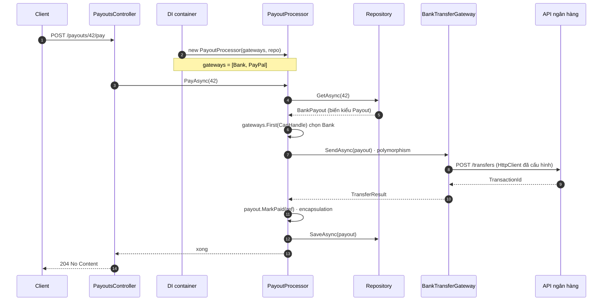

# Lập trình hướng đối tượng

**OOP** gom dữ liệu và luật đổi dữ liệu đó vào một object, để mỗi thay đổi nghiệp vụ chỉ chạm một chỗ. Trang đi từ nút Pay viết dồn trong Web Forms, tách dần thành bốn tính chất, rồi mở lời gọi method ra xem compiler hay runtime chọn code.

<svg width="0" height="0" style="position:absolute" aria-hidden="true"><defs><marker id="oA" viewBox="0 0 10 10" refX="8" refY="5" markerWidth="7" markerHeight="7" orient="auto-start-reverse"><path class="headAcc" d="M0 0L10 5L0 10z"/></marker><marker id="oBad" viewBox="0 0 10 10" refX="8" refY="5" markerWidth="7" markerHeight="7" orient="auto-start-reverse"><path class="headBad" d="M0 0L10 5L0 10z"/></marker><marker id="oMut" viewBox="0 0 10 10" refX="8" refY="5" markerWidth="7" markerHeight="7" orient="auto-start-reverse"><path style="fill:var(--vp-c-text-3)" d="M0 0L10 5L0 10z"/></marker></defs></svg>

## Bản đồ chủ đề {#topic-map}

<div class="fig">
<svg viewBox="0 0 720 740" role="img" aria-label="Bốn tính chất OOP trên ví dụ Payout: hộp kín có nút bấm, một mặt interface che máy phía sau, khuôn cha truyền xuống con, một lời gọi rẽ theo object thật">
<!-- 1. Encapsulation -->
<a href="#encapsulation" style="text-decoration:none">
<rect class="box" x="6" y="6" width="348" height="284" rx="10"/>
<text x="20" y="30" font-size="14" font-weight="700">Encapsulation</text>
<rect class="boxOk" x="150" y="48" width="190" height="176" rx="18" style="stroke-width:4"/>
<text x="268" y="70" font-size="12" font-weight="600" text-anchor="middle" class="okT">Payout</text>
<line class="lnAcc" x1="186" y1="100" x2="230" y2="113"/>
<line class="lnAcc" x1="186" y1="136" x2="230" y2="119"/>
<rect class="boxAcc" x="104" y="88" width="82" height="24" rx="12"/>
<text x="145" y="104" font-size="10.5" text-anchor="middle" class="mono">Approve()</text>
<rect class="boxAcc" x="104" y="124" width="82" height="24" rx="12"/>
<text x="145" y="140" font-size="10.5" text-anchor="middle" class="mono">MarkPaid()</text>
<path class="boxAcc" d="M246 100 L262 116 L246 132 L230 116 Z"/>
<text x="246" y="120" font-size="10" text-anchor="middle" font-weight="700" class="accT">?</text>
<text x="270" y="120" font-size="10" class="muted">kiểm luật</text>
<line class="lnAcc" x1="246" y1="132" x2="246" y2="162" marker-end="url(#oA)"/>
<rect class="box" x="160" y="166" width="50" height="20" rx="10"/>
<text x="185" y="180" font-size="9.5" text-anchor="middle">Pending</text>
<rect class="boxAcc" x="218" y="166" width="56" height="20" rx="10"/>
<text x="246" y="180" font-size="9.5" text-anchor="middle" font-weight="600" class="accT">Approved</text>
<rect class="box" x="282" y="166" width="46" height="20" rx="10"/>
<text x="305" y="180" font-size="9.5" text-anchor="middle">Paid</text>
<text x="245" y="208" font-size="9.5" text-anchor="middle" class="muted">trạng thái bên trong</text>
<text x="22" y="182" font-size="10.5" class="mono badT">p.Status = Paid</text>
<line class="lnBad" x1="22" y1="194" x2="138" y2="194" marker-end="url(#oBad)"/>
<line class="lnBad" x1="140" y1="186" x2="156" y2="202" style="stroke-width:3"/>
<line class="lnBad" x1="156" y1="186" x2="140" y2="202" style="stroke-width:3"/>
<text x="22" y="214" font-size="9.5" class="muted">lỗi compile: private set</text>
<line class="lnMuted" x1="20" y1="242" x2="340" y2="242"/>
<text x="180" y="266" font-size="11.5" text-anchor="middle">Chỉ đổi Status qua method; method kiểm luật trước.</text>

</a>
<!-- 2. Abstraction -->
<a href="#abstraction" style="text-decoration:none">
<rect class="box" x="366" y="6" width="348" height="284" rx="10"/>
<text x="380" y="30" font-size="14" font-weight="700">Abstraction</text>
<rect class="box" x="380" y="110" width="100" height="36" rx="6"/>
<text x="430" y="132" font-size="10.5" text-anchor="middle">PayoutProcessor</text>
<text x="430" y="164" font-size="9.5" text-anchor="middle" class="muted">chỉ thấy một mặt</text>
<line class="lnAcc" x1="480" y1="128" x2="566" y2="128" marker-end="url(#oA)"/>
<text x="523" y="119" font-size="10" text-anchor="middle" class="mono accT">SendAsync()</text>
<text x="577" y="46" font-size="10" text-anchor="middle" class="mono accT">IPayoutGateway</text>
<g opacity="0.6">
<rect class="box dash" x="592" y="56" width="110" height="168" rx="6"/>
<text x="647" y="76" font-size="9.5" text-anchor="middle" class="muted">phía sau, bị che</text>
<circle cx="610" cy="100" r="6" fill="none" style="stroke:var(--vp-c-text-2);stroke-width:4;stroke-dasharray:2.4 2"/>
<text x="624" y="104" font-size="10" class="muted">HTTP</text>
<circle cx="610" cy="128" r="6" fill="none" style="stroke:var(--vp-c-text-2);stroke-width:4;stroke-dasharray:2.4 2"/>
<text x="624" y="132" font-size="10" class="muted">ký HMAC</text>
<circle cx="610" cy="156" r="6" fill="none" style="stroke:var(--vp-c-text-2);stroke-width:4;stroke-dasharray:2.4 2"/>
<text x="624" y="160" font-size="10" class="muted">retry</text>
<circle cx="610" cy="184" r="6" fill="none" style="stroke:var(--vp-c-text-2);stroke-width:4;stroke-dasharray:2.4 2"/>
<text x="624" y="188" font-size="10" class="muted">mã lỗi bank</text>
</g>
<rect class="boxAcc" x="570" y="52" width="14" height="176" rx="3"/>
<circle class="boxAcc" cx="577" cy="128" r="5" style="fill:var(--vp-c-brand-1)"/>
<line class="lnMuted" x1="380" y1="242" x2="700" y2="242"/>
<text x="540" y="266" font-size="11.5" text-anchor="middle">Chỉ lộ một mặt interface; cách làm phía sau bị che.</text>

</a>
<!-- 3. Inheritance -->
<a href="#inheritance" style="text-decoration:none">
<rect class="box" x="6" y="302" width="348" height="284" rx="10"/>
<text x="20" y="326" font-size="14" font-weight="700">Inheritance</text>
<rect class="box" x="100" y="338" width="160" height="54" rx="6" style="stroke:var(--vp-c-text-2)"/>
<text x="180" y="355" font-size="11" text-anchor="middle" font-weight="600">Payout</text>
<rect class="box" x="108" y="364" width="40" height="18" rx="3"/>
<text x="128" y="377" font-size="9" text-anchor="middle">Amount</text>
<rect class="box" x="152" y="364" width="38" height="18" rx="3"/>
<text x="171" y="377" font-size="9" text-anchor="middle">Status</text>
<rect class="box" x="194" y="364" width="60" height="18" rx="3"/>
<text x="224" y="377" font-size="9" text-anchor="middle" class="mono">Approve()</text>
<path class="box" d="M180 393 L188 405 L172 405 Z" style="stroke:var(--vp-c-text-1)"/>
<polyline class="ln" points="180,405 180,424"/>
<polyline class="ln" points="100,446 100,424 260,424 260,446"/>
<text x="188" y="418" font-size="9.5" class="muted">is-a</text>
<rect class="box" x="30" y="446" width="140" height="54" rx="6"/>
<text x="100" y="463" font-size="11" text-anchor="middle" font-weight="600">BankPayout</text>
<rect class="box" x="40" y="472" width="14" height="18" rx="3"/>
<rect class="box" x="58" y="472" width="14" height="18" rx="3"/>
<rect class="box" x="76" y="472" width="14" height="18" rx="3"/>
<rect class="boxAcc" x="96" y="472" width="64" height="18" rx="3"/>
<text x="128" y="485" font-size="9" text-anchor="middle" class="accT">AccountNo</text>
<rect class="box" x="190" y="446" width="140" height="54" rx="6"/>
<text x="260" y="463" font-size="11" text-anchor="middle" font-weight="600">PayPalPayout</text>
<rect class="box" x="200" y="472" width="14" height="18" rx="3"/>
<rect class="box" x="218" y="472" width="14" height="18" rx="3"/>
<rect class="box" x="236" y="472" width="14" height="18" rx="3"/>
<rect class="boxAcc" x="256" y="472" width="64" height="18" rx="3"/>
<text x="288" y="485" font-size="9" text-anchor="middle" class="accT">Email</text>
<rect class="box" x="74" y="512" width="12" height="12" rx="2"/>
<text x="90" y="522" font-size="9.5" class="muted">có sẵn từ cha</text>
<rect class="boxAcc" x="186" y="512" width="12" height="12" rx="2"/>
<text x="202" y="522" font-size="9.5" class="muted">con tự thêm</text>
<line class="lnMuted" x1="20" y1="538" x2="340" y2="538"/>
<text x="180" y="562" font-size="11.5" text-anchor="middle">Con có sẵn phần chung của cha, chỉ thêm phần riêng.</text>

</a>
<!-- 4. Polymorphism -->
<a href="#polymorphism" style="text-decoration:none">
<rect class="box" x="366" y="302" width="348" height="284" rx="10"/>
<text x="380" y="326" font-size="14" font-weight="700">Polymorphism</text>
<rect class="boxAcc" x="470" y="346" width="140" height="28" rx="6"/>
<text x="540" y="364" font-size="10.5" text-anchor="middle" class="mono">gateway.SendAsync(p)</text>
<line class="lnAcc" x1="540" y1="374" x2="540" y2="406"/>
<text x="550" y="400" font-size="9.5" class="muted">object thật là gì?</text>
<line class="lnAcc" x1="540" y1="406" x2="432" y2="462" marker-end="url(#oA)"/>
<line class="lnMuted dash" x1="540" y1="406" x2="540" y2="462" marker-end="url(#oMut)"/>
<line class="lnMuted dash" x1="540" y1="406" x2="648" y2="462" marker-end="url(#oMut)"/>
<rect class="boxAcc" x="378" y="466" width="100" height="48" rx="6"/>
<text x="428" y="486" font-size="11" text-anchor="middle" font-weight="600" class="accT">BankTransfer</text>
<text x="428" y="503" font-size="9.5" text-anchor="middle">ký HMAC, gọi bank</text>
<rect class="box" x="490" y="466" width="100" height="48" rx="6"/>
<text x="540" y="486" font-size="11" text-anchor="middle" font-weight="600">PayPal</text>
<text x="540" y="503" font-size="9.5" text-anchor="middle" class="muted">gọi PayPal API</text>
<rect class="box" x="602" y="466" width="100" height="48" rx="6"/>
<text x="652" y="486" font-size="11" text-anchor="middle" font-weight="600">Fake (test)</text>
<text x="652" y="503" font-size="9.5" text-anchor="middle" class="muted">trả kết quả giả</text>
<line class="lnMuted" x1="380" y1="538" x2="700" y2="538"/>
<text x="540" y="562" font-size="11.5" text-anchor="middle">Một lời gọi; code chạy theo object thật lúc runtime.</text>
</a>
<text x="700" y="30" font-size="10" text-anchor="end" class="badT">bẫy: khác encapsulation</text>
<text x="340" y="326" font-size="10" text-anchor="end" class="badT">bẫy: C# chỉ 1 cha</text>
<text x="700" y="326" font-size="10" text-anchor="end" class="badT">bẫy: ai chọn object?</text>
<!-- 5. Mechanism -->
<a href="#mechanism" style="text-decoration:none">
<rect class="box" x="6" y="598" width="348" height="136" rx="10"/>
<text x="20" y="622" font-size="14" font-weight="700">Compiler hay runtime chọn</text>
<rect class="box" x="24" y="652" width="70" height="30" rx="5"/>
<text x="59" y="671" font-size="10.5" text-anchor="middle" class="mono">Base x</text>
<line class="ln" x1="94" y1="667" x2="122" y2="667" marker-end="url(#oMut)"/>
<rect class="boxAcc" x="126" y="646" width="84" height="42" rx="6"/>
<text x="168" y="671" font-size="10.5" text-anchor="middle" font-weight="600" class="accT">Derived</text>
<text x="222" y="660" font-size="10.5" class="accT">override: theo object</text>
<text x="222" y="682" font-size="10.5" class="badT">new: theo kiểu biến</text>
<line class="lnMuted" x1="20" y1="702" x2="340" y2="702"/>
<text x="180" y="724" font-size="11.5" text-anchor="middle">Một lời gọi, hai đường chọn code.</text>
</a>
<!-- 6. Composition -->
<a href="#composition" style="text-decoration:none">
<rect class="box" x="366" y="598" width="348" height="136" rx="10"/>
<text x="380" y="622" font-size="14" font-weight="700">Composition &gt; inheritance</text>
<rect class="boxBad" x="404" y="642" width="56" height="18" rx="3"/>
<text x="424" y="655" font-size="9" text-anchor="middle" class="badT">cha</text>
<path class="lnBad" d="M448 642 L454 651 L448 660" style="stroke-width:2"/>
<line class="lnBad" x1="432" y1="660" x2="406" y2="674"/><line class="lnBad" x1="432" y1="660" x2="458" y2="674"/>
<rect class="box" x="384" y="674" width="44" height="18" rx="3"/><rect class="box" x="436" y="674" width="44" height="18" rx="3"/>
<text x="488" y="672" font-size="9.5" class="badT">đổi cha, vỡ con</text>
<rect class="box" x="580" y="652" width="66" height="28" rx="5"/>
<text x="613" y="670" font-size="9.5" text-anchor="middle">Processor</text>
<line class="lnAcc" x1="646" y1="660" x2="660" y2="652"/><line class="lnAcc" x1="646" y1="672" x2="660" y2="680"/>
<rect class="boxAcc" x="662" y="642" width="46" height="18" rx="9"/><text x="685" y="655" font-size="9" text-anchor="middle" class="accT">Bank</text>
<rect class="boxAcc" x="662" y="672" width="46" height="18" rx="9"/><text x="685" y="685" font-size="9" text-anchor="middle" class="accT">PayPal</text>
<line class="lnMuted" x1="380" y1="702" x2="700" y2="702"/>
<text x="540" y="724" font-size="11.5" text-anchor="middle">Kế thừa khi thật sự is-a; còn lại ghép.</text>
</a>
</svg>
<p class="fig-caption">Nhìn từng ô, tự nói lại cơ chế bằng ví dụ payout; chữ đỏ là bẫy hay bị hỏi. Quên ô nào thì bấm vào ô đó.</p>
</div>

## 1. Vấn đề: nút Pay viết dồn một chỗ {#problem}

Code Web Forms quen thuộc: một event handler vừa đọc DB, vừa kiểm luật, vừa gọi ngân hàng, vừa cập nhật trạng thái.

```csharp
protected void btnPay_Click(object sender, EventArgs e)
{
    var p = conn.QuerySingle<PayoutRow>("SELECT * FROM Payouts WHERE Id = @id", new { id });
    if (p.Status != "Approved") { lblError.Text = "Not approved"; return; }

    if (p.Method == "Bank")        { /* format request, ký HMAC, gọi API ngân hàng */ }
    else if (p.Method == "PayPal") { /* lấy OAuth token, gọi API PayPal */ }

    conn.Execute("UPDATE Payouts SET Status = 'Paid' WHERE Id = @id", new { id });
}
```

Ba chỗ đau, mỗi chỗ là một tính chất OOP còn thiếu:

- **Luật trạng thái nằm ở UI.** Trang khác, job khác cũng `UPDATE Status` được mà không qua kiểm tra "đã duyệt chưa".
- **Page biết chi tiết ngân hàng.** Đổi cách ký request là sửa page.
- **`if` theo loại payout.** Thêm Wise là tìm và sửa mọi chỗ có `if` này; quên một chỗ thì nổ lúc chạy.


## 2. Bốn bước tách nút Pay {#oop-evolve}

Mỗi bước chữa một chỗ đau ở trên; tên tính chất là nhãn dán lên bước đó.

### Bước 1: Encapsulation, luật trạng thái về ở trong object {#encapsulation}

**Object tự giữ dữ liệu của mình và chỉ cho đổi qua method; method kiểm luật trước khi đổi**, nên không có đường nào đưa object vào trạng thái sai (gọi là giữ <T>invariant</T>). `Status` có `private set`, chỉ `Approve()` và `MarkPaid()` được đổi nó:

```csharp
public PayoutStatus Status { get; private set; } = PayoutStatus.Pending;

public void MarkPaid(string reference)
{
    EnsureStatus(PayoutStatus.Approved); // chưa duyệt thì không thể "đã trả"
    Status = PayoutStatus.Paid;
    Reference = reference;
}
```

Viết `p.Status = PayoutStatus.Paid` ở bất cứ đâu ngoài class là lỗi compile. Dùng EF Core vẫn giữ được điều này (private setter, private constructor, backing field): [Entity giàu hành vi với EF Core](/data/ef-core#rich-entity).

### Bước 2: Abstraction, page chỉ thấy "gửi tiền" {#abstraction}

**Bên gọi chỉ thấy một mặt nhỏ nói bằng ngôn ngữ nghiệp vụ; cách làm nằm phía sau.** `IPayoutGateway` chỉ có `SendAsync(payout)`. HTTP, ký HMAC, retry, dịch mã lỗi ngân hàng nằm trong `BankTransferGateway`; đổi chúng không chạm vào bên gọi.

Encapsulation và abstraction hay bị nói lẫn vì cả hai đều "giấu". Khác ở chỗ giấu để làm gì: encapsulation giấu **dữ liệu** để không ai phá luật bên trong (bước 1); abstraction giấu **độ phức tạp** để bên ngoài dùng đơn giản (bước này).

### Bước 3: Inheritance, Bank và PayPal dùng chung luật duyệt {#inheritance}

**Class con nhận sẵn dữ liệu và hành vi của class cha, chỉ thêm phần riêng** (quan hệ "is-a"). Payout qua ngân hàng cần số tài khoản, qua PayPal cần email, nhưng luật Pending → Approved → Paid giống nhau. Đặt luật đó vào `Payout` (abstract) một lần:

```csharp
public class BankPayout(decimal amount, string accountNo) : Payout(amount)
{
    public string AccountNo { get; } = accountNo; // chỉ thêm phần riêng
}
```

`Payout` là `abstract` vì không có "payout chung chung" để `new`; chỉ có payout qua kênh cụ thể. Inheritance có giá: con dính chặt vào cha. Khi nào nên ghép object thay vì kế thừa: [Composition over inheritance](#composition).

### Bước 4: Polymorphism, một lời gọi chạy code theo object thật {#polymorphism}

**Lời gọi qua interface hoặc method `virtual` được quyết định lúc chạy, theo kiểu thật của object, không theo kiểu của biến.** Polymorphism chỉ lo việc **gọi**; việc **chọn** object nào thì phải có người làm trước. Ở đây là hai dòng:

1. **Chọn**: DI đưa vào danh sách `[BankTransferGateway, PayPalGateway]`. `First` hỏi lần lượt `CanHandle(payout)`; payout 42 là `BankPayout` nên gateway ngân hàng trả `true`, và biến `gateway` giữ object đó.
2. **Gọi**: `gateway.SendAsync(payout)` không biết và không cần biết mình giữ object nào; runtime chạy `SendAsync` của object thật, ở đây là code ngân hàng.

```csharp
IPayoutGateway gateway = gateways.First(g => g.CanHandle(payout));
TransferResult result = await gateway.SendAsync(payout, ct); // không có if theo loại
```

Vì không còn `if` theo loại, thêm Wise là thêm một class `WiseGateway` và một dòng đăng ký DI; processor không đổi. Đó chính là [Open/Closed](/dotnet/solid-patterns#ocp). Đây là **runtime polymorphism**. **Compile-time polymorphism** là overloading: `Log(string)` và `Log(Exception)` cùng tên, compiler chọn theo kiểu tham số. Hai đường chọn này khác nhau ra sao: [mục 3](#mechanism).

### Code đầy đủ của bốn bước {#oop-example}

Mỗi file ứng với một bước: `Payout.cs` (bước 1, và lớp cha cho bước 3), `IPayoutGateway.cs` cùng hai gateway (bước 2), `BankPayout.cs`, `PayPalPayout.cs` (bước 3), `PayoutProcessor.cs` (bước 4).

::: code-group

```csharp [Payout.cs]
namespace PayoutHub.Core.Domain;

public enum PayoutStatus { Pending, Approved, Paid }

// Lớp cha trừu tượng: không có "payout chung chung", chỉ có payout qua bank hoặc PayPal
public abstract class Payout
{
    public int Id { get; private set; }
    public decimal Amount { get; private set; }
    public PayoutStatus Status { get; private set; } = PayoutStatus.Pending; // ENCAPSULATION
    public string? Reference { get; private set; }

    protected Payout(decimal amount)
    {
        if (amount <= 0)
            throw new ArgumentOutOfRangeException(nameof(amount));

        Amount = amount;
    }

    public void Approve()
    {
        EnsureStatus(PayoutStatus.Pending);
        Status = PayoutStatus.Approved;
    }

    public void MarkPaid(string reference)
    {
        EnsureStatus(PayoutStatus.Approved); // chưa duyệt thì không thể "đã trả"
        Status = PayoutStatus.Paid;
        Reference = reference;
    }

    private void EnsureStatus(PayoutStatus expected)
    {
        if (Status != expected)
            throw new InvalidOperationException($"Payout is {Status}, expected {expected}.");
    }
}
```

```csharp [BankPayout.cs]
namespace PayoutHub.Core.Domain;

// INHERITANCE: có sẵn Amount, Status, Approve(), MarkPaid() của Payout
public class BankPayout(decimal amount, string accountNo) : Payout(amount)
{
    public string AccountNo { get; } = accountNo; // chỉ thêm phần riêng
}
```

```csharp [PayPalPayout.cs]
namespace PayoutHub.Core.Domain;

public class PayPalPayout(decimal amount, string email) : Payout(amount)
{
    public string Email { get; } = email;
}
```

```csharp [IPayoutGateway.cs]
using PayoutHub.Core.Domain;

namespace PayoutHub.Core.Payments;

public record TransferResult(string Reference);

// ABSTRACTION: chỉ lộ "có gửi được payout này không" và "gửi đi"
public interface IPayoutGateway
{
    bool CanHandle(Payout payout);

    Task<TransferResult> SendAsync(Payout payout, CancellationToken ct);
}
```

```csharp [BankTransferGateway.cs]
using System.Net.Http.Json;
using PayoutHub.Core.Domain;
using PayoutHub.Core.Payments;

namespace PayoutHub.Infrastructure.Payments;

public class BankTransferGateway(HttpClient http) : IPayoutGateway
{
    public bool CanHandle(Payout payout) => payout is BankPayout;

    public async Task<TransferResult> SendAsync(Payout payout, CancellationToken ct)
    {
        var bank = (BankPayout)payout;

        // phần bị che sau interface: format request, ký, gọi API, dịch mã lỗi của ngân hàng
        var response = await http.PostAsJsonAsync("transfers", new { bank.AccountNo, bank.Amount }, ct);
        response.EnsureSuccessStatusCode();

        var body = await response.Content.ReadFromJsonAsync<BankResponse>(ct);
        return new TransferResult(body!.TransactionId);
    }

    private record BankResponse(string TransactionId);
}
```

```csharp [PayPalGateway.cs]
using PayoutHub.Core.Domain;
using PayoutHub.Core.Payments;

namespace PayoutHub.Infrastructure.Payments;

public class PayPalGateway(HttpClient http) : IPayoutGateway
{
    public bool CanHandle(Payout payout) => payout is PayPalPayout;

    public async Task<TransferResult> SendAsync(Payout payout, CancellationToken ct)
    {
        var paypal = (PayPalPayout)payout;

        // cách gọi khác hẳn ngân hàng: OAuth token, API payouts của PayPal...
        await Task.Delay(10, ct);
        return new TransferResult($"PP-{paypal.Email}-{Guid.NewGuid():N}");
    }
}
```

```csharp [PayoutProcessor.cs]
using PayoutHub.Core.Domain;
using PayoutHub.Core.Payments;

namespace PayoutHub.Api.Payouts;

public class PayoutProcessor(IEnumerable<IPayoutGateway> gateways, IPayoutRepository repo)
{
    public async Task PayAsync(int payoutId, CancellationToken ct)
    {
        Payout payout = await repo.GetAsync(payoutId, ct); // object thật: BankPayout hoặc PayPalPayout

        // CHỌN: hỏi lần lượt từng gateway "bạn xử lý được payout này không?"
        // payout là BankPayout → BankTransferGateway trả true → biến gateway giữ object đó
        IPayoutGateway gateway = gateways.First(g => g.CanHandle(payout));

        // GỌI (POLYMORPHISM): biến kiểu IPayoutGateway, nhưng runtime chạy SendAsync
        // của object mà biến đang giữ. Processor không có if/else theo loại.
        TransferResult result = await gateway.SendAsync(payout, ct);

        payout.MarkPaid(result.Reference); // ENCAPSULATION: không tự gán Status
        await repo.SaveAsync(payout, ct);
    }
}
```

```csharp [Program.cs]
// Typed client: factory tạo gateway kèm HttpClient đã cấu hình (BaseAddress, handler, resilience)
builder.Services.AddHttpClient<BankTransferGateway>(c => c.BaseAddress = new Uri("https://bank.example/"));
builder.Services.AddHttpClient<PayPalGateway>();

// "Ai xin IPayoutGateway thì đưa typed client ở trên", không tự new gateway
builder.Services.AddTransient<IPayoutGateway>(sp => sp.GetRequiredService<BankTransferGateway>());
builder.Services.AddTransient<IPayoutGateway>(sp => sp.GetRequiredService<PayPalGateway>());

builder.Services.AddScoped<PayoutProcessor>();
```

:::

**Vì sao đăng ký `IPayoutGateway` bằng delegate:** `AddHttpClient<BankTransferGateway>()` đăng ký gateway là một **typed client**: khi được xin, `IHttpClientFactory` tạo gateway và đưa vào đúng `HttpClient` đã cấu hình cho nó. Dòng delegate chỉ nói "xin `IPayoutGateway` thì lấy typed client đó". Nếu viết thường `AddTransient<IPayoutGateway, BankTransferGateway>()`, container tự `new` gateway, và `HttpClient` nó nhận là client mặc định không có `BaseAddress` hay handler nào: build vẫn chạy, gọi ngân hàng thì lỗi.

Cách viết gọn hơn là `AddHttpClient<IPayoutGateway, BankTransferGateway>("bank", ...)`, **phải đặt tên**: tên mặc định của typed client là tên của kiểu đầu (`IPayoutGateway`), nên hai gateway không đặt tên sẽ dùng chung một cấu hình.

Luồng gọi khi finance bấm trả payout 42 (bấm vào hình để phóng to):




## 3. Bên trong một lời gọi: compiler chọn hay runtime chọn {#mechanism}

**Mỗi lời gọi method được gắn với code theo một trong hai cách: compiler gắn sẵn lúc build theo kiểu của biến, hoặc runtime tra bảng method ảo (<T k="vtable">vtable</T>) của object thật lúc chạy.** Method `virtual`, `abstract` và method của interface đi đường runtime; mọi method khác đi đường compiler. Từ đó suy ra ba từ khoá hay bị hỏi:

- **`override`** thay ô của method cha trong vtable của object, nên gọi qua biến kiểu cha vẫn ra code của con.
- **`new`** không thay ô nào, nó thêm một method khác trùng tên. Compiler chọn theo kiểu biến, nên cùng một object, gọi qua biến kiểu cha ra code của cha.
- **Overloading** là nhiều method cùng tên khác tham số; compiler chọn theo kiểu tham số lúc build. Không dính tới vtable.

<div class="fig">
<svg viewBox="0 0 720 214" role="img" aria-label="Biến kiểu Base trỏ tới object Derived. x.A() tra vtable của object nên ra Derived.A. x.B() không virtual nên compiler chọn theo kiểu biến, ra Base.B">
<text x="20" y="26" font-size="11.5" class="mono">Base x = new Derived();</text>
<rect class="box" x="20" y="72" width="100" height="40" rx="6"/>
<text x="70" y="97" font-size="11" text-anchor="middle" class="mono">Base x</text>
<line class="ln" x1="120" y1="92" x2="196" y2="92" marker-end="url(#oMut)"/>
<rect class="box" x="200" y="44" width="224" height="156" rx="8"/>
<text x="312" y="64" font-size="11" text-anchor="middle" font-weight="600">object Derived</text>
<text x="214" y="86" font-size="10" class="muted">vtable</text>
<rect class="boxAcc" x="214" y="94" width="196" height="26" rx="4"/>
<text x="312" y="111" font-size="10.5" text-anchor="middle" class="mono accT">A → Derived.A</text>
<text x="214" y="148" font-size="10" class="muted">không virtual: compiler chọn</text>
<rect class="box dash" x="214" y="156" width="92" height="26" rx="4"/>
<text x="260" y="173" font-size="10" text-anchor="middle" class="mono muted">Derived.B</text>
<rect class="box" x="318" y="156" width="92" height="26" rx="4"/>
<text x="364" y="173" font-size="10" text-anchor="middle" class="mono">Base.B</text>
<line class="lnAcc" x1="462" y1="104" x2="414" y2="107" marker-end="url(#oA)"/>
<text x="468" y="104" font-size="11" class="mono">x.A() → "Derived.A"</text>
<text x="468" y="122" font-size="10" class="muted">runtime: tra vtable của object</text>
<line class="ln" x1="462" y1="166" x2="414" y2="169" marker-end="url(#oMut)"/>
<text x="468" y="166" font-size="11" class="mono">x.B() → "Base.B"</text>
<text x="468" y="184" font-size="10" class="muted">compile: theo kiểu biến Base</text>
</svg>
<p class="fig-caption">Cùng một object, vì sao <code>x.A()</code> và <code>x.B()</code> đi hai đường? Ép <code>((Derived)x).B()</code> thì ra gì? Overloading đi đường nào?</p>
</div>

```csharp
class Base    { public virtual string A() => "Base.A";   public string B() => "Base.B"; }
class Derived : Base
              { public override string A() => "Derived.A"; public new string B() => "Derived.B"; }

Base x = new Derived();
x.A();   // "Derived.A": override đi theo kiểu runtime
x.B();   // "Base.B":    new đi theo kiểu khai báo của biến
```

Quên ghi `override` thì compiler cảnh báo và coi như `new`. `new` chỉ nên dùng khi class cha (thường từ thư viện) thêm method trùng tên với method bạn đã có. **`sealed`** chặn kế thừa class hoặc chặn override tiếp một method; vì không còn con nào override được, <T>JIT</T> có thể gọi thẳng không qua vtable.

### Abstract class hay interface {#abstract-or-interface}

**Interface là danh sách ô method không có dữ liệu; abstract class là một class dở dang, có field, constructor và code chung, nhưng mỗi class chỉ kế thừa được một cha.** Vì vậy:

- `Payout` là abstract class vì nó **giữ state** (`Status`, `Amount`) và **luật trong constructor** (amount phải dương) mà các con dùng chung.
- `IPayoutGateway` là interface vì hai gateway không chung dữ liệu gì, chỉ chung "làm được việc gì"; một class còn có thể implement thêm `IRefundableGateway`, điều mà kế thừa một cha không làm được.

Từ C# 8 interface có default method, từ C# 11 có `static abstract`, nhưng vẫn không có instance field và constructor. Default method sinh ra để thêm member vào một interface đã public mà không làm vỡ các class đang implement, không phải để thay abstract class. Abstract class giữ một luồng chung và để con override vài bước chính là <T>Template Method</T> (vd `ReportBase` lấy data, build header, xuất file; con chỉ override phần tính toán).


## 4. Trade-off {#tradeoffs}

### Composition over inheritance {#composition}

**Kế thừa nối con vào cha lúc compile: con nhận mọi thứ của cha, đổi cha là ảnh hưởng mọi con, và C# chỉ cho một cha.** Vì vậy chỉ kế thừa khi thật sự là "is-a" và cần chia sẻ hành vi, như `BankPayout` với `Payout`. Còn lại thì ghép: `PayoutProcessor` không kế thừa gì, nó **có** một danh sách `IPayoutGateway` nhận qua <T>DI</T>, nên thay gateway lúc chạy hoặc trong test được mà không đụng cây kế thừa. Nhiều team để class mặc định `sealed` khi không thiết kế để kế thừa.


## Câu hỏi phỏng vấn {#interview}

### 4 tính chất của OOP {#oop}

::: tip Trả lời nhanh
Encapsulation giữ dữ liệu và chỉ cho đổi qua method có kiểm luật. Abstraction cho bên ngoài thấy một mặt đơn giản, giấu cách làm. Inheritance cho class con dùng lại phần chung của cha. Polymorphism: một lời gọi, code chạy theo object thật lúc runtime. Xem [bốn bước tách nút Pay](#oop-evolve).
:::

::: details Câu trả lời mẫu (English)
Encapsulation protects the inside: in my payout example, Status has a private setter, so it only changes through Approve and MarkPaid, which check the rules first. Abstraction simplifies the outside: the processor only sees IPayoutGateway.SendAsync, not HTTP, signing or bank error codes. Inheritance shares the approval rules between BankPayout and PayPalPayout through an abstract Payout base class. Polymorphism means one call, gateway.SendAsync, runs the bank or the PayPal code depending on the real object at runtime, so adding a new provider means adding a class, not editing the processor.
:::

::: warning Bẫy & follow-up
**"Encapsulation và abstraction khác gì nhau?"** Encapsulation giấu dữ liệu để bảo vệ <T>invariant</T>; abstraction giấu độ phức tạp để bên ngoài dùng đơn giản. Xem [bước 2](#abstraction).

**"Polymorphism có mấy loại?"** Runtime (`virtual`/`override`, interface) và compile-time (overloading). Xem [mục 3](#mechanism).

**"Composition over inheritance nghĩa là gì?"** Xem [trade-off](#composition).
:::

### Abstract class vs interface {#abstract-vs-interface}

::: tip Trả lời nhanh
Interface là hợp đồng "làm được gì", không có state, một class implement được nhiều. Abstract class là class cha dở dang, có field, constructor và code chung, nhưng chỉ kế thừa được một. Xem [Abstract class hay interface](#abstract-or-interface).
:::

::: details Câu trả lời mẫu (English)
An interface is a contract: a list of members with no instance state, and a class can implement many of them. An abstract class is a partially built base class: it can hold fields, a constructor and shared code, but a class can inherit only one. In my payout code, Payout is an abstract class because it owns the status and the validation in its constructor that every payout type shares. IPayoutGateway is an interface because the bank and PayPal gateways share no data, only a capability, and I want to mock it in tests.
:::

::: warning Bẫy & follow-up
**"Interface có default method rồi thì khác gì abstract class?"** Vẫn không có instance field và constructor. Default method để thêm member vào interface đã public mà không làm vỡ các class đang implement.
:::

### Overriding vs overloading vs `new` (method hiding) {#override-overload-new}

::: tip Trả lời nhanh
Overloading: cùng tên khác tham số, compiler chọn lúc build. Override: con thay ô của method `virtual` trong vtable, chọn lúc runtime theo object thật. `new`: con thêm method khác trùng tên, compiler chọn theo kiểu biến. Xem [compiler chọn hay runtime chọn](#mechanism).
:::

::: details Câu trả lời mẫu (English)
Overloading is several methods with the same name and different parameters; the compiler picks one at build time from the argument types. Overriding replaces a virtual method's slot in the object's vtable, so the call is resolved at runtime by the real object type, even through a base-class variable. The new keyword hides the base method instead: it adds a second method with the same name, and the compiler picks based on the declared type of the variable. So with Base x = new Derived(), x.A() runs the override but x.B() runs the base version if B was hidden with new.
:::

::: warning Bẫy & follow-up
**Câu "cho đoạn code, đoán output" rất hay gặp.** `override` theo object thật, `new` theo kiểu biến. Quên ghi `override` thì compiler cảnh báo và coi như `new`.

**"`sealed` dùng làm gì?"** Chặn kế thừa hoặc chặn override tiếp; <T>JIT</T> có thể gọi thẳng không qua vtable.
:::


## Tự kiểm tra

1. Trong [bản đồ](#topic-map), ô Polymorphism: `gateway.SendAsync(p)` chạy code nào, và ai đã chọn object đó trước?
2. Bỏ `private set` của `Status` đi thì bước nào trong bốn bước hỏng, và lỗi đó lộ ra ở đâu?
3. `Base x = new Derived(); x.B();` với `B` khai báo bằng `new` ra gì? Đổi thành `override` thì sao?
