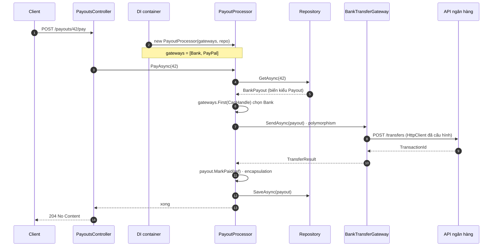

# OOP & C# cơ bản

**OOP** là cách gom dữ liệu và luật thay đổi dữ liệu đó vào cùng một object, để mỗi thay đổi nghiệp vụ chỉ chạm một chỗ. Trang này theo **một lần trả payout 42**: bắt đầu từ nút Pay trong Web Forms viết dồn mọi thứ một chỗ, tách dần thành bốn chặng ứng với bốn tính chất **encapsulation, abstraction, inheritance, polymorphism**; rồi mở lời gọi method ra xem compiler hay runtime chọn code, xem dữ liệu được copy thế nào khi gán (struct, class, record, string), và cuối cùng là **SOLID**, design pattern, khi nào không nên áp dụng.

<svg width="0" height="0" style="position:absolute" aria-hidden="true"><defs><marker id="oA" viewBox="0 0 10 10" refX="8" refY="5" markerWidth="7" markerHeight="7" orient="auto-start-reverse"><path class="headAcc" d="M0 0L10 5L0 10z"/></marker><marker id="oBad" viewBox="0 0 10 10" refX="8" refY="5" markerWidth="7" markerHeight="7" orient="auto-start-reverse"><path class="headBad" d="M0 0L10 5L0 10z"/></marker><marker id="oMut" viewBox="0 0 10 10" refX="8" refY="5" markerWidth="7" markerHeight="7" orient="auto-start-reverse"><path style="fill:var(--vp-c-text-3)" d="M0 0L10 5L0 10z"/></marker></defs></svg>

## Bản đồ chủ đề {#topic-map}

<div class="fig">
<svg viewBox="0 0 720 384" role="img" aria-label="Bản đồ chủ đề: payout 42 đi qua bốn chặng. 1 lấy object thật BankPayout qua biến kiểu Payout, 2 chọn gateway theo object thật, 3 gọi SendAsync qua interface, 4 đổi Status chỉ qua MarkPaid. Hàng dưới là các mục đọc thêm.">
<a href="#problem" style="text-decoration:none">
<rect class="boxBad" x="10" y="8" width="700" height="38" rx="8"/>
<text x="360" y="32" font-size="11.5" text-anchor="middle" class="badT">Trước: nút Pay trong Web Forms tự if theo loại, gọi thẳng bank, tự UPDATE Status</text>
</a>
<text x="360" y="68" font-size="11" text-anchor="middle" class="muted">Sau: PayoutProcessor.PayAsync(42) đi qua bốn chặng</text>

<!-- 1 -->
<a href="#inheritance" style="text-decoration:none">
<rect class="box" x="10" y="80" width="164" height="218" rx="10"/>
<circle class="boxAcc" cx="30" cy="100" r="12"/><text x="30" y="105" font-size="12" text-anchor="middle" font-weight="700" class="accT">1</text>
<text x="48" y="105" font-size="12.5" font-weight="700">Inheritance</text>
</a>
<text x="92" y="132" font-size="10" text-anchor="middle" class="mono">repo.GetAsync(42)</text>
<rect class="box" x="18" y="158" width="62" height="26" rx="4"/>
<text x="49" y="175" font-size="9.5" text-anchor="middle" class="mono">Payout p</text>
<line class="lnAcc" x1="80" y1="171" x2="96" y2="171" marker-end="url(#oA)"/>
<rect class="boxAcc" x="98" y="152" width="70" height="38" rx="6"/>
<text x="133" y="169" font-size="9.5" text-anchor="middle" font-weight="600" class="accT">BankPayout</text>
<text x="133" y="183" font-size="8.5" text-anchor="middle" class="muted">object thật</text>
<line class="ln" x1="133" y1="190" x2="133" y2="214"/>
<path class="box" d="M133 226 L125 214 L141 214 Z" style="stroke:var(--vp-c-text-1)"/>
<rect class="box" x="98" y="226" width="70" height="24" rx="4" style="stroke:var(--vp-c-text-2)"/>
<text x="133" y="242" font-size="10" text-anchor="middle" font-weight="600">Payout</text>
<text x="112" y="208" font-size="9" text-anchor="end" class="muted">is-a</text>
<text x="92" y="280" font-size="10" text-anchor="middle">biến kiểu cha, object con</text>

<line class="ln" x1="175" y1="190" x2="187" y2="190" marker-end="url(#oMut)"/>

<!-- 2 -->
<a href="#polymorphism" style="text-decoration:none">
<rect class="box" x="188" y="80" width="164" height="218" rx="10"/>
<circle class="boxAcc" cx="208" cy="100" r="12"/><text x="208" y="105" font-size="12" text-anchor="middle" font-weight="700" class="accT">2</text>
<text x="226" y="105" font-size="12.5" font-weight="700">Polymorphism</text>
</a>
<text x="270" y="132" font-size="10" text-anchor="middle" class="mono">g.CanHandle(p)?</text>
<path class="boxAcc" d="M270 152 L286 168 L270 184 L254 168 Z"/>
<text x="270" y="172" font-size="10" text-anchor="middle" font-weight="700" class="accT">?</text>
<line class="lnAcc" x1="262" y1="180" x2="236" y2="214" marker-end="url(#oA)"/>
<line class="lnMuted dash" x1="278" y1="180" x2="304" y2="214" marker-end="url(#oMut)"/>
<rect class="boxAcc" x="198" y="218" width="66" height="30" rx="6"/>
<text x="231" y="237" font-size="10" text-anchor="middle" font-weight="600" class="accT">Bank</text>
<rect class="box dash" x="276" y="218" width="66" height="30" rx="6"/>
<text x="309" y="237" font-size="10" text-anchor="middle" class="muted">PayPal</text>
<text x="270" y="280" font-size="10" text-anchor="middle">chọn theo object thật</text>

<line class="ln" x1="353" y1="190" x2="365" y2="190" marker-end="url(#oMut)"/>

<!-- 3 -->
<a href="#abstraction" style="text-decoration:none">
<rect class="box" x="366" y="80" width="164" height="218" rx="10"/>
<circle class="boxAcc" cx="386" cy="100" r="12"/><text x="386" y="105" font-size="12" text-anchor="middle" font-weight="700" class="accT">3</text>
<text x="404" y="105" font-size="12.5" font-weight="700">Abstraction</text>
</a>
<text x="448" y="132" font-size="10" text-anchor="middle" class="mono">SendAsync(p)</text>
<rect class="box" x="374" y="176" width="58" height="26" rx="4"/>
<text x="403" y="193" font-size="9" text-anchor="middle">Processor</text>
<line class="lnAcc" x1="432" y1="189" x2="454" y2="189" marker-end="url(#oA)"/>
<rect class="boxAcc" x="456" y="146" width="10" height="110" rx="3"/>
<text x="461" y="270" font-size="9" text-anchor="middle" class="muted">interface</text>
<g opacity="0.6">
<rect class="box dash" x="472" y="150" width="52" height="102" rx="4"/>
<text x="498" y="176" font-size="9" text-anchor="middle" class="muted">HTTP</text>
<text x="498" y="202" font-size="9" text-anchor="middle" class="muted">ký HMAC</text>
<text x="498" y="228" font-size="9" text-anchor="middle" class="muted">retry</text>
</g>
<text x="448" y="290" font-size="10" text-anchor="middle">chỉ thấy một mặt</text>

<line class="ln" x1="531" y1="190" x2="543" y2="190" marker-end="url(#oMut)"/>

<!-- 4 -->
<a href="#encapsulation" style="text-decoration:none">
<rect class="box" x="544" y="80" width="166" height="218" rx="10"/>
<circle class="boxAcc" cx="564" cy="100" r="12"/><text x="564" y="105" font-size="12" text-anchor="middle" font-weight="700" class="accT">4</text>
<text x="582" y="105" font-size="12.5" font-weight="700">Encapsulation</text>
</a>
<text x="627" y="132" font-size="10" text-anchor="middle" class="mono">p.MarkPaid(ref)</text>
<rect class="box" x="552" y="186" width="62" height="22" rx="11"/>
<text x="583" y="201" font-size="9.5" text-anchor="middle">Approved</text>
<line class="lnAcc" x1="614" y1="197" x2="642" y2="197" marker-end="url(#oA)"/>
<rect class="boxAcc" x="644" y="186" width="52" height="22" rx="11"/>
<text x="670" y="201" font-size="9.5" text-anchor="middle" font-weight="600" class="accT">Paid</text>
<text x="628" y="180" font-size="9" text-anchor="middle" class="muted">kiểm luật rồi mới đổi</text>
<text x="554" y="236" font-size="9.5" class="mono badT">p.Status = Paid</text>
<line class="lnBad" x1="554" y1="248" x2="638" y2="248" marker-end="url(#oBad)"/>
<line class="lnBad" x1="644" y1="241" x2="656" y2="255" style="stroke-width:3"/>
<line class="lnBad" x1="656" y1="241" x2="644" y2="255" style="stroke-width:3"/>
<text x="627" y="280" font-size="10" text-anchor="middle">chỉ đổi qua method</text>

<!-- đọc thêm -->
<text x="10" y="322" font-size="10.5" class="muted">Đọc thêm</text>
<a href="#mechanism" style="text-decoration:none">
<rect class="box dash" x="10" y="330" width="164" height="46" rx="8"/>
<text x="92" y="349" font-size="10.5" text-anchor="middle">Compiler hay runtime chọn</text>
<text x="92" y="366" font-size="10" text-anchor="middle" class="muted">override, new, overload</text>
</a>
<a href="#value-reference" style="text-decoration:none">
<rect class="box dash" x="188" y="330" width="164" height="46" rx="8"/>
<text x="270" y="349" font-size="10.5" text-anchor="middle">Gán là copy biến</text>
<text x="270" y="366" font-size="10" text-anchor="middle" class="muted">struct, record, string, ref</text>
</a>
<a href="#solid-lesson" style="text-decoration:none">
<rect class="box dash" x="366" y="330" width="164" height="46" rx="8"/>
<text x="448" y="349" font-size="10.5" text-anchor="middle">SOLID</text>
<text x="448" y="366" font-size="10" text-anchor="middle" class="muted">thêm Wise = thêm 1 class</text>
</a>
<a href="#tradeoffs" style="text-decoration:none">
<rect class="box dash" x="544" y="330" width="166" height="46" rx="8"/>
<text x="627" y="349" font-size="10.5" text-anchor="middle">Trade-off</text>
<text x="627" y="366" font-size="10" text-anchor="middle" class="muted">composition, khi nào không</text>
</a>
</svg>
<p class="fig-caption">Ở chặng 1 biến và object khác kiểu nhau thế nào? Chặng 2 thêm Wise thì sửa gì? Chặng 4 vì sao dòng đỏ không compile?</p>
</div>

## 1. Vấn đề: nút Pay viết dồn một chỗ {#problem}

Code Web Forms quen thuộc: một event handler vừa đọc DB, vừa kiểm luật, vừa gọi ngân hàng, vừa cập nhật trạng thái.

```csharp
protected void btnPay_Click(object sender, EventArgs e)
{
    var p = conn.QuerySingle<PayoutRow>("SELECT * FROM Payouts WHERE Id = @id", new { id });
    if (p.Status != "Approved") { lblError.Text = "Not approved"; return; }

    if (p.Method == "Bank")        { /* format request, ký HMAC, gọi API ngân hàng */ }
    else if (p.Method == "PayPal") { /* lấy OAuth token, gọi API PayPal */ }

    conn.Execute("UPDATE Payouts SET Status = 'Paid' WHERE Id = @id", new { id });
}
```

Ba chỗ đau, mỗi chỗ là một tính chất OOP còn thiếu:

- **Luật trạng thái nằm ở UI.** Trang khác, job khác cũng `UPDATE Status` được mà không qua kiểm tra "đã duyệt chưa".
- **Page biết chi tiết ngân hàng.** Đổi cách ký request là sửa page.
- **`if` theo loại payout.** Thêm Wise là tìm và sửa mọi chỗ có `if` này; quên một chỗ thì nổ lúc chạy.

## 2. Bốn bước tách nút Pay: bốn tính chất OOP {#oop-evolve}

Mỗi bước chữa một chỗ đau ở trên. Tên tính chất chỉ là nhãn dán lên bước đó.

<div class="fig">
<svg viewBox="0 0 720 592" role="img" aria-label="Bốn tính chất OOP trên ví dụ Payout: hộp kín có nút bấm, một mặt interface che máy phía sau, khuôn cha truyền xuống con, một lời gọi rẽ theo object thật">
<!-- 1. Encapsulation -->
<rect class="box" x="6" y="6" width="348" height="284" rx="10"/>
<text x="20" y="30" font-size="14" font-weight="700">Encapsulation</text>
<rect class="boxOk" x="150" y="48" width="190" height="176" rx="18" style="stroke-width:4"/>
<text x="268" y="70" font-size="12" font-weight="600" text-anchor="middle" class="okT">Payout</text>
<line class="lnAcc" x1="186" y1="100" x2="230" y2="113"/>
<line class="lnAcc" x1="186" y1="136" x2="230" y2="119"/>
<rect class="boxAcc" x="104" y="88" width="82" height="24" rx="12"/>
<text x="145" y="104" font-size="10.5" text-anchor="middle" class="mono">Approve()</text>
<rect class="boxAcc" x="104" y="124" width="82" height="24" rx="12"/>
<text x="145" y="140" font-size="10.5" text-anchor="middle" class="mono">MarkPaid()</text>
<path class="boxAcc" d="M246 100 L262 116 L246 132 L230 116 Z"/>
<text x="246" y="120" font-size="10" text-anchor="middle" font-weight="700" class="accT">?</text>
<text x="270" y="120" font-size="10" class="muted">kiểm luật</text>
<line class="lnAcc" x1="246" y1="132" x2="246" y2="162" marker-end="url(#oA)"/>
<rect class="box" x="160" y="166" width="50" height="20" rx="10"/>
<text x="185" y="180" font-size="9.5" text-anchor="middle">Pending</text>
<rect class="boxAcc" x="218" y="166" width="56" height="20" rx="10"/>
<text x="246" y="180" font-size="9.5" text-anchor="middle" font-weight="600" class="accT">Approved</text>
<rect class="box" x="282" y="166" width="46" height="20" rx="10"/>
<text x="305" y="180" font-size="9.5" text-anchor="middle">Paid</text>
<text x="245" y="208" font-size="9.5" text-anchor="middle" class="muted">trạng thái bên trong</text>
<text x="22" y="182" font-size="10.5" class="mono badT">p.Status = Paid</text>
<line class="lnBad" x1="22" y1="194" x2="138" y2="194" marker-end="url(#oBad)"/>
<line class="lnBad" x1="140" y1="186" x2="156" y2="202" style="stroke-width:3"/>
<line class="lnBad" x1="156" y1="186" x2="140" y2="202" style="stroke-width:3"/>
<text x="22" y="214" font-size="9.5" class="muted">lỗi compile: private set</text>
<line class="lnMuted" x1="20" y1="242" x2="340" y2="242"/>
<text x="180" y="266" font-size="11.5" text-anchor="middle">Chỉ đổi Status qua method; method kiểm luật trước.</text>

<!-- 2. Abstraction -->
<rect class="box" x="366" y="6" width="348" height="284" rx="10"/>
<text x="380" y="30" font-size="14" font-weight="700">Abstraction</text>
<rect class="box" x="380" y="110" width="100" height="36" rx="6"/>
<text x="430" y="132" font-size="10.5" text-anchor="middle">PayoutProcessor</text>
<text x="430" y="164" font-size="9.5" text-anchor="middle" class="muted">chỉ thấy một mặt</text>
<line class="lnAcc" x1="480" y1="128" x2="566" y2="128" marker-end="url(#oA)"/>
<text x="523" y="119" font-size="10" text-anchor="middle" class="mono accT">SendAsync()</text>
<text x="577" y="46" font-size="10" text-anchor="middle" class="mono accT">IPayoutGateway</text>
<g opacity="0.6">
<rect class="box dash" x="592" y="56" width="110" height="168" rx="6"/>
<text x="647" y="76" font-size="9.5" text-anchor="middle" class="muted">phía sau, bị che</text>
<circle cx="610" cy="100" r="6" fill="none" style="stroke:var(--vp-c-text-2);stroke-width:4;stroke-dasharray:2.4 2"/>
<text x="624" y="104" font-size="10" class="muted">HTTP</text>
<circle cx="610" cy="128" r="6" fill="none" style="stroke:var(--vp-c-text-2);stroke-width:4;stroke-dasharray:2.4 2"/>
<text x="624" y="132" font-size="10" class="muted">ký HMAC</text>
<circle cx="610" cy="156" r="6" fill="none" style="stroke:var(--vp-c-text-2);stroke-width:4;stroke-dasharray:2.4 2"/>
<text x="624" y="160" font-size="10" class="muted">retry</text>
<circle cx="610" cy="184" r="6" fill="none" style="stroke:var(--vp-c-text-2);stroke-width:4;stroke-dasharray:2.4 2"/>
<text x="624" y="188" font-size="10" class="muted">mã lỗi bank</text>
</g>
<rect class="boxAcc" x="570" y="52" width="14" height="176" rx="3"/>
<circle class="boxAcc" cx="577" cy="128" r="5" style="fill:var(--vp-c-brand-1)"/>
<line class="lnMuted" x1="380" y1="242" x2="700" y2="242"/>
<text x="540" y="266" font-size="11.5" text-anchor="middle">Chỉ lộ một mặt interface; cách làm phía sau bị che.</text>

<!-- 3. Inheritance -->
<rect class="box" x="6" y="302" width="348" height="284" rx="10"/>
<text x="20" y="326" font-size="14" font-weight="700">Inheritance</text>
<rect class="box" x="100" y="338" width="160" height="54" rx="6" style="stroke:var(--vp-c-text-2)"/>
<text x="180" y="355" font-size="11" text-anchor="middle" font-weight="600">Payout</text>
<rect class="box" x="108" y="364" width="40" height="18" rx="3"/>
<text x="128" y="377" font-size="9" text-anchor="middle">Amount</text>
<rect class="box" x="152" y="364" width="38" height="18" rx="3"/>
<text x="171" y="377" font-size="9" text-anchor="middle">Status</text>
<rect class="box" x="194" y="364" width="60" height="18" rx="3"/>
<text x="224" y="377" font-size="9" text-anchor="middle" class="mono">Approve()</text>
<path class="box" d="M180 393 L188 405 L172 405 Z" style="stroke:var(--vp-c-text-1)"/>
<polyline class="ln" points="180,405 180,424"/>
<polyline class="ln" points="100,446 100,424 260,424 260,446"/>
<text x="188" y="418" font-size="9.5" class="muted">is-a</text>
<rect class="box" x="30" y="446" width="140" height="54" rx="6"/>
<text x="100" y="463" font-size="11" text-anchor="middle" font-weight="600">BankPayout</text>
<rect class="box" x="40" y="472" width="14" height="18" rx="3"/>
<rect class="box" x="58" y="472" width="14" height="18" rx="3"/>
<rect class="box" x="76" y="472" width="14" height="18" rx="3"/>
<rect class="boxAcc" x="96" y="472" width="64" height="18" rx="3"/>
<text x="128" y="485" font-size="9" text-anchor="middle" class="accT">AccountNo</text>
<rect class="box" x="190" y="446" width="140" height="54" rx="6"/>
<text x="260" y="463" font-size="11" text-anchor="middle" font-weight="600">PayPalPayout</text>
<rect class="box" x="200" y="472" width="14" height="18" rx="3"/>
<rect class="box" x="218" y="472" width="14" height="18" rx="3"/>
<rect class="box" x="236" y="472" width="14" height="18" rx="3"/>
<rect class="boxAcc" x="256" y="472" width="64" height="18" rx="3"/>
<text x="288" y="485" font-size="9" text-anchor="middle" class="accT">Email</text>
<rect class="box" x="74" y="512" width="12" height="12" rx="2"/>
<text x="90" y="522" font-size="9.5" class="muted">có sẵn từ cha</text>
<rect class="boxAcc" x="186" y="512" width="12" height="12" rx="2"/>
<text x="202" y="522" font-size="9.5" class="muted">con tự thêm</text>
<line class="lnMuted" x1="20" y1="538" x2="340" y2="538"/>
<text x="180" y="562" font-size="11.5" text-anchor="middle">Con có sẵn phần chung của cha, chỉ thêm phần riêng.</text>

<!-- 4. Polymorphism -->
<rect class="box" x="366" y="302" width="348" height="284" rx="10"/>
<text x="380" y="326" font-size="14" font-weight="700">Polymorphism</text>
<rect class="boxAcc" x="470" y="346" width="140" height="28" rx="6"/>
<text x="540" y="364" font-size="10.5" text-anchor="middle" class="mono">gateway.SendAsync(p)</text>
<line class="lnAcc" x1="540" y1="374" x2="540" y2="406"/>
<text x="550" y="400" font-size="9.5" class="muted">object thật là gì?</text>
<line class="lnAcc" x1="540" y1="406" x2="432" y2="462" marker-end="url(#oA)"/>
<line class="lnMuted dash" x1="540" y1="406" x2="540" y2="462" marker-end="url(#oMut)"/>
<line class="lnMuted dash" x1="540" y1="406" x2="648" y2="462" marker-end="url(#oMut)"/>
<rect class="boxAcc" x="378" y="466" width="100" height="48" rx="6"/>
<text x="428" y="486" font-size="11" text-anchor="middle" font-weight="600" class="accT">BankTransfer</text>
<text x="428" y="503" font-size="9.5" text-anchor="middle">ký HMAC, gọi bank</text>
<rect class="box" x="490" y="466" width="100" height="48" rx="6"/>
<text x="540" y="486" font-size="11" text-anchor="middle" font-weight="600">PayPal</text>
<text x="540" y="503" font-size="9.5" text-anchor="middle" class="muted">gọi PayPal API</text>
<rect class="box" x="602" y="466" width="100" height="48" rx="6"/>
<text x="652" y="486" font-size="11" text-anchor="middle" font-weight="600">Fake (test)</text>
<text x="652" y="503" font-size="9.5" text-anchor="middle" class="muted">trả kết quả giả</text>
<line class="lnMuted" x1="380" y1="538" x2="700" y2="538"/>
<text x="540" y="562" font-size="11.5" text-anchor="middle">Một lời gọi; code chạy theo object thật lúc runtime.</text>
</svg>
<p class="fig-caption">Ô nào chặn được dòng <code>UPDATE Status</code> ở UI? Ô nào làm page không còn biết HMAC? Thêm Wise thì ô nào không phải sửa?</p>
</div>

### Bước 1: Encapsulation, luật trạng thái về ở trong object {#encapsulation}

**Object tự giữ dữ liệu của mình và chỉ cho đổi qua method; method kiểm luật trước khi đổi**, nên không có đường nào đưa object vào trạng thái sai (gọi là giữ <T>invariant</T>). `Status` có `private set`, chỉ `Approve()` và `MarkPaid()` được đổi nó:

```csharp
public PayoutStatus Status { get; private set; } = PayoutStatus.Pending;

public void MarkPaid(string reference)
{
    EnsureStatus(PayoutStatus.Approved); // chưa duyệt thì không thể "đã trả"
    Status = PayoutStatus.Paid;
    Reference = reference;
}
```

Viết `p.Status = PayoutStatus.Paid` ở bất cứ đâu ngoài class là lỗi compile. Dùng EF Core vẫn giữ được điều này (private setter, private constructor, backing field): [Entity giàu hành vi với EF Core](/data/ef-core#rich-entity).

### Bước 2: Abstraction, page chỉ thấy "gửi tiền" {#abstraction}

**Bên gọi chỉ thấy một mặt nhỏ nói bằng ngôn ngữ nghiệp vụ; cách làm nằm phía sau.** `IPayoutGateway` chỉ có `SendAsync(payout)`. HTTP, ký HMAC, retry, dịch mã lỗi ngân hàng nằm trong `BankTransferGateway`; đổi chúng không chạm vào bên gọi.

Encapsulation và abstraction hay bị nói lẫn vì cả hai đều "giấu". Khác ở chỗ giấu để làm gì: encapsulation giấu **dữ liệu** để không ai phá luật bên trong (bước 1); abstraction giấu **độ phức tạp** để bên ngoài dùng đơn giản (bước này).

### Bước 3: Inheritance, Bank và PayPal dùng chung luật duyệt {#inheritance}

**Class con nhận sẵn dữ liệu và hành vi của class cha, chỉ thêm phần riêng** (quan hệ "is-a"). Payout qua ngân hàng cần số tài khoản, qua PayPal cần email, nhưng luật Pending → Approved → Paid giống nhau. Đặt luật đó vào `Payout` (abstract) một lần:

```csharp
public class BankPayout(decimal amount, string accountNo) : Payout(amount)
{
    public string AccountNo { get; } = accountNo; // chỉ thêm phần riêng
}
```

`Payout` là `abstract` vì không có "payout chung chung" để `new`; chỉ có payout qua kênh cụ thể. Inheritance có giá: con dính chặt vào cha. Khi nào nên ghép object thay vì kế thừa: [Composition over inheritance](#composition).

### Bước 4: Polymorphism, một lời gọi chạy code theo object thật {#polymorphism}

**Lời gọi qua interface hoặc method `virtual` được quyết định lúc chạy, theo kiểu thật của object, không theo kiểu của biến.** Processor chỉ có một dòng `gateway.SendAsync(payout)`; object thật là `BankTransferGateway` thì chạy code ngân hàng, là `PayPalGateway` thì chạy code PayPal.

```csharp
IPayoutGateway gateway = gateways.First(g => g.CanHandle(payout));
TransferResult result = await gateway.SendAsync(payout, ct); // không có if theo loại
```

Vì không còn `if` theo loại, thêm Wise là thêm một class `WiseGateway` và một dòng đăng ký DI; processor không đổi. Đó chính là [Open/Closed](#ocp). Đây là **runtime polymorphism**. **Compile-time polymorphism** là overloading: `Log(string)` và `Log(Exception)` cùng tên, compiler chọn theo kiểu tham số. Hai đường chọn này khác nhau ra sao: [mục 3](#mechanism).

### Code đầy đủ của bốn bước {#oop-example}

Mỗi file ứng với một bước: `Payout.cs` (bước 1, và lớp cha cho bước 3), `IPayoutGateway.cs` cùng hai gateway (bước 2), `BankPayout.cs`, `PayPalPayout.cs` (bước 3), `PayoutProcessor.cs` (bước 4).

::: code-group

```csharp [Payout.cs]
namespace PayoutHub.Core.Domain;

public enum PayoutStatus { Pending, Approved, Paid }

// Lớp cha trừu tượng: không có "payout chung chung", chỉ có payout qua bank hoặc PayPal
public abstract class Payout
{
    public int Id { get; private set; }
    public decimal Amount { get; private set; }
    public PayoutStatus Status { get; private set; } = PayoutStatus.Pending; // ENCAPSULATION
    public string? Reference { get; private set; }

    protected Payout(decimal amount)
    {
        if (amount <= 0)
            throw new ArgumentOutOfRangeException(nameof(amount));

        Amount = amount;
    }

    public void Approve()
    {
        EnsureStatus(PayoutStatus.Pending);
        Status = PayoutStatus.Approved;
    }

    public void MarkPaid(string reference)
    {
        EnsureStatus(PayoutStatus.Approved); // chưa duyệt thì không thể "đã trả"
        Status = PayoutStatus.Paid;
        Reference = reference;
    }

    private void EnsureStatus(PayoutStatus expected)
    {
        if (Status != expected)
            throw new InvalidOperationException($"Payout is {Status}, expected {expected}.");
    }
}
```

```csharp [BankPayout.cs]
namespace PayoutHub.Core.Domain;

// INHERITANCE: có sẵn Amount, Status, Approve(), MarkPaid() của Payout
public class BankPayout(decimal amount, string accountNo) : Payout(amount)
{
    public string AccountNo { get; } = accountNo; // chỉ thêm phần riêng
}
```

```csharp [PayPalPayout.cs]
namespace PayoutHub.Core.Domain;

public class PayPalPayout(decimal amount, string email) : Payout(amount)
{
    public string Email { get; } = email;
}
```

```csharp [IPayoutGateway.cs]
using PayoutHub.Core.Domain;

namespace PayoutHub.Core.Payments;

public record TransferResult(string Reference);

// ABSTRACTION: chỉ lộ "có gửi được payout này không" và "gửi đi"
public interface IPayoutGateway
{
    bool CanHandle(Payout payout);

    Task<TransferResult> SendAsync(Payout payout, CancellationToken ct);
}
```

```csharp [BankTransferGateway.cs]
using System.Net.Http.Json;
using PayoutHub.Core.Domain;
using PayoutHub.Core.Payments;

namespace PayoutHub.Infrastructure.Payments;

public class BankTransferGateway(HttpClient http) : IPayoutGateway
{
    public bool CanHandle(Payout payout) => payout is BankPayout;

    public async Task<TransferResult> SendAsync(Payout payout, CancellationToken ct)
    {
        var bank = (BankPayout)payout;

        // phần bị che sau interface: format request, ký, gọi API, dịch mã lỗi của ngân hàng
        var response = await http.PostAsJsonAsync("transfers", new { bank.AccountNo, bank.Amount }, ct);
        response.EnsureSuccessStatusCode();

        var body = await response.Content.ReadFromJsonAsync<BankResponse>(ct);
        return new TransferResult(body!.TransactionId);
    }

    private record BankResponse(string TransactionId);
}
```

```csharp [PayPalGateway.cs]
using PayoutHub.Core.Domain;
using PayoutHub.Core.Payments;

namespace PayoutHub.Infrastructure.Payments;

public class PayPalGateway(HttpClient http) : IPayoutGateway
{
    public bool CanHandle(Payout payout) => payout is PayPalPayout;

    public async Task<TransferResult> SendAsync(Payout payout, CancellationToken ct)
    {
        var paypal = (PayPalPayout)payout;

        // cách gọi khác hẳn ngân hàng: OAuth token, API payouts của PayPal...
        await Task.Delay(10, ct);
        return new TransferResult($"PP-{paypal.Email}-{Guid.NewGuid():N}");
    }
}
```

```csharp [PayoutProcessor.cs]
using PayoutHub.Core.Domain;
using PayoutHub.Core.Payments;

namespace PayoutHub.Api.Payouts;

public class PayoutProcessor(IEnumerable<IPayoutGateway> gateways, IPayoutRepository repo)
{
    public async Task PayAsync(int payoutId, CancellationToken ct)
    {
        Payout payout = await repo.GetAsync(payoutId, ct); // object thật: BankPayout hoặc PayPalPayout

        IPayoutGateway gateway = gateways.First(g => g.CanHandle(payout));

        // POLYMORPHISM: cùng một dòng, chạy SendAsync của BankTransferGateway hay PayPalGateway
        // tuỳ object thật lúc runtime. Processor không có if/else theo loại.
        TransferResult result = await gateway.SendAsync(payout, ct);

        payout.MarkPaid(result.Reference); // ENCAPSULATION: không tự gán Status
        await repo.SaveAsync(payout, ct);
    }
}
```

```csharp [Program.cs]
// Typed client: factory tạo gateway kèm HttpClient đã cấu hình (BaseAddress, handler, resilience)
builder.Services.AddHttpClient<BankTransferGateway>(c => c.BaseAddress = new Uri("https://bank.example/"));
builder.Services.AddHttpClient<PayPalGateway>();

// "Ai xin IPayoutGateway thì đưa typed client ở trên", không tự new gateway
builder.Services.AddTransient<IPayoutGateway>(sp => sp.GetRequiredService<BankTransferGateway>());
builder.Services.AddTransient<IPayoutGateway>(sp => sp.GetRequiredService<PayPalGateway>());

builder.Services.AddScoped<PayoutProcessor>();
```

:::

**Vì sao đăng ký `IPayoutGateway` bằng delegate:** `AddHttpClient<BankTransferGateway>()` đăng ký gateway là một **typed client**: khi được xin, `IHttpClientFactory` tạo gateway và đưa vào đúng `HttpClient` đã cấu hình cho nó. Dòng delegate chỉ nói "xin `IPayoutGateway` thì lấy typed client đó". Nếu viết thường `AddTransient<IPayoutGateway, BankTransferGateway>()`, container tự `new` gateway, và `HttpClient` nó nhận là client mặc định không có `BaseAddress` hay handler nào: build vẫn chạy, gọi ngân hàng thì lỗi.

Cách viết gọn hơn là `AddHttpClient<IPayoutGateway, BankTransferGateway>("bank", ...)`, **phải đặt tên**: tên mặc định của typed client là tên của kiểu đầu (`IPayoutGateway`), nên hai gateway không đặt tên sẽ dùng chung một cấu hình.

Luồng gọi khi finance bấm trả payout 42 (bấm vào hình để phóng to):



## 3. Bên trong một lời gọi: compiler chọn hay runtime chọn {#mechanism}

**Mỗi lời gọi method được gắn với code theo một trong hai cách: compiler gắn sẵn lúc build theo kiểu của biến, hoặc runtime tra bảng method ảo (<T k="vtable">vtable</T>) của object thật lúc chạy.** Method `virtual`, `abstract` và method của interface đi đường runtime; mọi method khác đi đường compiler. Từ đó suy ra ba từ khoá hay bị hỏi:

- **`override`** thay ô của method cha trong vtable của object, nên gọi qua biến kiểu cha vẫn ra code của con.
- **`new`** không thay ô nào, nó thêm một method khác trùng tên. Compiler chọn theo kiểu biến, nên cùng một object, gọi qua biến kiểu cha ra code của cha.
- **Overloading** là nhiều method cùng tên khác tham số; compiler chọn theo kiểu tham số lúc build. Không dính tới vtable.

<div class="fig">
<svg viewBox="0 0 720 214" role="img" aria-label="Biến kiểu Base trỏ tới object Derived. x.A() tra vtable của object nên ra Derived.A. x.B() không virtual nên compiler chọn theo kiểu biến, ra Base.B">
<text x="20" y="26" font-size="11.5" class="mono">Base x = new Derived();</text>
<rect class="box" x="20" y="72" width="100" height="40" rx="6"/>
<text x="70" y="97" font-size="11" text-anchor="middle" class="mono">Base x</text>
<line class="ln" x1="120" y1="92" x2="196" y2="92" marker-end="url(#oMut)"/>
<rect class="box" x="200" y="44" width="224" height="156" rx="8"/>
<text x="312" y="64" font-size="11" text-anchor="middle" font-weight="600">object Derived</text>
<text x="214" y="86" font-size="10" class="muted">vtable</text>
<rect class="boxAcc" x="214" y="94" width="196" height="26" rx="4"/>
<text x="312" y="111" font-size="10.5" text-anchor="middle" class="mono accT">A → Derived.A</text>
<text x="214" y="148" font-size="10" class="muted">không virtual: compiler chọn</text>
<rect class="box dash" x="214" y="156" width="92" height="26" rx="4"/>
<text x="260" y="173" font-size="10" text-anchor="middle" class="mono muted">Derived.B</text>
<rect class="box" x="318" y="156" width="92" height="26" rx="4"/>
<text x="364" y="173" font-size="10" text-anchor="middle" class="mono">Base.B</text>
<line class="lnAcc" x1="462" y1="104" x2="414" y2="107" marker-end="url(#oA)"/>
<text x="468" y="104" font-size="11" class="mono">x.A() → "Derived.A"</text>
<text x="468" y="122" font-size="10" class="muted">runtime: tra vtable của object</text>
<line class="ln" x1="462" y1="166" x2="414" y2="169" marker-end="url(#oMut)"/>
<text x="468" y="166" font-size="11" class="mono">x.B() → "Base.B"</text>
<text x="468" y="184" font-size="10" class="muted">compile: theo kiểu biến Base</text>
</svg>
<p class="fig-caption">Cùng một object, vì sao <code>x.A()</code> và <code>x.B()</code> đi hai đường? Ép <code>((Derived)x).B()</code> thì ra gì? Overloading đi đường nào?</p>
</div>

```csharp
class Base    { public virtual string A() => "Base.A";   public string B() => "Base.B"; }
class Derived : Base
              { public override string A() => "Derived.A"; public new string B() => "Derived.B"; }

Base x = new Derived();
x.A();   // "Derived.A": override đi theo kiểu runtime
x.B();   // "Base.B":    new đi theo kiểu khai báo của biến
```

Quên ghi `override` thì compiler cảnh báo và coi như `new`. `new` chỉ nên dùng khi class cha (thường từ thư viện) thêm method trùng tên với method bạn đã có. **`sealed`** chặn kế thừa class hoặc chặn override tiếp một method; vì không còn con nào override được, <T>JIT</T> có thể gọi thẳng không qua vtable.

### Abstract class hay interface {#abstract-or-interface}

**Interface là danh sách ô method không có dữ liệu; abstract class là một class dở dang, có field, constructor và code chung, nhưng mỗi class chỉ kế thừa được một cha.** Vì vậy:

- `Payout` là abstract class vì nó **giữ state** (`Status`, `Amount`) và **luật trong constructor** (amount phải dương) mà các con dùng chung.
- `IPayoutGateway` là interface vì hai gateway không chung dữ liệu gì, chỉ chung "làm được việc gì"; một class còn có thể implement thêm `IRefundableGateway`, điều mà kế thừa một cha không làm được.

Từ C# 8 interface có default method, từ C# 11 có `static abstract`, nhưng vẫn không có instance field và constructor. Default method sinh ra để thêm member vào một interface đã public mà không làm vỡ các class đang implement, không phải để thay abstract class. Abstract class giữ một luồng chung và để con override vài bước chính là <T>Template Method</T> (vd `ReportBase` lấy data, build header, xuất file; con chỉ override phần tính toán).

## 4. Dữ liệu đi qua code: gán là copy biến {#value-reference}

**Biến kiểu value (struct, `int`, `decimal`) chứa chính dữ liệu; biến kiểu reference (class, `string`) chứa địa chỉ của object. Phép gán và truyền tham số copy thứ nằm trong biến.** Value thì copy cả dữ liệu, reference thì copy địa chỉ, hai biến cùng trỏ một object.

<div class="fig">
<svg viewBox="0 0 720 226" role="img" aria-label="Bên trái struct Money: b = a copy cả dữ liệu, sửa b thì a vẫn 100. Bên phải class Payout: p2 = p1 copy địa chỉ, hai biến cùng trỏ một object, sửa qua p2 thì p1 thấy ngay">
<text x="180" y="22" font-size="12.5" font-weight="600" text-anchor="middle">struct Money: biến chứa dữ liệu</text>
<text x="540" y="22" font-size="12.5" font-weight="600" text-anchor="middle">class Payout: biến chứa địa chỉ</text>
<text x="40" y="50" font-size="10.5" class="mono">Money b = a;</text>
<rect class="box" x="40" y="66" width="140" height="38" rx="6"/>
<text x="56" y="90" font-size="11" class="mono">a</text>
<rect class="box" x="76" y="72" width="96" height="26" rx="4"/>
<text x="124" y="89" font-size="10.5" text-anchor="middle">100 AUD</text>
<rect class="box" x="40" y="146" width="140" height="38" rx="6"/>
<text x="56" y="170" font-size="11" class="mono">b</text>
<rect class="boxAcc" x="76" y="152" width="96" height="26" rx="4"/>
<text x="124" y="169" font-size="10.5" text-anchor="middle" class="accT">120 AUD</text>
<path class="lnAcc dash" d="M180 85 C 230 95, 230 155, 184 165" marker-end="url(#oA)"/>
<text x="226" y="128" font-size="10" class="muted">copy dữ liệu</text>
<text x="110" y="208" font-size="10.5" text-anchor="middle">sửa b, a vẫn 100</text>
<line class="lnMuted" x1="360" y1="12" x2="360" y2="214"/>
<text x="392" y="50" font-size="10.5" class="mono">Payout p2 = p1;</text>
<rect class="box" x="392" y="66" width="120" height="38" rx="6"/>
<text x="408" y="90" font-size="11" class="mono">p1</text>
<rect class="box" x="432" y="72" width="72" height="26" rx="4"/>
<text x="468" y="89" font-size="10.5" text-anchor="middle" class="mono">→ #42</text>
<rect class="box" x="392" y="146" width="120" height="38" rx="6"/>
<text x="408" y="170" font-size="11" class="mono">p2</text>
<rect class="box" x="432" y="152" width="72" height="26" rx="4"/>
<text x="468" y="169" font-size="10.5" text-anchor="middle" class="mono">→ #42</text>
<rect class="boxAcc" x="590" y="98" width="116" height="56" rx="8"/>
<text x="648" y="120" font-size="11" text-anchor="middle" font-weight="600" class="accT">Payout #42</text>
<text x="648" y="140" font-size="10" text-anchor="middle">Status: Paid</text>
<line class="lnAcc" x1="504" y1="85" x2="586" y2="114" marker-end="url(#oA)"/>
<line class="lnAcc" x1="504" y1="165" x2="586" y2="140" marker-end="url(#oA)"/>
<text x="540" y="208" font-size="10.5" text-anchor="middle">sửa qua p2, p1 thấy ngay</text>
</svg>
<p class="fig-caption"><code>b = a</code> copy cái gì ở mỗi bên? <code>readonly</code> trên <code>p1</code> khoá cái gì? <code>ref</code> đưa cái gì vào method?</p>
</div>

Mọi câu "X vs Y" về kiểu dữ liệu suy ra từ một hình này:

- **struct**: gán là copy. Vì thế struct có thể sửa (mutable) rất bẫy: `list[0].X = 5` không compile với `List<Point>`, còn sửa qua biến tạm chỉ sửa bản copy. Struct nên là `readonly struct`, nhỏ (khoảng 16 byte trở xuống), tạo nhiều, ít bị <T>boxing</T>.
- **class**: gán là copy địa chỉ, sửa qua biến nào cũng thấy. Truyền object vào method rồi sửa property thì bên ngoài thấy; nhưng gán `param = new Payout(...)` trong method chỉ đổi bản copy địa chỉ, bên ngoài không đổi.
- **record** (C# 9): vẫn là class, nhưng compiler sinh sẵn `Equals`/`==` so theo giá trị và `with` để tạo bản sao. Hợp với <T>DTO</T> và <T>value object</T>. `record struct` (C# 10) là bản value type.
- **string**: là reference type vì độ dài thay đổi, copy cả nội dung mỗi lần gán thì quá đắt. Nhưng nó **immutable** (mọi phép "sửa" tạo string mới) và overload `==` để so nội dung, nên dùng giống value type. Nhờ immutable nó an toàn khi dùng chung giữa các thread và làm key Dictionary; cái giá là ghép string trong vòng lặp tạo rất nhiều bản, nên dùng `StringBuilder` hoặc `string.Join`.
- **`ref`/`out`/`in`**: thay vì copy thứ trong biến, đưa **chính biến** vào method. `ref` phải gán trước, method đọc và sửa được; `out` method bắt buộc gán (như `int.TryParse`); `in` chỉ đọc, để truyền struct lớn mà không copy.
- **`readonly`** khoá **biến**, không khoá object biến trỏ tới: `readonly List<int>` vẫn `Add` được. Muốn khoá nội dung thì dùng `IReadOnlyList` hoặc immutable collection.

```csharp
public record Money(decimal Amount, string Currency);

var a = new Money(100, "AUD");
var b = new Money(100, "AUD");
a == b;                         // true: so sánh theo giá trị
var c = a with { Amount = 120 }; // bản sao mới, a không đổi
```

`==` và `Equals` mặc định so địa chỉ với class; string, record và kiểu tự override thì so nội dung. `ReferenceEquals` luôn so địa chỉ. Tự override `Equals` thì phải override cả `GetHashCode`, vì Dictionary tìm theo hash trước rồi mới gọi `Equals`.

### Giá trị được gán lúc nào: const, readonly, static readonly {#when-assigned}

**Ba từ khoá khác nhau ở thời điểm giá trị được chốt.** `const` chốt lúc compile: compiler chép thẳng giá trị vào mọi chỗ dùng, nên chỉ cho kiểu primitive và string. `static readonly` chốt một lần cho cả type lúc runtime, ngay trước lần đầu type được dùng (chạy static initializer rồi static constructor), dùng được mọi kiểu. `readonly` chốt mỗi lần `new` object, trong initializer hoặc constructor.

Vì `const` bị chép vào <T>assembly</T> gọi nó, đổi `const` trong một library mà assembly gọi không build lại thì vẫn dùng giá trị cũ; giá trị có thể đổi theo version thì dùng `static readonly`. Vì static sống theo process, nó dùng chung cho mọi request của mọi user; Web Forms recycle <T>app pool</T> thì static khởi tạo lại, nhiều server thì mỗi server một bản.

## 5. SOLID: năm câu hỏi khi requirement đổi {#solid-lesson}

**SOLID là năm thói quen trả lời một câu hỏi: khi requirement đổi, phải sửa bao nhiêu chỗ, và phần logic có test được không.** Nút Pay ở [mục 1](#problem) trả lời tệ cả hai, và mỗi nguyên tắc dưới đây gọi tên một kiểu tệ. Đây là heuristic, không phải luật: áp trước khi có lý do thì sinh interface và tầng lớp thừa ([khi nào không cần](#tradeoffs)).

### S · Single Responsibility {#srp}

**Một class chỉ nên có một lý do để thay đổi**, tức là chỉ phục vụ một bên hay yêu cầu sửa nó (chỉ Finance với rule phí, hoặc chỉ Ops với layout báo cáo). Số method không phải thước đo: `Payout` có `Approve`, `MarkPaid`, `Cancel` vẫn đúng <T>SRP</T> vì tất cả là luật trạng thái payout. Ngược lại một class chỉ có `Run()` nhưng vừa tính phí, vừa dựng HTML, vừa gửi email thì sai. Tự kiểm tra: mô tả class mà phải nối nhiều việc không liên quan bằng chữ "và" là dấu hiệu nên tách.

```csharp
// Trước: Finance, Ops và Marketing đều phải sửa chung class này
public class MonthlyStatementJob
{
    public void Run(int month)
    {
        var rows = _db.Query<Txn>("SELECT ... WHERE Month = @month", new { month });  // data
        foreach (var g in rows.GroupBy(r => r.MerchantId))
        {
            var fee  = g.Sum(r => r.Amount) * (g.First().Tier == "Gold" ? 0.08m : 0.10m); // rule của Finance
            var html = $"<h1>Statement {month}</h1>...";                             // layout của Ops
            _smtp.Send(g.First().Email, "Your monthly statement", html);                // nội dung của Marketing
        }
    }
}

// Sau: mỗi class một lý do để đổi, job chỉ điều phối
public class CommissionCalculator { public decimal Calculate(IEnumerable<Txn> txns, Tier tier) { ... } }
public class StatementRenderer    { public string Render(Statement s) { ... } }
public interface INotifier        { Task SendAsync(string to, string subject, string body); }

public class MonthlyStatementJob(ITxnRepository txns, CommissionCalculator calc,
                                 StatementRenderer renderer, INotifier notifier) { ... }
```

Finance đổi tỷ lệ phí thì chỉ sửa và test `CommissionCalculator`, không cần DB hay <T>SMTP</T>, không có rủi ro làm hỏng email. Quá tay khi chẻ một class 50 dòng thành 5 file mỗi file một method: phần nào luôn đổi cùng nhau thì để chung.

### O · Open/Closed {#ocp}

**Thêm hành vi bằng cách viết code mới, không sửa code đang chạy ổn.** [Bước 4](#polymorphism) đã làm điều này cho việc gửi tiền. Trong hệ thống thật, mỗi kênh trả tiền còn có phí và luật validate riêng; nếu mỗi việc là một file có `switch` theo kênh, hiểu biết về một kênh bị rải ra nhiều nơi:

```csharp
// FeeCalculator.cs
public decimal Fee(Payout p) => p.Method switch
{
    "Bank"   => 1.5m,
    "PayPal" => p.Amount * 0.02m,
    _        => throw new NotSupportedException(p.Method)
};

// PayoutValidator.cs
public void Validate(Payout p)
{
    switch (p.Method)
    {
        case "Bank":   if (string.IsNullOrEmpty(p.Bsb)) throw new ValidationException("BSB required"); break;
        case "PayPal": if (!p.PayPalEmail.Contains('@')) throw new ValidationException("Invalid email"); break;
    }
}

// PayoutSender.cs
public Task<TransferResult> SendAsync(Payout p) => p.Method switch
{
    "Bank"   => _bankApi.TransferAsync(p.Bsb, p.AccountNo, p.Amount),
    "PayPal" => _payPalApi.PayoutAsync(p.PayPalEmail, p.Amount),
    _        => throw new NotSupportedException(p.Method)
};
```

Thêm Wise phải sửa cả ba file. Quên một chỗ không có lỗi compile; nó nổ giữa luồng trả tiền, khi payout đã tính phí và validate xong mà bước gửi ném `NotSupportedException`. Và mỗi lần mở ba file ra sửa là một lần có thể làm hỏng Bank và PayPal đang chạy tốt.

Chữa: gom mọi hiểu biết về **một** kênh vào **một** class. Interface là checklist mà kênh nào cũng phải trả lời đủ:

```csharp
// 1. Hợp đồng chung
public interface IPayoutMethod
{
    string Code { get; }        // "Bank", "PayPal": khớp với giá trị lưu trong DB
    decimal Fee(Payout p);
    void Validate(Payout p);
    Task<TransferResult> SendAsync(Payout p, CancellationToken ct);
}

// 2. Mỗi phương thức một class: mọi hiểu biết về Bank nằm ở đây
public class BankTransferMethod(IBankApi bank) : IPayoutMethod
{
    public string Code => "Bank";
    public decimal Fee(Payout p) => 1.5m;
    public void Validate(Payout p)
    {
        if (string.IsNullOrEmpty(p.Bsb)) throw new ValidationException("BSB required");
    }
    public Task<TransferResult> SendAsync(Payout p, CancellationToken ct) =>
        bank.TransferAsync(p.Bsb, p.AccountNo, p.Amount, ct);
}
public class PayPalMethod(IPayPalApi payPal) : IPayoutMethod { public string Code => "PayPal"; /* ... */ }

// 3. Tra cứu: đổi chuỗi "Bank" lấy từ DB thành đúng object xử lý
public class PayoutMethods(IEnumerable<IPayoutMethod> all)   // DI đưa vào TẤT CẢ implementation đã đăng ký
{
    private readonly Dictionary<string, IPayoutMethod> _byCode = all.ToDictionary(m => m.Code);

    public IPayoutMethod For(Payout p) =>
        _byCode.TryGetValue(p.Method, out var m) ? m : throw new NotSupportedException(p.Method);
}

// 4. Nơi dùng: không còn if/switch nào theo phương thức
public class PayoutProcessor(PayoutMethods methods, IPayoutRepository repo)
{
    public async Task PayAsync(int payoutId, CancellationToken ct)
    {
        var payout = await repo.GetAsync(payoutId, ct);
        var method = methods.For(payout);              // Bank hay PayPal, không cần biết
        method.Validate(payout);
        payout.SetFee(method.Fee(payout));
        var result = await method.SendAsync(payout, ct);
        payout.MarkPaid(result.Reference);
        await repo.SaveAsync(payout, ct);
    }
}

// 5. Đăng ký trong Program.cs
builder.Services.AddScoped<IPayoutMethod, BankTransferMethod>();
builder.Services.AddScoped<IPayoutMethod, PayPalMethod>();
builder.Services.AddScoped<PayoutMethods>();
```

Bây giờ thêm Wise chỉ là thêm `WiseMethod.cs` và một dòng `AddScoped`; không file cũ nào bị sửa, chỉ phải test `WiseMethod`, và quên một method thì là lỗi compile chứ không nổ lúc chạy. Về pattern, đây là <T>Strategy</T> kết hợp <T>DI</T>. Không code nào "đóng" với mọi kiểu thay đổi; <T>OCP</T> là chọn đúng hướng nghiệp vụ hay đổi để mở, ở đây là "thêm kênh trả tiền". `switch` chỉ ở một chỗ, 2–3 giá trị, gần như không đổi thì cứ để `switch`.

### L · Liskov Substitution {#lsp}

**Chỗ nào dùng được kiểu cha thì thay kiểu con vào mà bên gọi không bị bất ngờ.** Cụ thể, class con không được đòi đầu vào chặt hơn, trả về ít hơn điều đã hứa, hay ném loại exception mà cha không ném. Dấu hiệu vi phạm: con ném `NotSupportedException` hoặc override rỗng, bên gọi phải viết `if (x is LoaiDacBiet)` để né.

```csharp
// Trước: interface hứa mọi gateway đều refund được
public interface IPayoutGateway
{
    Task SendAsync(Payout p);
    Task RefundAsync(Payout p);
}
public class CryptoGateway : IPayoutGateway
{
    public Task RefundAsync(Payout p) => throw new NotSupportedException();  // phá hợp đồng
}
// Job refund hàng loạt chạy được nửa chừng thì nổ, nửa batch đã refund, nửa chưa

// Sau: chỉ hứa điều thật sự làm được (tách interface, cũng chính là ISP)
public interface IPayoutGateway     { Task SendAsync(Payout p); }
public interface IRefundableGateway : IPayoutGateway { Task RefundAsync(Payout p); }
// Luồng refund chỉ nhận IRefundableGateway, compiler chặn CryptoGateway từ đầu
```

Ví dụ có sẵn trong .NET: `ReadOnlyCollection<T>` implement `ICollection<T>.Add` rồi ném lỗi. Ví dụ Square/Rectangle nên biết, nhưng ví dụ từ nghiệp vụ ghi điểm hơn.

### I · Interface Segregation {#isp}

**Bên dùng không nên bị buộc phụ thuộc vào method nó không dùng**, nên thiết kế interface theo vai trò của bên gọi, không theo mọi thứ class làm được.

```csharp
// Trước: màn hình báo cáo chỉ đọc nhưng nhận cả interface 15 method, có cả Delete
public interface IMerchantRepository { GetById, Search, GetActive, Add, Update, Delete, UpdateBalance, ... }

// Sau: một class implement cả hai, mỗi bên gọi chỉ thấy phần nó cần
public interface IMerchantReader { Task<Merchant?> GetByIdAsync(int id); Task<IReadOnlyList<Merchant>> SearchAsync(MerchantQuery q); }
public interface IMerchantWriter { Task AddAsync(Merchant m); Task UpdateBalanceAsync(int id, decimal delta); }
public class MerchantRepository : IMerchantReader, IMerchantWriter { ... }
```

<T>Mock</T> trong test chỉ cần 2 method thay vì 15, và code báo cáo không thể vô tình ghi dữ liệu. Quá tay khi mỗi method một interface.

### D · Dependency Inversion {#dip}

**Tầng nghiệp vụ không phụ thuộc trực tiếp hạ tầng; cả hai phụ thuộc một abstraction, và abstraction đó do tầng nghiệp vụ định nghĩa bằng ngôn ngữ nghiệp vụ.** Ý thứ hai là chỗ phân biệt người hiểu sâu: một interface sao chép nguyên SDK thì vẫn bị hạ tầng định hình.

```csharp
// Sai 1: business gọi thẳng SDK
public class PayoutService { private readonly StripeClient _stripe = new(...); }

// Sai 2: có interface nhưng là bản sao của SDK, vẫn bị hạ tầng định hình
public interface IStripeClient { Task<StripeTransfer> CreateTransferAsync(StripeTransferOptions o); }

// Đúng: interface nằm trong project Core, nói ngôn ngữ nghiệp vụ
namespace Payouts.Core;
public interface IPayoutGateway { Task<TransferResult> SendAsync(Payout payout, CancellationToken ct); }

// Implementation nằm trong project Infrastructure, phụ thuộc NGƯỢC vào Core
namespace Payouts.Infrastructure;
public class StripePayoutGateway(StripeClient stripe) : IPayoutGateway { ... }
```

Mũi tên reference giữa các project là `Infrastructure → Core`, không bao giờ ngược lại. Đổi Stripe sang nhà cung cấp khác không chạm Core; test dùng `FakePayoutGateway`. Code khó viết test gần như luôn vi phạm DIP: nó tự `new` DB, HTTP, clock (`DateTime.Now`) bên trong. DIP là nguyên tắc; **DI** là kỹ thuật truyền dependency từ ngoài vào; **IoC** là ý tưởng framework gọi code của bạn. Chi tiết: [DI hoạt động thế nào](/aspnet-core/dependency-injection).

### Bài tập: chỉ ra vi phạm trong nút Approve {#solid-exercise}

Dạng phỏng vấn hay gặp: cho một đoạn code, chỉ ra vi phạm rồi nói cách refactor.

```csharp
// Web Forms code-behind
protected void btnApprove_Click(object sender, EventArgs e)
{
    var id = int.Parse(hfPayoutId.Value);
    using (var conn = new SqlConnection(ConfigurationManager.ConnectionStrings["Main"].ConnectionString))
    {
        var p = conn.QuerySingle<Payout>("SELECT * FROM Payouts WHERE Id = @id", new { id });
        if (p.Status != "Pending") { lblError.Text = "Payout is not pending"; return; }

        if (p.Method == "Bank")        { /* gọi API ngân hàng */ }
        else if (p.Method == "PayPal") { /* gọi API PayPal */ }

        conn.Execute("UPDATE Payouts SET Status = 'Approved', ApprovedBy = @u WHERE Id = @id",
                     new { id, u = User.Identity.Name });
        new SmtpClient().Send("noreply@...", p.MerchantEmail, "Payout approved", "...");
    }
}
```

**Vi phạm:**

- **SRP**: một handler làm năm việc: đọc input UI, truy cập DB, luật nghiệp vụ, gọi cổng thanh toán, gửi email.
- **OCP**: `if/else` theo `Method`, chắc chắn lặp lại ở màn hình khác.
- **<T>DIP</T>**: `new SqlConnection`, `new SmtpClient` ngay trong UI, không test được nếu thiếu DB và mail server thật.
- Thêm nữa: luật "chỉ duyệt khi Pending" nằm ở UI, màn hình hoặc API khác có thể duyệt sai (thiếu [encapsulation](#encapsulation)).

**Refactor theo thứ tự rủi ro thấp lên cao, không làm một lần:**

1. Viết vài test bao quanh hành vi hiện tại (<T>characterization test</T>) để biết mình không làm hỏng gì.
2. Đưa luật vào domain: `payout.Approve(user)` tự kiểm trạng thái, như [bước 1](#encapsulation).
3. Tách data access ra `IPayoutRepository`, email ra `INotifier`.
4. Thay `if/else` bằng `IPayoutMethod` theo từng kênh, như [Open/Closed](#ocp).
5. Gom luồng vào một use case `ApprovePayout`; Web Forms nhận nó qua DI (4.7.2+ có `WebObjectActivator`).

```csharp
protected void btnApprove_Click(object sender, EventArgs e)
{
    var result = _approvePayout.Execute(int.Parse(hfPayoutId.Value), User.Identity.Name);
    lblError.Text = result.Error;   // UI chỉ còn việc của UI
}
```

Làm dần theo các ticket có chạm vào chỗ đó. Phần `ApprovePayout` tách ra cũng là phần mang sang .NET mới nguyên vẹn khi migrate.

## 6. Design pattern: tên cho những cách ghép đã thấy {#patterns}

**Pattern là tên đặt cho một cách ghép object lặp đi lặp lại, để nói ngắn với nhau.** Trang này đã dùng vài cái mà không gọi tên: bước 4 là Strategy, `Payout` abstract với luồng chung là Template Method, `PayoutMethods` tra theo code là một Factory. Khi trả lời, nêu chỗ pattern có sẵn trong .NET mà bạn đã dùng, nghe thực tế hơn ví dụ Pizza. Ba nhóm: **Creational** (tạo object), **Structural** (ghép object), **Behavioral** (object phối hợp thế nào).

| Pattern | Dùng khi | Có sẵn trong .NET |
|---|---|---|
| Singleton | Cả app chỉ cần 1 instance | `AddSingleton`, `ArrayPool<T>.Shared` |
| Factory | Ẩn logic chọn và tạo object | `IHttpClientFactory`, `ILoggerFactory` |
| Builder | Dựng object nhiều bước, nhiều tùy chọn | `WebApplication.CreateBuilder`, `StringBuilder`, `UriBuilder` |
| Strategy | Đổi thuật toán lúc runtime | `IComparer<T>`, inject nhiều implementation của cùng interface |
| Decorator | Bọc thêm hành vi mà không sửa class gốc | `BufferedStream`, `GZipStream` bọc `Stream`; `DelegatingHandler` của HttpClient |
| Adapter | Đổi interface bên thứ ba cho khớp code mình | Wrapper quanh SDK của provider |
| Chain of Responsibility | Request đi qua chuỗi handler, mỗi handler xử lý hoặc chuyển tiếp | **Middleware pipeline** của ASP.NET Core |
| Observer | Thông báo cho nhiều bên khi có sự kiện | C# `event`, `IObservable<T>` |
| Template Method | Luồng cố định, các bước con cho override | `BackgroundService.ExecuteAsync` |
| Repository / Unit of Work | Tách data access khỏi business | `DbSet<T>` ≈ repository, `DbContext` ≈ unit of work |

Singleton không dùng DI thì viết thread-safe bằng `Lazy<T>`:

```csharp
// Singleton thread-safe khi không dùng DI
public sealed class AppClock
{
    private static readonly Lazy<AppClock> _instance = new(() => new AppClock());
    public static AppClock Instance => _instance.Value;
    private AppClock() { }
}
```

## 7. Biến thể và trade-off {#tradeoffs}

### Composition over inheritance {#composition}

**Kế thừa nối con vào cha lúc compile: con nhận mọi thứ của cha, đổi cha là ảnh hưởng mọi con, và C# chỉ cho một cha.** Vì vậy chỉ kế thừa khi thật sự là "is-a" và cần chia sẻ hành vi, như `BankPayout` với `Payout`. Còn lại thì ghép: `PayoutProcessor` không kế thừa gì, nó **có** một danh sách `IPayoutGateway` nhận qua <T>DI</T>, nên thay gateway lúc chạy hoặc trong test được mà không đụng cây kế thừa. Nhiều team để class mặc định `sealed` khi không thiết kế để kế thừa.

### Khi nào không cần interface, không cần tách

Vì interface chỉ đáng giá khi có nhiều implementation hoặc cần thay khi test, class tính toán thuần, không I/O như `CommissionCalculator` cứ `new` và test trực tiếp. Vì Strategy chỉ đáng khi số nhánh tăng và mỗi nhánh cần test riêng, 2–3 nhánh ổn định thì `switch` rõ hơn. Thực tế: viết đơn giản trước, khi thay đổi cùng loại xuất hiện lần thứ hai, thứ ba (<T>rule of three</T>) mới tách abstraction. Abstraction đúng sinh ra từ thay đổi thật, không từ phỏng đoán.

Singleton (static `Instance`) là global state: khó <T>mock</T>, ẩn dependency, phải thread-safe nếu có state thay đổi. Trong ASP.NET Core dùng `AddSingleton` để vẫn inject và test được. Repository bọc <T>EF Core</T>: <T>DbContext</T> đã là unit of work và `DbSet` đã là repository, bọc thêm một lớp generic thường làm mất `Include` và projection; chỉ viết repository theo nghiệp vụ (`GetPendingPayouts`) khi cần gom query hoặc tách khỏi EF để test.

### DRY, KISS, YAGNI {#principles}

**DRY**: mỗi **kiến thức nghiệp vụ** chỉ nằm một chỗ. **KISS**: chọn cách đơn giản nhất mà đủ đúng. **YAGNI**: không làm trước thứ chưa ai cần. DRY nói về kiến thức, không về ký tự trùng nhau: hai đoạn code giống nhau nhưng đổi vì hai lý do khác nhau mà bị gộp làm một, sau này mỗi bên đổi một kiểu, abstraction chung đầy cờ `if`. Lặp lại một chút rẻ hơn một abstraction sai. Đây cũng là lý do SOLID áp quá sớm mâu thuẫn với <T>KISS</T>/<T>YAGNI</T>.

## Câu hỏi phỏng vấn {#interview}

### 4 tính chất của OOP {#oop}

::: tip Trả lời nhanh
Encapsulation giữ dữ liệu và chỉ cho đổi qua method có kiểm luật. Abstraction cho bên ngoài thấy một mặt đơn giản, giấu cách làm. Inheritance cho class con dùng lại phần chung của cha. Polymorphism: một lời gọi, code chạy theo object thật lúc runtime. Xem [bốn bước tách nút Pay](#oop-evolve).
:::

::: details Câu trả lời mẫu (English)
Encapsulation protects the inside: in my payout example, Status has a private setter, so it only changes through Approve and MarkPaid, which check the rules first. Abstraction simplifies the outside: the processor only sees IPayoutGateway.SendAsync, not HTTP, signing or bank error codes. Inheritance shares the approval rules between BankPayout and PayPalPayout through an abstract Payout base class. Polymorphism means one call, gateway.SendAsync, runs the bank or the PayPal code depending on the real object at runtime, so adding a new provider means adding a class, not editing the processor.
:::

::: warning Bẫy & follow-up
**"Encapsulation và abstraction khác gì nhau?"** Encapsulation giấu dữ liệu để bảo vệ <T>invariant</T>; abstraction giấu độ phức tạp để bên ngoài dùng đơn giản. Xem [bước 2](#abstraction).

**"Polymorphism có mấy loại?"** Runtime (`virtual`/`override`, interface) và compile-time (overloading). Xem [mục 3](#mechanism).

**"Composition over inheritance nghĩa là gì?"** Xem [trade-off](#composition).
:::

### Abstract class vs interface {#abstract-vs-interface}

::: tip Trả lời nhanh
Interface là hợp đồng "làm được gì", không có state, một class implement được nhiều. Abstract class là class cha dở dang, có field, constructor và code chung, nhưng chỉ kế thừa được một. Xem [Abstract class hay interface](#abstract-or-interface).
:::

::: details Câu trả lời mẫu (English)
An interface is a contract: a list of members with no instance state, and a class can implement many of them. An abstract class is a partially built base class: it can hold fields, a constructor and shared code, but a class can inherit only one. In my payout code, Payout is an abstract class because it owns the status and the validation in its constructor that every payout type shares. IPayoutGateway is an interface because the bank and PayPal gateways share no data, only a capability, and I want to mock it in tests.
:::

::: warning Bẫy & follow-up
**"Interface có default method rồi thì khác gì abstract class?"** Vẫn không có instance field và constructor. Default method để thêm member vào interface đã public mà không làm vỡ các class đang implement.
:::

### Overriding vs overloading vs `new` (method hiding) {#override-overload-new}

::: tip Trả lời nhanh
Overloading: cùng tên khác tham số, compiler chọn lúc build. Override: con thay ô của method `virtual` trong vtable, chọn lúc runtime theo object thật. `new`: con thêm method khác trùng tên, compiler chọn theo kiểu biến. Xem [compiler chọn hay runtime chọn](#mechanism).
:::

::: details Câu trả lời mẫu (English)
Overloading is several methods with the same name and different parameters; the compiler picks one at build time from the argument types. Overriding replaces a virtual method's slot in the object's vtable, so the call is resolved at runtime by the real object type, even through a base-class variable. The new keyword hides the base method instead: it adds a second method with the same name, and the compiler picks based on the declared type of the variable. So with Base x = new Derived(), x.A() runs the override but x.B() runs the base version if B was hidden with new.
:::

::: warning Bẫy & follow-up
**Câu "cho đoạn code, đoán output" rất hay gặp.** `override` theo object thật, `new` theo kiểu biến. Quên ghi `override` thì compiler cảnh báo và coi như `new`.

**"`sealed` dùng làm gì?"** Chặn kế thừa hoặc chặn override tiếp; <T>JIT</T> có thể gọi thẳng không qua vtable.
:::

### `const` vs `readonly` vs `static readonly` {#const-readonly}

::: tip Trả lời nhanh
`const` chốt lúc compile, được chép vào chỗ dùng, chỉ primitive và string. `readonly` chốt trong constructor, mỗi object một giá trị. `static readonly` chốt một lần cho cả type lúc runtime, mọi kiểu. Xem [giá trị được gán lúc nào](#when-assigned).
:::

::: details Câu trả lời mẫu (English)
They differ in when the value is fixed. A const is a compile-time constant: the compiler copies the value into every place that uses it, so it only works for primitives and strings. A readonly field is set once per instance, in the initializer or the constructor. A static readonly field is set once per type at runtime, before the type is first used, and can hold any type. One practical consequence: if a library changes a public const, callers keep the old value until they're recompiled, so for values that may change between versions I use static readonly.
:::

::: warning Bẫy & follow-up
**"`readonly List<int>` có thêm phần tử được không?"** Được. `readonly` khoá biến, không khoá object. Xem [gán là copy biến](#value-reference).

**"Static constructor ném exception thì sao?"** Xem [Hỏi đáp](#static-ctor-exception).
:::

### `struct` vs `class` vs `record` {#struct-class-record}

::: tip Trả lời nhanh
`struct` là <T>value type</T>: biến chứa dữ liệu, gán là copy. `class` là <T>reference type</T>: biến chứa địa chỉ, gán là copy địa chỉ. `record` là class có so sánh theo giá trị và `with`; `record struct` là bản value type. Xem [gán là copy biến](#value-reference).
:::

::: details Câu trả lời mẫu (English)
A struct is a value type: the variable holds the data itself, so assigning or passing it copies the whole value. A class is a reference type: the variable holds a reference, so two variables can point to the same object. A record is a class where the compiler generates value-based equality and a with expression for non-destructive copies, which makes it a good fit for DTOs and value objects like Money; record struct is the value-type version. I use structs only for small, immutable, frequently created values, and default to classes or records otherwise.
:::

::: warning Bẫy & follow-up
**"Struct mutable có vấn đề gì?"** Mỗi lần lấy ra là một bản copy, sửa bản copy không sửa bản gốc. Struct nên là `readonly struct`.

**"Khi nào dùng struct?"** Nhỏ (khoảng 16 byte trở xuống), bất biến, tạo rất nhiều, ít bị <T>boxing</T>.

**"`Tuple` và `ValueTuple`?"** Xem [Hỏi đáp](#tuple).
:::

### String immutable nghĩa là gì? `==` vs `Equals` vs `ReferenceEquals` {#string-equality}

::: tip Trả lời nhanh
String không bao giờ bị sửa tại chỗ, mọi phép "sửa" tạo string mới, nên an toàn khi dùng chung giữa thread và làm key. `ReferenceEquals` luôn so địa chỉ; `==` và `Equals` mặc định so địa chỉ với class, nhưng string, record và kiểu tự override thì so nội dung. Xem [gán là copy biến](#value-reference).
:::

::: details Câu trả lời mẫu (English)
Immutable means a string is never changed in place: Replace, ToUpper or concatenation all return a new string. That makes strings safe to share across threads and to use as dictionary keys, but building a string in a loop creates many copies, so I use StringBuilder or string.Join there. For equality, ReferenceEquals always compares references. Equals and == compare references by default for classes, but string overrides both to compare content, and records generate value equality too.
:::

::: warning Bẫy & follow-up
**"String là reference type mà sao giống value type?"** Độ dài thay đổi nên không thể là value type cố định kích thước; immutable cộng với overload `==` làm nó dùng giống value type mà vẫn chỉ copy địa chỉ.

**"Override `Equals` cần làm gì thêm?"** Override cả `GetHashCode`. Nếu hash dựa vào field có thể sửa, object "biến mất" khỏi Dictionary/HashSet sau khi sửa.
:::

### `ref` vs `out` vs `in` {#ref-out-in}

::: tip Trả lời nhanh
Cả ba đưa chính biến vào method thay vì copy. `ref`: gán trước, method đọc và sửa. `out`: method bắt buộc gán (`int.TryParse`). `in`: chỉ đọc, để truyền struct lớn không copy. Xem [gán là copy biến](#value-reference).
:::

::: details Câu trả lời mẫu (English)
All three pass the variable itself instead of a copy of its content. With ref, the caller must initialize it and the method can read and change it. With out, the method must assign it, like int.TryParse returning the parsed value. With in, the method can only read it; it's for passing large structs without copying. Note that passing a class without ref already shares the object, but reassigning the parameter inside the method doesn't affect the caller.
:::

::: warning Bẫy & follow-up
**"Truyền object vào method rồi sửa property, bên ngoài có thấy không?"** Có, cùng trỏ một object. Nhưng gán `param = new Order()` thì bên ngoài không đổi, trừ khi dùng `ref`. Reference type được truyền bằng copy địa chỉ, không phải "truyền theo tham chiếu".

**"Async method dùng `ref`/`out` được không?"** Không; trả về tuple hoặc object kết quả.
:::

### SOLID <Badge type="warning" text="hay bị hỏi sâu" /> {#solid}

::: tip Trả lời nhanh
Năm thói quen để requirement đổi thì sửa ít chỗ và logic test được: **S**ingle Responsibility, **O**pen/Closed, **L**iskov Substitution, **I**nterface Segregation, **D**ependency Inversion. Interviewer thường đào tiếp: ví dụ thật từng nguyên tắc, chỉ ra vi phạm trong đoạn code, khi nào không nên áp. Xem [SOLID](#solid-lesson) và [bài tập nút Approve](#solid-exercise).
:::

::: details Câu trả lời mẫu (English)
I don't check the five letters one by one while coding; I ask how many places I'd have to change when a requirement changes, and whether the logic can be unit tested. SOLID names those habits. Single responsibility: one reason to change, so the fee rules live in a CommissionCalculator that Finance changes without touching email. Open/closed: adding Wise as a payout method means adding a WiseMethod class and one DI registration, not editing switches in three files. Liskov: a gateway that throws NotSupportedException on Refund breaks the contract, so refund gets its own interface. Interface segregation: a read-only report gets a reader interface, not a fifteen-method repository. Dependency inversion: the core defines IPayoutGateway in business terms and infrastructure implements it. I apply them when a second or third change of the same kind shows up, not upfront.
:::

::: warning Bẫy & follow-up
**"SOLID có mâu thuẫn với KISS/YAGNI không?"** Có thể, nếu áp trước khi có lý do. Xem [khi nào không cần](#tradeoffs).

**"SOLID liên quan gì tới testability?"** SRP làm unit nhỏ; DIP cho thay hạ tầng bằng fake. Code khó test gần như luôn vi phạm DIP.

**"Nguyên tắc nào quan trọng nhất với bạn?"** Không có đáp án đúng, trả lời có lý do: "SRP và DIP, vì chúng quyết định code test được và sửa an toàn được. OCP thì chỉ áp khi thấy một trục thay đổi lặp lại."

**"DIP, DI và IoC khác nhau thế nào?"** Xem [Dependency Inversion](#dip).
:::

### Design pattern hay bị hỏi (và chỗ chúng có sẵn trong .NET) {#design-patterns}

::: tip Trả lời nhanh
Creational (tạo object), Structural (ghép object), Behavioral (phối hợp). Mỗi pattern nêu một chỗ có sẵn trong .NET: Factory là `IHttpClientFactory`, Decorator là `DelegatingHandler`, Chain of Responsibility là middleware pipeline, Template Method là `BackgroundService`. Xem [design pattern](#patterns).
:::

::: details Câu trả lời mẫu (English)
I think of patterns as names for arrangements I already use in .NET. Strategy is injecting several implementations of one interface, like payout methods for bank and PayPal. Factory is IHttpClientFactory. Decorator is a DelegatingHandler wrapping an HttpClient, or GZipStream wrapping a Stream. Chain of responsibility is the ASP.NET Core middleware pipeline. Template method is BackgroundService, where I only implement ExecuteAsync. And singleton today is usually AddSingleton in the container rather than a static Instance, so it stays injectable and testable.
:::

::: warning Bẫy & follow-up
**"Tại sao dùng Strategy thay vì if/else?"** Khi số nhánh tăng, mỗi nhánh cần test riêng và muốn thêm nhánh không sửa code cũ. 2–3 nhánh ổn định thì `switch` đơn giản hơn.

**"Singleton có nhược điểm gì?"** Global state: khó <T>mock</T>, ẩn dependency, phải thread-safe. Dùng `AddSingleton` thay static `Instance`.

**"Có nên viết Repository trên EF Core không?"** Trả lời theo trade-off, xem [khi nào không cần](#tradeoffs).
:::

### DRY, KISS, YAGNI {#dry-kiss-yagni}

::: tip Trả lời nhanh
**DRY**: mỗi kiến thức nghiệp vụ một chỗ. **KISS**: cách đơn giản nhất mà đủ đúng. **YAGNI**: không làm trước thứ chưa ai cần. Xem [DRY, KISS, YAGNI](#principles).
:::

::: details Câu trả lời mẫu (English)
DRY means every piece of business knowledge lives in one place, for example the rule that only approved payouts can be paid lives in Payout.MarkPaid, not in every page. KISS means picking the simplest design that is correct. YAGNI means not building things nobody needs yet. DRY is about knowledge, not identical-looking code: two similar blocks that change for different reasons should stay separate, because a wrong shared abstraction ends up full of flags.
:::

::: warning Bẫy & follow-up
**"DRY có lúc nào sai không?"** Có: gộp hai đoạn giống nhau nhưng đổi vì hai lý do khác nhau. Lặp lại một chút rẻ hơn một abstraction sai.
:::

## Hỏi đáp

### `Tuple` và `ValueTuple` khác nhau thế nào? {#tuple}

`System.Tuple` là class cũ, phần tử chỉ có tên `Item1`, `Item2`. `ValueTuple` `(int Id, string Name)` là struct, đặt tên được, nhưng tên chỉ tồn tại lúc compile và mất khi serialize. Dùng tuple cho giá trị trả về nội bộ; ở API public thì dùng record.

### Static constructor ném exception thì sao? {#static-ctor-exception}

Mọi lần dùng type sau đó ném `TypeInitializationException`, và <T>CLR</T> không thử chạy lại static constructor: type hỏng tới khi process khởi động lại. Vì vậy đừng gọi DB, file hay API trong static constructor.

## Tự kiểm tra

1. Trong [bản đồ](#topic-map), biến `Payout p` trỏ tới `BankPayout`. Nếu `SendAsync` không phải method của interface mà là method thường của class, chặng 2 còn chạy đúng không? Vì sao?
2. Bỏ `private set` của `Status` đi thì bước nào trong bốn bước hỏng, và lỗi đó lộ ra ở đâu?
3. `Base x = new Derived(); x.B();` với `B` khai báo bằng `new` ra gì? Đổi thành `override` thì sao?
4. Truyền một `Money` (struct) và một `Payout` (class) vào method rồi sửa bên trong: bên ngoài thấy gì ở mỗi cái? Thêm `ref` thì khác gì?
5. Thêm kênh Wise: với code `switch` ở ba file, rủi ro là gì? Với `IPayoutMethod`, quên một method thì chuyện gì xảy ra?
6. Khi nào bạn **không** tạo interface cho một class?
