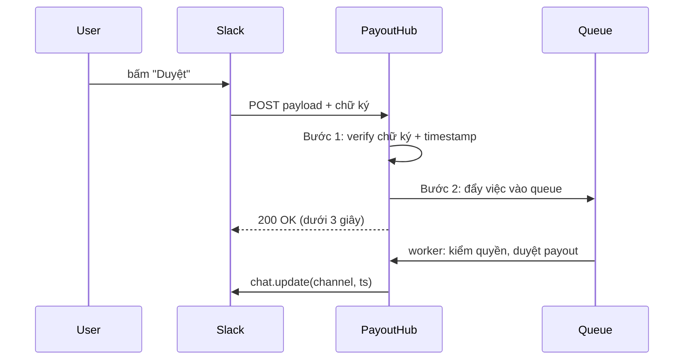
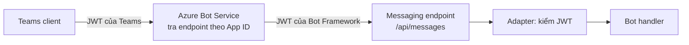

# Notification tương tác: Slack và Teams

Một **notification tương tác** là tin nhắn app gửi vào Slack hay Teams có **nút bấm**, và sau khi người nhận bấm thì chính tin đó được **sửa lại** để phản ánh kết quả ("Đã duyệt bởi An"). Nghe đơn giản, nhưng nó gồm bốn chặng dễ vỡ: gửi, nhớ đã gửi tin nào, nhận callback khi user bấm, và cập nhật tin. Trang này đi qua bốn chặng đó bằng một ví dụ PayoutHub, rồi phần riêng của Teams (định tuyến qua Azure Bot Service và cách debug "Unable to connect to the app").

Liên quan: [Bảo mật API](/aspnet-core/api-security) cho phần xác minh request, [Messaging](/architecture/messaging) cho phần đẩy việc nặng vào queue.

<svg width="0" height="0" style="position:absolute" aria-hidden="true"><defs><marker id="inInk" viewBox="0 0 10 10" refX="8" refY="5" markerWidth="7" markerHeight="7" orient="auto-start-reverse"><path class="head" d="M0 0L10 5L0 10z"/></marker><marker id="inBad" viewBox="0 0 10 10" refX="8" refY="5" markerWidth="7" markerHeight="7" orient="auto-start-reverse"><path class="headBad" d="M0 0L10 5L0 10z"/></marker><marker id="inAcc" viewBox="0 0 10 10" refX="8" refY="5" markerWidth="7" markerHeight="7" orient="auto-start-reverse"><path class="headAcc" d="M0 0L10 5L0 10z"/></marker></defs></svg>

## Bản đồ chủ đề {#topic-map}

<div class="fig">
<svg viewBox="0 0 720 330" role="img" aria-label="Bản đồ chủ đề. Hàng trên đọc 1 đến 4: gửi tin có nút, lưu định danh channel và ts, nhận callback khi user bấm với chữ ký và trả 200 dưới 3 giây, cập nhật tin. Bẫy đỏ: HTTP 200 vẫn có thể ok false, chưa lưu ts thì không sửa được, việc nặng làm trong callback, hai đường cùng update. Hàng dưới: 429 và retry, định tuyến Teams, debug Teams.">
<!-- 1 send -->
<a href="#send" style="text-decoration:none">
<rect class="box" x="20" y="40" width="150" height="100" rx="8"/>
<circle class="boxAcc" cx="36" cy="40" r="11"/><text x="36" y="44.5" font-size="12" font-weight="700" text-anchor="middle" class="accT">1</text>
<rect class="box" x="55" y="58" width="80" height="44" rx="6"/><line class="lnMuted" x1="63" y1="69" x2="120" y2="69"/><rect class="boxAcc" x="63" y="80" width="30" height="13" rx="3"/><rect class="box" x="98" y="80" width="30" height="13" rx="3"/>
<text x="95" y="126" font-size="11.5" text-anchor="middle">Gửi tin có nút</text>
</a>
<line class="ln" x1="170" y1="90" x2="191" y2="90" marker-end="url(#inInk)"/>
<!-- 2 identity -->
<a href="#identity" style="text-decoration:none">
<rect class="box" x="195" y="40" width="150" height="100" rx="8"/>
<circle class="boxAcc" cx="211" cy="40" r="11"/><text x="211" y="44.5" font-size="12" font-weight="700" text-anchor="middle" class="accT">2</text>
<path class="box" d="M250 66 V92 A20 5.5 0 0 0 290 92 V66"/><ellipse class="boxAcc" cx="270" cy="66" rx="20" ry="5.5"/>
<text x="270" y="110" font-size="10" text-anchor="middle" class="mono muted">channel + ts</text>
<text x="270" y="126" font-size="11.5" text-anchor="middle">Lưu định danh tin</text>
</a>
<line class="ln" x1="345" y1="90" x2="366" y2="90" marker-end="url(#inInk)"/>
<!-- 3 callback -->
<a href="#callback" style="text-decoration:none">
<rect class="boxAcc" x="370" y="40" width="150" height="100" rx="8"/>
<circle class="boxAcc" cx="386" cy="40" r="11"/><text x="386" y="44.5" font-size="12" font-weight="700" text-anchor="middle" class="accT">3</text>
<path class="box" d="M418 58 l14 -5 l14 5 v14 c0 10 -7 16 -14 19 c-7 -3 -14 -9 -14 -19 z"/><path class="lnOk" d="M425 71 l5 5 l9 -10"/>
<text x="478" y="70" font-size="11" font-weight="600" class="okT">200</text><text x="478" y="86" font-size="10" class="muted">&lt; 3 giây</text>
<text x="445" y="126" font-size="11.5" text-anchor="middle">Nhận callback</text>
</a>
<line class="ln" x1="520" y1="90" x2="541" y2="90" marker-end="url(#inInk)"/>
<!-- 4 update -->
<a href="#update" style="text-decoration:none">
<rect class="box" x="545" y="40" width="150" height="100" rx="8"/>
<circle class="boxAcc" cx="561" cy="40" r="11"/><text x="561" y="44.5" font-size="12" font-weight="700" text-anchor="middle" class="accT">4</text>
<rect class="box" x="580" y="58" width="80" height="44" rx="6"/><line class="lnMuted" x1="588" y1="69" x2="645" y2="69"/><path class="lnOk" d="M590 86 l6 6 l12 -12"/><line class="lnMuted" x1="614" y1="88" x2="650" y2="88"/>
<text x="620" y="126" font-size="11.5" text-anchor="middle">Sửa lại tin</text>
</a>
<!-- traps -->
<a href="#errors" style="text-decoration:none"><circle class="dotBad" cx="28" cy="158" r="4"/><text x="37" y="162" font-size="11" class="badT">HTTP 200 vẫn ok:false</text></a>
<a href="#identity" style="text-decoration:none"><circle class="dotBad" cx="203" cy="158" r="4"/><text x="212" y="162" font-size="11" class="badT">thiếu ts = không sửa được</text></a>
<a href="#ack" style="text-decoration:none"><circle class="dotBad" cx="378" cy="158" r="4"/><text x="387" y="162" font-size="11" class="badT">việc nặng trong callback</text></a>
<a href="#single-writer" style="text-decoration:none"><circle class="dotBad" cx="553" cy="158" r="4"/><text x="562" y="162" font-size="11" class="badT">hai đường cùng update</text></a>
<!-- bottom row -->
<a href="#rate-limit" style="text-decoration:none">
<rect class="box" x="20" y="200" width="200" height="100" rx="8"/>
<text x="60" y="246" font-size="20" font-weight="700" class="badT">429</text>
<path class="ln" d="M110 240 h20 m10 0 h28 m10 0 h22" stroke-dasharray="0"/>
<circle class="box" cx="135" cy="240" r="4"/><circle class="box" cx="173" cy="240" r="4"/>
<text x="120" y="230" font-size="9.5" class="mono muted">2s</text><text x="152" y="230" font-size="9.5" class="mono muted">4s</text><text x="190" y="230" font-size="9.5" class="mono muted">8s</text>
<text x="120" y="284" font-size="11.5" text-anchor="middle">429 và retry đúng chỗ</text>
</a>
<a href="#teams" style="text-decoration:none">
<rect class="box" x="260" y="200" width="200" height="100" rx="8"/>
<rect class="box" x="276" y="224" width="36" height="26" rx="4"/><rect class="boxAcc" x="342" y="224" width="36" height="26" rx="4"/><rect class="box" x="408" y="224" width="36" height="26" rx="4"/>
<line class="ln" x1="312" y1="237" x2="338" y2="237" marker-end="url(#inInk)"/><line class="ln" x1="378" y1="237" x2="404" y2="237" marker-end="url(#inInk)"/>
<text x="294" y="266" font-size="9" text-anchor="middle" class="muted">Teams</text><text x="360" y="266" font-size="9" text-anchor="middle" class="muted">Bot Service</text><text x="426" y="266" font-size="9" text-anchor="middle" class="muted">bot</text>
<text x="360" y="288" font-size="11.5" text-anchor="middle">Teams: định tuyến</text>
</a>
<a href="#debug-teams" style="text-decoration:none">
<rect class="box" x="500" y="200" width="200" height="100" rx="8"/>
<circle class="box" cx="580" cy="238" r="14"/><line class="ln" x1="590" y1="248" x2="604" y2="262"/>
<text x="625" y="236" font-size="10" class="mono muted">GET → 405</text><text x="625" y="252" font-size="10" class="mono muted">POST?</text>
<text x="600" y="288" font-size="11.5" text-anchor="middle">Debug "Unable to connect"</text>
</a>
<a href="#teams" style="text-decoration:none"><circle class="dotBad" cx="268" cy="316" r="4"/><text x="277" y="320" font-size="11" class="badT">hai Azure Bot trùng tên</text></a>
</svg>
<p class="fig-caption">Đọc 1 đến 4 theo vòng đời một tin; mỗi ô bấm được. Tự hỏi: vì sao phải lưu định danh ngay ở bước 2 chứ không tìm lại sau? Vì sao callback phải trả lời trước khi làm xong việc? Một lỗi 429 khi update có chắc là bị throttle không?</p>
</div>

## 1. Vấn đề: tin đã gửi là "mất dấu" {#problem}

PayoutHub muốn báo cho người duyệt mỗi khi có payout lớn chờ duyệt: một tin vào kênh `#finance` với hai nút **Duyệt** và **Từ chối**. Bản đầu tiên thường là thế này:

```csharp
await http.PostAsJsonAsync(webhookUrl, new { text = $"Payout #{id} chờ duyệt" });
```

Nó chạy, nhưng ngay khi có yêu cầu thứ hai thì đau:

- User bấm **Duyệt** xong, tin vẫn hiện hai nút. Người khác bấm lại, payout bị duyệt hai lần hoặc lỗi khó hiểu. Muốn sửa tin thì app **không biết tin nào** là tin đó.
- Ai cũng có thể gọi vào URL nhận callback và giả làm "user bấm Duyệt".
- Callback làm việc nặng (gọi ngân hàng) mất 10 giây; Slack bỏ cuộc sau 3 giây và hiện lỗi cho user dù việc vẫn đang chạy.

Mỗi chặng dưới đây chữa một cái đau trong số đó.

## 2. Gửi: chọn kênh gửi có trả về định danh {#send}

**Chỉ cách gửi nào trả về định danh của tin thì mới sửa tin đó được về sau.** Vì vậy lựa chọn đầu tiên quyết định mọi thứ phía sau:

| Cách gửi | Trả về định danh? | Hợp khi |
|---|---|---|
| Slack Incoming Webhook | Không | Đẩy tin một chiều vào một kênh cố định |
| Slack Web API `chat.postMessage` + bot token | Có: `channel` + `ts` | Có nút, cần sửa hoặc xoá sau, gửi nhiều kênh hay DM |
| Teams bot (gửi chủ động) | Có: `activity.Id` | Có card, modal, cập nhật card |

Nội dung có nút được dựng bằng **Block Kit** (Slack) hoặc <T>Adaptive Card</T> (Teams). Mỗi nút mang hai giá trị: `action_id` nói **làm gì** (`approve_payout`), `value` nói **trên đối tượng nào** (`42`). `value` đi qua máy client nên không nhét dữ liệu nhạy cảm vào đó.

## 3. Lưu định danh tin ngay khi gửi {#identity}

**Một tin trong Slack được xác định bởi cặp `channel` + `ts`, trong Teams bởi <T>conversation reference</T> + `activity.Id`.** Thiếu một nửa thì chỉ gửi được tin mới, không sửa được tin cũ. Hệ quả:

- `channel` là **ID** (`C0123...`, `D0456...` cho DM), không phải tên kênh. Tên kênh đổi được, ID thì không.
- `ts` trông như timestamp (`1700000000.000200`) nhưng thật ra là **ID của tin trong kênh đó**.
- Lưu ngay vào DB cạnh bản ghi nghiệp vụ, trong cùng bước gửi:

```csharp
var res = await slack.PostMessageAsync(channelId, blocks);   // trả về { ok, channel, ts }
payout.NotifyChannel = res.Channel;
payout.NotifyTs = res.Ts;
await db.SaveChangesAsync();
```

Teams cũng vậy: lưu `ConversationReference` khi user cài bot hoặc nhắn lần đầu (không có nó thì bot **không tự mở được** cuộc trò chuyện), và lưu `activity.Id` trả về sau mỗi lần gửi card.

## 4. Nhận callback khi user bấm {#callback}

**Khi user bấm nút, Slack (hoặc Teams qua Azure Bot Service) gọi một <T>webhook</T> vào app của bạn.** Endpoint này công khai trên internet, nên phải tự trả lời ba câu hỏi theo thứ tự: request có thật từ Slack không, trả lời kịp không, người bấm có quyền không.



### Bước 1: xác minh chữ ký {#verify}

**Slack ký mỗi request bằng signing secret mà chỉ bạn và Slack biết**, nên ai không có secret thì không làm giả được.

1. Đọc **raw body** trước khi parse. Parse rồi serialize lại thì byte khác, chữ ký không khớp.
2. Tính `HMAC-SHA256(secret, "v0:" + timestamp + ":" + rawBody)`, so với header `X-Slack-Signature` bằng so sánh <T>constant-time</T>.
3. Từ chối nếu header `X-Slack-Request-Timestamp` lệch quá khoảng 5 phút: chữ ký đúng nhưng request cũ là dấu hiệu <T>replay attack</T>.

<T>HMAC</T> ở đây cùng cơ chế với chữ ký <T>JWT</T>: hai bên giữ chung một secret, bên nhận tính lại rồi so. Teams không dùng HMAC mà gửi JWT do Bot Framework ký; adapter của SDK tự kiểm.

### Bước 2: trả 200 trước, làm việc sau {#ack}

**Slack chờ phản hồi khoảng 3 giây rồi coi như lỗi**, nên callback chỉ làm việc rẻ: verify, đẩy một message vào queue, trả 200. Việc nặng (gọi ngân hàng, ghi DB nhiều bước) chạy ở worker, xong thì sửa tin bằng `chat.update` hoặc `response_url`.

`response_url` đi kèm payload tiện hơn nhưng có hạn (theo tài liệu Slack khoảng 30 phút, tối đa 5 lần dùng). Việc có thể lâu hơn thì dùng `chat.update` với `channel` + `ts` đã lưu.

### Bước 3: kiểm quyền người bấm {#authorize}

**Card chỉ hiện nút cho người có quyền không phải là kiểm quyền**, vì payload mang `user.id` của Slack và ai trong kênh cũng bấm được. Map `user.id` sang user trong hệ thống (bảng liên kết tài khoản), rồi kiểm quyền như với một request API bình thường ([Authorization](/aspnet-core/authorization)). Teams cũng vậy: kiểm lại trong handler `task/submit`.

## 5. Cập nhật tin {#update}

**`chat.update` thay toàn bộ `blocks` của tin**, không vá từng phần. Vì thế muốn giữ nút thì phải gửi lại cả nút; muốn bỏ nút (sau khi đã duyệt) thì gửi blocks không có `actions`. Gọi bằng **cùng bot** đã gửi tin gốc.

Teams: tạo activity mới, gán `update.Id = savedActivityId`, gọi `UpdateActivityAsync`. Thiếu `Id` thì Teams không biết sửa tin nào. Trong một turn đang phản hồi user thì context có sẵn; còn cập nhật chủ động (từ worker) thì phải tự gán `Id` đã lưu.

### Một tin, một người sửa {#single-writer}

**Hai đường code cùng update một tin thì lần tới sau cùng thắng** (<T>last write wins</T>), lần kia biến mất không báo lỗi. Ví dụ: callback của user sửa tin thành "Đã duyệt", cùng lúc job nền đồng bộ trạng thái sửa lại thành "Chờ ngân hàng". Cách chữa không phải khoá hay retry mà là thiết kế: **chỉ một đường sở hữu việc update một tin** (ví dụ chỉ worker xử lý kết quả), các đường khác gửi sự kiện cho nó.

## 6. Lỗi và rate limit {#rate-limit}

**Slack và Teams giới hạn số lời gọi theo method và theo workspace; vượt thì trả `429` kèm header `Retry-After` (giây).** Phản ứng đúng là chờ đúng số giây đó rồi thử lại, có giới hạn số lần ([Backoff](/aspnet-core/rest-api#idempotent-post-retry)).

Nhưng **chẩn đoán trước khi thêm retry**: một trường hợp 429 thật khi `UpdateActivityAsync` trên Teams hoá ra không phải throttle mà là **hai đường code cùng update một tin cùng lúc** (đúng lỗi ở [mục trên](#single-writer)). Thêm retry chỉ che lỗi thiết kế; sửa đúng là bỏ đường update thừa.

Khi chắc là throttle, retry phải nằm **bên trong** callback của turn. Exception trong turn bị `OnTurnError` của adapter nuốt, nên retry bọc ngoài `ContinueConversationAsync` không bao giờ chạy:

```csharp
await adapter.ContinueConversationAsync(appId, reference, async (turn, ct) =>
{
    var update = MessageFactory.Attachment(card);
    update.Id = savedActivityId;
    for (var attempt = 0; ; attempt++)
    {
        try { await turn.UpdateActivityAsync(update, ct); break; }
        catch (ErrorResponseException ex) when ((int)ex.Response.StatusCode == 429 && attempt < 3)
        {
            await Task.Delay(RetryAfterOr(ex, TimeSpan.FromSeconds(Math.Pow(2, attempt + 1))), ct);
        }
    }
}, ct);
```

`RetryAfterOr` đọc header `Retry-After` (chặn trên 60 giây), không có thì backoff 2s, 4s, 8s. Code dùng Bot Framework SDK v4; xem [tình trạng SDK](#teams-sdk) trước khi chép.

### HTTP 200 chưa chắc là thành công {#errors}

**Slack Web API trả HTTP 200 cho phần lớn lỗi nghiệp vụ**, và đặt lỗi trong body: `{"ok": false, "error": "channel_not_found"}`. Code chỉ kiểm status code sẽ tưởng đã gửi. Luôn kiểm `ok`. Các lỗi hay gặp:

- `not_in_channel`: bot chưa được mời vào private channel.
- `message_not_found`: sai `ts`, hoặc `ts` đúng nhưng sai `channel`.
- `invalid_auth`: token sai hoặc đã thu hồi.

Một bẫy khác khi gửi cùng notification qua cả Slack và Teams: **mỗi kênh có hệ ID người dùng riêng**. Lọc người nhận Teams bằng Slack user ID thì không ai nhận được. Giữ bảng map riêng cho từng kênh, đặt tên cột theo kênh (`SlackUserId`, `TeamsUserId`).

## 7. Teams: request đi qua Azure Bot Service {#teams}

**Teams không gọi thẳng vào bot của bạn; mọi thứ đi qua Azure Bot Service, nơi tra messaging endpoint theo bot App ID.** Vì vậy cấu hình nằm ở hai nơi và hay lệch nhau:



- **Teams app manifest** giữ bot App ID.
- **Azure Bot resource** giữ messaging endpoint cho App ID đó.

Card có nút `Action.Submit` với `msteams: { type: "task/fetch" }` sẽ mở một <T>task module</T> (modal). Bot nhận invoke `task/fetch` và trả nội dung modal; user bấm gửi thì bot nhận `task/submit`, chạy nghiệp vụ, rồi cập nhật card gốc như [mục 5](#update).

### Tình trạng SDK {#teams-sdk}

Bot Framework SDK (v4, và thế hệ v3 cũ hơn) **hết hỗ trợ từ 31/12/2025**, repo đã archive. Bot đang chạy trên Azure Bot Service vẫn chạy, nhưng không còn bản vá. Microsoft hướng sang:

- **Teams SDK**: bot chỉ chạy trong Teams. Có gói tương thích giữ handler cũ, chỉ đổi adapter, nên là đường ít việc nhất cho bot v4.
- **Microsoft 365 Agents SDK**: agent đa kênh. Phía C# cần .NET 8 trở lên và chỉ host bằng ASP.NET Core, nên app .NET Framework phải tách bot thành service riêng.

Phần hành vi ở trang này (định tuyến, manifest, task module, lưu reference, cập nhật card, 429) là của Teams và Azure Bot Service, không đổi theo SDK. Hai bản hướng dẫn chi tiết cũ (v3 trên .NET Framework, v4 trên ASP.NET Core) nằm ở nhóm [Legacy](/legacy/).

### Debug "Unable to connect to the app" {#debug-teams}

**Mỗi bước loại một nhóm nguyên nhân, nên đi theo thứ tự**, đừng đoán:

1. **Tunnel tới được endpoint không?** Mở messaging endpoint bằng GET trên browser. Đúng là `405 Method Not Allowed` (endpoint chỉ nhận POST). Connection refused, 404 hay redirect thì <T>tunnel</T> hoặc web server chưa chạy đúng.
2. **Có POST tới không?** Nhắn bot trong Teams, xem màn inspect của tunnel. Có POST thì sang bước 4; không có thì bước 3.
3. **Không có POST: Bot Service đang gửi đi nơi khác.**
   - Hay gặp nhất: **hai Azure Bot resource trùng tên**, sửa endpoint nhầm resource. Phải sửa đúng resource có App ID khớp manifest và config local.
   - Endpoint chưa bấm lưu trong Azure Portal.
   - Tunnel không cho anonymous: Bot Service không đăng nhập được nên bị từ chối âm thầm. Dev Tunnels: `devtunnel access create <id> -p <port> --anonymous`.
   - Thử `curl -X POST https://<tunnel>/api/messages -d "{}"`. POST này hiện trong inspect mà traffic từ Teams thì không, nghĩa là tunnel ổn và lỗi là sai resource.
4. **Có POST nhưng breakpoint không dính: auth fail trước khi vào code.** Adapter bắt `UnauthorizedAccessException`, trả 401 và dừng, không gọi bot, cũng không gọi `OnTurnError`. Kiểm App ID và secret khớp chính xác (không thừa khoảng trắng), App type khớp (để trống là MultiTenant), Tenant ID có set nếu SingleTenant.

## 8. Biến thể và trade-off {#trade-offs}

- **Webhook một chiều đủ dùng** khi tin chỉ để đọc (báo deploy xong, báo lỗi). Vì không cần sửa tin nên không cần bot token, không cần lưu định danh.
- **`response_url` thay cho `chat.update`** khi việc xong trong vài phút: không cần lưu `ts`. Vì nó có hạn nên việc dài vẫn phải lưu.
- **Đẩy vào queue** tốn thêm một hạ tầng, nhưng vì callback phải trả trong 3 giây nên gần như bắt buộc khi việc phía sau gọi hệ thống ngoài. Việc chỉ ghi một dòng DB thì làm thẳng trong callback được.
- **Gửi qua nhiều kênh** (Slack và Teams) thì tách phần "nội dung notification" khỏi phần "adapter từng kênh"; mỗi adapter giữ hệ ID và định danh tin của riêng nó.

Checklist khi làm tính năng mới:

- [ ] Chọn Web API hay webhook, ghi lý do
- [ ] Lưu `channel` + `ts` (hoặc reference + activity id) ngay khi gửi
- [ ] Verify chữ ký và timestamp ở callback, đọc raw body
- [ ] Trả 200 dưới 3 giây, việc nặng vào queue
- [ ] Map user của kênh sang user nội bộ, kiểm quyền trước khi làm
- [ ] Kiểm `ok`, xử lý `429` + `Retry-After`
- [ ] Một đường duy nhất sở hữu việc update một tin
- [ ] Test với private channel, DM, user chưa liên kết tài khoản

## Câu hỏi phỏng vấn {#interview}

### Endpoint nhận webhook từ bên thứ ba cần làm gì? <Badge type="warning" text="hay bị hỏi" /> {#webhook-endpoint}

::: tip Trả lời nhanh
Ba việc theo thứ tự: **xác minh** request (chữ ký HMAC trên raw body + timestamp chống replay), **trả lời nhanh** (đẩy việc vào queue, trả 200 trong vài giây), rồi **xử lý idempotent** vì bên kia có thể gửi lại. Xem [Nhận callback](#callback) và [Idempotent consumer](/architecture/messaging#idempotent-consumer).
:::

::: details Câu trả lời mẫu (English)
- Verify first: HMAC over the raw body with the shared secret, constant-time compare, reject old timestamps to stop replays.
- Ack fast: the sender times out in seconds, so enqueue and return 200; a worker does the real work.
- Assume duplicates: senders retry, so the handler must be idempotent (dedupe by event id).
- Authorize the actor from the payload; the button being visible is not a permission check.
:::

::: warning Bẫy & follow-up
- Parse JSON rồi mới verify: byte đã đổi, chữ ký luôn sai (hoặc tệ hơn, bạn bỏ verify vì "nó không chạy").
- So sánh chữ ký bằng `==`: rò thời gian. Dùng `CryptographicOperations.FixedTimeEquals`.
- Follow-up: "Worker lỗi sau khi đã trả 200 thì sao?" Queue phải bền và có dead-letter, xem [Messaging](/architecture/messaging#dead-letter).
:::

### Bạn gặp 429 khi gọi API bên ngoài. Xử lý thế nào? {#handle-429}

::: tip Trả lời nhanh
**Chẩn đoán trước**: có thật là throttle không, hay hai đường code đang tranh nhau một tài nguyên? Nếu là throttle: tôn trọng `Retry-After`, không có thì exponential backoff có jitter, giới hạn số lần, và đặt retry đúng chỗ exception thật sự nổi lên. Xem [Lỗi và rate limit](#rate-limit).
:::

::: details Câu trả lời mẫu (English)
- First confirm it's real throttling; I once saw 429s that were two code paths updating the same message concurrently. The fix was removing one path, not adding retries.
- If it is throttling: honor Retry-After, else exponential backoff with jitter, capped attempts.
- Put the retry where the exception actually surfaces (inside the turn callback, not around a call that swallows errors).
- Long term: reduce call volume (batching, caching), and in .NET use `Microsoft.Extensions.Http.Resilience`.
:::

::: warning Bẫy & follow-up
- Retry mọi 4xx: sai, 4xx nghĩa là gửi lại y nguyên vẫn hỏng, trừ 408 và 429 ([REST API](/aspnet-core/rest-api)).
- Retry không giới hạn: biến một sự cố nhỏ thành tự DDoS chính nhà cung cấp.
:::

## Tự kiểm tra {#self-check}

1. Bạn dùng Incoming Webhook và giờ sếp muốn "sau khi duyệt thì bỏ nút đi". Vì sao phải đổi cách gửi, và đổi xong phải lưu thêm gì?
2. Callback verify chữ ký đúng, nhưng timestamp là của 2 tiếng trước. Chấp nhận thì rủi ro gì?
3. Callback gọi ngân hàng mất 8 giây rồi mới trả 200. User thấy gì, và hệ thống có thể làm gì hai lần?
4. Bot Teams báo "Unable to connect", inspect của tunnel không thấy POST nào. Ba nguyên nhân nào còn lại, nguyên nhân nào hay gặp nhất?
5. Bạn bọc retry quanh `ContinueConversationAsync(...)` nhưng log cho thấy không bao giờ retry. Vì sao?
