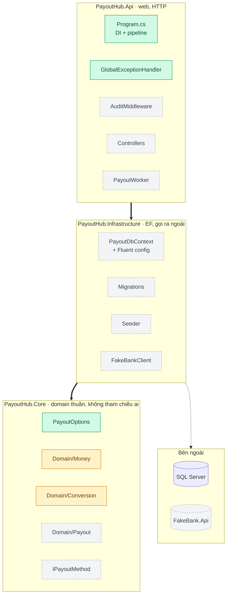
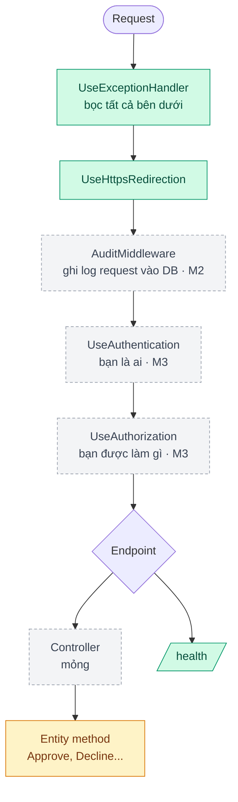
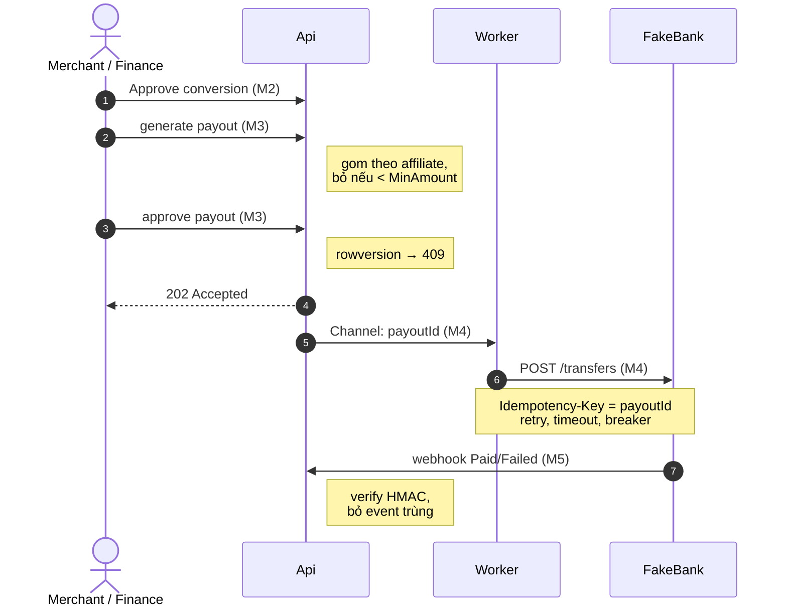
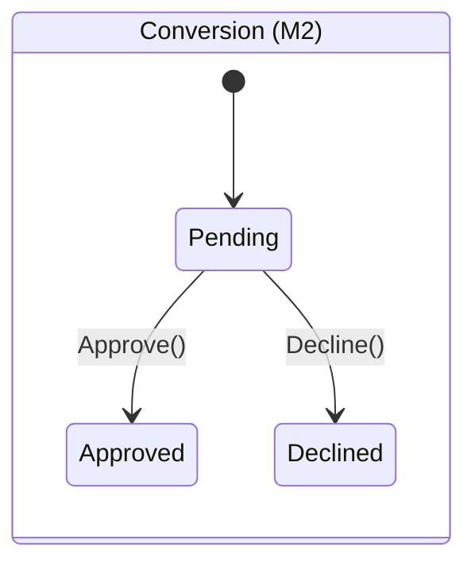
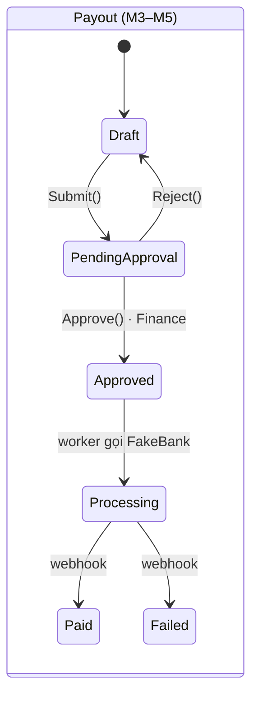

# Bản đồ dự án PayoutHub

Trang này vẽ lại toàn bộ PayoutHub để nhìn một lần là thấy: **code nằm ở đâu, request đi qua đâu, tiền đi thế nào**. Cập nhật sau mỗi bước của [Plan](/progress/plan).

Chú thích màu: <span class="pm-done">đã làm</span> · <span class="pm-wip">đang làm</span> · <span class="pm-todo">chưa làm</span>

## 1. Các layer và file {#layers}

Mũi tên đậm = "tham chiếu tới" (Api cũng tham chiếu Core). **Core không tham chiếu ai**: Core khai báo interface, Infrastructure implement (DIP).



## 2. Một request đi qua pipeline {#pipeline}

Thứ tự trong `Program.cs`. Middleware chỉ bọc được những gì **đứng sau** nó ([Middleware pipeline](/aspnet-core/middleware#middleware)).



Mỗi request có **một scope DI**: `PayoutDbContext` (scoped) sống đúng một request, rồi bị dispose.

```
App start ──●──────────────────────────────────▶
            └ Singleton: logger, options,
              convention middleware (new 1 lần)
Request 1     ├─ scope 1: DbContext #1 ─┤
Request 2              ├─ scope 2: DbContext #2 ─┤
              (IMiddleware cũng new theo từng scope)
```

## 3. Luồng tiền từ đầu đến cuối {#money-flow}



Bấm vào sơ đồ bất kỳ để mở toàn màn hình: kéo để di chuyển, cuộn chuột hoặc `+`/`-` để zoom, Esc để đóng.


## 4. State machine {#state-machines}

Chỉ đổi trạng thái qua **method của entity**; sai trạng thái thì throw (sau map thành 409).





## 5. Lý thuyết nằm ở đâu trong code {#theory-map}

| Câu phỏng vấn | Nằm ở | Bước |
|---|---|---|
| [Options pattern](/aspnet-core/options-pattern#options-interfaces) | `Core/PayoutOptions.cs`, `Program.cs` (`ValidateOnStart`) | M1 ✓ |
| [Exception handling](/aspnet-core/exception-handling#exception-flow) | `Api/GlobalExceptionHandler.cs` | M1 ✓ |
| Encapsulation ([OOP](/dotnet/oop-fundamentals#oop)) | `Core/Domain/Conversion.cs` (`private set`, `Approve()`) | M2 |
| [record, value object](/dotnet/oop-fundamentals#struct-class-record) | `Core/Domain/Money.cs` | M2 |
| [Middleware lifetime](/aspnet-core/middleware#middleware-lifetime), [Captive dependency](/aspnet-core/dependency-injection#captive-dependency) | `Api/AuditMiddleware.cs` | M2 |
| [IEnumerable vs IQueryable](/dotnet/collections-linq#ienumerable-vs-iqueryable), N+1 | `GET /affiliates/{id}/conversions` | M2 |
| Optimistic concurrency, [REST status](/aspnet-core/questions#rest-design) | `POST /payouts/{id}/approve` | M3 |
| [SOLID](/dotnet/oop-fundamentals#solid) (OCP), [Nhiều implementation](/aspnet-core/dependency-injection#multiple-implementations) | `Core/IPayoutMethod` + Bank/PayPal/Wise | M3 |
| [Async](/runtime/async), scope trong singleton | `Api/PayoutWorker.cs` | M4 |
| [IHttpClientFactory](/aspnet-core/questions#httpclientfactory), idempotency | `Infrastructure/FakeBankClient.cs` | M4 |

<style>
.pm-done, .pm-wip, .pm-todo { padding: 1px 8px; border-radius: 6px; font-size: .85em; }
.pm-done { background: #d1fae5; color: #064e3b; }
.pm-wip  { background: #fef3c7; color: #78350f; }
.pm-todo { background: #f3f4f6; color: #374151; border: 1px dashed #9ca3af; }
</style>
