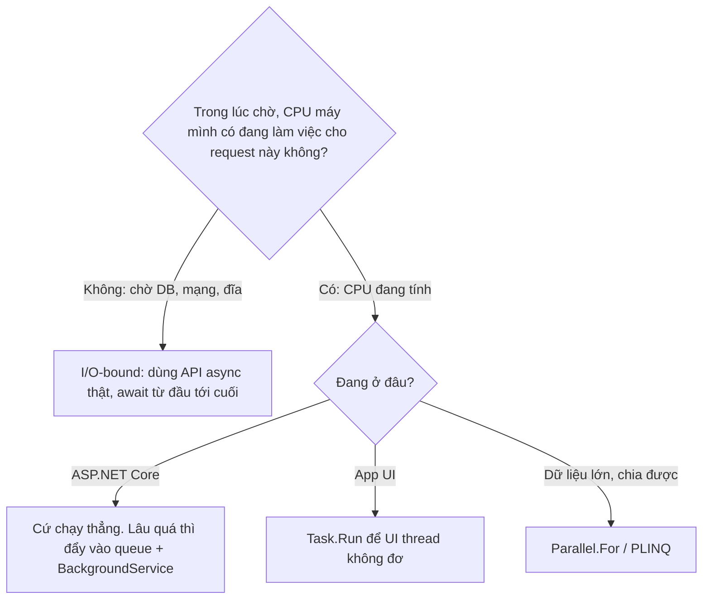

# Async từ nút bấm tới database

Trang này đi theo **một** request thật từ đầu tới cuối. Mỗi keyword (thread, thread pool, Task, awaiter, state machine, continuation, SynchronizationContext...) được giải thích **đúng chỗ nó xuất hiện lần đầu**. Đọc xong trang này rồi mới quay lại [Async & Concurrency](/runtime/async) để luyện câu phỏng vấn.

## Kịch bản {#scenario}

Người dùng Finance bấm nút **Approve** trên một payout. Front end gọi:

```js
const res = await fetch('/payouts/42/approve', { method: 'POST' })
```

Backend có action:

```csharp
[HttpPost("{id:int}/approve")]
public async Task<IActionResult> Approve(int id, CancellationToken ct)
{
    var payout = await db.Payouts.FindAsync([id], ct);      // await #1: đọc DB
    payout!.Approve();                                        // CPU, rất nhanh
    await db.SaveChangesAsync(ct);                            // await #2: ghi DB
    return NoContent();
}
```

Theo dõi hai thứ ở cột trái của mỗi bước: **tầng** đang xử lý (màu) và **thread nào** đang bận vì request này. Chip <span style="color: var(--vp-c-warning-1)">cam</span> = có một thread đang bị chiếm. Chip <span style="color: var(--vp-c-green-1)">xanh</span> = không thread nào của app bị chiếm.

## Luồng đầy đủ {#flow}

<FlowStep :n="1" title="User bấm Approve" layer="Browser" thread="UI thread (JS)" tone="busy">

Browser gọi event handler JavaScript trên **UI thread** của tab. Mỗi tab chỉ có **một** thread chạy JS.

`fetch(...)` không chờ server. Nó gửi yêu cầu cho tầng network của browser rồi **trả về ngay một Promise**: một object nghĩa là "kết quả sẽ có sau".

Handler chạy tới `await` thì dừng, UI thread rảnh. Nhờ vậy spinner trên nút vẫn quay, user vẫn cuộn trang được.

> **Event loop:** vòng lặp của browser. Lấy việc tiếp theo trong hàng đợi (click, timer, response mạng về) và chạy trên UI thread, từng việc một. `await` trong JS = "đăng ký phần còn lại vào hàng đợi, nhả thread". **.NET làm đúng ý tưởng này**, chỉ khác là có nhiều thread.

</FlowStep>

<FlowStep :n="2" title="Request đi trên mạng" layer="Network" thread="không có thread" tone="free">

Các byte của HTTP request đi qua mạng tới server. Mất vài ms tới vài chục ms.

Phía .NET **chưa có ai chờ** request này: server còn chưa biết nó tồn tại.

</FlowStep>

<FlowStep :n="3" title="OS nhận kết nối, báo cho Kestrel" layer="Kestrel" thread="không có thread" tone="free">

**Kestrel** là web server có sẵn trong ASP.NET Core. Card mạng nhận byte, **kernel của OS** gom thành dữ liệu của socket.

Kestrel không dựng một thread ngồi canh từng socket. Nó dùng cơ chế **async I/O của OS**: "khi socket này có dữ liệu thì báo tôi".

- Windows: **IOCP** (I/O Completion Port).
- Linux: **epoll**.

Khi OS báo, runtime đưa việc "xử lý dữ liệu vừa tới" vào hàng đợi của **thread pool**.

> **Thread:** đơn vị mà CPU thực sự chạy. Mỗi thread có **stack** riêng (mặc định cỡ 1 MB trên Windows). Tạo và huỷ thread tốn kém; số thread nhiều thì tốn RAM và CPU phải chuyển qua lại giữa chúng.
>
> **Thread pool:** một nhóm worker thread .NET tạo sẵn và **dùng lại**. Có một hàng đợi việc; thread nào rảnh thì lấy việc tiếp theo ra chạy, xong lại quay về chờ việc. Khi việc dồn mà không có thread rảnh, pool **tăng thêm thread rất chậm** (thêm dần từng cái, có độ trễ), để không đẻ thread vô tội vạ.

</FlowStep>

<FlowStep :n="4" title="Pipeline và model binding" layer="ASP.NET Core" thread="Thread #7" tone="busy">

Một worker rảnh của thread pool, gọi là **Thread #7**, nhận việc. Từ đây Thread #7 đang bận vì request này.

Thread #7 chạy lần lượt:

1. Parse HTTP request, tạo `HttpContext`.
2. [Middleware pipeline](/aspnet-core/middleware#middleware): logging, exception handling, auth, routing...
3. Tạo **DI scope** cho request, tạo controller, inject `DbContext`.
4. **Model binding**: lấy `id = 42` từ route, `ct` = token bị huỷ khi client đóng kết nối.
5. Gọi `Approve(42, ct)`.

</FlowStep>

<FlowStep :n="5" title="Code của bạn chạy đồng bộ" layer="Your code" thread="Thread #7" tone="busy">

Điểm hay bị hiểu sai: method `async` **không** chạy trên thread mới. Nó chạy **đồng bộ trên Thread #7** cho tới `await` đầu tiên gặp một việc **chưa xong**.

`async` không tạo thread. Nó chỉ cho phép method **tạm dừng** ở `await`.

> **Stack:** vùng nhớ riêng của mỗi thread. Mỗi lần gọi method, một **stack frame** được đẩy vào, chứa biến local và tham số (`id`, `ct`, `payout`). Method return là frame bị bỏ đi, biến local mất.
>
> **Heap:** vùng nhớ chung cho object (`new ...`). Object sống chừng nào còn ai trỏ tới; **GC** dọn khi không còn ai. Xem thêm [stack vs heap](/runtime/memory#value-vs-reference).

Ghi nhớ chỗ này: biến local nằm trên stack, mà stack sẽ bị bỏ khi method return. Bước 8 cần giải quyết đúng vấn đề đó.

</FlowStep>

<FlowStep :n="6" title="FindAsync gửi SQL đi" layer="EF Core" thread="Thread #7" tone="busy">

Vẫn trên Thread #7:

1. **EF Core** kiểm tra cache của DbContext. Chưa có entity 42, nên dịch thành SQL: `SELECT ... FROM Payouts WHERE Id = @p0`.
2. **SqlClient** (driver của SQL Server) mượn connection từ connection pool, **ghi** request vào socket TCP.
3. SqlClient bắt đầu một **async read** trên socket: "khi có byte trả về thì báo tôi" (lại là IOCP/epoll).
4. Chưa có kết quả, nên `FindAsync` trả về ngay một **Task chưa hoàn thành**.

> **Task:** object đại diện cho một việc **sẽ xong sau**, giống Promise bên JS. Nó có trạng thái (đang chờ / xong / lỗi / huỷ), giữ **kết quả** hoặc **exception**, và cho phép đăng ký "khi xong thì gọi cái này". Task **không phải thread**: Task chờ DB không chiếm thread nào. (`FindAsync` trả `ValueTask`, một biến thể nhẹ hơn của Task; ý tưởng giống hệt.)

</FlowStep>

<FlowStep :n="7" title="Gặp await: awaiter và state machine" layer="Your code" thread="Thread #7" tone="busy">

`await` không phải phép màu. Compiler dịch nó thành vài lời gọi trên **awaiter**.

> **Awaiter:** object lấy từ `task.GetAwaiter()`. Có 3 thứ:
> - `IsCompleted`: xong chưa?
> - `OnCompleted(callback)`: "xong thì gọi callback này".
> - `GetResult()`: lấy kết quả, hoặc **ném lại exception** nếu task lỗi.
>
> **State machine:** compiler viết lại method `async` thành một **struct** có field `state` (đang dừng ở `await` nào) và method `MoveNext()` (chạy tiếp từ chỗ đó). Tham số và biến local trở thành **field** của struct.

Code compiler sinh cho `Approve`, **đơn giản hoá** (không phải code thật):

```csharp
struct ApproveStateMachine : IAsyncStateMachine
{
    public int state = -1;           // -1: chưa dừng ở đâu; 0: dừng ở await #1; 1: dừng ở await #2
    public AsyncTaskMethodBuilder<IActionResult> builder;  // tạo và hoàn thành Task trả cho caller
    public PayoutsController self;   // tham số + this → field
    public int id;
    public CancellationToken ct;
    Payout? payout;                  // biến local → field
    ValueTaskAwaiter<Payout?> a1;
    TaskAwaiter<int> a2;

    public void MoveNext()
    {
        try
        {
            switch (state)
            {
                case -1:
                    a1 = self.db.Payouts.FindAsync([id], ct).GetAwaiter();
                    if (!a1.IsCompleted)
                    {
                        state = 0;
                        builder.AwaitUnsafeOnCompleted(ref a1, ref this); // đăng ký continuation
                        return;                                         // nhả thread
                    }
                    goto case 0;                                        // fast path: chạy tiếp luôn
                case 0:
                    payout = a1.GetResult();
                    payout!.Approve();
                    a2 = self.db.SaveChangesAsync(ct).GetAwaiter();
                    if (!a2.IsCompleted)
                    {
                        state = 1;
                        builder.AwaitUnsafeOnCompleted(ref a2, ref this);
                        return;
                    }
                    goto case 1;
                case 1:
                    a2.GetResult();
                    builder.SetResult(self.NoContent());                // Task của caller: xong
                    return;
            }
        }
        catch (Exception ex) { builder.SetException(ex); }              // Task của caller: lỗi
    }
}
```

**Fast path:** nếu `IsCompleted` đã là `true` (ví dụ entity 42 đã có sẵn trong DbContext), code chạy tiếp ngay trên Thread #7, **không dừng, không đổi thread**. Lần này DB chưa trả lời, nên đi nhánh chậm.

</FlowStep>

<FlowStep :n="8" title="Method return, Thread #7 về pool" layer="Your code" thread="không có thread" tone="free">

Đây là **bước quan trọng nhất** của cả trang.

1. **Đưa state machine lên heap.** Stack frame của `Approve` sắp bị bỏ. Lần đầu phải dừng, runtime copy state machine (cùng `id`, `ct`, `payout`...) thành một object trên **heap** ("box"). Biến local sống sót nhờ vậy.
2. **Đăng ký continuation.** Gắn vào Task của `FindAsync`: "khi xong thì gọi `MoveNext()` của state machine này".
3. **Return.** `Approve` trả về một `Task<IActionResult>` **chưa xong** cho MVC; MVC trả Task của nó cho Kestrel. Cả chuỗi chỉ còn lại "Task + callback" nằm trên heap.
4. **Thread #7 quay về thread pool** và đi phục vụ request khác.

> **Continuation:** "phần còn lại của method" sau `await`, được gói thành một callback. Ở đây nó chính là lời gọi `MoveNext()` lần nữa, với `state = 0`.

Trong lúc DB đang chạy query: **không có thread nào** của app ngồi chờ request này. Chỉ có vài object trên heap, và OS giữ một yêu cầu đọc socket đang chờ.

```
Thread #7  ██ pipeline ██ action → FindAsync ┐ trả về pool → phục vụ request khác …
(không thread nào)                           └──── chờ SQL Server (I/O) ────┐
Thread #12                                                                  └ ██ MoveNext: Approve(), SaveChangesAsync ┐ …
```

</FlowStep>

<FlowStep :n="9" title="SQL Server chạy query" layer="SQL Server" thread="không có thread" tone="free">

SQL Server là **process khác**, thường ở máy khác. Nó dùng thread **của nó** để parse, lập plan, đọc page từ buffer pool hoặc đĩa.

Những thread đó **không phải** thread của app. Phía app: 0 thread bận cho request này, dù query mất 5 ms hay 5 giây.

</FlowStep>

<FlowStep :n="10" title="Kết quả về, OS báo cho .NET" layer="OS kernel" thread="không có thread" tone="free">

Byte kết quả về card mạng → kernel đưa vào buffer của socket → hoàn thành yêu cầu đọc đã đăng ký ở bước 6.

OS báo cho .NET qua **IOCP** (Windows) hoặc **epoll** (Linux). Runtime nhận tín hiệu và **xếp một việc vào hàng đợi của thread pool**: "chạy tiếp SqlClient cho socket này".

</FlowStep>

<FlowStep :n="11" title="Continuation chạy trên một pool thread" layer=".NET runtime" thread="Thread #12" tone="busy">

Một worker rảnh nhận việc. Có thể là **Thread #12**, cũng có thể lại là Thread #7, không ai đảm bảo. SqlClient đọc rows, EF Core tạo entity `Payout`, Task của `FindAsync` được đánh dấu **xong**, và continuation được gọi:

- `MoveNext()` → `switch (state)` nhảy tới `case 0`.
- `a1.GetResult()` trả về entity. Nếu query lỗi (timeout, mất kết nối), **exception được ném ra ở đây**, đúng dòng `await` trong code của bạn, nên `try/catch` quanh `await` vẫn bắt được.

**Câu hỏi: tại sao lại chạy trên "một pool thread bất kỳ"?** Vì ASP.NET Core **không có SynchronizationContext**.

> **SynchronizationContext:** một "chính sách" tuỳ chọn trả lời câu "continuation phải chạy **ở đâu**?". Lúc `await`, nếu có context thì nó được capture, và continuation được **gửi về** context đó thay vì chạy ở đâu cũng được.

| Môi trường | Context | Continuation chạy ở đâu |
|---|---|---|
| WinForms / WPF / MAUI | UI context | Gửi về **UI thread**, vì chỉ UI thread được đụng vào control |
| ASP.NET Framework (Web Forms, MVC 5) | `AspNetSynchronizationContext` | Mỗi request **một thread chạy tại một thời điểm**, khôi phục `HttpContext.Current`, culture |
| ASP.NET Core | **Không có** | Thread pool thread nào rảnh |

**`ConfigureAwait(false)`** = "không cần quay về context cũ". Rất quan trọng trong **library** và code UI/Web Forms (vì có context). Trong code app ASP.NET Core thì gần như không đổi gì, vì không có context để quay về. Chi tiết: [ConfigureAwait](/runtime/async#configureawait).

**Nối với deadlock kinh điển:** ở Web Forms, nếu thay `await` bằng `.Result`, request thread **bị chặn** chờ Task. Khi DB trả lời, continuation muốn quay về context của request, mà context chỉ cho đúng một thread chạy, đang bị `.Result` giữ. Thread chờ Task, Task chờ thread: [deadlock](/runtime/async#deadlock).

</FlowStep>

<FlowStep :n="12" title="payout.Approve(): việc CPU" layer="Your code" thread="Thread #12" tone="busy">

`Approve()` chỉ kiểm tra trạng thái và đổi `Status = Approved` trong memory. Mất vài micro giây.

Đây là **việc CPU**: không chờ thiết bị nào cả, nên **không có gì để `await`**. Cứ gọi thẳng trên thread hiện tại.

</FlowStep>

<FlowStep :n="13" title="SaveChangesAsync: lặp lại bước 6–11" layer="EF Core" thread="Thread #12 → không có → Thread #?" tone="busy">

Cùng một vòng, lần này với `state = 1`:

1. EF Core phát hiện thay đổi, sinh `UPDATE Payouts SET Status = ... WHERE Id = 42`.
2. SqlClient ghi lên socket, đăng ký async read, trả Task chưa xong.
3. `await`: chưa xong → `state = 1`, đăng ký continuation, **Thread #12 về pool**. State machine đã ở trên heap từ bước 8, nên không phải box lại.
4. SQL Server chạy `UPDATE`, trả số dòng bị ảnh hưởng.
5. IOCP/epoll báo → một pool thread bất kỳ chạy `MoveNext()` → `case 1`.

</FlowStep>

<FlowStep :n="14" title="return NoContent(): Task hoàn thành" layer="ASP.NET Core" thread="Thread #?" tone="busy">

`builder.SetResult(...)` đánh dấu **xong** cho Task đã trả cho MVC ở bước 8. Việc này kích hoạt continuation của MVC, rồi của Kestrel, cứ thế ngược lên:

1. MVC chạy result filter, ghi response **204 No Content**.
2. Kestrel ghi byte response ra socket (cũng là async write).
3. Request kết thúc: **DI scope** bị dispose, kéo theo `DbContext` (connection trả về connection pool). Xem [lifetime](/aspnet-core/dependency-injection#lifetimes).
4. Thread quay về pool.

</FlowStep>

<FlowStep :n="15" title="Browser nhận response, cập nhật UI" layer="Browser" thread="UI thread (JS)" tone="busy">

Response về browser. Tầng network của browser **resolve Promise** của `fetch`, rồi xếp continuation (phần code sau `await fetch(...)`) vào hàng đợi của **event loop**.

Khi tới lượt, UI thread chạy tiếp: tắt spinner, đổi badge thành "Approved".

Hai đầu của luồng dùng **cùng một ý tưởng**: chờ I/O thì nhả thread, xong thì chạy tiếp phần còn lại.

</FlowStep>

### Tóm tắt: lúc nào chiếm thread {#summary}

| Thời điểm | Thread của app bị chiếm vì request này |
|---|---|
| Bước 1–3: browser, mạng, OS nhận kết nối | 0 |
| Bước 4–7: pipeline, code của bạn tới `await` #1 | 1 (Thread #7) |
| Bước 8–10: SQL Server đang chạy | **0** |
| Bước 11–12: continuation, `Approve()` | 1 (Thread #12) |
| Bước 13: chờ `UPDATE` | **0** |
| Bước 14: ghi response | 1 (thread nào đó) |

## I/O-bound hay CPU-bound? Hỏi 1 câu {#io-vs-cpu}

Chỉ cần một câu hỏi:

> **Trong lúc chờ, CPU của máy mình có đang làm việc cho request này không?**
>
> - **Không**: đang chờ thứ ở ngoài (DB, mạng, đĩa) → **I/O-bound**. Ví dụ bước 8–10.
> - **Có**: CPU đang tính → **CPU-bound**. Ví dụ bước 12.



| Việc | Loại | Vì sao |
|---|---|---|
| Query DB (`FindAsync`, `ToListAsync`) | I/O | Chờ SQL Server trả lời qua mạng |
| Gọi HTTP sang FakeBank | I/O | Chờ server khác |
| Đọc / ghi file | I/O | Chờ đĩa |
| Gửi email qua SMTP | I/O | Chờ mail server |
| Hash mật khẩu, mã hoá, ký HMAC | CPU | CPU đang tính |
| Sinh file PDF | CPU | Layout, render trong memory |
| Resize ảnh | CPU | Xử lý từng pixel |
| Tính commission cho 100k dòng **đã nằm trong memory** | CPU | Vòng lặp tính toán |
| Serialize JSON một object khổng lồ | CPU | Duyệt object, ghi chuỗi |
| **Export CSV** | **Hỗn hợp** | Đọc DB = I/O (`await`), format từng dòng = CPU, ghi ra stream = I/O |

**Làm gì với từng loại:**

- **I/O** → dùng API async thật (`FindAsync`, `SaveChangesAsync`, `HttpClient.SendAsync`, `File.ReadAllTextAsync`) và `await` **suốt từ controller xuống tới driver**. Chỉ cần một chỗ `.Result` ở giữa là mất hết lợi ích.
- **CPU trong ASP.NET Core** → cứ chạy thẳng trên thread hiện tại. `Task.Run` **không giúp gì**: request vẫn phải chờ kết quả, chỉ là đổi pool thread này lấy pool thread khác, cộng thêm overhead. Việc dài (vài giây trở lên) thì đẩy vào queue cho `BackgroundService` xử lý, trả response sớm. Xem [Task.Run](/runtime/async#task-vs-thread).
- **CPU trong app UI** → `await Task.Run(...)`: UI thread được giải phóng, giao diện không đơ.
- **CPU, dữ liệu lớn chia được** → `Parallel.For` / `Parallel.ForEach` / PLINQ để dùng nhiều core.

::: danger Bẫy "fake async"
```csharp
await Task.Run(() => db.SaveChanges());   // trông async, thực chất vẫn chặn một pool thread
```
`SaveChanges()` đồng bộ vẫn **chặn** một thread trong suốt lúc chờ DB. Chỉ là chặn thread khác thay vì Thread #7. Tổng số thread bị chiếm không giảm. Dùng `await db.SaveChangesAsync()`.
:::

## Async, concurrency, parallelism: 3 thứ khác nhau {#async-concurrency-parallelism}

Nhìn cùng một kiểu hình: **mỗi core là một hàng**, thời gian chạy từ trái sang phải. `█` = core đang chạy code của việc đó.

- **Concurrency**: nhiều việc cùng **đang dở dang** trong một khoảng thời gian (chồng lấn về thời gian). Không cần chạy cùng một tích tắc. Làm được trên **1 core**.
- **Parallelism**: nhiều việc **chạy thật cùng một tích tắc** trên **nhiều core**. Parallelism là một dạng của concurrency.
- **Async**: kỹ thuật **không giữ thread khi chờ I/O**. Là công cụ để có concurrency cho việc I/O mà không tốn thread.

**Mẹo nhớ: căn bếp.** Dịch ra tiếng Việt ("đồng thời", "song song") gần như cùng nghĩa nên dễ lẫn; nhớ bằng hình thì chắc hơn.

```
🧑‍🍳 Concurrency: 1 đầu bếp lo 3 món
   bắc nồi canh ──▶ trong lúc chờ sôi: thái rau ──▶ chiên trứng ──▶ quay lại nêm canh
   → cả 3 món đều "đang dở dang", nhưng mỗi tích tắc chỉ 1 người làm 1 việc

🧑‍🍳🧑‍🍳🧑‍🍳 Parallelism: 3 đầu bếp, mỗi người 1 món, nấu CÙNG LÚC

⏰ Async: đầu bếp KHÔNG đứng nhìn nồi nước sôi. Nồi có chuông (OS báo I/O xong):
   làm việc khác, chuông kêu mới quay lại.  Sync / .Result = đứng canh nồi.
```

| Trong bếp | Trong .NET |
|---|---|
| Đầu bếp | **Thread** |
| Đội đầu bếp ca trực | **Thread pool** |
| Số bếp lò | **CPU core** (bao nhiêu người nấu được *cùng lúc*) |
| Chờ nước sôi, chờ hàng giao | **I/O**: chờ DB, chờ API |
| Thái, xào, nêm | **CPU-bound** |
| Đầu bếp nào cũng đứng canh nồi, khách mới không ai tiếp | **Thread pool starvation** |

> *Concurrency = một người tung hứng nhiều quả bóng. Parallelism = nhiều người, mỗi người một quả. Async = cách để không phải cầm quả bóng trong lúc chờ.*

```
Tuần tự (sequential):          Core 1  A████████B████████              B chỉ bắt đầu khi A xong

Concurrent, 1 core, xen kẽ:    Core 1  A██B██A██B██A██B██              cả hai cùng dở dang, không cái nào chạy cùng tích tắc

Concurrent nhờ async I/O:      Core 1  A█ gửi query ┐ B████████ ┌ A█ xong
                               (không thread)       └ A chờ DB ┘      A chờ mà không chiếm core/thread nào

Parallel, 2 core:              Core 1  A████████
                               Core 2  B████████                       chạy thật cùng lúc
```

|  | **Không parallel** | **Có parallel** |
|---|---|---|
| **Có async** | `Task.WhenAll` 3 call HTTP sang FakeBank: **concurrent + async**. Chạy được trên 1 core, **0 thread** trong lúc chờ, tổng ≈ call lâu nhất. Còn `await` từng call một trong vòng lặp: **async nhưng không concurrent** (tuần tự, chỉ là không giữ thread) | Hiếm trong code app: nhiều việc I/O async mà phần xử lý kết quả lại nặng CPU, chia ra nhiều core |
| **Không async** | 100 request sync, mỗi cái chặn một thread chờ DB: **concurrent nhờ thread**, không async, tốn 100 thread | `Parallel.For` hash hoặc tính commission cho 100k dòng: **parallel CPU**, mỗi core một phần |

**Code → khái niệm:**

| Code | Là gì | Dùng khi |
|---|---|---|
| `Task.WhenAll(t1, t2, t3)` | Concurrency cho I/O | Vài việc I/O độc lập, muốn chờ chung |
| `Parallel.For` / `Parallel.ForEach` / PLINQ | Parallelism cho CPU | Dữ liệu lớn trong memory, chia được theo core |
| `Parallel.ForEachAsync` + `MaxDegreeOfParallelism` | Concurrency I/O **có giới hạn** | Gửi 2.000 payout sang FakeBank, **10 cái một lúc** để không đè bên kia |
| `Task.Run` | Đẩy việc CPU sang một pool thread | App UI; không giúp gì trong request ASP.NET Core |
| `Channel<T>` + `BackgroundService` | Concurrency kiểu producer/consumer | Request ghi job vào queue, worker xử lý phía sau |

Ví dụ code cho từng cái: [Concurrency vs parallelism](/runtime/async#concurrency-vs-parallelism).

::: warning Bẫy & follow-up
**"Async có làm code chạy song song không?"**

Không. Async chỉ nhả thread khi chờ. Một method `async` vẫn chạy tuần tự từng dòng. Muốn nhiều việc chồng lấn thì phải **bắt đầu** chúng trước rồi mới chờ (`Task.WhenAll`).

**"`Task.WhenAll` có tạo nhiều thread không?"**

Không cho phần chờ: 3 call HTTP đang chờ thì chiếm 0 thread. Khi từng response về, continuation của chúng có thể chạy chốc lát trên các pool thread khác nhau, rồi thread lại về pool.

**"Concurrency chạy được trên 1 core không?"**

Có. Xen kẽ (OS chia lượt) hoặc async I/O đều cho concurrency trên 1 core. Chỉ parallelism mới cần nhiều core.

**"Khi nào có race condition?"**

Khi các việc **concurrent** cùng đọc-sửa-ghi một **state chung**, kể cả với async trên một thread tại một thời điểm. Ví dụ: 2 request cùng approve payout 42, cả hai đọc thấy `Pending` rồi cùng ghi. Sửa ở DB bằng `UPDATE ... WHERE Status = 'Pending'` hoặc rowversion. Xem [Thread safety](/runtime/async#thread-safety).
:::

::: tip Model answer
Concurrency means several tasks are in progress during the same period of time, even if only one runs at any instant, so it works on a single core. Parallelism means tasks literally run at the same instant on different cores, which only helps CPU-bound work. Async is a technique for not holding a thread while waiting for I/O, so it gives you cheap concurrency for I/O-bound work, like `Task.WhenAll` over three HTTP calls with zero threads blocked while waiting. For CPU-bound work I use `Parallel.For` or PLINQ, and for many I/O calls I use bounded concurrency such as `Parallel.ForEachAsync` with `MaxDegreeOfParallelism`.
:::

## Thread bị chặn vs được trả về {#sync-vs-async}

Cùng action nhưng viết đồng bộ: `db.Payouts.Find(id)` và `db.SaveChanges()`.

<Compare :labels="['Sync', 'Async']" caption="Sync: Thread #7 bị giữ suốt lúc chờ DB. Async: Thread #7 chỉ bận lúc CPU thực sự chạy code.">
<template #a>

```
Thread #7  ██ pipeline ██ Find ░░░░ bị chặn, chờ SELECT ░░░░ ██ Approve ██ SaveChanges ░░░░ bị chặn, chờ UPDATE ░░░░ ██ 204
           ↑ suốt cả request, Thread #7 không làm được gì khác
```

</template>
<template #b>

```
Thread #7  ██ pipeline ██ FindAsync ┐ về pool → phục vụ request khác …
(không thread nào)                  └── chờ SELECT ──┐
Thread #12                                           └ ██ Approve ██ SaveChangesAsync ┐ về pool …
(không thread nào)                                                                    └── chờ UPDATE ──┐
Thread #9                                                                                              └ ██ 204
```

</template>
</Compare>

**Vì sao điều này quan trọng dưới tải:**

- Sync: 100 request đồng thời, mỗi cái chờ DB 1 giây → cần **~100 thread** cùng lúc, đa số chỉ ngồi chờ.
- Thread pool **tăng thread rất chậm**. Request mới phải xếp hàng chờ thread, dù CPU gần như rảnh. Đó là **thread pool starvation**: latency vọt lên, timeout, CPU thấp. Xem [Deadlock và starvation](/runtime/async#deadlock).
- Async: 100 request đó trong lúc chờ DB chiếm **0 thread**. Vài thread là đủ chạy các đoạn CPU ngắn.

Async **không làm một request nhanh hơn** (thậm chí thêm chút overhead). Nó giúp server **chịu được nhiều request đồng thời hơn** với cùng số thread.

## Trả lời phỏng vấn {#interview}

::: tip "What happens when you await a database call in ASP.NET Core?"
The compiler turns the async method into a state machine, and the method runs synchronously on a thread-pool thread until it hits an `await` on a task that is not completed yet. EF Core and SqlClient send the query over the socket and register an asynchronous read with the OS (IOCP on Windows, epoll on Linux), then return an incomplete Task. At the `await`, the state machine is moved to the heap, the rest of the method is registered as a continuation, and the method returns the incomplete Task up to the framework, so the thread goes back to the pool to serve other requests. While SQL Server is working, no thread in our process is blocked for this request. When the response arrives, the OS signals the runtime, which queues the continuation to the thread pool; any free thread calls `MoveNext`, `GetResult` returns the entity or rethrows the exception, and the method continues. Because ASP.NET Core has no SynchronizationContext, the continuation can run on any pool thread, which is why the classic `.Result` deadlock does not happen there, but blocking is still bad because it causes thread-pool starvation.
:::

::: warning Bẫy & follow-up
**"Is a new thread created for the await?"**

No. `async` and `await` never create a thread. The thread is released during the wait, and an existing pool thread runs the continuation.

**"Where does the code after await run?"**

In ASP.NET Core, on whichever thread-pool thread is free (maybe a different one). In a UI app or classic ASP.NET, it is posted back to the captured SynchronizationContext, unless `ConfigureAwait(false)` is used.

**"Why is .Result bad here?"**

It blocks a pool thread for the whole DB wait, so under load you get thread-pool starvation. With a single-threaded SynchronizationContext (WinForms, Web Forms) it also deadlocks, because the continuation needs the very thread that `.Result` is blocking.
:::

## Từ khoá trong trang này {#glossary}

| Keyword | Một dòng | Gặp ở |
|---|---|---|
| Event loop | Vòng lặp lấy việc trong hàng đợi và chạy từng việc trên UI thread của browser | [Bước 1](#step-1) |
| Promise | Object JS đại diện kết quả có sau; tương đương Task | [Bước 1](#step-1) |
| Kestrel | Web server có sẵn của ASP.NET Core | [Bước 3](#step-3) |
| IOCP / epoll | Cơ chế async I/O của Windows / Linux: OS báo khi I/O xong | [Bước 3](#step-3) |
| Thread | Đơn vị CPU chạy, có stack riêng, tạo tốn kém | [Bước 3](#step-3) |
| Thread pool | Nhóm worker thread dùng lại, lấy việc từ hàng đợi, tăng thêm thread chậm | [Bước 3](#step-3) |
| Middleware pipeline | Chuỗi component xử lý request trước khi tới controller | [Bước 4](#step-4) |
| Stack | Bộ nhớ riêng của thread, giữ biến local, mất khi method return | [Bước 5](#step-5) |
| Heap | Bộ nhớ chung cho object, sống tới khi GC dọn | [Bước 5](#step-5) |
| Task | Object đại diện việc sẽ xong sau, giữ kết quả hoặc exception; không phải thread | [Bước 6](#step-6) |
| Awaiter | Object có `IsCompleted`, `OnCompleted`, `GetResult` mà `await` dùng | [Bước 7](#step-7) |
| State machine | Struct compiler sinh từ method async: field `state` + `MoveNext()` | [Bước 7](#step-7) |
| Fast path | Task đã xong sẵn thì chạy tiếp luôn, không nhả thread | [Bước 7](#step-7) |
| Continuation | Phần còn lại của method sau `await`, gói thành callback | [Bước 8](#step-8) |
| SynchronizationContext | Chính sách tuỳ chọn quyết định continuation chạy ở đâu | [Bước 11](#step-11) |
| `ConfigureAwait(false)` | Không quay về context đã capture | [Bước 11](#step-11) |
| Deadlock (async) | `.Result` giữ thread duy nhất mà continuation cần | [Bước 11](#step-11) |
| DI scope | Phạm vi sống của scoped service (DbContext) trong một request | [Bước 14](#step-14) |
| I/O-bound / CPU-bound | Chờ thiết bị bên ngoài / CPU đang tính | [I/O hay CPU](#io-vs-cpu) |
| Thread pool starvation | Thread bị chặn hết, request mới phải xếp hàng dù CPU rảnh | [Sync vs async](#sync-vs-async) |
| Concurrency | Nhiều việc cùng dở dang trong một khoảng thời gian, chạy được trên 1 core | [Async, concurrency, parallelism](#async-concurrency-parallelism) |
| Parallelism | Nhiều việc chạy thật cùng một tích tắc trên nhiều core | [Async, concurrency, parallelism](#async-concurrency-parallelism) |
| Async | Không giữ thread khi chờ I/O; công cụ để có concurrency cho I/O | [Async, concurrency, parallelism](#async-concurrency-parallelism) |
| Race condition | Việc concurrent cùng đọc-sửa-ghi state chung, kết quả phụ thuộc thứ tự | [Async, concurrency, parallelism](#async-concurrency-parallelism) |
