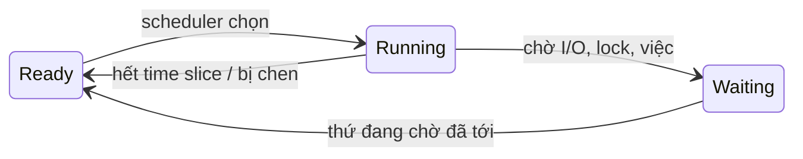
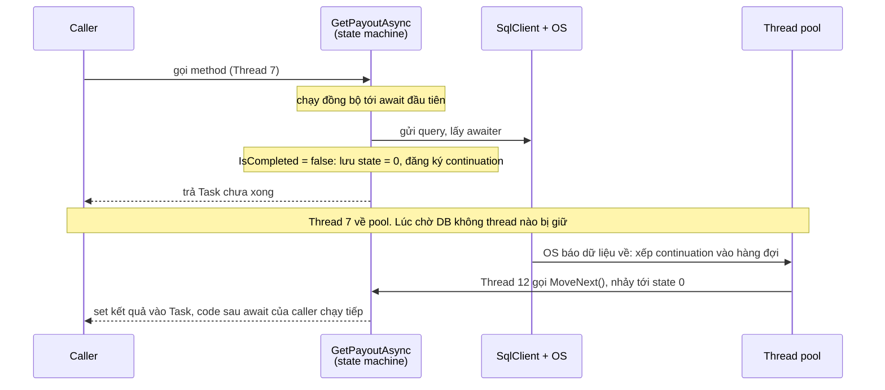
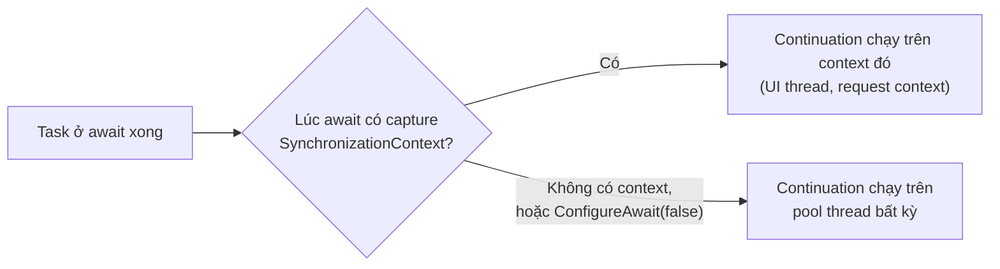
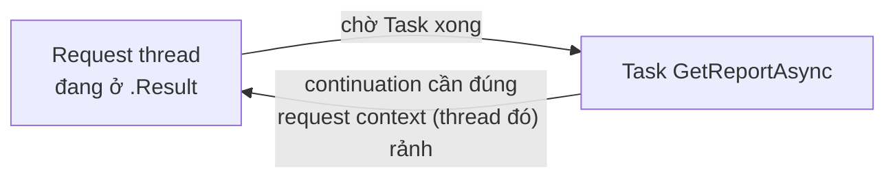
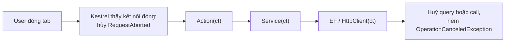

# Async & Concurrency

Chủ đề hỏi sâu nhất và cũng có nhiều chỗ liên quan trực tiếp tới Web Forms 4.8, nên kinh nghiệm hiện tại của bạn là lợi thế ở phần này.

::: tip Mới học async? Đọc [Async từ nút bấm tới database](/runtime/async-flow) trước: một luồng thật, giải thích từng keyword tại chỗ.
:::

## CPU, OS thread và ThreadPool: 3 tầng khác nhau {#cpu-os-threadpool}

::: tip Trả lời nhanh
Chữ "thread" xuất hiện ở 3 tầng, mỗi tầng một nghĩa:

1. **Phần cứng**: CPU "8 core 16 thread" có 16 <T>logical processor</T>, tức 16 **chỗ** chạy được code cùng một tích tắc. Số này cố định.
2. **OS**: <T>thread</T> là thứ **phần mềm** do OS quản lý. Mọi <T>process</T> cộng lại có hàng nghìn thread. <T>OS scheduler</T> xếp các thread **đang Ready** lên các chỗ đó, mỗi lượt một <T>time slice</T> ngắn.
3. **.NET**: <T>thread pool</T> là một nhóm OS thread **bên trong từng process .NET**, do <T>CLR</T> tạo và dùng lại. Code ASP.NET Core của bạn chạy trên các thread này.
:::

**Bản đồ: request 42 đi qua máy chủ.** Cùng kịch bản với [Async từ nút bấm tới database](/runtime/async-flow#scenario): user bấm Approve payout 42. Lần này nhìn từ trên cao xuống: mỗi vùng là một nơi trong máy chủ, ghi rõ **ai quản lý**. Đường liền là chiều đi, đường nét đứt là chiều về. Mỗi số là một trạm.

<ThreadMap />

Mỗi dòng: **ở đâu** · **thread nào đang bận vì request 42**. Bấm một dòng (hoặc một số trên bản đồ) để mở.

<FlowToggleAll />

<FlowStep collapsible :n="1" where="OS kernel" asks="chưa thread nào của app biết" title="Byte của request tới, OS gom lại" layer="OS kernel" thread="0 thread của app" tone="free" icon="gate">

Card mạng nhận byte, **kernel của OS** gom chúng vào socket. App chưa hề biết có request.

Từ trước, Kestrel đã nhờ OS: "socket này có dữ liệu thì báo tôi" (<T>IOCP</T> trên Windows). Nhờ vậy không có thread nào của app phải ngồi canh socket.

</FlowStep>

<FlowStep collapsible :n="2" where="process PayoutHub.Api: hàng đợi của pool" asks="request 42 chỉ là một phiếu việc" title="OS báo, việc &quot;xử lý request 42&quot; vào hàng đợi" layer=".NET runtime" thread="0 thread, 1 phiếu trong hàng" tone="free" icon="bell">

OS báo qua IOCP. Một thread I/O của <T>CLR</T> nhận tin trong chốc lát rồi **thêm một work item** vào hàng đợi của <T>thread pool</T>.

Request 42 giờ là một **phiếu việc nằm trong hàng**, chưa ai chạy nó. Hàng đợi này của CLR, nằm trong process PayoutHub.Api; OS không biết nó tồn tại.

</FlowStep>

<FlowStep collapsible :n="3" where="thread pool" asks="W2: Waiting → Ready" title="W2 đang rảnh được đánh thức" layer=".NET runtime" thread="W2 muốn chạy" tone="busy" icon="wake">

W2 là một OS thread của pool. Nó đang **Waiting**: ngủ chờ việc, không tốn CPU.

Có phiếu việc mới nên CLR đánh thức W2. W2 chuyển sang **Ready**, nghĩa là "muốn chạy". Nhưng chưa chạy được ngay: muốn chạy phải có **chỗ trên CPU**, và chỗ do **OS** chia, không phải CLR.

</FlowStep>

<FlowStep collapsible :n="4" where="OS kernel: scheduler" asks="W2: Ready → Running" title="OS scheduler xếp W2 lên một chỗ trống" layer="OS kernel" thread="W2 chờ chỗ" tone="busy" icon="schedule">

<T>OS scheduler</T> nhìn hàng Ready của **mọi process**: W2 đứng chung hàng với thread của Chrome, Rider, SQL Server. Có chỗ trống thì đặt W2 lên đó (ở đây là LP3) cho chạy một <T>time slice</T>.

Scheduler **không biết** W2 đang lo request nào; nó chỉ thấy một thread. Nếu cả 8 chỗ đều bận, W2 đứng trong hàng Ready chờ tới lượt.

</FlowStep>

<FlowStep collapsible :n="5" where="CPU: LP3" asks="W2 Running" title="W2 chạy code của bạn" layer="Your code" thread="W2 bận" tone="busy" icon="pipeline">

Lúc này CPU thật sự chạy lệnh của W2: middleware, routing, `Approve(42)` trong controller, tới `await db.Payouts.FindAsync(...)`.

Nếu hết time slice giữa chừng, OS tạm đưa W2 về Ready (một <T>context switch</T>) rồi cho lên lại, có khi trên LP khác. Code của bạn không hề thấy điều này.

</FlowStep>

<FlowStep collapsible :n="6" where="socket tới SQL Server" asks="0 thread chờ" title="Tới await: gửi query, W2 về pool" layer=".NET runtime" thread="0 thread chờ" tone="free" icon="release">

SqlClient ghi câu `SELECT` vào socket, OS gửi đi. Task chưa xong, nên method đăng ký <T>continuation</T> rồi trả thread.

W2 quay về pool, lại **Waiting** chờ việc khác (có thể phục vụ request 43 ngay). Request 42 lúc này **không chiếm thread nào**: nó chỉ còn là một continuation chờ OS báo.

</FlowStep>

<FlowStep collapsible :n="7" where="process SQL Server" asks="thread của SQL Server, không phải của app" title="SQL Server chạy query bằng thread của nó" layer="SQL Server" thread="0 thread của app" tone="free" icon="dbwork">

SQL Server là **process khác**, có thread riêng. Thread của nó cũng xin chỗ trên **cùng CPU**, qua **cùng OS scheduler** (ô "SQL" trên LP1, LP5 trong bản đồ). Nếu SQL Server nằm máy khác thì nó dùng CPU của máy đó.

PayoutHub.Api không có thread nào chờ ở trạm này.

</FlowStep>

<FlowStep collapsible :n="8" where="IOCP rồi hàng đợi của pool" asks="0 thread, 1 phiếu trong hàng" title="Kết quả về, continuation vào hàng đợi" layer="OS kernel" thread="0 thread, 1 phiếu trong hàng" tone="free" icon="network">

Byte kết quả về socket, OS báo qua IOCP, thread I/O của CLR đưa **continuation của request 42** vào hàng đợi.

Giống hệt bước 2, chỉ khác phiếu việc lần này là "chạy tiếp sau `await`".

</FlowStep>

<FlowStep collapsible :n="9" where="thread pool rồi CPU: LP6" asks="W5 Running" title="W5 lấy việc, chạy tiếp, trả response" layer="Your code" thread="W5 bận" tone="busy" icon="respond">

Thread rảnh nào cũng lấy được phiếu; lần này là **W5**, không phải W2. W5 lại đi qua bước 3 và 4: Ready, rồi OS xếp lên LP6.

W5 chạy `payout.Approve()`, `SaveChangesAsync` (lại một vòng giống bước 6 đến 8), ghi `204` ra socket, rồi về pool.

</FlowStep>

**Cả hành trình gói lại:** request 42 chờ ở **3 kiểu chỗ** khác nhau.

| Chờ ở đâu | Chờ cái gì | Ai quản lý | Bước |
|---|---|---|---|
| Hàng đợi của thread pool | Một **thread** rảnh | CLR, trong process | 2, 8 |
| Hàng Ready của OS | Một **chỗ trên CPU** | OS scheduler | 3, 4 |
| Socket, chờ SQL trả lời | Không chờ ai: **0 thread** | OS + SQL Server | 6, 7 |

### Phần cứng: core và logical processor {#hardware-threads}

- **Core**: một bộ xử lý hoàn chỉnh trong con chip, tự chạy được một dòng lệnh.
- <T>Hyper-Threading</T>: một core giả làm **2** logical processor. Hai bên dùng chung bộ tính toán của core, nên lợi thêm một phần chứ **không** bằng 2 core thật.
- OS và .NET chỉ thấy logical processor. `Environment.ProcessorCount` trả về 16 với CPU 8 core 16 thread.

::: info Dễ nhầm: "luồng" trên thông số CPU không phải thread của app
|  | Logical processor (hardware thread) | Thread (OS thread) |
|---|---|---|
| Là gì | **Chỗ** trong CPU để chạy lệnh | **Việc** cần chạy: có stack, có vị trí lệnh đang chạy |
| Số lượng | Cố định, ví dụ 16 | Hàng nghìn, tạo và huỷ lúc app chạy |
| Ai tạo | Nhà sản xuất CPU | App gọi OS: `new Thread`, thread pool, Kestrel… |
| Trong [căn bếp](/runtime/async-flow#async-concurrency-parallelism) | Bếp lò | Đầu bếp |

Máy 16 logical processor vẫn chạy được 3.000 thread; chỉ là **cùng một tích tắc** thì tối đa 16 thread đang chạy.
:::

### OS: process, thread và scheduler {#os-scheduler}

<T>Process</T> là một app đang chạy (Chrome, Rider, PayoutHub.Api): có vùng nhớ riêng và ít nhất một thread. Process không tự chạy; **thread mới là thứ được xếp lên CPU**.

Mỗi thread luôn ở một trong 3 trạng thái:



- **Running**: đang ngồi trên một logical processor. Rời chỗ khi hết time slice, hoặc khi một thread priority cao hơn cần chỗ.
- **Ready**: muốn chạy, đứng chờ chỗ trống.
- **Waiting**: đang chờ một thứ bên ngoài (I/O đồng bộ, lock, `Thread.Sleep`, pool thread chờ việc), **không tranh chỗ**. Vì vậy máy có 3.000 thread mà CPU vẫn chỉ 5%: gần như tất cả đang Waiting.

<T>OS scheduler</T> chỉ nhìn các thread **Ready** của **mọi process**, chọn theo priority, cùng priority thì lần lượt. Thread chạy hết <T>time slice</T> (vài ms tới vài chục ms tuỳ OS) hoặc tự chuyển sang Waiting thì scheduler đưa thread khác vào chỗ đó: một <T>context switch</T>.

<Timeline :duration="12" :markers="[{ at: 3, text: 'hết lượt: context switch' }, { at: 7, text: 'W2 tới await, về pool' }]" :lanes="[{ group: 'Nhìn từ CPU: mỗi chỗ chạy lần lượt thread của nhiều app', label: 'LP0', segments: [{ from: 0, to: 3, text: 'Api W2', kind: 'cpu' }, { from: 3, to: 6, text: 'Chrome T3', kind: 'other' }, { from: 6, to: 9, text: 'SQL T11', kind: 'other' }, { from: 9, to: 12, text: 'Api W5', kind: 'cpu' }] }, { group: 'Nhìn từ CPU: mỗi chỗ chạy lần lượt thread của nhiều app', label: 'LP1', segments: [{ from: 0, to: 2.5, text: 'Rider T5', kind: 'other' }, { from: 2.5, to: 5, text: 'Chrome T9', kind: 'other' }, { from: 5, to: 7, text: 'Api W2', kind: 'cpu' }, { from: 7, to: 10, text: 'Rider T8', kind: 'other' }, { from: 10, to: 12, text: 'Teams T2', kind: 'other' }] }, { group: 'Nhìn từ một thread: Api W2', label: 'W2', segments: [{ from: 0, to: 3, text: 'Running trên LP0', kind: 'cpu' }, { from: 3, to: 5, text: 'Ready: chờ chỗ', kind: 'wait' }, { from: 5, to: 7, text: 'Running trên LP1', kind: 'cpu' }, { from: 7, to: 12, text: 'Waiting: về pool chờ việc, không tranh chỗ', kind: 'free' }] }]" caption="Màu brand = thread của PayoutHub.Api, xám = thread của app khác. W2 lượt trước chạy trên LP0, lượt sau trên LP1: thread không gắn cố định với một chỗ." />

::: info Dễ nhầm: OS không "chia luồng cho từng app"
**Sai:** OS chia CPU cho từng app, mỗi app một phần.

**Đúng:** OS lên lịch theo **thread**. App nào có nhiều thread Ready hơn thì nhận nhiều lượt hơn (khi cùng priority). OS không biết "request" hay "Task" là gì; nó chỉ thấy thread.
:::

### .NET: ThreadPool sống trong từng process {#thread-pool}

- Mỗi process .NET có **một** <T>thread pool</T> riêng, do <T>CLR</T> quản lý. Hai app .NET chạy cạnh nhau có hai pool riêng, không biết nhau.
- Thread của pool là **OS thread bình thường**. Điểm khác duy nhất: pool **giữ lại để dùng lại**, không tạo mới cho mỗi việc, vì tạo thread đắt.
- Pool có một **hàng đợi việc** (work item): request mới, <T>continuation</T> sau `await`, `Task.Run`. Thread rảnh lấy việc ra chạy; hết việc thì nằm Waiting.
- Số thread: dưới mức tối thiểu (mặc định bằng `Environment.ProcessorCount`) pool tạo thread ngay khi cần. Vượt mức đó, pool **thêm từ từ**, vì với 16 chỗ ngồi thì 16 thread đang bận CPU đã lấp kín; thêm thread chỉ có ích khi có thread đang bị chặn.

Trong process PayoutHub.Api, ngoài pool còn vài thread khác: **main thread** (chạy `app.Run()` rồi chờ tới lúc tắt app), thread của <T>GC</T>, thread nhận thông báo I/O từ OS (<T>IOCP</T> trên Windows, <T>epoll</T> trên Linux).

::: info Dễ nhầm: có 2 hàng chờ khác nhau
| Hàng chờ | Ai quản lý | Ai đứng chờ | Đầy khi |
|---|---|---|---|
| Hàng đợi việc của thread pool | **CLR**, trong process | Request, continuation chờ **một thread** | Thread của pool đều bận hoặc bị chặn: <T>thread pool starvation</T> |
| Hàng Ready của OS | **OS scheduler** | Thread chờ **một logical processor** | CPU chạy kín 100% |

Starvation thường xảy ra khi CPU **thấp**: request kẹt ở hàng thứ nhất vì thread đang Waiting (bị `.Result` chặn), trong khi CPU còn trống.
:::

::: details Đào sâu: theo dõi và chỉnh thread pool
- `dotnet-counters monitor -n PayoutHub.Api` có _ThreadPool Thread Count_ và _ThreadPool Queue Length_. Queue Length tăng mãi trong khi CPU thấp = starvation.
- `ThreadPool.SetMinThreads(200, 200)` cho pool tạo nhanh tới 200 thread. Đây là **chữa cháy**: mỗi thread thêm một stack, nhiều thread Ready hơn thì nhiều context switch hơn. Sửa gốc là bỏ chỗ block đồng bộ.
- Task Manager, tab Performance, mục CPU: dòng _Cores_ và _Logical processors_ chính là hai tầng phần cứng ở trên; dòng _Threads_ là tổng OS thread của mọi process.
:::

::: warning Bẫy & follow-up
**"Máy 16 logical processor thì app chỉ có được 16 thread?"**

Không. Tạo được hàng nghìn thread; chỉ là cùng một tích tắc tối đa 16 thread đang chạy.

**"Async có làm app dùng nhiều core hơn không?"**

Không. Async làm **ít thread bị Waiting vô ích** hơn, nên cùng số thread phục vụ được nhiều request hơn. Muốn dùng nhiều core cho một việc thì đó là parallelism.

**"Hai app .NET trên cùng máy có dùng chung thread pool?"**

Không. Mỗi process một pool. Chúng chỉ dùng chung CPU, qua OS scheduler.
:::

## Async/await giải quyết vấn đề gì? {#why-async}

::: tip Trả lời nhanh
Giải phóng thread trong lúc chờ I/O (DB, HTTP, file), để thread đó phục vụ request khác. Nó **không làm một request nhanh hơn**; nó giúp server chịu được nhiều request đồng thời hơn với cùng số thread. Với việc nặng CPU thì async không giúp gì; đó là bài toán parallelism.
:::

::: info Bản chất
|  | <T k="io-bound">I/O-bound</T> | <T k="cpu-bound">CPU-bound</T> |
|---|---|---|
| Ví dụ | Query DB, gọi API, đọc file | Tính toán, nén, resize ảnh, parse lớn |
| Thời gian đi đâu | Chờ thiết bị/mạng trả lời | CPU đang tính |
| Công cụ | `async`/`await` với API async thật | `Parallel`, PLINQ, `Task.Run` (ở app UI) |

Trong lúc chờ một I/O async, **không có thread nào bị block** để chờ cả. Hệ điều hành báo lại khi dữ liệu về (<T>IOCP</T>), lúc đó mới cần một thread để chạy tiếp phần code sau `await`.
:::

**Hình: 2 thread, 4 request, mỗi request chờ DB 5 đơn vị thời gian.**

<Compare :labels="['Sync', 'Async']" caption="Sync: thread ngồi chờ DB nên R3, R4 phải xếp hàng. Async: lúc chờ DB không ai giữ thread, 2 thread đủ bắt đầu cả 4 request ngay.">
<template #a>

<Timeline plain :duration="13" :markers="[{ at: 7, text: 'R1, R2 xong' }, { at: 13, text: 'R3, R4 xong' }]" :lanes="[{ label: 'Thread A', segments: [{ from: 0, to: 1, text: 'R1', kind: 'busy' }, { from: 1, to: 6, text: 'R1 bị chặn, chờ DB', kind: 'wait' }, { from: 6, to: 7, text: 'R1', kind: 'busy' }, { from: 7, to: 8, text: 'R3', kind: 'busy' }, { from: 8, to: 13, text: 'R3 bị chặn, chờ DB', kind: 'wait' }] }, { label: 'Thread B', segments: [{ from: 0, to: 1, text: 'R2', kind: 'busy' }, { from: 1, to: 6, text: 'R2 bị chặn, chờ DB', kind: 'wait' }, { from: 6, to: 7, text: 'R2', kind: 'busy' }, { from: 7, to: 8, text: 'R4', kind: 'busy' }, { from: 8, to: 13, text: 'R4 bị chặn, chờ DB', kind: 'wait' }] }, { label: 'R3, R4', sub: 'chưa có thread', segments: [{ from: 0, to: 7, text: 'xếp hàng chờ thread rảnh', kind: 'other' }] }]" />

</template>
<template #b>

<Timeline plain :duration="13" :markers="[{ at: 8, text: 'cả 4 xong' }]" :lanes="[{ label: 'Thread A', segments: [{ from: 0, to: 1, text: 'R1', kind: 'busy' }, { from: 1, to: 2, text: 'R3', kind: 'busy' }, { from: 2, to: 6, text: 'về pool', kind: 'free' }, { from: 6, to: 7, text: 'R1', kind: 'busy' }, { from: 7, to: 8, text: 'R3', kind: 'busy' }, { from: 8, to: 13, text: 'về pool', kind: 'free' }] }, { label: 'Thread B', segments: [{ from: 0, to: 1, text: 'R2', kind: 'busy' }, { from: 1, to: 2, text: 'R4', kind: 'busy' }, { from: 2, to: 6, text: 'về pool', kind: 'free' }, { from: 6, to: 7, text: 'R2', kind: 'busy' }, { from: 7, to: 8, text: 'R4', kind: 'busy' }, { from: 8, to: 13, text: 'về pool', kind: 'free' }] }, { label: 'không thread', segments: [{ from: 1, to: 7, text: 'R1 R2 R3 R4 chờ DB', kind: 'io' }] }]" />

</template>
</Compare>

Mỗi request **không** nhanh hơn (vẫn 5 đơn vị chờ DB). Cái lợi là cả 4 xong ở mốc 8 thay vì 13, với cùng 2 thread.

::: details Ở dự án thật
Một page Web Forms đồng bộ gọi API bên ngoài mất 3 giây giữ nguyên một thread của IIS trong 3 giây. Lúc đông người, request phải xếp hàng dù CPU gần như rảnh. Đây là triệu chứng điển hình nên dùng async.
:::

## `await` thực sự chạy thế nào? <Badge type="warning" text="câu &quot;under the hood&quot;" /> {#how-await-works}

::: tip Trả lời nhanh
Compiler biến method `async` thành một <T>state machine</T>. Tại mỗi `await`, nếu task chưa xong, method lưu lại trạng thái, đăng ký "phần còn lại" làm <T>continuation</T> rồi trả về một <T>Task</T> chưa hoàn thành cho caller, trả thread lại. Khi task xong, continuation được lên lịch chạy tiếp từ đúng chỗ đã dừng.
:::

::: info Bản chất: từng bước
1. Compiler sinh một struct implement `IAsyncStateMachine`; biến local trở thành field của nó.
2. Method chạy **đồng bộ** trên thread của caller cho tới `await` đầu tiên.
3. Tại `await`: lấy <T>awaiter</T> của task. Nếu `IsCompleted` đã là true thì chạy tiếp luôn, không đổi thread (<T>fast path</T>).
4. Nếu chưa xong: lưu số state, đăng ký continuation, return. Lúc này state machine mới bị đưa lên heap.
5. Khi task xong: continuation được post về <T>SynchronizationContext</T> đã capture (UI thread, ASP.NET Framework); nếu không có thì chạy trên thread pool.
6. State machine nhảy tới đúng state, chạy tiếp; cuối cùng set kết quả hoặc exception vào Task đã trả về cho caller.
:::



::: warning Bẫy & follow-up
**"Method async có luôn chạy trên thread khác không?"**

Không. Nó có thể chạy từ đầu tới cuối trên cùng một thread nếu mọi thứ đã xong sẵn (ví dụ đọc từ cache). `async` không tạo thread.

**"Có `async` mà không có `await` thì sao?"**

Compiler cảnh báo CS1998, method chạy đồng bộ hoàn toàn mà vẫn tốn chi phí state machine.

**"Return thẳng Task thay vì `return await` được không?"**

Được và nhẹ hơn, nhưng nguy hiểm khi đang trong `using` hoặc `try/catch`: object bị dispose trước khi task xong, và exception không được catch ở đó. Mặc định cứ `await`; chỉ bỏ ở method một dòng chuyển tiếp đơn giản.
:::

## Task vs Thread. Khi nào dùng `Task.Run`? {#task-vs-thread}

::: tip Trả lời nhanh
**Thread** là thread thật của OS: tốn bộ nhớ stack, tạo và hủy đắt. **Task** đại diện cho một việc sẽ xong trong tương lai (giống promise); nó không nhất thiết gắn với thread nào, và thường chạy trên thread pool. `Task.Run` đẩy việc CPU sang thread pool.
:::

::: info Bản chất
- Ở app UI: `Task.Run` để việc nặng không làm đơ UI thread. Hợp lý.
- Ở ASP.NET Core: request vốn đã chạy trên thread pool. Bọc `Task.Run` quanh I/O hay "cho nhanh" chỉ là đổi thread này lấy thread khác cộng thêm overhead.
- Thread ở đây là **OS thread** (xem [3 tầng](#cpu-os-threadpool)): mỗi cái một stack. Một Task đang chờ I/O không chiếm thread nào, nên 10.000 Task cùng chờ là bình thường; 10.000 thread thì là 10.000 stack.
- <T>Thread pool</T> thêm thread khá chậm khi bị thiếu. Đây là gốc của chuyện <T>thread pool starvation</T> (xem câu deadlock bên dưới).
:::

::: warning Bẫy & follow-up
**"Muốn trả response ngay rồi xử lý tiếp phía sau (fire-and-forget) thì làm thế nào?"**

Đừng `_ = Task.Run(...)` trong controller: exception bị nuốt, và DbContext/scoped service đã bị dispose khi request kết thúc. Cách đúng: đẩy job vào một queue (`Channel<T>` trong process, hoặc message queue), một `BackgroundService` đọc ra xử lý và tự tạo scope riêng cho mỗi job.

```csharp
public class PayoutWorker(Channel<int> queue, IServiceScopeFactory scopes) : BackgroundService
{
    protected override async Task ExecuteAsync(CancellationToken ct)
    {
        await foreach (var payoutId in queue.Reader.ReadAllAsync(ct))
        {
            using var scope = scopes.CreateScope();
            var svc = scope.ServiceProvider.GetRequiredService<IPayoutService>();
            await svc.ProcessAsync(payoutId, ct);
        }
    }
}
```
:::

## Concurrency vs parallelism {#concurrency-vs-parallelism}

::: tip Trả lời nhanh
<T>Concurrency</T>: nhiều việc cùng đang dở dang, có thể xen kẽ nhau trên ít thread (thường là chờ I/O). <T>Parallelism</T>: nhiều việc thật sự chạy cùng lúc trên nhiều core (việc CPU). Parallelism là một dạng của concurrency, nhưng không phải ngược lại.
:::

::: info Bản chất
```csharp
// Tuần tự: tổng = 3 lần chờ
var merchant = await GetMerchantAsync(id);
var stats    = await GetStatsAsync(id);
var payouts  = await GetPayoutsAsync(id);

// Concurrent: tổng ≈ lần chờ lâu nhất (khi 3 việc độc lập nhau)
var mTask = GetMerchantAsync(id);
var sTask = GetStatsAsync(id);
var pTask = GetPayoutsAsync(id);
await Task.WhenAll(mTask, sTask, pTask);

// Nhiều I/O có giới hạn đồng thời
await Parallel.ForEachAsync(merchantIds,
    new ParallelOptions { MaxDegreeOfParallelism = 8, CancellationToken = ct },
    async (id, token) => await SyncMerchantAsync(id, token));
```
:::

<Timeline :duration="9" :lanes="[{ group: 'await từng cái: tuần tự, tổng = 3 + 3 + 3', label: 'không thread', segments: [{ from: 0, to: 3, text: 'Merchant', kind: 'io' }, { from: 3, to: 6, text: 'Stats', kind: 'io' }, { from: 6, to: 9, text: 'Payouts', kind: 'io' }] }, { group: 'Task.WhenAll: concurrent, tổng ≈ việc lâu nhất', label: 'không thread', segments: [{ from: 0, to: 3, text: 'Merchant', kind: 'io' }] }, { group: 'Task.WhenAll: concurrent, tổng ≈ việc lâu nhất', label: 'không thread', segments: [{ from: 0, to: 2, text: 'Stats', kind: 'io' }] }, { group: 'Task.WhenAll: concurrent, tổng ≈ việc lâu nhất', label: 'không thread', segments: [{ from: 0, to: 2.5, text: 'Payouts', kind: 'io' }] }, { group: 'Parallel.For trên việc CPU: parallel, mỗi core một phần', label: 'Core 1', segments: [{ from: 0, to: 3, text: 'dòng 1–33k', kind: 'cpu' }] }, { group: 'Parallel.For trên việc CPU: parallel, mỗi core một phần', label: 'Core 2', segments: [{ from: 0, to: 3, text: 'dòng 33k–66k', kind: 'cpu' }] }, { group: 'Parallel.For trên việc CPU: parallel, mỗi core một phần', label: 'Core 3', segments: [{ from: 0, to: 3, text: 'dòng 66k–100k', kind: 'cpu' }] }]" caption="Khung nét đứt = đang chờ I/O, không chiếm thread. WhenAll chồng lấn phần chờ; Parallel.For chia phần tính toán ra nhiều core." />

::: warning Bẫy & follow-up
**"Dùng `Parallel.ForEach` để gọi 100 API được không?"**

Sai công cụ: nó dành cho việc CPU, và với code async bên trong sẽ thành `async void` hoặc block thread. Dùng `Parallel.ForEachAsync` có giới hạn, hoặc `SemaphoreSlim` + `Task.WhenAll`.

**"Chạy 3 query song song trên cùng một DbContext?"**

Lỗi "A second operation was started on this context". <T>DbContext</T> không thread-safe. Mỗi task phải có context riêng (qua `IDbContextFactory`), hoặc chạy tuần tự.
:::

## SynchronizationContext và `ConfigureAwait(false)` {#configureawait}

::: tip Trả lời nhanh
<T>SynchronizationContext</T> quyết định phần code sau `await` chạy ở đâu. App UI (WinForms, WPF) và ASP.NET Framework có context riêng; ASP.NET Core và console app thì không có. <T k="configureawait">ConfigureAwait(false)</T> nghĩa là "không cần quay lại context cũ", chạy tiếp trên thread pool là được.
:::

::: info Bản chất
| Môi trường | Có context? | Có cần `ConfigureAwait(false)`? |
|---|---|---|
| WinForms / WPF / MAUI | Có: UI thread | Trong library: có. Code UI: không, vì cần quay về UI thread để cập nhật control |
| ASP.NET Framework (Web Forms, MVC 5) | Có: `AspNetSynchronizationContext`, giữ `HttpContext.Current`, culture | Trong library: có. Nhưng sau nó thì `HttpContext.Current` là null |
| ASP.NET Core | Không | Code app: không cần. Library: vẫn nên dùng, vì không biết ai sẽ gọi nó |
| Console | Không | Không ảnh hưởng |
:::



::: details Ở dự án thật
Bug dễ gặp trong Web Forms: helper async có `ConfigureAwait(false)`, sau đó code đọc `HttpContext.Current.User` và gặp NullReferenceException, vì phần sau await đang chạy trên thread pool, ngoài request context. Cách nhìn đúng: library thuần (gọi API, truy DB) thì dùng `ConfigureAwait(false)`; code nào cần HttpContext thì lấy giá trị ra trước `await`.
:::

::: warning Bẫy & follow-up
**"Chỉ cần đặt `ConfigureAwait(false)` ở `await` đầu tiên là đủ?"**

Không. Nếu task đó đã xong sẵn, code chạy tiếp đồng bộ và vẫn đang ở context cũ; các `await` sau lại capture context. Trong library phải đặt ở mọi `await`.

**"Có gì mới không?"**

.NET 8 có `ConfigureAwait(ConfigureAwaitOptions)`, ví dụ `SuppressThrowing` để chờ một task mà không ném exception, `ForceYielding` để luôn chạy tiếp bất đồng bộ.
:::

## Deadlock xảy ra khi nào? <Badge type="warning" text="câu kinh điển" /> {#deadlock}

::: tip Trả lời nhanh
Cần đủ 3 điều kiện cùng lúc:

1. Có một <T>SynchronizationContext</T> chỉ cho **một thread chạy tại một thời điểm** (UI, ASP.NET Framework).
2. Code **block đồng bộ** để chờ một async method: `.Result`, `.Wait()`, `.GetAwaiter().GetResult()`.
3. Bên trong async method đó có `await` **không** có `ConfigureAwait(false)`, nên continuation muốn quay về đúng context đó.

Thread đang chờ task xong; task lại chờ thread đó rảnh để chạy tiếp. Không bên nào nhường.
:::

::: info Bản chất
```csharp
// Web Forms 4.8: treo vĩnh viễn
protected void Page_Load(object sender, EventArgs e)
{
    var report = _service.GetReportAsync().Result;  // (1) block request thread
}

public async Task<Report> GetReportAsync()
{
    var data = await _http.GetStringAsync(url);     // (2) xong rồi, muốn quay về request context
    return Parse(data);                             // (3) không bao giờ chạy tới: context đang bị (1) giữ
}
```



**Cách sửa**, theo thứ tự nên dùng:

1. **Async từ đầu tới cuối.** Với Web Forms: `<%@ Page Async="true" %>` và `RegisterAsyncTask(new PageAsyncTask(LoadAsync))`.
2. `ConfigureAwait(false)` ở mọi await trong library: hết deadlock, nhưng vẫn đang block một thread.
3. `Task.Run(() => GetReportAsync()).Result`: chữa cháy, tốn thêm một thread và mất `HttpContext.Current` bên trong.
:::

::: details Ở dự án thật
Đây là câu bạn có thể kể từ chính codebase Web Forms: gọi một thư viện chỉ có API async (SDK mới, `HttpClient`) từ page đồng bộ. Nêu được cả nguyên nhân lẫn cách làm page async đúng chuẩn là điểm cộng rõ.
:::

::: warning Bẫy & follow-up
**"ASP.NET Core có bị deadlock kiểu này không?"**

Không, vì không có SynchronizationContext. Nhưng `.Result` vẫn xấu: nó block một thread pool thread. Dưới tải, nhiều request cùng block gây <T>thread pool starvation</T>: latency tăng vọt, request timeout, trong khi CPU thấp. Nhận biết qua `dotnet-counters`: _ThreadPool Queue Length_ tăng, _ThreadPool Thread Count_ tăng dần đều.

<Timeline :duration="12" :markers="[{ at: 8, text: 'pool thêm W5' }]" :lanes="[{ label: 'W1', segments: [{ from: 0, to: 1, text: 'R1', kind: 'busy' }, { from: 1, to: 12, text: 'R1 .Result: bị chặn', kind: 'wait' }] }, { label: 'W2', segments: [{ from: 1, to: 2, text: 'R2', kind: 'busy' }, { from: 2, to: 12, text: 'R2 .Result: bị chặn', kind: 'wait' }] }, { label: 'W3', segments: [{ from: 2, to: 3, text: 'R3', kind: 'busy' }, { from: 3, to: 12, text: 'R3 .Result: bị chặn', kind: 'wait' }] }, { label: 'W4', segments: [{ from: 3, to: 4, text: 'R4', kind: 'busy' }, { from: 4, to: 12, text: 'R4 .Result: bị chặn', kind: 'wait' }] }, { label: 'W5', segments: [{ from: 8, to: 9, text: 'R5', kind: 'busy' }, { from: 9, to: 12, text: 'R5 .Result…', kind: 'wait' }] }, { label: 'Hàng đợi', sub: 'của pool', segments: [{ from: 4, to: 12, text: 'R5 R6 R7 R8 … chờ thread, kể cả continuation để gỡ R1–R4', kind: 'other' }] }]" caption="Minh hoạ: pool 4 thread, mọi thread bị .Result chặn. CPU gần như rảnh, nhưng việc mới (gồm cả continuation sẽ giải phóng R1–R4) không có thread để chạy. Pool thêm thread từ từ, mỗi thread mới lại bị chặn tiếp." />

**"`.GetAwaiter().GetResult()` khác `.Result` chỗ nào?"**

Cùng block, cùng deadlock. Khác duy nhất: ném exception gốc thay vì bọc trong `AggregateException`.
:::

## `async void` có vấn đề gì? {#async-void}

::: tip Trả lời nhanh
Chỉ dùng cho event handler. Caller không await được nên không biết khi nào xong, và exception bên trong không bắt được từ phía caller: nó bị ném lên <T>SynchronizationContext</T> hoặc thread pool, có thể làm sập process.
:::

::: details Ở dự án thật
Web Forms cho phép `protected async void Page_Load` khi page có `Async="true"`, vì `AspNetSynchronizationContext` đếm các thao tác async void đang chạy và chờ chúng xong trước khi render. Thiếu `Async="true"` thì gặp lỗi "An asynchronous operation cannot be started at this time". Dù chạy được, Microsoft vẫn khuyên dùng `RegisterAsyncTask`.
:::

::: warning Bẫy & follow-up
**"Lambda async truyền vào chỗ nhận `Action` thì sao?"**

Nó thành `async void` ngầm. Ví dụ `list.ForEach(async x => await SaveAsync(x))`: vòng lặp xong ngay, các lần save chạy lung tung, lỗi bị mất. Dùng `foreach` + `await`.
:::

## Exception trong async và `Task.WhenAll` {#async-exceptions}

::: tip Trả lời nhanh
`await` ném lại exception gốc. Với `Task.WhenAll`, `await` chỉ ném **exception đầu tiên**; muốn xem hết thì đọc `task.Exception.InnerExceptions`.
:::

::: info Bản chất
```csharp
var all = Task.WhenAll(tasks);
try { await all; }
catch
{
    foreach (var ex in all.Exception!.InnerExceptions)
        _logger.LogError(ex, "Sync failed");
}
```

Task bị fire-and-forget mà lỗi sẽ không làm sập app (từ .NET 4.5); lỗi chỉ đi vào sự kiện `TaskScheduler.UnobservedTaskException`, nghĩa là bị nuốt im lặng nếu không ai log.
:::

**Await từng cái vs `Task.WhenAll`:** khác nhau trước hết ở **thời gian**: tuần tự thì tổng = A + B + C, `WhenAll` thì tổng ≈ việc lâu nhất (xem hình ở [Concurrency vs parallelism](#concurrency-vs-parallelism)).

Task (C#) và Promise (JS) đều **hot**: chạy ngay khi được tạo. Vì vậy kết quả phụ thuộc vào *lúc tạo task*:

```csharp
// (a) tạo + await trong vòng lặp → tuần tự; A lỗi thì B, C chưa bao giờ chạy
foreach (var id in ids) await CallAsync(id);

// (b) tạo trước, await từng cái → đã chạy đồng thời; A lỗi thì vòng lặp dừng,
//     nhưng B, C vẫn chạy tiếp và lỗi của chúng không ai đọc
var tasks = ids.Select(CallAsync).ToList();
foreach (var t in tasks) await t;
```

| Dễ nhầm | C# | JS/TS |
|---|---|---|
| Chờ tất cả | `Task.WhenAll`: **chờ tất cả xong** rồi mới ném lỗi đầu tiên | `Promise.all`: **fail-fast**, reject ngay ở lỗi đầu tiên |
| Lấy kết quả từng cái kể cả lỗi | đọc `task.Status` / `task.Exception` sau `WhenAll` | `Promise.allSettled` |

::: warning Bẫy
Không `Task.WhenAll` nhiều query trên **cùng một `DbContext`**: DbContext không thread-safe, EF ném *"A second operation was started on this context"*.
:::

## `CancellationToken` {#cancellation}

::: tip Trả lời nhanh
Cơ chế hủy hợp tác: bên gọi phát tín hiệu, bên làm việc tự kiểm tra và dừng. Phải truyền token xuyên qua mọi tầng (controller → service → EF/HttpClient). Trong ASP.NET Core, thêm tham số `CancellationToken` vào action là nhận được `HttpContext.RequestAborted`: token bị hủy khi client đóng kết nối.
:::



Token chỉ có tác dụng ở tầng nào **được truyền vào**. Quên truyền ở `Service` thì EF chạy tới cùng dù user đã đi.

::: info Bản chất
```csharp
using var cts = CancellationTokenSource.CreateLinkedTokenSource(requestToken);
cts.CancelAfter(TimeSpan.FromSeconds(10));        // timeout riêng, vẫn hủy theo request

try { await _api.FetchAsync(cts.Token); }
catch (OperationCanceledException) when (requestToken.IsCancellationRequested)
{
    // client bỏ đi: không phải lỗi, đừng log Error
}
```
:::

::: warning Bẫy & follow-up
**"Hủy giữa chừng một luồng ghi dữ liệu thì sao?"**

Có thể để lại dữ liệu ghi dở. Với bước commit cuối hoặc thao tác không được dừng giữa chừng (đã trừ tiền, đã gọi provider), đừng truyền token của request; hoặc bọc trong transaction để hủy thì rollback. Đây là câu hỏi về nghiệp vụ hơn là kỹ thuật.
:::

## `ValueTask` vs `Task` {#valuetask}

::: tip Trả lời nhanh
<T>ValueTask</T> tránh cấp phát một object Task khi kết quả thường có sẵn ngay (ví dụ cache hit). Mặc định vẫn dùng `Task`; `ValueTask` chỉ cho hot path hoặc library.
:::

::: warning Bẫy & follow-up
**"Có gì phải cẩn thận?"**

Chỉ được await **một lần**; không await từ hai nơi cùng lúc; không gọi `.Result` khi chưa xong. Cần dùng nhiều lần thì gọi `.AsTask()`.
:::

## Thread safety: race condition và các công cụ đồng bộ {#thread-safety}

::: tip Trả lời nhanh
<T>Race condition</T> xảy ra khi nhiều thread đọc-sửa-ghi cùng dữ liệu và kết quả phụ thuộc vào thứ tự chạy. Dạng hay gặp nhất là "kiểm tra rồi mới làm" (check-then-act).
:::

<Timeline :duration="8" :markers="[{ at: 7, text: 'count = 6, mất một lần cộng' }]" :lanes="[{ label: 'Thread A', segments: [{ from: 0, to: 2, text: 'đọc count = 5', kind: 'cpu' }, { from: 2, to: 4, text: '5 + 1', kind: 'cpu' }, { from: 4, to: 6, text: 'ghi 6', kind: 'cpu' }] }, { label: 'Thread B', segments: [{ from: 1, to: 3, text: 'đọc count = 5', kind: 'other' }, { from: 3, to: 5, text: '5 + 1', kind: 'other' }, { from: 5, to: 7, text: 'ghi 6', kind: 'other' }] }]" caption="count++ thực ra là 3 bước: đọc, cộng, ghi. B đọc trước khi A kịp ghi, nên cả hai cùng ghi 6 thay vì 7. Interlocked.Increment gộp 3 bước thành một." />

::: info Bản chất
```csharp
// Hai thread cùng thấy "chưa có" và cùng Load
if (!_cache.ContainsKey(key)) _cache[key] = Load(key);

// ConcurrentDictionary: an toàn khi ghi, NHƯNG factory vẫn có thể chạy nhiều lần
var v = _cache.GetOrAdd(key, k => Load(k));

// Muốn Load đúng một lần: lưu Lazy
var v2 = _lazyCache.GetOrAdd(key, k => new Lazy<Data>(() => Load(k))).Value;
```

| Công cụ | Dùng khi | Lưu ý |
|---|---|---|
| `lock` | Đoạn code đồng bộ ngắn | Không được `await` bên trong (lỗi compile). .NET 9 có kiểu `System.Threading.Lock` riêng |
| `SemaphoreSlim(1,1)` | Cần "lock" quanh code async | `await WaitAsync()`, luôn `Release()` trong `finally` |
| `Interlocked` | Tăng giảm, đổi giá trị một biến | Nhanh nhất, không lock |
| `ConcurrentDictionary`, `ConcurrentQueue` | Collection dùng chung | Từng thao tác an toàn, nhưng ghép nhiều thao tác thì không |
| `Channel<T>` | Producer/consumer | Thay cho `BlockingCollection` trong code async |
| Immutable collection, record | Dữ liệu chia sẻ chỉ đọc | Không cần lock nếu không ai sửa |
:::

::: details Ở dự án thật
Hai người cùng bấm duyệt một payout. `lock` trong code không giải quyết được, vì app chạy trên nhiều server hoặc nhiều process. Phải xử lý ở database: `UPDATE Payouts SET Status = 'Approved' WHERE Id = @id AND Status = 'Pending'` rồi kiểm tra số dòng bị ảnh hưởng, hoặc dùng concurrency token (rowversion) của EF. Interviewer rất thích câu trả lời nhận ra rằng lock trong memory không đủ cho hệ thống nhiều instance.
:::

::: warning Bẫy & follow-up
**"`volatile` có thay được `lock` không?"**

Không. `volatile` chỉ đảm bảo đọc giá trị mới nhất và chặn sắp xếp lại lệnh; nó không làm `count++` thành thao tác **atomic** (đọc, cộng, ghi trong một bước không bị thread khác chen vào). Cần thì dùng `Interlocked.Increment`. Hiếm khi cần trong code business.
:::

## `Task.Yield()` dùng để làm gì? {#task-yield}

::: tip Trả lời nhanh
Buộc phần code sau nó luôn chạy như một continuation bất đồng bộ, kể cả khi không có gì để chờ. Method trả control về cho caller ngay tại đó. Dùng hiếm: ở app UI để nhường UI thread trước một đoạn xử lý dài, hoặc khi cần chắc chắn method trả về trước khi làm tiếp.
:::

::: warning Bẫy & follow-up
**"Có giúp tăng hiệu năng hay chống thread pool starvation không?"**

Không. Trên ASP.NET Core nó chỉ đưa phần còn lại vào hàng đợi của thread pool. Nguyên nhân thật của starvation là block đồng bộ, cách sửa là bỏ block.
:::
